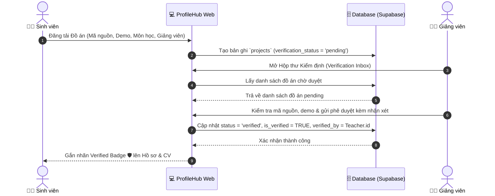
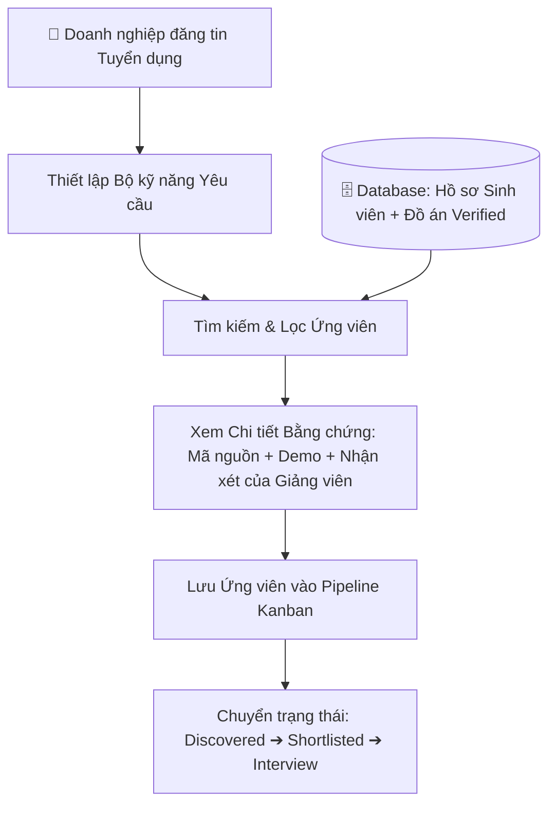
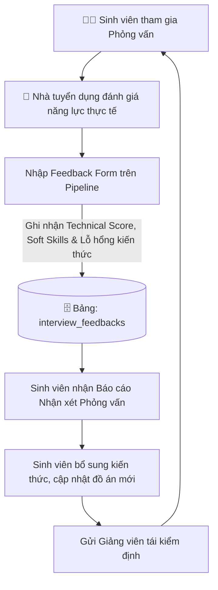
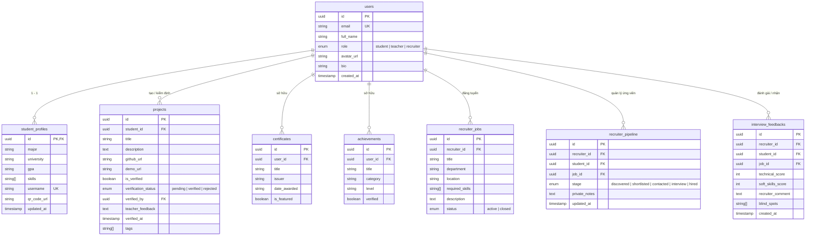

# 🛡️ PROFILEHUB — Core System Architecture & Documentation

> **Nền tảng Quản lý Hồ sơ Năng lực Học thuật & Tuyển dụng Dựa trên Bằng chứng Thực tế (Evidence-Based Career Platform)**

---

## 📌 1. Tổng Quan Hệ Thống (Executive Summary)

**ProfileHub** là nền tảng kết nối 3 bên: **Sinh viên (Student) — Giảng viên (Teacher) — Nhà tuyển dụng (Recruiter)**, nhằm chuẩn hóa dữ liệu năng lực học thuật và tối ưu hóa quy trình tuyển dụng nhân sự trẻ. 

Hệ thống giải quyết **3 bài toán cốt lõi**:

1. **Xác thực Năng lực Học thuật (Academic Verification):**
   * Giải quyết tình trạng CV thổi phồng, thiếu trung thực.
   * Giảng viên trực tiếp thẩm định đồ án môn học, khóa luận tốt nghiệp, cấp nhãn **Verified Badge 🛡️** kèm nhận xét chuyên môn.

2. **Tuyển dụng Dựa trên Bằng chứng Thực tế (Evidence-Based Recruitment):**
   * Chuyển trọng tâm đánh giá ứng viên từ *"Tôi viết gì trên CV"* sang *"Tôi đã làm được sản phẩm thực tế nào"*.
   * Doanh nghiệp tìm kiếm và sàng lọc ứng viên trực tiếp thông qua đồ án đã được nhà trường kiểm định, mã nguồn GitHub và bản demo hoạt động.

3. **Vòng lặp Phản hồi Tuyển dụng (Recruiter Feedback Loop):**
   * Đóng kín khoảng cách giữa đào tạo đại học và nhu cầu thực tế của doanh nghiệp.
   * Nhà tuyển dụng gửi đánh giá phỏng vấn (Điểm kỹ thuật, Kỹ năng mềm, Lỗ hổng kiến thức) trực tiếp cho sinh viên để cải thiện kỹ năng.

---

## 👥 2. Phân Quyền & Chức Năng Theo Vai Trò (Role-Based Features)

Hệ thống được thiết kế theo kiến trúc giao diện đồng nhất (`Single-Layout Architecture`), điều hướng tập trung qua thanh Sidebar cho 3 nhóm đối tượng:

```
                  ┌──────────────────────────────┐
                  │          ProfileHub          │
                  └──────────────┬───────────────┘
          ┌──────────────────────┼──────────────────────┐
          ▼                      ▼                      ▼
  👨‍🎓 Student Role        👨‍🏫 Teacher Role       🏢 Recruiter Role
  • Hồ sơ & QR Cá nhân   • Hộp thư Kiểm định    • Đăng tin Tuyển dụng
  • Quản lý Đồ án/Repo   • Thẩm định Đồ án      • Tìm kiếm Ứng viên
  • Chứng chỉ/Thành tích • Cấp Verified Badge   • Pipeline Kanban
  • Trình tạo CV Chuẩn   • Đánh giá Chuyên môn  • Gửi Phản hồi Phỏng vấn
```

### 2.1. 👨‍🎓 Sinh viên (`student`)
* **Tổng quan (Dashboard):** Theo dõi số lượng đồ án, trạng thái kiểm định (`pending`, `verified`, `rejected`), chứng chỉ và giải thưởng.
* **Hồ sơ Cá nhân (Profile):** Quản lý GPA, chuyên ngành, kỹ năng, Bio, danh thiếp số và mã **Smart QR Code** định danh cá nhân.
* **Quản lý Đồ án (Project Management):** 
  * Tạo và cập nhật đồ án (Mã nguồn GitHub, Link Demo, vai trò trong nhóm, tài liệu đính kèm).
  * Gửi yêu cầu thẩm định đồ án tới Giảng viên hướng dẫn/Bộ môn.
* **Chứng chỉ & Thành tích (Certificates & Achievements):** Lưu trữ bằng cấp ngoại ngữ, chứng chỉ công nghệ và giải thưởng học thuật.
* **Trình tạo CV (CV Builder):** Tự động tổng hợp thông tin, kỹ năng và các đồ án verified vào 4 mẫu CV chuyên nghiệp, hỗ trợ xuất file in PDF chuẩn A4.

### 2.2. 👨‍🏫 Giảng viên (`teacher`)
* **Thông tin Giảng viên (Teacher Profile):** Quản lý học hàm, học vị, trường đại học, khoa/viện và danh sách môn học phụ trách.
* **Hộp thư Kiểm định (Verification Inbox):**
  * Nhận danh sách yêu cầu thẩm định đồ án từ sinh viên.
  * Xem tài liệu, mã nguồn và sản phẩm demo.
  * Phê duyệt (cấp nhãn **Verified Badge 🛡️**) hoặc từ chối kèm phản hồi đóng góp chuyên môn.

### 2.3. 🏢 Nhà tuyển dụng (`recruiter`)
* **Hồ sơ Doanh nghiệp (Company Profile):** Quản lý thương hiệu nhà tuyển dụng, quy mô, lĩnh vực hoạt động và website.
* **Quản lý Tin tuyển dụng (Job Management):** Đăng tải, chỉnh sửa và đóng/mở các vị trí tuyển dụng với bộ kỹ năng yêu cầu cụ thể.
* **Tìm kiếm Ứng viên (Candidate Search):** Bộ lọc nâng cao theo chuyên ngành, trường đại học, kỹ năng và số lượng đồ án verified.
* **Quy trình Tuyển dụng (Recruiter Pipeline):** Quản lý ứng viên theo bảng Kanban trực quan (`Discovered` ➔ `Shortlisted` ➔ `Contacted` ➔ `Interview` ➔ `Hired`), ghi chú nội bộ.
* **Vòng lặp Đánh giá (Interview Feedback Modal):** Nhập điểm phỏng vấn chuyên môn, kỹ năng mềm và ghi nhận lỗ hổng kiến thức gửi về cho ứng viên.

---

## 🔄 3. Quy Trình Luồng Hoạt Động Cốt Lõi (Core Workflows)

### 3.1. Luồng Xác Thực Đồ Án (Academic Verification Workflow)



---

### 3.2. Luồng Tuyển Dụng Theo Bằng Chứng (Evidence-Based Recruitment Workflow)



---

### 3.3. Luồng Vòng Lặp Phản Hồi Phỏng Vấn (Recruiter Feedback Loop Workflow)



---

## 🗄️ 4. Thiết Kế Cơ Sở Dữ Liệu (Database Schema)

Hệ thống sử dụng cơ sở dữ liệu quan hệ **PostgreSQL (Supabase)** với các ràng buộc chặt chẽ:



---

## 📁 5. Cấu Trúc Thư Mục Dự Án (Source Code Architecture)

```
profilehub/
├── docs/                                # Tài liệu kỹ thuật & đặc tả hệ thống
│   ├── api/                             # API contracts & interfaces
│   ├── database/                        # Database schema & migrations log
│   ├── product/                         # PRD, Roadmap & Product Vision
│   └── sprint/                          # Kế hoạch Sprint & phân rã Tasks
├── src/                                 # Mã nguồn ứng dụng Frontend
│   ├── assets/                          # Static assets, icons, hình ảnh
│   ├── components/                      # UI Components dùng chung & theo module
│   │   ├── auth/                        # ProtectedRoute, Auth forms
│   │   ├── common/                      # VerifiedBadge, Modal, Button, LoadingSpinner
│   │   ├── cv/                          # Mẫu CV layout & xuất PDF
│   │   ├── layout/                      # MainLayout, Navigation Sidebar
│   │   ├── projects/                    # Form thêm/sửa đồ án, Document Reader
│   │   └── recruiter/                   # Pipeline Kanban Board, Feedback Modal
│   ├── hooks/                           # Custom React Hooks (useAuth, useProjects,...)
│   ├── pages/                           # Các trang chức năng chính
│   │   ├── auth/                        # LoginPage, RegisterPage
│   │   ├── student/                     # Dashboard, Profile, Projects, CVBuilder
│   │   ├── teacher/                     # TeacherDashboard, VerificationInbox
│   │   └── recruiter/                   # RecruiterDashboard, JobManagement, CandidateSearch
│   ├── services/                        # Tầng kết nối API & Supabase Client
│   │   ├── authService.ts               # Xử lý xác thực người dùng
│   │   ├── projectService.ts            # Xử lý CRUD đồ án & gửi yêu cầu duyệt
│   │   ├── verificationService.ts       # Xử lý thẩm định của giảng viên
│   │   ├── recruiterService.ts          # Xử lý tìm kiếm, pipeline & feedback
│   │   └── supabaseClient.ts            # Khởi tạo Supabase Client
│   ├── types/                           # Định nghĩa TypeScript Interfaces & Database Models
│   │   └── index.ts                     # User, Project, Certificate, Feedback, Job
│   ├── utils/                           # Hàm tiện ích (định dạng ngày tháng, validator)
│   ├── App.tsx                          # Router điều hướng trung tâm
│   └── main.tsx                         # Entry point ứng dụng
├── supabase/                            # Cấu hình & Migrations Backend
│   ├── migrations/                      # File SQL định nghĩa schema & RLS policies
│   └── rollbacks/                       # Script hoàn tác CSDL (down scripts)
├── package.json                         # Danh sách dependencies & scripts
├── tailwind.config.js                   # Cấu hình Design System & UI tokens
├── tsconfig.json                        # Cấu hình TypeScript compiler
└── vite.config.ts                       # Cấu hình Vite build tool
```

---

## 🧪 6. Tiêu Chuẩn Chất Lượng & Quy Trình Kiểm Thử (QA & Standards)

### 6.1. Quy trình Kiểm thử & Type-Safety
Trước khi tạo Pull Request hoặc bàn giao công việc, toàn bộ mã nguồn phải vượt qua các cổng kiểm soát:
1. **Type-Safety Check:** `npm run build` hoặc `npx tsc --noEmit` đạt 0 lỗi biên dịch.
2. **Linting Check:** Tuân thủ quy chuẩn Clean Code, không để biến thừa hoặc console log không cần thiết.
3. **Database Integrity:** Kiểm tra đầy đủ khóa ngoại (`Foreign Keys`), chỉ mục (`Indexes`) và phân quyền dữ liệu (`Row Level Security - RLS`).

### 6.2. Tính Nhất Quán Giao Diện (UI/UX Consistency)
* **Single-Layout Pattern:** Tuyệt đối sử dụng layout chuẩn `MainLayout.tsx` bọc ngoài các trang chức năng để tránh giật lag hoặc lặp thanh Sidebar.
* **Visual Verification:** Mọi đồ án đã được giảng viên xác nhận bắt buộc hiển thị biểu tượng nhãn **Verified Badge 🛡️** đồng nhất trên cả Hồ sơ web, Modal chi tiết và bản in CV PDF.
* **Client-Side Fallback:** Các thao tác lưu dữ liệu quan trọng cần xử lý graceful fallback (thông báo lỗi rõ ràng, đệm dữ liệu tạm thời) khi mất kết nối mạng.

---

## 🚀 7. Hướng Dẫn Cài Đặt & Chạy Trên Local

```bash
# 1. Điều hướng vào thư mục dự án
cd profilehub

# 2. Cài đặt các gói phụ thuộc
npm install

# 3. Cấu hình biến môi trường (nếu có Supabase)
cp .env.example .env

# 4. Chạy Development Server
npm run dev
```

* Truy cập ứng dụng tại: **`http://localhost:3000`**
