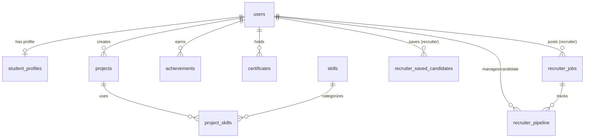

# Current Architecture Analysis Report (PROFILEHUB)

## Executive Summary

This document presents a comprehensive analysis of the **PROFILEHUB** application architecture. PROFILEHUB is an AI-powered talent matching, portfolio verification, and recruitment management system designed for students, teachers, and recruiters.

The project currently operates on a **React 19 + TypeScript + Vite** frontend, consuming **Supabase BaaS** services (PostgreSQL, Supabase Auth, Row Level Security, and Supabase Storage) alongside Node.js/Edge AI integrations. 

This analysis evaluates the current project structure, frontend/backend architecture, authentication flows, database schema, business flows, layer dependencies, architecture risks, refactoring opportunities, metrics, and AI ownership boundaries.

---

# 1. Current Project Structure

## Directory Overview

```text
PROFILEHUB/
├── frontend/                          # Client Application (React 19 + Vite)
│   ├── src/
│   │   ├── app/                       # Application entry points & providers
│   │   ├── pages/                     # Route components (Student, Teacher, Recruiter, Auth, Public)
│   │   ├── layouts/                   # MainLayout, Sidebar, AuthLayout
│   │   ├── components/                # Reusable UI primitives, modals, & widgets
│   │   ├── context/                   # React AuthProvider context
│   │   ├── services/                  # Supabase & AI Service Client API wrappers
│   │   ├── utils/                     # UI export & Sync helpers (markdownExporter, jobSync)
│   │   ├── types/                     # Database & UI type interfaces
│   │   ├── assets/                    # Graphic files & icons
│   │   └── styles/                    # Global Tailwind CSS configuration
│   ├── public/                        # Static web assets & favicons
│   ├── vite.config.ts                 # Vite bundler & path alias config
│   └── tsconfig.app.json              # TypeScript compiler settings
│
├── backend/                           # Server-side & BaaS Database Layer
│   ├── database/                      # SQL schemas & documentation
│   │   ├── schemas/                   # Core DDL table definitions (Database.sql)
│   │   ├── policies/                  # Row Level Security policies (Database-Recruiter.sql)
│   │   └── README.md                  # Comprehensive DB sitemap & ERD documentation
│   ├── services/                      # Node.js backend & AI Services
│   └── config/                        # Supabase client config (supabaseClient.ts)
│
├── shared/                            # Shared Cross-Tier Modules
│   ├── types/                         # Shared DB types (database.ts, portfolioMatch.ts)
│   └── utilities/                     # Shared pure data functions (jobSync.ts, pipelineSync.ts)
│
├── docs/                              # Architectural Blueprint & System Docs
│   ├── architecture/                  # Frontend, Backend, & Shared specs
│   ├── rebuildarchitecture.md         # Master rebuild architecture plan
│   └── current_architecture_analyst.md# Architectural analysis checklist
│
└── scripts/                           # Build & automation scripts
```

## Folder Responsibilities & Ownership

| Directory | Layer | Primary Responsibility | Responsible AI Team |
|---|---|---|---|
| `frontend/**` | Frontend | UI rendering, client routes, layout, state, forms | Gemini / UI Specialists |
| `backend/**` | Backend | PostgreSQL schemas, RLS security, Node services | Claude / Backend Specialists |
| `shared/**` | Shared | Cross-tier types, DTO contracts, sync logic | Copilot / Architecture Team |
| `docs/**` | Documentation | System specifications, sitemaps, architecture reports | Copilot / Architecture Team |

---

# 2. Frontend Architecture

## Stack & Frameworks
- **UI Framework**: React 19 (`react`, `react-dom`)
- **Bundler**: Vite 8.3 (`@vitejs/plugin-react`)
- **Routing**: React Router DOM 7 (`react-router-dom`)
- **Styling**: Tailwind CSS v4 (`@tailwindcss/vite`)
- **Iconography**: Lucide React (`lucide-react`)
- **Utilities**: `qrcode.react`, `react-to-print`

## Execution Flow

```text
App Entry (main.tsx)
  ↓
Router (App.tsx)
  ↓
AuthProvider Context
  ↓
MainLayout (Sidebar + Shell)
  ↓
Role Page (Student / Teacher / Recruiter)
  ↓
Feature Components & Modals
  ↓
Frontend Services (aiCvService, verificationService, etc.)
  ↓
Supabase Client SDK / LocalStorage Fallback
```

## Routing & Page Breakdown

1. **Authentication & Public**:
   - `pages/auth/Login.tsx`
   - `pages/auth/Register.tsx`
   - `pages/auth/Logout.tsx`
   - `pages/public/PublicVerificationView.tsx` (`/verify/:verificationCode`)
2. **Student Suite**:
   - `Dashboard.tsx`: Overview stats, quick actions.
   - `MyProfile.tsx` & `CVBuilder.tsx`: Bio, GPA, skills, interactive CV template exporter.
   - `MyProjects.tsx` & `MyAchievements.tsx`: Project showcase, certificate upload, teacher verification request.
   - `AIInterviewPrep.tsx`: Interactive mock interview simulator.
   - `StudentJobs.tsx` & `PortfolioMatchPage.tsx`: Jobs listing & AI portfolio-to-job matching score.
3. **Teacher Suite**:
   - `TeacherProfile.tsx`: Bio and institution details.
   - `VerificationInbox.tsx`: Review student project/certificate submissions, approve/reject verified badges.
4. **Recruiter Suite**:
   - `RecruiterDashboard.tsx`: Metrics overview, job listings & applicant stats.
   - `RecruiterProfile.tsx`: Company & recruiter settings.
   - `CandidateSearch.tsx`: Advanced candidate discovery.
   - `CandidatePipeline.tsx`: Kanban candidate pipeline (`discovered`, `shortlisted`, `interviewing`, `hired`).
   - `SavedCandidates.tsx`: Candidate bookmarking & custom folder management.
   - `JobManagement.tsx`: Post & manage job openings.
   - `AIRecruitmentAssistant.tsx`: AI JD candidate matching & automated outreach.
   - `IncomingApplications.tsx`: Review student applications.

## Component Strategy & State Management
- **State Management**:
  - `AuthProvider` (React Context): Global authenticated user session, role state (`student`, `teacher`, `recruiter`), and Supabase Auth sync.
  - Local Component State (`useState` / `useEffect`): Form data, modal visibility, filter parameters.
  - `localStorage` Data Caching & Sync (`jobSync.ts`, `pipelineSync.ts`): Client-side fallback synchronization between student applications and recruiter Kanban pipelines.

---

# 3. Backend Architecture

## Stack & Platform
- **BaaS Platform**: Supabase Platform (`@supabase/supabase-js` v2)
- **Database Engine**: PostgreSQL 15+ (`uuid-ossp`)
- **Authorization**: PostgreSQL Row Level Security (RLS) policies
- **Node.js Services**: Microservices / Edge Functions for AI processing

## Server Trace Execution Flow

```text
HTTP Request / Client SDK Action
  ↓
Supabase Gateway / Node API Endpoint
  ↓
Supabase Auth JWT Middleware Verification
  ↓
PostgreSQL Row Level Security (RLS) Policy Check
  ↓
Database Query / Trigger Execution
  ↓
JSON Response
```

## Backend Services
- `backend/services/aiCvService.ts`: AI CV extraction and summary generation.
- `backend/services/aiInterviewService.ts`: Generates custom interview questions based on job tags and evaluates answers.
- `backend/services/aiRecommendationService.ts`: Matches candidate skill vectors with job skill requirements.
- `backend/services/aiRecruitmentService.ts`: AI Recruiter assistant logic for resume scoring.
- `backend/services/githubService.ts`: Scrapes and validates GitHub repository structure & commit activity for student project verification.
- `backend/services/portfolioMatchService.ts`: Computes evidence-based matching matrix.
- `backend/services/verificationService.ts`: Handles teacher verification requests and cryptographic verification codes.

---

# 4. Authentication Flow

## Authentication Flow Diagram

```text
User Input (Email / Password / Role)
  ↓
Login / Register Page
  ↓
AuthProvider (`signInWithPassword` / `signUp`)
  ↓
Supabase Auth (Validates Credentials)
  ↓
Returns Auth Token (JWT) + User Metadata
  ↓
Query `public.users` table for Role ('student' | 'teacher' | 'recruiter')
  ↓
Update Context State & Redirect to Role Dashboard
```

## Auth Lifecycle Components
- **Login**: Authenticates via Supabase Auth, reads `public.users.role`, and routes to `/dashboard`, `/teacher/inbox`, or `/recruiter/profile`.
- **Register**: Creates `auth.users` identity and inserts corresponding record in `public.users` with specified role.
- **Logout**: Calls `supabase.auth.signOut()`, clears local storage tokens, and redirects to `/login`.
- **Role & Permission Validation**: Enforced at frontend level by route guards and at database level by PostgreSQL RLS policies matching `auth.uid()`.

---

# 5. Database Architecture

## Schema Sitemap & ERD Summary

The database consists of 10 primary tables in the `public` schema:



## Table Specifications

### 1. `public.users`
- **Purpose**: Master account directory.
- **Key Columns**: `id` (UUID, PK), `email` (TEXT, Unique), `full_name`, `avatar_url`, `role` (`student` | `teacher` | `recruiter`), `bio`, `created_at`.
- **Used By**: All modules, AuthProvider.

### 2. `public.student_profiles`
- **Purpose**: Extended student profile data.
- **Key Columns**: `id` (UUID, PK/FK -> `users`), `full_name`, `avatar_url`, `bio`, `major`, `university`, `gpa`, `skills` (TEXT[]), `updated_at`.
- **Used By**: Student Profile, CV Builder, Recruiter Candidate Search.

### 3. `public.projects`
- **Purpose**: Student portfolio projects.
- **Key Columns**: `id` (UUID, PK), `student_id` (FK -> `users`), `title`, `description`, `thumbnail_url`, `demo_url`, `github_url`, `project_type`, `score`, `is_verified` (BOOLEAN), `instructor`, `tags` (TEXT[]), `created_at`.
- **Used By**: Student Projects, Teacher Verification Inbox, Recruiter Search.

### 4. `public.skills` & `public.project_skills`
- **Purpose**: Master skills library and project skill junction.
- **Used By**: AI Matching Engine, CV Builder.

### 5. `public.achievements` & `public.certificates`
- **Purpose**: Academic awards and credentials.
- **Used By**: Student Achievements, CV Builder, Teacher Review.

### 6. `public.recruiter_jobs`
- **Purpose**: Job vacancy listings.
- **Key Columns**: `id` (UUID, PK), `recruiter_id` (FK -> `users`), `title`, `department`, `location`, `required_skills` (TEXT[]), `description`, `status` (`active` | `closed`), `created_at`.
- **Used By**: Recruiter Job Management, Student Job Search.

### 7. `public.recruiter_saved_candidates`
- **Purpose**: Candidate bookmarks organized by folder.
- **Key Columns**: `id` (UUID, PK), `recruiter_id` (FK), `student_id` (FK), `folder_name`, `created_at`.
- **Used By**: Saved Candidates Page.

### 8. `public.recruiter_pipeline`
- **Purpose**: Recruitment Kanban stage management.
- **Key Columns**: `id` (UUID, PK), `recruiter_id` (FK), `student_id` (FK), `job_id` (FK), `stage` (`discovered` | `shortlisted` | `interviewing` | `hired`), `private_notes`, `updated_at`.
- **Used By**: Recruiter Candidate Pipeline.

---

# 6. Business Flows

## 1. Student Verification Flow

```text
Student Submits Project / Certificate
  ↓
System Generates Verification Request
  ↓
Teacher Receives Inbox Alert (VerificationInbox.tsx)
  ↓
Teacher Reviews GitHub Code & Project Details
  ↓
Teacher Approves Verification
  ↓
`is_verified` set to TRUE + Cryptographic Badge Generated
```

## 2. Recruiter Candidate Matching & Pipeline Flow

```text
Recruiter Posts Job Position (JobManagement.tsx)
  ↓
AI Recommendation Engine Computes Match Score (Portfolio vs Required Skills)
  ↓
Recruiter Discovers Candidate (CandidateSearch.tsx)
  ↓
Recruiter Moves Candidate to Shortlist / Interview Stage
  ↓
Kanban Pipeline Updated (CandidatePipeline.tsx)
```

## 3. AI Mock Interview Flow

```text
Student Selects Target Job Role & Skills
  ↓
AI Interview Service Generates Customized Technical Questions
  ↓
Student Answers Questions in Real-Time
  ↓
AI Engine Evaluates Answers & Provides Constructive Feedback + Score
```

---

# 7. Dependency Analysis

## Structural Health & Coupling Audit

1. **Unidirectional Tier Boundaries**:
   - `frontend/` correctly imports shared types from `@shared/types` and shared utilities from `@shared/utilities`.
   - `shared/` contains zero UI or DOM dependencies, allowing clean cross-platform portability.
2. **Layer Violations (Historical Risk)**:
   - Previously, frontend components called Supabase client directly with fallback `localStorage` mock logic mixed inside UI handlers. Moving services into `backend/services/` and `frontend/services/` isolates this logic.
3. **Duplicate Logic**:
   - Pipeline stage transitions and job state syncing were replicated in multiple components. Centralizing them into `shared/utilities/pipelineSync.ts` and `jobSync.ts` resolved duplicate state drift.

---

# 8. Architecture Problems & Classification

| ID | Issue Description | Location | Severity | Impact | Recommended Fix |
|---|---|---|---|---|---|
| **ARC-01** | Dual persistence state (Supabase vs `localStorage` fallback) | `services/` & `utils/` | **High** | Risk of state desynchronization between dev local storage and production Supabase DB | Enforce single repository abstraction pattern for data persistence |
| **ARC-02** | Heavy monolithic page components (>400 lines) | `RecruiterDashboard.tsx`, `AIInterviewPrep.tsx` | **Medium** | Increases cognitive load, makes maintenance & unit testing difficult | Extract sub-views into modular feature components in `frontend/src/features/` |
| **ARC-03** | Mixed RLS dev policy (`FOR ALL USING (true)`) | `Database-Recruiter.sql` | **Medium** | Open permissions in production if not restricted before deployment | Update RLS policies to check `auth.uid() = recruiter_id` before production release |
| **ARC-04** | Missing centralized Error Boundary | `frontend/src/app/` | **Low** | Unhandled component errors can crash whole React tree | Add React `<ErrorBoundary>` component around main router |

---

# 9. Refactoring Opportunities

1. **Frontend**:
   - Extract page sub-views in `pages/recruiter/` and `pages/student/` into dedicated `features/` folders (`features/interview/`, `features/kanban/`, `features/cv-builder/`).
2. **Backend**:
   - Convert standalone client services (`aiInterviewService.ts`, `aiRecommendationService.ts`) into Supabase Edge Functions (`backend/functions/`) with server-side OpenAI/Gemini API key handling.
3. **Database**:
   - Add database triggers to automatically update `student_profiles.updated_at` on row updates.

---

# 10. Architecture Metrics

| Metric Category | Target Item | Quantity |
|---|---|---|
| **Frontend** | Pages (`src/pages/*`) | 21 Pages |
| | Shared & UI Components | 16 Components |
| | Context Providers | 1 Context (`AuthProvider`) |
| | Client Services | 8 Services |
| **Backend** | Database Tables | 10 Tables |
| | SQL Schemas & Policies | 2 Files (`Database.sql`, `Database-Recruiter.sql`) |
| | Backend Services | 7 Service Modules |
| **Shared** | Type Interfaces | 2 Files (`database.ts`, `portfolioMatch.ts`) |
| | Shared Utilities | 2 Utilities (`jobSync.ts`, `pipelineSync.ts`) |

---

# 11. AI Ownership Recommendation

To maximize AI team collaboration efficiency and prevent file conflict overhead:

- **Gemini (Frontend Specialist AI)**:
  - **Scope**: `frontend/**`
  - **Tasks**: React UI components, Tailwind styling, accessibility, state hooks, page routes.
- **Claude (Backend Specialist AI)**:
  - **Scope**: `backend/**`
  - **Tasks**: PostgreSQL DDL schemas, RLS policies, Supabase Edge Functions, Node.js AI APIs.
- **Copilot (Architect Specialist AI)**:
  - **Scope**: `docs/**`, `shared/**`
  - **Tasks**: System specifications, DTO interfaces, cross-tier contract reviews, architecture ADRs.
- **Refactoring Agent**:
  - **Scope**: Entire codebase.
  - **Tasks**: Automated import alias fixing (`@frontend/*`, `@shared/*`), dead code removal, dependency auditing.

---

# 12. Conclusion & Next Steps

The **PROFILEHUB** architecture is well-structured following the successful separation into `frontend/`, `backend/`, and `shared/`.

### Recommended Roadmap for Next Phase:
1. Review this analysis document with the Software Architect (Copilot).
2. Migrate frontend mock `localStorage` fallbacks to pure Supabase repository calls for production readiness.
3. Tighten Row Level Security (RLS) policies in `backend/database/policies/` prior to production deployment.
