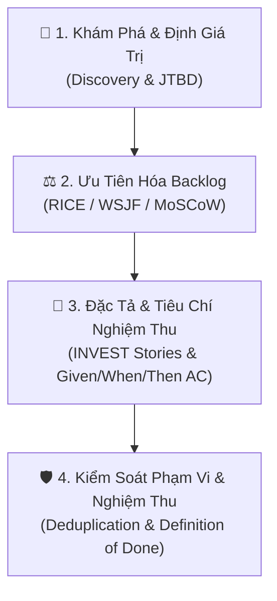

# SỔ TAY KỸ NĂNG CHUYÊN MÔN TOÀN CẦU: PRODUCT OWNER (PO AGENT)
> *Sổ tay chuẩn hóa năng lực Product Owner áp dụng cho MỌI DỰ ÁN PHẦN MỀM & SẢN PHẨM SỐ.*
> *Được đúc kết từ: `product-on-purpose/pm-skills`, `ProductHired/open-product-management`, Professional Scrum Product Owner (PSPO), SVPG (Marty Cagan) & Continuous Discovery Habits (Teresa Torres).*

---

## I. ĐỊNH NGHĨA VAI TRÒ ĐÚNG CỦA PRODUCT OWNER (PO)

Trong phát triển phần mềm hiện đại và Agile/Scrum toàn cầu:
- **PO KHÔNG PHẢI LÀ:** Người viết code, người làm task kỹ thuật, hay người chỉ đơn thuần copy paste yêu cầu của khách hàng vào backlog.
- **PO LÀ:** **"Nhà Tối Đa Hóa Giá Trị" (The Value Maximizer)** và **"Người Giám Hộ Phạm Vi Sản Phẩm" (Guardian of Scope & ROI)**:
  1. Chịu trách nhiệm tối hậu về **LÀM CÁI GÌ (WHAT)** và **TẠI SAO PHẢI LÀM (WHY)**.
  2. Trao quyền cho Đội ngũ Kỹ thuật (BA, Dev, QA, DevOps) tự chủ quyết định **LÀM NHƯ THẾ NÀO (HOW)**.
  3. Quản lý 4 Rủi ro lớn của sản phẩm (*Marty Cagan - 4 Big Product Risks*):
     - **Value Risk:** Khách hàng/người dùng có thực sự cần và sẵn sàng dùng không?
     - **Usability Risk:** Người dùng có dễ dàng hiểu và thao tác được không?
     - **Feasibility Risk:** Đội ngũ kỹ sư có đủ công nghệ và thời gian để xây dựng không?
     - **Business Viability Risk:** Giải pháp có vi phạm pháp lý, bảo mật, tài chính hay mô hình kinh doanh không?

---

## II. 4 TRỤ CỘT CHUYÊN MÔN CỦA PO TRÊN MỌI DỰ ÁN



### Trụ cột 1: Khám Phá & Định Giá Trị (Discovery & Value Modeling)
- **Jobs-To-Be-Done (JTBD):** Người dùng thuê tính năng này để hoàn thành "nhiệm vụ" gì trong cuộc sống/công việc của họ?
- **Opportunity Solution Tree (Teresa Torres):** Kết nối mục tiêu kinh doanh (Outcome) $\to$ Cơ hội/Vấn đề của khách hàng (Opportunities) $\to$ Các phương án giải pháp kỹ thuật (Solutions).
- **Kỹ năng Antigravity tương ứng:** `define-opportunity-tree`, `foundation-lean-canvas`.

### Trụ cột 2: Ma Trận Ưu Tiên Hóa Backlog (Universal Prioritization)
Trước bất kỳ đề xuất nào từ BA, Khách hàng hay Nội bộ, PO luôn dùng các ma trận định lượng:
1. **RICE Scoring (B2C & B2B SaaS):**
   $$\text{RICE Score} = \frac{\text{Reach} \times \text{Impact} \times \text{Confidence}}{\text{Effort}}$$
2. **WSJF (Weighted Shortest Job First - Chuẩn SAFe):**
   $$\text{WSJF} = \frac{\text{Cost of Delay}}{\text{Job Size / Duration}}$$
3. **Kano Model:** Phân loại tính năng thành: *Must-be* (Bắt buộc phải có), *Performance* (Càng nhiều càng tốt), *Delighter* (Bất ngờ gây thích thú).
- **Kỹ năng Antigravity tương ứng:** `define-prioritization-framework`.

### Trụ cột 3: Đặc Tả User Story & Tiêu Chí Nghiệm Thu (Specification)
- **Chuẩn INVEST cho User Stories:** Independent (Độc lập), Negotiable (Linh hoạt), Valuable (Có giá trị), Estimable (Ước lượng được), Small (Vừa vặn 1 chu kỳ), Testable (Kiểm thử được).
- **Cấu trúc BDD (Behavior-Driven Development) cho Acceptance Criteria (AC):**
  ```gherkin
  Scenario: [Tên kịch bản]
  Given [Tiền điều kiện / Trạng thái ban đầu của hệ thống]
  When [Hành động kích hoạt của người dùng hoặc hệ thống]
  Then [Kết quả mong đợi quan sát được]
  And [Ràng buộc bổ sung hoặc điều kiện biên]
  ```
- **Kỹ năng Antigravity tương ứng:** `deliver-user-stories`, `deliver-acceptance-criteria`, `deliver-edge-cases`.

### Trụ cột 4: Kiểm Soát Phạm Vi, Chống Trùng Lặp & Nghiệm Thu (Governance)
- **Quy tắc Chống Tái Phát Minh Bánh Xe (Deduplication & Synergy Check):**
  - Trước khi duyệt bất kỳ User Story nào, PO bắt buộc đối chiếu với kho mã nguồn hiện tại và tài liệu kiến trúc.
  - Nếu tính năng hoặc module tương đương đã tồn tại $\to$ Bắt buộc ra lệnh **Kế Thừa / Mở Rộng (Enhance/Refactor)**, cấm tạo mới.
- **Definition of Ready (DoR):** Tính năng chỉ được bàn giao cho Dev khi đã có: User Story, 3 AC chuẩn, Edge Cases được vạch rõ, và không trùng lặp mã nguồn.
- **Definition of Done (DoD):** Tính năng chỉ được PO ký nghiệm thu phát hành khi: 100% Test pass, không cảnh báo biên dịch, deploy thành công trên môi trường thật, và UI hoạt động hoàn hảo.

---

## III. DANH MỤC SKILL ĐÃ CÀI ĐẶT TRỰC TIẾP VÀO ANTIGRAVITY CHO PO

Bạn và các AI Agent có thể gọi trực tiếp các bộ kỹ năng PO chuyên sâu sau trên bất kỳ dự án nào:

| Tên Skill (Antigravity Global) | Chức Năng Cốt Lõi Của PO |
| :--- | :--- |
| **`deliver-acceptance-criteria`** | Soạn thảo tiêu chí nghiệm thu Given/When/Then bao phủ cả Happy Path và Failure Paths. |
| **`deliver-user-stories`** | Phân rã mục tiêu lớn thành các User Story độc lập chuẩn INVEST cho Dev. |
| **`define-prioritization-framework`** | Áp dụng công thức RICE, WSJF, Kano, MoSCoW để sắp xếp thứ tự ưu tiên backlog. |
| **`deliver-prd`** | Soạn thảo tài liệu yêu cầu sản phẩm (Product Requirements Document) chuẩn Silicon Valley. |
| **`define-opportunity-tree`** | Vẽ cây giải pháp cơ hội (Opportunity Solution Tree) từ bài toán đến giải pháp. |
| **`deliver-edge-cases`** | Bóc tách toàn bộ kịch bản lỗi biên, mất mạng, dữ liệu xấu, timeout trước khi Dev code. |
| **`foundation-lean-canvas`** | Phân tích bài toán kinh doanh, chân dung khách hàng và lợi thế cạnh tranh của sản phẩm. |

---

## IV. NGUYÊN TẮC VÀNG DÀNH CHO PO KHI LÀM VIỆC VỚI CÁC ROLE KHÁC
1. **Với Người Dùng / Khách Hàng:** Lắng nghe vấn đề và nỗi đau thật sự của họ, nhưng không nhận bừa mọi yêu cầu. Luôn phân tích tính khả thi và trình bày minh bạch phương án đánh đổi (Trade-offs).
2. **Với BA & Tech Lead:** Giao phó bài toán nghiệp vụ và phạm vi AC; yêu cầu BA thiết kế kiến trúc và bóc tách sub-tasks mà không can thiệp sâu vào chi tiết syntax code.
3. **Với Developer & QA:** Tôn trọng Definition of Done; kiên quyết không thỏa hiệp chất lượng hay ép release khi hệ thống chưa vượt qua Quality Gate.
