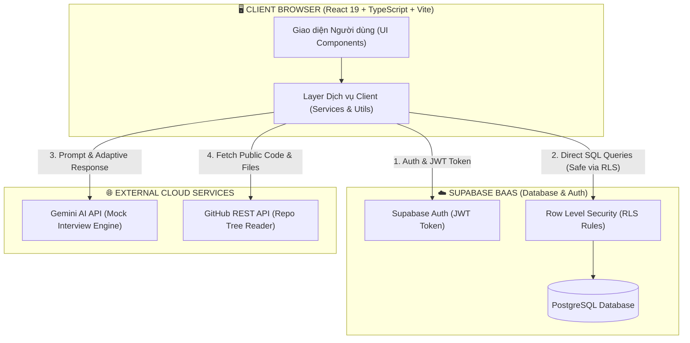
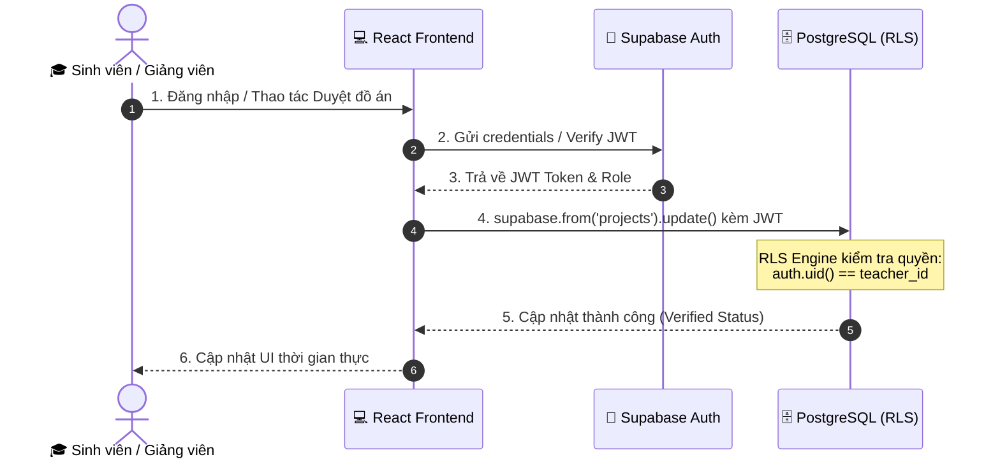
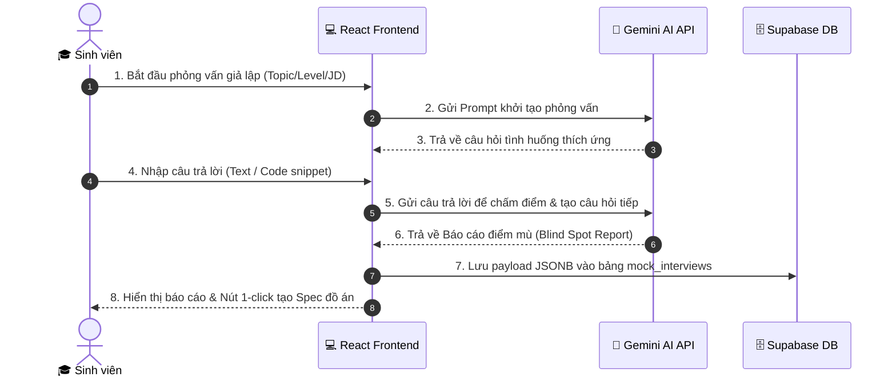
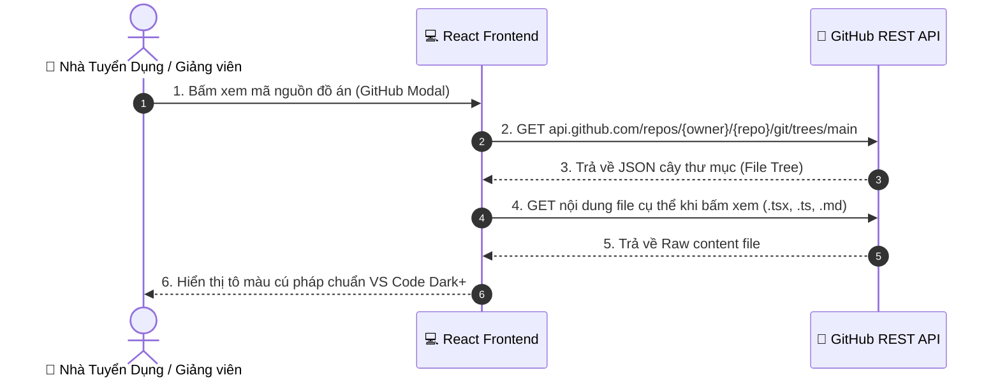
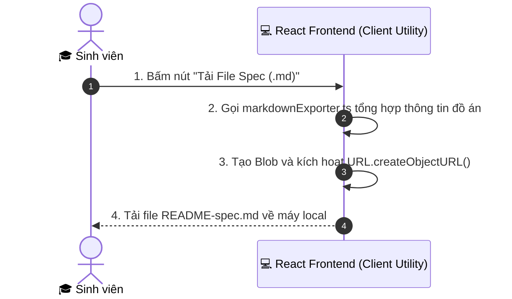

# Đặc Tả Cơ Cấu Kiến Trúc Dự Án ProfileHub (No-Backend / BaaS Architecture)

## 📌 1. Tổng Quan Kiến Trúc (Architecture Overview)

Dự án **ProfileHub** là hệ thống quản lý hồ sơ sinh viên, xác thực đồ án với Giảng viên và tích hợp AI tuyển dụng/phỏng vấn giả lập. 

Khác với các ứng dụng web truyền thống sử dụng mô hình MVC 3 lớp (Frontend -> Custom Backend Server -> Database), ProfileHub được xây dựng trên kiến trúc **SPA (Single Page Application) kết hợp BaaS (Backend-as-a-Service)**. Hệ thống loại bỏ hoàn toàn việc dựng một máy chủ Backend riêng (Node.js/Express, Java/Spring Boot, Python/Django) mà vẫn đảm bảo tính bảo mật, hiệu năng và khả năng mở rộng.

---

## ❓ 2. Tại Sao Bình Thường Phải Cần Custom Backend vs. Giải Pháp Của ProfileHub

### 2.1. Vai trò của Backend trong mô hình truyền thống
Trong mô hình MVC truyền thống:
1. **Bảo vệ CSDL & Credentials:** Trình duyệt không thể gọi trực tiếp Database (MySQL, PostgreSQL) vì nguy cơ lộ mật khẩu DB và bị tấn công SQL Injection.
2. **Quản lý Xác thực & Phân quyền (Auth & Security):** Kiểm tra session, JWT, quyền hạn của người dùng (Admin, Student, Teacher, Recruiter).
3. **Xử lý Logic nghiệp vụ (Business Logic):** Tính toán điểm số, tạo file, tương tác với API bên thứ 3 (Payment, AI, Email) mà không lộ Secret Key.

### 2.2. Lý do ProfileHub không cần Custom Backend
ProfileHub thay thế hoàn toàn máy chủ Backend bằng giải pháp công nghệ đám mây hiện đại:

| Thành phần Backend truyền thống | Giải pháp thay thế của ProfileHub | Cơ chế hoạt động & Bảo mật |
| :--- | :--- | :--- |
| **Database & ORM** | **Supabase BaaS (PostgreSQL)** | Client gọi SDK `@supabase/supabase-js` trực tiếp. Bảo mật bằng **Row Level Security (RLS)** trên PostgreSQL. |
| **Authentication & Session** | **Supabase Auth** | Quản lý đăng ký/đăng nhập, cấp JWT Token và phân quyền vai trò (`student`, `teacher`, `recruiter`). |
| **AI Integration Engine** | **Direct Cloud API (Gemini API)** | Frontend giao tiếp trực tiếp với dịch vụ Gemini AI qua HTTP Client Services. |
| **Code Tree Inspector** | **GitHub REST API** | Truy vấn trực tiếp `api.github.com` đọc cây thư mục & file mã nguồn công khai của sinh viên. |
| **File Export & Document Generator** | **Client-side Utilities** | Sinh file Spec `.md` và mã QR trực tiếp trên trình duyệt JavaScript không tốn tài nguyên máy chủ. |

---

## 📐 3. Sơ Đồ Kiến Trúc Hệ Thống (Architecture Diagrams)

### 3.1. Sơ đồ tổng thể hệ thống (System Architecture Flow)



---

## 🔄 4. Chi Tiết Các Luồng Hoạt Động (Detailed Data Flows)

### 📊 Luồng 1: Xác thực & Quản lý Đồ án (Student - Teacher Workflow)


- **Tệp nguồn chính:** 
  - [AuthProvider.tsx](file:///C:/Users/ADMIN/Desktop/STUDY/PROFILEHUB/portfolio-web/src/context/AuthProvider.tsx)
  - [supabase.ts](file:///C:/Users/ADMIN/Desktop/STUDY/PROFILEHUB/portfolio-web/src/services/supabase.ts)
  - [verificationService.ts](file:///C:/Users/ADMIN/Desktop/STUDY/PROFILEHUB/portfolio-web/src/services/verificationService.ts)
  - [VerificationInbox.tsx](file:///C:/Users/ADMIN/Desktop/STUDY/PROFILEHUB/portfolio-web/src/pages/teacher/VerificationInbox.tsx)

---

### 🤖 Luồng 2: Phỏng Vấn Giả Lập & Phân Tích Điểm Mù (AI Engine Workflow)


- **Tệp nguồn chính:**
  - [AIInterviewPrep.tsx](file:///C:/Users/ADMIN/Desktop/STUDY/PROFILEHUB/portfolio-web/src/pages/student/AIInterviewPrep.tsx)
  - [aiInterviewService.ts](file:///C:/Users/ADMIN/Desktop/STUDY/PROFILEHUB/portfolio-web/src/services/aiInterviewService.ts)
  - [aiRecommendationService.ts](file:///C:/Users/ADMIN/Desktop/STUDY/PROFILEHUB/portfolio-web/src/services/aiRecommendationService.ts)

---

### 🐙 Luồng 3: Đọc Cây Thư Mục & Mã Nguồn Đồ Án (GitHub Tree Inspector)


- **Tệp nguồn chính:**
  - [githubService.ts](file:///C:/Users/ADMIN/Desktop/STUDY/PROFILEHUB/portfolio-web/src/services/githubService.ts)
  - [ProjectModal.tsx](file:///C:/Users/ADMIN/Desktop/STUDY/PROFILEHUB/portfolio-web/src/components/projects/ProjectModal.tsx)

---

### 📄 Luồng 4: Đóng Gói & Xuất Tài Liệu Spec Đồ Án (.md)


- **Tệp nguồn chính:**
  - [markdownExporter.ts](file:///C:/Users/ADMIN/Desktop/STUDY/PROFILEHUB/portfolio-web/src/utils/markdownExporter.ts)
  - [AIProjectRecommenderWidget.tsx](file:///C:/Users/ADMIN/Desktop/STUDY/PROFILEHUB/portfolio-web/src/components/student/AIProjectRecommenderWidget.tsx)

---

## 🛠️ 5. Cấu Trúc Mã Nguồn Dữ Liệu (Source Structure Sitemap)

```
PROFILEHUB/
├── docs/
│   ├── co-cau-du-an.md                  # Tài liệu kiến trúc dự án (File hiện tại)
│   ├── system-design-spec.md            # Đặc tả thiết kế hệ thống chi tiết
│   ├── ai-mock-interview-and-token-usage-guide.md
│   └── spec-verification-gateway-and-ai-recommender.md
└── portfolio-web/                       # Ứng dụng Frontend chính (React + Vite)
    ├── package.json                     # Quản lý dependencies (React 19, Supabase, Tailwind v4)
    ├── vite.config.ts                   # Cấu hình Vite bundler
    └── src/
        ├── context/
        │   └── AuthProvider.tsx         # Quản lý trạng thái đăng nhập & Session
        ├── services/
        │   ├── supabase.ts              # Khởi tạo Supabase BaaS Client
        │   ├── aiInterviewService.ts    # Dịch vụ AI phỏng vấn & Phân tích điểm mù
        │   ├── aiRecommendationService.ts # Dịch vụ AI đề xuất đồ án khắc phục
        │   ├── verificationService.ts   # Dịch vụ xác thực đồ án (Teacher Batch Actions)
        │   └── githubService.ts         # Dịch vụ đọc cây thư mục mã nguồn GitHub
        ├── pages/
        │   ├── student/                 # Các màn hình cho Sinh viên (Dashboard, AI Prep, MyProjects...)
        │   ├── teacher/                 # Các màn hình cho Giảng viên (VerificationInbox...)
        │   ├── recruiter/               # Các màn hình cho Nhà tuyển dụng (CandidateSearch...)
        │   └── public/                  # Cổng xác thực công khai (/verify/:code)
        └── utils/
            └── markdownExporter.ts      # Công cụ sinh & xuất file Spec .md tại Client
```

---

## 💎 6. Kết Luận & Ưu Điểm Của Kiến Trúc

1. **Tiết kiệm 80% thời gian phát triển:** Không tốn thời gian viết boilerplate code cho REST API endpoints, DTO, Controller, Service Layer trên Backend.
2. **Chi phí vận hành bằng $0:** Không cần thuê máy chủ riêng, tận dụng Free Tier cực lớn của Supabase, Vercel và GitHub API.
3. **Bảo mật tối đa:** Quyền truy cập được quản lý chặt chẽ ở cấp CSDL (PostgreSQL Row Level Security - RLS), ngăn chặn các lỗ hổng bypass API truyền thống.
4. **Trải nghiệm mượt mà:** Xử lý và tính toán trực tiếp trên trình duyệt client giúp phản hồi giao diện tức thì.
