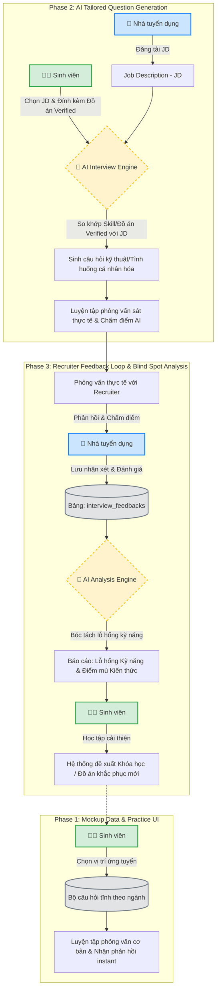

# 🔄 Workflow & Architecture Specification: AI Interview & Feedback Loop

Sơ đồ và tài liệu dưới đây mô tả lộ trình 3 giai đoạn triển khai tính năng **Luyện tập phỏng vấn thông minh (AI Interview Prep & Feedback Loop)** cho nền tảng PROFILEHUB.

---

## 📊 1. Sơ đồ Luồng hoạt động (Mermaid Diagram)



---

## 🗄️ 2. Mô Hình Dữ Liệu Database Schema (Supabase Extension)

```sql
-- Bảng 1: Lịch sử phiên luyện tập phỏng vấn của Sinh viên
CREATE TABLE IF NOT EXISTS interview_sessions (
    id UUID PRIMARY KEY DEFAULT uuid_generate_v4(),
    student_id UUID REFERENCES auth.users(id) ON DELETE CASCADE,
    target_role VARCHAR(255) NOT NULL,
    jd_id UUID REFERENCES recruiter_jobs(id) ON DELETE SET NULL,
    score INTEGER DEFAULT 0,
    status VARCHAR(50) DEFAULT 'completed', -- in_progress, completed
    created_at TIMESTAMP WITH TIME ZONE DEFAULT timezone('utc'::text, now())
);

-- Bảng 2: Phản hồi & Đánh giá thực tế từ Nhà tuyển dụng (Phase 3)
CREATE TABLE IF NOT EXISTS interview_feedbacks (
    id UUID PRIMARY KEY DEFAULT uuid_generate_v4(),
    recruiter_id UUID REFERENCES auth.users(id) ON DELETE CASCADE,
    student_id UUID REFERENCES auth.users(id) ON DELETE CASCADE,
    job_id UUID REFERENCES recruiter_jobs(id) ON DELETE CASCADE,
    technical_score INTEGER DEFAULT 0, -- Thang điểm 1-10
    soft_skills_score INTEGER DEFAULT 0, -- Thang điểm 1-10
    recruiter_comment TEXT,
    blind_spots TEXT[], -- Mảng lưu các điểm yếu/lỗ hổng cần khắc phục
    created_at TIMESTAMP WITH TIME ZONE DEFAULT timezone('utc'::text, now())
);
```

---

## 🚀 3. Kế Hoạch Triển Khai Theo Giai Đoạn (Phase Execution Plan)

### 🟢 **PHASE 1: Mockup Data & Practice UI (Luyện Tập Phỏng Vấn Cơ Bản)**
- [x] Tạo trang `AIInterviewPrep.tsx` cho vai trò Sinh viên.
- [x] Thiết lập Bộ câu hỏi phỏng vấn chuẩn theo từng vị trí (Frontend, UI/UX, Backend, Data Analyst).
- [x] Xây dựng giao diện luyện tập phỏng vấn theo từng câu hỏi (nhập câu trả lời, nhận gợi ý đáp án chuẩn từ AI).
- [x] **QA & Verification Gate:** Chạy `npx tsc --noEmit` & `npx eslint src` đạt 0 errors.

### 🔵 **PHASE 2: AI Tailored Question Generation (Sinh Câu Hỏi Theo Đồ Án Verified & JD)**
- [x] Tích hợp `aiInterviewService` để tự động bóc tách kỹ năng từ Đồ án Verified của Sinh viên và yêu cầu từ JD.
- [x] Sinh câu hỏi tình huống thực tế cá nhân hóa theo từng dự án và vị trí tuyển dụng.
- [x] Chấm điểm câu trả lời tự động bằng AI (Match score + Điểm mạnh + Góp ý cải thiện instant).
- [x] **QA & Verification Gate:** Chạy `npx tsc --noEmit` & `npx eslint src` đạt 0 errors.

### 🟣 **PHASE 3: Feedback Loop & Blind Spot Analysis (Báo Cáo Điểm Mù Kiến Thức)**
- [x] Xây dựng Modal cho Nhà tuyển dụng nhập đánh giá phỏng vấn thực tế (`RecruiterFeedbackModal.tsx` / `interview_feedbacks`).
- [x] AI tổng hợp phân tích điểm mù kiến thức & kỹ năng của sinh viên (`feedbackService.ts`).
- [x] Gợi ý lộ trình tự học & đề xuất đồ án thực chiến khắc phục triệt để lỗ hổng.
- [x] **QA & Verification Gate:** Chạy `npx tsc --noEmit` & `npx eslint src` đạt 0 errors.