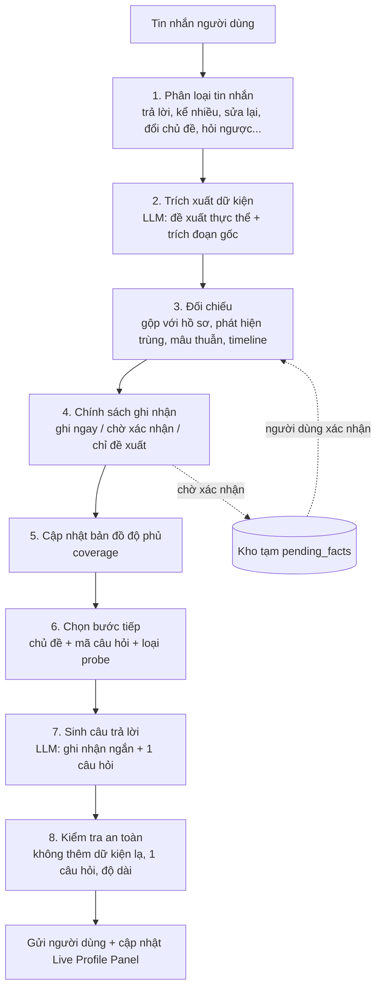

# ProfileHub MVP v1.1: Fresher-first, Discovery dạng chat tự do

**Cập nhật cho:** `profilehub_roadmap_mvp_v1.md`, `career_discovery_flow_v1.md`, `career_discovery_question_bank_v1.md`, `career_data_model_v1.md`.
**Hai quyết định đã chốt:**

1. **Nhóm người dùng đầu tiên:** sinh viên và fresher.
2. **Discovery:** chat tự do (không phải giao diện từng bước cố định).

Tài liệu này ghi lại những gì **thay đổi** so với bản v1, không lặp lại phần vẫn đúng.

---

## 0. Tóm tắt thay đổi

| Hạng mục | Bản v1 | Bản v1.1 |
|---|---|---|
| Persona chính | P2 Junior/Mid là chuẩn, P1 Fresher là nhánh | **P1 Fresher là luồng chính**; P2, P3, P4 để sau |
| Đơn vị để đào sâu | Chủ yếu kinh nghiệm làm việc | **Đồ án, dự án, CLB, cuộc thi, làm thêm, thực tập, tự học** |
| Module ngành | 3-4 ngành + FRS | **FRS mở rộng làm xương sống** + 2 ngành (đề xuất IT, Marketing/Kinh doanh) |
| Cách chấm thành tích | Rubric `ach-1.0` (nặng số liệu, 30 điểm) | Rubric **`ach-1.1-fresher`**: chấp nhận số đo quy mô, thêm điểm "học hỏi" |
| Gate CV | Điểm tổng ≥ 65 | **≥ 60** với điều kiện riêng cho fresher (mục 4.3) |
| CV | ATS và Recruiter chung | **Mẫu CV fresher:** 1 trang, học vấn và dự án đứng đầu |
| Discovery | Flow theo Stage | **Flow là "kim chỉ nam" trong chat tự do**, do bộ điều phối kiểm soát trạng thái (mục 5) |
| Giao diện | Chỉ chat | Chat + **bảng hồ sơ sống bên cạnh** (Live Profile Panel) |
| Kiểm thử | Golden set hồ sơ mô phỏng | Golden set **+ bộ mô phỏng người dùng** (biết trước sự thật, đo được độ chính xác trích xuất) |
| Lịch | 7 sprint | **8 sprint** (mục 8) |

---

## 1. Người dùng đầu tiên: sinh viên và fresher

### 1.1 Ai và cần gì

| Nhóm | Tình huống | Nhu cầu chính |
|---|---|---|
| Sinh viên năm 3-4 | Tìm thực tập, CV đầu tiên | CV trình bày được đồ án, CLB, học tập thành giá trị |
| Fresher 0-1 năm | Tìm việc đầu tiên | CV khớp JD entry-level, luyện phỏng vấn |
| Chưa rõ hướng | Chưa biết muốn làm gì | Gợi ý hướng phù hợp (chỉ ở mức nhẹ trong MVP) |

### 1.2 Đặc điểm dữ liệu (khác hẳn người đi làm)

| Đặc điểm | Hệ quả thiết kế |
|---|---|
| Ít hoặc không có kinh nghiệm chính thức | Xem đồ án, CLB, làm thêm, cuộc thi, tự học là **"đơn vị trải nghiệm"** ngang hàng với công việc |
| Ít số liệu kinh doanh (doanh thu, ROAS…) | Chấp nhận **số đo quy mô và độ khó** (mục 4.2). **Không** cố ép ra số liệu kinh doanh giả |
| Hay tự ti: "mình chưa có gì" | Cần câu gợi nhớ, ví dụ cùng cấp độ, giọng điệu bình thường hóa |
| Trả lời ngắn, hoặc ngược lại, kể một mạch nhiều thứ | Chat tự do phải xử lý cả hai (mục 5.3) |
| Nhiều việc là làm nhóm | Luôn tách **phần việc của riêng họ** |
| Ít có bằng chứng chính thức | Chấp nhận link GitHub, demo, điểm số, nhận xét giảng viên là bằng chứng nhẹ |
| Khả năng chi trả thấp, dùng chủ yếu trên điện thoại | Chi phí LLM mỗi người dùng phải thấp; giao diện mobile-first |

### 1.3 Nguyên tắc riêng cho fresher

1. **Không bao giờ giúp người dùng bịa** kinh nghiệm hoặc số liệu để "cho đẹp". Giá trị nằm ở việc kể **thật, cụ thể, có vai trò cá nhân**.
2. **Một dự án làm tốt hơn năm mục sơ sài.** CV fresher cần ít mục nhưng có chiều sâu.
3. **Nhấn vào trưởng thành và học hỏi**: đây là điều nhà tuyển dụng đánh giá ở fresher (PRD: tiềm năng, khả năng học tập, tư duy).

---

## 2. Ngành trong MVP

**Đề xuất:** `FRS` (mở rộng, dùng cho mọi người) + **2 module ngành**, chọn dựa vào kênh tiếp cận đầu tiên của bạn.

| Lựa chọn | Lý do | Ghi chú |
|---|---|---|
| **IT** | Sinh viên IT có nhiều đồ án và sản phẩm để kể; nhu cầu thực tập cao | Module IT đã có, chỉnh câu hỏi cho đồ án |
| **Marketing / Kinh doanh** | Nhiều sinh viên, hoạt động CLB và cuộc thi phong phú | Gộp MKT và SAL ở mức Core |
| Tài chính - Kế toán | Có thể là lựa chọn thứ ba nếu kênh phân phối là trường kinh tế | Làm sau |

Quyết định cuối cùng cần dựa vào **trường hoặc cộng đồng bạn sẽ tiếp cận đầu tiên** (mục 10). Ngành nào chưa có module riêng vẫn dùng được bộ Core và FRS.

---

## 3. Discovery cho fresher

### 3.1 "Đơn vị trải nghiệm"

Thay vì chỉ deep-dive `experiences`, chat khai thác các đơn vị sau, mỗi đơn vị ghi vào đúng thực thể trong Data Model:

| Đơn vị | Ghi vào | Ví dụ |
|---|---|---|
| Học vấn, học phần, đồ án tốt nghiệp | `education[]`, `projects[]` | Đồ án môn Công nghệ phần mềm |
| Dự án cá nhân / nhóm | `projects[]` | Web đặt sân bóng |
| CLB, tình nguyện, tổ chức sự kiện | `activities[]`, `leadership[]` | Phó ban Kỹ thuật CLB Lập trình |
| Cuộc thi | `activities[]` (type `competition`), `awards[]` | Hackathon, cuộc thi case study |
| Làm thêm, thực tập, freelance | `experiences[]` | Gia sư, nhân viên cửa hàng, thực tập sinh |
| Tự học, sản phẩm tự làm | `learning[]`, `projects[]` | Khóa học online, blog, GitHub |

`discovery.deep_dive_queue` nay chứa tham chiếu (`{type, id}`) tới **bất kỳ** đơn vị nào ở trên.

### 3.2 Điều chỉnh các Stage (Flow v1)

| Stage | Thay đổi cho fresher |
|---|---|
| 0. Onboarding | Hỏi thêm năm học và dự kiến tốt nghiệp; vị trí mục tiêu có thể là "chưa biết"; bỏ hỏi cấp độ (mặc định P1) |
| 1. Timeline | Thành **"Bản đồ trải nghiệm"**: học vấn, đồ án, CLB, cuộc thi, làm thêm, tự học. AI dựng từ lời kể tự do |
| 2. Deep-dive | Chọn **2-4 đơn vị** đáng kể nhất; dùng bộ câu hỏi FRS (mục 3.3) thay cho câu hỏi đi làm |
| 3. Nền tảng chéo | Kỹ năng gắn ví dụ từ đồ án; chứng chỉ (IELTS, TOEIC, MOS…) |
| 4. Learning và Failure | Vẫn cần cho phỏng vấn (Phase 2); trong MVP chỉ ghi nhận khi người dùng tự kể |
| 5. Career Goal | Nếu chưa biết hướng: khám phá nhẹ (mục 7, US-1.18) |
| 6. Career Story | Thế mạnh và **tóm tắt bản thân** là bắt buộc vì CV fresher không có nhiều kinh nghiệm để "nói thay" |
| 7. Completeness | Dùng gate fresher (mục 4.3) |

### 3.3 Question Bank mở rộng: module FRS v1.1

Thêm vào Question Bank (thay thế 4 câu FRS cũ, giữ `FRS-MOT-01` và `FRS-TRF-01` ở dạng sau).

**Học vấn và học tập**

| ID | Câu hỏi | → field | Ưu tiên |
|---|---|---|---|
| FRS-EDU-01 | Bạn học trường nào, ngành gì, năm mấy, dự kiến tốt nghiệp khi nào? (GPA nếu bạn muốn ghi) | `education[]` | P0 |
| FRS-EDU-02 | Môn học hoặc đồ án nào bạn hứng thú và làm tốt nhất? Vì sao? | `education[].highlights`, `projects[]` | P1 |
| FRS-EDU-03 | Bạn có học bổng, điểm cao, giải thưởng học thuật nào không? | `awards[]` | P1 |

**Đồ án và dự án**

| ID | Câu hỏi | → field | Ưu tiên |
|---|---|---|---|
| FRS-PRJ-01 | Kể về một đồ án/dự án bạn tự hào nhất: mục tiêu là gì, nhóm mấy người? | `projects[]` | P0 |
| FRS-PRJ-02 | Phần nào do riêng bạn làm? Bạn tự quyết định điều gì (kỹ thuật, nội dung, cách làm)? | `achievements[].role`, `star.actions` | P0 |
| FRS-PRJ-03 | Khó khăn lớn nhất là gì và bạn xử lý thế nào? | `problems[]` | P1 |
| FRS-PRJ-04 | Có ai dùng, xem hoặc chấm sản phẩm này không? Điểm, nhận xét giảng viên, link demo/GitHub? | `result.metrics`, `evidence[]` | P0 |
| FRS-PRJ-05 | Nếu làm lại, bạn sẽ đổi điều gì? | `problems[].reflection`, `learning_growth` | P1 |

**CLB, tình nguyện, cuộc thi**

| ID | Câu hỏi | → field | Ưu tiên |
|---|---|---|---|
| FRS-ACT-01 | Bạn tham gia CLB, đội nhóm, tình nguyện nào? Vai trò và trong bao lâu? | `activities[]` | P0 |
| FRS-ACT-02 | Bạn từng tổ chức hoặc phụ trách việc gì? Quy mô ra sao (số người, số buổi, ngân sách)? | `activities[].result`, `leadership[]` | P0 |
| FRS-ACT-03 | Cuộc thi bạn từng tham gia: vai trò, kết quả, bài học? | `activities[]`, `awards[]` | P1 |

**Làm thêm, thực tập**

| ID | Câu hỏi | → field | Ưu tiên |
|---|---|---|---|
| FRS-JOB-01 | Bạn từng làm thêm, thực tập hoặc freelance gì (kể cả không liên quan ngành)? | `experiences[]` | P0 |
| FRS-JOB-02 | Công việc đó dạy bạn điều gì phù hợp với vị trí bạn muốn ứng tuyển? | `skills.transferable[]` | P1 |
| FRS-JOB-03 | Có lúc nào bạn phải xử lý một khách hàng hoặc đồng nghiệp khó không? | `problems[]`, `leadership[].conflict_story` | P2 |

**Tự học và sáng kiến**

| ID | Câu hỏi | → field | Ưu tiên |
|---|---|---|---|
| FRS-LRN-01 | Bạn tự học điều gì ngoài chương trình? Bằng cách nào và trong bao lâu? | `learning[]` | P1 |
| FRS-LRN-02 | Bạn đã tạo ra sản phẩm, bài viết hay repo nào từ việc tự học? | `projects[]` | P1 |
| FRS-LRN-03 | Bạn có từng giúp bạn khác học (kèm bạn, gia sư, viết tài liệu)? | `leadership[].mentoring` | P2 |

**Động lực và định hướng**

| ID | Câu hỏi | → field | Ưu tiên |
|---|---|---|---|
| FRS-MOT-01 | Điều gì khiến bạn quan tâm đến vị trí/lĩnh vực này? Có khoảnh khắc nào không? | `goals.motivation` | P0 |
| FRS-MOT-02 | Trong học tập và hoạt động, bạn thích loại việc nào nhất, và việc gì làm bạn mất năng lượng? | `goals.priorities`, `story.strengths` | P1 |
| FRS-MOT-03 | Nếu bạn chưa chắc muốn làm gì: 2-3 việc bạn thấy mình làm tốt và thích nhất? | `goals.target_roles` (gợi ý) | P2 |

**Câu gợi nhớ (dùng khi người dùng bí, "mình chưa có gì")**

| ID | Gợi nhớ | → field |
|---|---|---|
| FRS-NUDGE-01 | Nghĩ về học kỳ gần nhất: có việc nhóm nào mà nếu bạn không làm thì nhóm sẽ gặp khó? | `achievements[]` |
| FRS-NUDGE-02 | Lần gần nhất có ai nhờ bạn giúp một việc học tập, kỹ thuật hay tổ chức là khi nào? | `achievements[]`, `skills.soft[]` |
| FRS-NUDGE-03 | Có việc nào bạn tự làm mà không ai bắt bạn không? | `projects[]`, `learning[]` |

**Tổng:** 23 câu FRS mới. Các module ngành (IT, MKT…) giữ nguyên nhưng khi persona là P1 thì diễn đạt lại theo bối cảnh đồ án/CLB (ví dụ `IT-IMP-01` hỏi "số người dùng thử" thay vì "số người dùng sản phẩm").

---

## 4. Chất lượng dữ liệu cho fresher

### 4.1 Rubric thành tích `ach-1.1-fresher`

Áp dụng khi `persona = P1_fresher`.

| Tiêu chí | Tối đa | Ghi chú |
|---|---|---|
| Bối cảnh rõ | 15 | Giữ nguyên |
| Vai trò cá nhân rõ | 20 | **Quan trọng nhất** với việc làm nhóm |
| Hành động cụ thể | 20 | Giữ nguyên |
| Kết quả có số đo hoặc số đo quy mô | 20 | Xác nhận/proxy: 20; ước lượng: 14; định tính: 7 |
| **Học hỏi/trưởng thành** | 10 | Bài học, điều đã thay đổi trong cách làm |
| Bằng chứng | 10 | Link GitHub, điểm, nhận xét giảng viên… đều tính |
| Liên quan vị trí đích | 5 | Giữ nguyên |

Tổng 100. Schema đã thêm trường `breakdown.learning_growth` cho rubric này.

### 4.2 Số đo hợp lệ cho fresher (proxy)

Khi không có số liệu kinh doanh, chấp nhận các loại sau, **có thật và người dùng xác nhận**:

| Loại | Ví dụ |
|---|---|
| Quy mô | Số thành viên nhóm, số người tham dự, số người dùng thử, số bài viết, số buổi |
| Độ phức tạp | Số tính năng, số bảng dữ liệu, số API, số kênh triển khai |
| Kết quả học thuật | Điểm số, xếp hạng, học bổng, giải thưởng |
| Phản hồi | Nhận xét của giảng viên, khách hàng, người dùng thử |
| Tiết kiệm/nhanh hơn | "Giảm từ khoảng X xuống Y" nếu người dùng tự đo hoặc ước lượng có cơ sở |

**Quy tắc:** proxy là quy mô và độ khó, không được "đóng gói" như tác động kinh doanh. Ví dụ đồ án có 30 người dùng thử thì viết "30 người dùng thử", không viết "cải thiện hiệu quả 30%".

### 4.3 Gate CV cho fresher (giả thuyết, cần hiệu chỉnh sau beta)

| Điều kiện | Yêu cầu |
|---|---|
| Đơn vị trải nghiệm | ≥ 3 (dự án, hoạt động, làm thêm, cuộc thi…), trong đó ≥ 2 có achievement điểm ≥ 55 |
| Học vấn | Đủ trường, ngành, thời gian |
| Kỹ năng | ≥ 4 kỹ năng chuyên môn, mỗi kỹ năng có ví dụ hoặc mức độ |
| Có số đo hoặc proxy | ≥ 30% achievement |
| Mục tiêu | Có vị trí đích **hoặc** trạng thái "đang khám phá" kèm ≥ 2 hướng quan tâm |
| Tóm tắt bản thân | Đã được người dùng xác nhận |
| Điểm Data Quality tổng | ≥ 60 |

---

## 5. Discovery dạng chat tự do: thiết kế

### 5.1 Nguyên tắc

**LLM lo ngôn ngữ, code lo trạng thái.** LLM hiểu tin nhắn, trích xuất dữ liệu, diễn đạt câu hỏi. Còn **cái gì đã được ghi nhận, cái gì còn thiếu, hỏi gì tiếp, khi nào dừng** do bộ điều phối (code) quyết định dựa trên bản đồ độ phủ. Cách này cho cảm giác nói chuyện tự nhiên nhưng vẫn kiểm soát được chất lượng và chi phí.

Flow v1 vẫn còn nguyên giá trị, nhưng đổi vai trò: từ **kịch bản tuần tự** thành **danh sách "ô cần lấp"** (slot) mà AI khéo léo dẫn dắt để điền dần, theo thứ tự linh hoạt.

### 5.2 Kiến trúc mỗi lượt hội thoại

| Bước | Ai làm | Ghi chú |
|---|---|---|
| 1. Phân loại | LLM (mô hình nhỏ) | Một tin nhắn có thể thuộc nhiều loại |
| 2. Trích xuất | LLM | Mỗi dữ kiện kèm **trích đoạn nguyên văn** từ tin nhắn làm căn cứ. Không có trích đoạn thì không được đề xuất |
| 3. Đối chiếu | Code | Gộp trùng, phát hiện mâu thuẫn (ngày, số, vai trò), kiểm tra timeline hợp lý |
| 4. Chính sách ghi nhận | Code | Xem mục 5.4 |
| 5. Cập nhật độ phủ | Code | Ghi `discovery.coverage` theo từng slot (`empty`, `partial`, `complete`, `skipped`) |
| 6. Chọn bước tiếp | **Code**, có thể LLM xếp hạng khi nhiều lựa chọn | Ưu tiên P0 còn trống của đơn vị đang nói (`discovery.focus`), rồi đến khoảng trống ảnh hưởng gate |
| 7. Sinh câu trả lời | LLM | Ràng buộc: ghi nhận ngắn, **1 câu hỏi**, giọng "mình - bạn", tối đa khoảng 60 từ |
| 8. Kiểm tra | Code + LLM | Chặn phản hồi chứa số hoặc sự kiện không có trong hồ sơ; chặn nhiều hơn 1 câu hỏi |

### 5.3 Xử lý các loại tin nhắn

| Loại tin nhắn | Ví dụ | Cách xử lý |
|---|---|---|
| Trả lời đúng câu hỏi | "Mình làm backend, dùng Node.js" | Trích xuất, ghi, hỏi tiếp slot quan trọng nhất |
| **Kể một mạch nhiều thứ (dump)** | "Mình năm 4 CNTT, làm đồ án web, là phó ban CLB…" | Trích xuất **tất cả** (một tin nhắn có thể phủ nhiều câu hỏi: `covers_question_ids`), tóm tắt lại để xác nhận, rồi hỏi phần thiếu quan trọng nhất. Không hỏi lại điều vừa kể |
| Trả lời ngắn hoặc mơ hồ | "Cũng ổn ạ" | Probe cụ thể hóa, tối đa 2 lần, sau đó ghi nhận `partial` và chuyển |
| **Sửa thông tin trước đó** | "Nhầm, là 3 tháng chứ không phải 6" | Cập nhật, không hỏi lại, lưu lịch sử thay đổi |
| Đổi chủ đề hoặc chủ động dẫn | "Để mình kể về CLB trước" | Đổi `focus`, giữ nguyên hàng đợi, quay lại chủ đề cũ sau |
| Hỏi ngược AI | "CV cần ghi GPA không?" | Trả lời ngắn, rồi quay lại luồng |
| **Tự ti** | "Mình chưa có gì đặc biệt" | Bình thường hóa, dùng câu gợi nhớ `FRS-NUDGE`, đưa ví dụ cùng cấp độ. Không phóng đại |
| **Yêu cầu AI bịa hoặc thổi phồng** | "Viết giúp mình là tăng 50% đi" | Từ chối nhẹ nhàng, giải thích vì sao, đưa cách **ước lượng thật** hoặc dùng proxy. Không ghi nhận |
| Thông tin nhạy cảm | Số CCCD, tên riêng của người khác, bí mật công ty | Nhắc, đề nghị ẩn danh, **không lưu** trường đó |
| Muốn dừng hoặc tạo CV luôn | "Làm CV luôn đi" | Lưu tiến độ, chạy readiness, cảnh báo phần yếu, cho lựa chọn tiếp tục hoặc tạo |
| Dấu hiệu quá tải hoặc căng thẳng | "Mệt quá, không biết viết gì" | Ghi nhận, giảm nhịp, đề nghị nghỉ và quay lại sau, không khai thác thêm |
| Ngoài chủ đề | Nói chuyện phiếm | Đáp ngắn, kéo lại nhẹ nhàng |
| Không hiểu hoặc nội dung rác | "asdf" | Hỏi lại đơn giản, không ghi |

### 5.4 Chính sách ghi nhận (commit/confirm)

| Loại dữ kiện | Xử lý | Lý do |
|---|---|---|
| Rủi ro thấp: tên trường, tên CLB, công cụ được nêu | Ghi ngay | Ít khả năng sai, dễ sửa |
| **Rủi ro cao:** con số, ngày tháng, vai trò/chức danh, kết quả, giải thưởng, GPA, điểm chứng chỉ | **Chờ xác nhận**: hiện thẻ trên panel (1 chạm) hoặc tóm tắt trong chat mỗi 3-5 lượt | CV chứa sai là lỗi nghiêm trọng |
| AI suy ra: thế mạnh, kỹ năng mềm, DNA signals | **Chỉ là đề xuất**, người dùng xác nhận mới ghi (Data Model quy tắc 4) | Người dùng kiểm soát hình ảnh của mình |
| Số ước lượng | Ghi kèm `estimated: true` sau khi người dùng xác nhận là ước lượng | Không bịa số |

Dữ kiện chờ xác nhận nằm trong **kho tạm của phiên** (`pending_facts`), chưa vào hồ sơ chính. Chỉ dữ kiện đã ghi nhận mới được Extractor, Auditor, Resume Builder sử dụng.

### 5.5 Bảng hồ sơ sống (Live Profile Panel)

Chat tự do có rủi ro: người dùng không biết AI đã "hiểu" và "ghi lại" những gì. Bảng này giải quyết điều đó và cũng là nơi xác nhận nhanh.

| Thành phần | Chức năng |
|---|---|
| Thẻ theo đơn vị (đồ án, CLB, làm thêm…) | Hiển thị những gì đã ghi nhận, kèm nhãn "ước lượng" nếu có |
| Nút xác nhận, sửa, xóa trên từng dữ kiện | Sửa nhanh không cần gõ lại |
| Thanh tiến độ | Data Quality và còn thiếu gì để đạt gate CV |
| "AI đề xuất" | Thế mạnh, tóm tắt bản thân chờ xác nhận |
| Trên mobile | Ngăn kéo (bottom sheet) mở từ chat, không chiếm màn hình |

### 5.6 Giảm "trang giấy trắng" cho fresher

- **Gợi ý trả lời (chips):** 2-3 gợi ý ngắn dưới mỗi câu hỏi, ví dụ "Đồ án môn học", "Hoạt động CLB", "Mình tự học". Người dùng bấm hoặc gõ tự do.
- **Ví dụ mẫu cùng cấp độ:** khi người dùng bí, đưa một ví dụ của sinh viên khác (ẩn danh, mẫu do đội soạn, không phải dữ liệu người dùng thật).
- **Câu gợi nhớ** `FRS-NUDGE-*` khi hai lượt liên tiếp không có nội dung.
- **Cho gửi nhiều tin nhắn liền nhau** trước khi AI phản hồi, đúng thói quen nhắn tin.

### 5.7 Nhịp, độ dài, kiểm soát chi phí

| Quy tắc | Giá trị đề xuất |
|---|---|
| Số câu hỏi chính mỗi phiên | ≤ 25 (giữ từ Flow v1) |
| Độ dài tin nhắn AI | ≤ 60 từ, 1 câu hỏi |
| Tóm tắt nhịp | Mỗi 5-7 lượt: "Mình đã ghi nhận…" |
| Nén ngữ cảnh | Không đưa cả hội thoại vào LLM; đưa **hồ sơ hiện tại + độ phủ + 6-8 lượt gần nhất**. Bảo đảm chi phí không tăng theo độ dài phiên |
| Mô hình | Mô hình nhỏ cho phân loại và trích xuất đơn giản, mô hình mạnh cho sinh bullet và tóm tắt |

### 5.8 Kiểm thử chat tự do

Chat tự do khó test hơn form. Cần thêm **bộ mô phỏng người dùng**:

| Thành phần | Mô tả |
|---|---|
| Hồ sơ "sự thật" | Bộ hồ sơ mô phỏng (≥ 30) biết trước từng dữ kiện đúng |
| Persona hành vi | Trả lời ngắn, kể dông dài, tự ti, thổi phồng, lạc đề, hay sửa lời, yêu cầu AI bịa số, cố chèn thông tin nhạy cảm |
| Người dùng mô phỏng | LLM đóng vai người dùng theo hồ sơ và persona, chat với hệ thống qua toàn bộ Discovery |
| Đo lường | **Precision** dữ kiện đã ghi (ghi đúng hay sai so với sự thật), **recall** dữ kiện chính, số lần bịa, tỷ lệ 1 câu hỏi mỗi lượt, độ phủ sau N lượt, số lượt đến gate |
| Ngưỡng đề xuất | Precision dữ kiện đã ghi ≥ 95%; recall dữ kiện chính ≥ 80%; **bịa số = 0** |

Người dùng mô phỏng không thay thế người thật. Beta kín vẫn là bước xác nhận cuối.

---

## 6. Thay đổi Data Model (đã áp dụng vào schema)

Các sửa đổi đều **tương thích ngược** (nới lỏng hoặc thêm trường). Schema vẫn để `schema_version: 1.0.0` vì chưa phát hành.

| Thay đổi | Lý do |
|---|---|
| `EntityRef.type` thêm `education` | Thành tích có thể gắn với học vấn (đồ án tốt nghiệp, học bổng) |
| `raw_answers[]`: `question_id` không còn bắt buộc; thêm `message_id`, `covers_question_ids` | Trong chat tự do, một tin nhắn có thể trả lời nhiều câu hỏi hoặc không gắn câu hỏi nào |
| `discovery.deep_dive_queue[]` đổi từ danh sách ID sang danh sách `EntityRef` | Hàng đợi chứa đồ án, hoạt động, không chỉ kinh nghiệm |
| `discovery.coverage` (mới) | Bản đồ độ phủ theo slot (`empty`, `partial`, `complete`, `skipped`, `not_applicable`) |
| `discovery.focus` (mới) | Thực thể đang được nói tới |
| `Quality.breakdown.learning_growth` (mới, tối đa 10) | Rubric fresher |
| `Project.deep_dive_done`, `Activity.deep_dive_done` (mới) | Theo dõi tiến độ đào sâu |

**Lưu ý triển khai:** `pending_facts` (dữ kiện chờ xác nhận) **không** nằm trong hồ sơ; đó là trạng thái của phiên. Chỉ khi người dùng xác nhận mới ghi vào hồ sơ.

**File kèm theo:**
- `career_profile_v1.schema.json` (đã cập nhật)
- `career_profile_v1.example.json` (đã cập nhật `deep_dive_queue`)
- `career_profile_v1.example_fresher.json` (**mới**): sinh viên IT năm 4, có đồ án, CLB, số đo ước lượng, `coverage`, tin nhắn phủ nhiều câu hỏi

Cả hai ví dụ đã kiểm tra khớp schema bằng một trình kiểm tra tự viết (đủ cho `required`, `type`, `enum`, `pattern`, `$ref`, giới hạn số). Nên chạy lại bằng thư viện JSON Schema chính thức khi tích hợp, vì trình kiểm tra của mình không phủ mọi từ khóa.

---

## 7. Thay đổi user story trong MVP

### 7.1 Story cũ được điều chỉnh

| Story | Thay đổi | Lý do |
|---|---|---|
| US-1.1 Onboarding | Thêm năm học/dự kiến tốt nghiệp; vị trí mục tiêu có thể "chưa biết"; bỏ chọn cấp độ | Fresher là mặc định |
| US-1.2 Tải CV cũ | **M/S → C** (Could) | Nhiều sinh viên chưa có CV |
| US-1.3 Timeline | Đổi thành **Bản đồ trải nghiệm** (học vấn, đồ án, CLB, làm thêm, cuộc thi, tự học); vẫn Must | Mục 3.1 |
| US-1.4 Chọn đơn vị đào sâu | Chọn 2-4 đơn vị đa loại; ưu tiên đơn vị liên quan vị trí đích | Mục 3.1 |
| US-1.5 Deep-dive | Chuyển sang cơ chế chat tự do (dựa vào US-1.15); dùng câu hỏi FRS v1.1 | Mục 3.3, 5 |
| US-1.6 Không có số liệu | Dùng số đo proxy (mục 4.2); vẫn Must, quan trọng hơn | Fresher ít số liệu kinh doanh |
| US-1.10 Thế mạnh và tóm tắt | **S → M** (Must) | CV fresher cần phần tóm tắt tốt |
| US-1.12 Kiểm tra độ đầy đủ | Dùng gate fresher (mục 4.3) | |
| US-2.1 Sinh bullet | Mẫu cho fresher: nhấn vai trò cá nhân và bài học; quy tắc "không đóng gói proxy thành tác động kinh doanh" | Mục 4.2 |
| US-3.1, 3.2 JD Intelligence | Hỗ trợ JD thực tập/entry-level (yêu cầu "không cần kinh nghiệm", nhiều kỹ năng nền) | Đúng đối tượng |
| US-4.1, 4.2 CV | **Mẫu CV fresher**: 1 trang, học vấn và dự án đứng đầu, có mục hoạt động | Fresher không có kinh nghiệm để dẫn đầu |
| US-4.3 Tailor theo JD | Giữ; đặc biệt quan trọng để chọn dự án nào nên đưa lên | |
| US-5.1 Auditor | Thêm luật fresher: cảnh báo từ sáo rỗng ("chăm chỉ, nhiệt tình"), CV quá 1 trang, thiếu dự án, việc nhóm không nêu vai trò cá nhân | |
| US-1.7, 1.11, 4.4, 4.6, 8.1 | Giữ nguyên | |
| US-4.5 CV song ngữ | Giữ mức Should | Nhiều thực tập IT yêu cầu CV tiếng Anh, nên cân nhắc nâng lên Must nếu chọn ngành IT |

### 7.2 Story mới

**US-0.5 Bộ mô phỏng người dùng để kiểm thử** · M · L · Phụ thuộc: US-0.3
- Có ≥ 30 hồ sơ "sự thật" và ≥ 6 persona hành vi (mục 5.8).
- Chạy tự động khi đổi prompt hoặc logic điều phối, xuất báo cáo precision, recall, số lần bịa.
- Đạt ngưỡng ở mục 5.8 trước khi vào beta.

**US-1.13 Học vấn và học phần** · M · M · Phụ thuộc: US-1.1
- Thu thập `education[]` qua chat (`FRS-EDU-01`), GPA là tùy chọn.
- Học phần hoặc đồ án nổi bật liên kết với `projects[]`.
- Người dùng chọn có hiển thị GPA trên CV hay không.

**US-1.14 Bảng hồ sơ sống** · M · L · Phụ thuộc: US-0.2, US-1.15
Là người dùng, tôi muốn thấy AI đã ghi nhận gì để yên tâm và sửa được ngay.
- Hiển thị dữ kiện đã ghi và dữ kiện chờ xác nhận, phân biệt rõ.
- Xác nhận, sửa, xóa một dữ kiện chỉ với 1-2 thao tác; thay đổi phản ánh ngay vào hồ sơ và độ phủ.
- Dữ kiện ước lượng có nhãn rõ.
- Dùng được trên màn hình điện thoại nhỏ (ngăn kéo).

**US-1.15 Chuỗi xử lý tin nhắn tự do** · M · XL · Phụ thuộc: US-0.2, US-0.3
Là hệ thống, tôi cần biến lời kể tự do thành dữ liệu có cấu trúc, đáng tin cậy.
- Thực hiện 8 bước ở mục 5.2. Mỗi dữ kiện đề xuất kèm **trích đoạn gốc** và `raw_answer_ids`.
- Áp dụng chính sách ghi nhận ở mục 5.4; dữ kiện rủi ro cao không vào hồ sơ khi chưa xác nhận.
- Một tin nhắn nhiều thông tin được phủ đúng nhiều slot (`covers_question_ids`).
- Trên bộ mô phỏng: precision ≥ 95%, không có con số nào được ghi mà người dùng chưa nói.
- Có timeout, thử lại, và không mất tin nhắn khi LLM lỗi.

**US-1.16 Xử lý các loại tin nhắn đặc biệt** · M · L · Phụ thuộc: US-1.15
- Xử lý đủ các loại ở mục 5.3: kể nhiều, sửa lại, đổi chủ đề, hỏi ngược, tự ti, yêu cầu bịa, dữ liệu nhạy cảm, muốn dừng.
- Với "yêu cầu bịa": 100% từ chối và không ghi nhận trong bộ test (đây là điều kiện chặn ra mắt).
- Với dữ liệu nhạy cảm: không lưu trường đó trong `raw_answers` ở dạng rõ.
- Với sửa lại: cập nhật đúng thực thể, không tạo bản ghi trùng.

**US-1.17 Gợi ý trả lời và câu gợi nhớ** · M · M · Phụ thuộc: US-1.15
- Mỗi câu hỏi có 2-3 chip gợi ý phù hợp ngữ cảnh; người dùng vẫn gõ tự do.
- Khi hai lượt liên tiếp không có nội dung hữu ích, dùng câu `FRS-NUDGE-*`.
- Ví dụ mẫu lấy từ thư viện do đội soạn, không lấy từ dữ liệu người dùng thật.

**US-1.18 Khám phá hướng nghề nhẹ** · C · M · Phụ thuộc: US-1.15
- Nếu người dùng chưa biết mục tiêu: hỏi `FRS-MOT-02`, `FRS-MOT-03`, gợi ý 2-3 hướng kèm lý do dựa trên chính lời họ kể.
- Người dùng chọn hướng hoặc để "đang khám phá"; không tự động gán vị trí đích.
- Không đưa ra khẳng định về thu nhập, cơ hội việc làm nếu không có nguồn.

---

## 8. Tác động đến lịch và phạm vi

**Chat tự do tăng đáng kể công việc của E1** (chuỗi xử lý, bảng hồ sơ, mô phỏng, kiểm thử). Ước lượng thêm khoảng **1 sprint** so với bản v1, cùng giả định đội 5 người.

### Kế hoạch 8 sprint

| Sprint | Trọng tâm | Story chính |
|---|---|---|
| 1 | Nền tảng dữ liệu, đăng nhập, đồng ý dữ liệu; bắt đầu golden set và bộ mô phỏng | US-0.1, US-0.2, US-0.5 (khởi tạo) |
| 2 | Lớp LLM; khung chuỗi xử lý tin nhắn; bảng hồ sơ v0 | US-0.3, US-1.15 (khung), US-1.14 (v0), US-1.1 |
| 3 | Bộ điều phối và độ phủ; câu hỏi FRS; bản đồ trải nghiệm | US-1.15, US-1.3, US-1.4, US-1.13 |
| 4 | **M1 Discovery alpha:** deep-dive đồ án và CLB qua chat; số đo proxy; xác nhận STAR | US-1.5, US-1.6, US-1.7, US-1.11 |
| 5 | Sinh bullet và CV fresher; phân tích JD (song song) | US-2.1, US-2.3, US-4.1, US-3.1, US-1.16 |
| 6 | **M2 CV alpha:** duyệt bullet, kỹ năng/chứng chỉ, thế mạnh và tóm tắt, CV Recruiter | US-1.8, US-1.10, US-4.2, US-1.17 |
| 7 | **M3 Beta kín (≥ 30 sinh viên):** JD match, Auditor, readiness, module ngành thứ hai | US-3.2, US-5.1, US-1.12, US-8.1 |
| 8 | **M4 Ra mắt MVP:** DOCX, xuất/xóa dữ liệu, sửa lỗi beta, đo lường | US-0.4, US-4.4, US-4.6, các story `S` |

**Nếu cần giữ 7 sprint:** cắt theo thứ tự US-4.5 (song ngữ), US-5.2 (mô phỏng nhà tuyển dụng), US-1.2 (tải CV), US-1.18 (khám phá hướng nghề), module ngành thứ hai. **Không cắt** US-0.5 (mô phỏng), US-1.14 (bảng hồ sơ), US-1.16 (xử lý yêu cầu bịa).

### Interview Coach có nên lên sớm hơn không?

Fresher có nhu cầu luyện phỏng vấn rất rõ (PRD: đánh giá tiềm năng, khả năng học tập, tư duy). Đề xuất **giữ Phase 2 ngay sau MVP**, nhưng khi beta, hãy hỏi trực tiếp người dùng: "Sau CV, bạn cần gì nhất?". Nếu phần lớn chọn luyện phỏng vấn, đưa **bản rút gọn** (behavioral và JD-based, dạng text) vào Phase 1.5. Dữ liệu cho việc này (câu chuyện đồ án và CLB) đã có từ Discovery.

---

## 9. Tiêu chí ra mắt cập nhật (bổ sung cho mục 8 của roadmap v1)

| # | Tiêu chí bổ sung | Ngưỡng đề xuất |
|---|---|---|
| 1 | Bộ mô phỏng: precision dữ kiện đã ghi | ≥ 95% |
| 2 | Bộ mô phỏng: recall dữ kiện chính | ≥ 80% |
| 3 | Bộ mô phỏng: con số bịa hoặc do AI tự thêm | **0** |
| 4 | Yêu cầu bịa/thổi phồng số liệu bị từ chối đúng | 100% |
| 5 | Beta kín: sinh viên đạt gate fresher | ≥ 50% |
| 6 | Beta kín: thời gian trung vị đến CV đầu tiên | ≤ 35 phút (có thể qua 2 phiên) |
| 7 | Người dùng tự chấm "CV mới tốt hơn CV cũ hoặc tự viết" | ≥ 70% |
| 8 | **Chấm mù:** 3-5 người có kinh nghiệm tuyển dụng (hoặc giảng viên/mentor) so sánh CV cũ với CV mới, không biết cái nào là của ProfileHub | ≥ 70% chọn CV mới |
| 9 | Người dùng dùng bảng hồ sơ sống để sửa/xác nhận ít nhất một dữ kiện | ≥ 60% (cho thấy họ thực sự kiểm tra) |
| 10 | Chi phí LLM trung bình để một người dùng đạt gate | Đo trong beta, đặt trần dựa vào mô hình kinh doanh (mục 10) |

---

## 10. Quyết định còn lại

| # | Câu hỏi | Vì sao cần chốt |
|---|---|---|
| 1 | **Hai ngành ưu tiên nào?** (mục 2) Đề xuất IT và Marketing/Kinh doanh | Quyết định module ngành, JD và golden set |
| 2 | **Tiếp cận sinh viên bằng kênh nào?** (trường, CLB, career center, mạng xã hội) | Ảnh hưởng ngành ưu tiên, cách thu thập người dùng beta, mô hình kinh doanh |
| 3 | **Mô hình kinh doanh cho sinh viên** (miễn phí, freemium, bán qua trường, trả theo lần xuất CV) | Khả năng chi trả thấp; quyết định trần chi phí LLM mỗi người dùng |
| 4 | **Chat nằm trong web app hay trên kênh nhắn tin (Zalo, Messenger)?** | Bảng hồ sơ sống cần ứng dụng; nếu chỉ chat trên Zalo thì xác nhận dữ kiện sẽ phải làm bằng tin nhắn |
| 5 | **Xưng hô của AI**: "mình - bạn" (đề xuất cho sinh viên) hay "em - anh/chị" | Ảnh hưởng toàn bộ prompt và cảm giác sản phẩm |
| 6 | **Ai review golden set và chấm mù?** Cần người từng tuyển thực tập sinh/fresher | Chất lượng đánh giá |
| 7 | **Đưa Interview Lite vào Phase 1.5 hay giữ Phase 2?** (mục 8) | Dựa vào khảo sát trong beta |

Ba câu quan trọng nhất để bắt đầu Sprint 1 là **#1, #2 và #4**.
