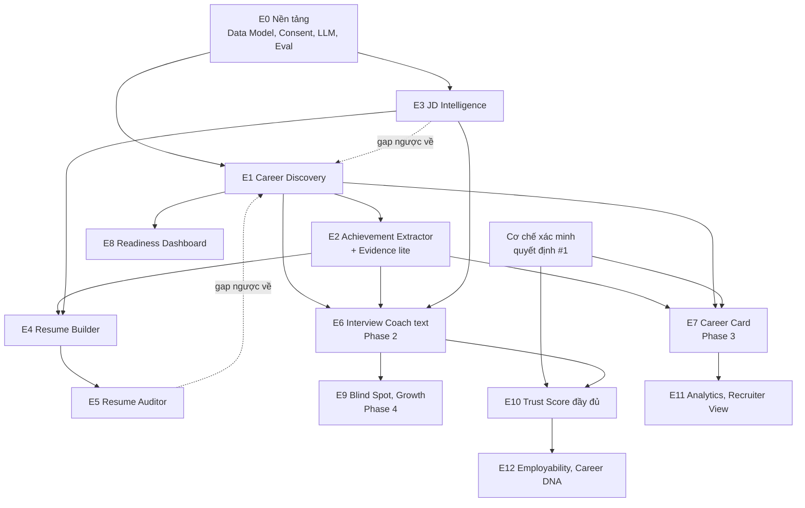

# ProfileHub: Roadmap và phạm vi MVP v1

**Căn cứ:** PRD v2.0, Career Discovery Question Bank v1, Career Discovery Flow v1, Career Data Model v1.
**Mục đích:** chốt cái gì làm trước, cái gì làm sau, mỗi chức năng "xong" nghĩa là gì, và chức năng nào phụ thuộc chức năng nào.

> **Lưu ý về ước lượng:** tôi chưa biết quy mô đội và công nghệ của bạn. Các mốc thời gian bên dưới giả định đội khoảng 5 người (2 backend, 1 frontend/mobile, 1 AI/prompt engineer, 1 PM kiêm design), sprint 2 tuần. Hãy xem đây là thứ tự và tỷ lệ tương đối, không phải cam kết. Các chỉ số mục tiêu (%, điểm) là **giả thuyết cần xác nhận** bằng dữ liệu thật.

---

## 1. Luận điểm MVP

**MVP phải chứng minh một điều:** một người không biết viết CV có thể trò chuyện với AI 20-40 phút và nhận về một CV **tốt hơn CV họ tự viết, có số liệu thật, và họ dám nộp**.

Vì vậy MVP tập trung vào chuỗi giá trị **Discovery → Achievement → CV → Audit → Match JD**. Đây cũng là chuỗi tạo ra dữ liệu chất lượng cho mọi chức năng sau (phỏng vấn, Career Card, điểm số).

**Vì sao chưa đưa phỏng vấn, Career Card, điểm số vào MVP:**

| Chức năng | Lý do để sau |
|---|---|
| Interview Coach | Cần kho câu chuyện STAR từ Discovery làm nguyên liệu. Làm ngay sau MVP (Phase 2) là hợp lý, nhưng làm song song sẽ chia nhỏ nguồn lực khi chất lượng Discovery chưa ổn |
| Career Card, Recruiter View | Cần cơ chế xác minh và quyền riêng tư đã chốt, và cần dữ liệu ổn định |
| Employability, Trust, Hiring Potential, Career DNA | Điểm số chỉ có nghĩa khi có đủ dữ liệu và bằng chứng. Trong MVP chỉ hiển thị **Data Quality và Readiness** (đã có công thức) |
| Voice Interview, Blind Spot, Analytics | Cần rubric phỏng vấn ổn định và đủ số phiên/người dùng |

---

## 2. Các phase

| Phase | Tên | Mục tiêu | Thời gian gợi ý |
|---|---|---|---|
| **0** | Nền tảng | Hạ tầng dữ liệu, LLM, đánh giá chất lượng, đồng ý dữ liệu | Sprint 1-3 |
| **1** | **MVP: CV Builder có Discovery** | Người dùng có CV tốt hơn nhờ Discovery | Sprint 2-7 (chồng phase 0) |
| **2** | Interview Coach (text) | Luyện phỏng vấn cá nhân hóa từ hồ sơ | Sprint 8-10 |
| **3** | Career Card | Hồ sơ sống, chia sẻ bằng QR, Recruiter View, xác minh | Sprint 11-14 |
| **4** | Nâng cao | Voice, Blind Spot, Analytics, Employability/Trust hoàn chỉnh, Career DNA | Sau Sprint 14, theo dữ liệu |

### Các cột mốc (milestone) trong Phase 0-1

| Mốc | Sprint | Nội dung | Có thể demo |
|---|---|---|---|
| M0 | 3 | Lưu hồ sơ theo Data Model, validate, đăng nhập, consent, LLM layer | Hồ sơ mẫu ghi và đọc được, eval harness chạy |
| M1: Discovery alpha | 4 | Onboarding, timeline, deep-dive 1 ngành (khuyến nghị Marketing hoặc IT), lưu tiến độ | Nội bộ trò chuyện xong 1 kinh nghiệm, ra achievement STAR |
| M2: CV alpha | 5 | Extractor, duyệt bullet, CV ATS, export PDF | Từ chat ra CV PDF đầu tiên |
| M3: Beta kín | 6 | Thêm 2 ngành nữa, Recruiter CV, JD Intelligence, Auditor, Readiness | 20-30 người dùng thật thử |
| M4: MVP release | 7 | Sửa theo beta, DOCX, song ngữ, đo lường, hoàn thiện xóa/xuất dữ liệu | Đủ tiêu chí mục 8 |

**Chọn ngành thế nào cho MVP:** không cần đủ 10 ngành. Bắt đầu với ngành của nhóm người dùng đầu tiên bạn nhắm tới. Gợi ý: **3-4 ngành** (ví dụ IT, Marketing, Sales, và module Fresher `FRS` vì lượng người cần CV đầu tiên lớn). Các ngành còn lại dùng bộ Core, chưa có module riêng.

---

## 3. Bản đồ phụ thuộc

### Ma trận phụ thuộc chi tiết

| Chức năng | Cần có trước | Vì sao |
|---|---|---|
| Discovery (E1) | Data Model, LLM layer, lưu tiến độ | Mọi câu trả lời ghi vào model |
| Achievement Extractor (E2) | Discovery ra `achievements[]` có `star` và `metrics` | Chỉ viết lại dữ liệu đã có, không bịa |
| JD Intelligence (E3) | Data Model, LLM layer. **Không phụ thuộc Discovery** để phân tích JD, nhưng cần Discovery để tính match có ý nghĩa | Có thể làm song song với E1 |
| Resume Builder (E4) | E2, dữ liệu experiences/skills, E3 (cho bản tailor theo JD) | CV lắp từ bullet đã duyệt |
| Resume Auditor (E5) | E4 (có CV để chấm), rubric | Chấm CV đã sinh |
| Readiness Dashboard (E8) | Công thức Data Quality trong E1 | Hiển thị điểm và việc cần làm |
| Interview Coach (E6) | E1 (kho câu chuyện), E2, E3 (cho JD-based), Stage 4 của Discovery | Câu hỏi và chấm điểm dựa vào hồ sơ |
| Career Card (E7) | E2, `story`, **cơ chế xác minh** và consent hiển thị | Chỉ hiển thị dữ liệu đã được xác nhận và cho phép |
| Trust Score đầy đủ (E10) | Evidence và cơ chế xác minh | Không có xác minh thì điểm không có nghĩa |
| Employability, Career DNA (E12) | E1, E2, E6, E3 và đủ dữ liệu | Công thức dùng nhiều nguồn |
| Analytics, Recruiter View (E11) | E7, quyết định quyền riêng tư (#5, #4 ở Data Model) | Pháp lý và niềm tin |

---

## 4. Phạm vi MVP (Phase 1)

### 4.1 Trong phạm vi

| Chức năng (theo PRD) | Phạm vi trong MVP |
|---|---|
| Career Discovery Engine | Stage 0-3, 5 rút gọn, 6 rút gọn (thế mạnh và narrative để dùng cho phần tóm tắt CV). Lưu tiến độ. 3-4 module ngành + Core |
| Achievement Extractor | Sinh bullet từ dữ liệu đã khai, người dùng duyệt. Có placeholder khi thiếu số |
| Evidence Engine | **Bản nhẹ:** phân loại `categories` cho achievement, cho đính kèm bằng chứng (file/link), trạng thái tối đa `evidence_attached`. Chưa xác minh bên thứ ba |
| Resume Auditor | Chấm chất lượng nội dung, phát hiện thiếu số liệu, thiếu impact, chung chung, timeline. Recruiter Simulation bản đơn giản |
| JD Intelligence | Dán văn bản JD. Must-have, nice-to-have, keywords, level. Match Score kèm thiếu kỹ năng, thành tích, kinh nghiệm |
| Dynamic Resume Builder | 2 biến thể: **ATS** và **Recruiter**. Tailor theo JD. Xuất PDF và DOCX. Tiếng Việt, tiếng Anh |
| Dashboard | **Chỉ Readiness:** Data Quality, gate CV, việc cần làm tiếp |

### 4.2 Ngoài phạm vi MVP (có chủ đích)

- Interview Coach mọi loại (Phase 2).
- Manager Resume, Executive Resume (làm sau khi có nhóm người dùng senior, Phase 2-3).
- Career Card, QR, Recruiter View, Career Analytics (Phase 3-4).
- Employability, Trust, Hiring Potential, Career DNA hiển thị cho người dùng (Phase 3-4). Trong nền vẫn ghi dữ liệu để có lịch sử.
- Voice, Blind Spot, Growth Tracking (Phase 4).
- Lấy JD từ URL tự động (dễ lỗi, dán văn bản là đủ cho MVP).
- Xác minh bên thứ ba, tích hợp LinkedIn/GitHub.
- Ứng dụng di động native (làm web responsive, ưu tiên mobile-first vì người dùng chủ yếu dùng điện thoại).

---

## 5. User story và tiêu chí hoàn thành: MVP

**Chú thích:** Ưu tiên `M` = Must, `S` = Should, `C` = Could. Effort: `S` ≤ 3 ngày, `M` ≈ 1 tuần, `L` ≈ 2 tuần, `XL` > 2 tuần (một đội nhỏ).

### E0. Nền tảng

**US-0.1 Đăng ký, đăng nhập, đồng ý dữ liệu** · M · M
Là người dùng, tôi muốn tạo tài khoản và biết dữ liệu của mình được dùng thế nào, để yên tâm chia sẻ thông tin nghề nghiệp.
- Đăng ký/đăng nhập bằng email hoặc Google.
- Trước khi bắt đầu Discovery, hiển thị và ghi lại `consents` `data_processing` và `ai_analysis` kèm `policy_version`.
- Không thể bắt đầu Discovery nếu chưa đồng ý.

**US-0.2 Lưu hồ sơ theo Data Model v1** · M · L · Phụ thuộc: không
Là hệ thống, tôi cần lưu và kiểm tra hồ sơ đúng schema để mọi chức năng dùng chung dữ liệu.
- Validate bằng `career_profile_v1.schema.json` mỗi lần ghi.
- Cài các quy tắc bất biến số 1, 2, 3, 5, 6 (Data Model mục 5) thành validator riêng.
- Ghi audit log thay đổi cho `achievements`, `evidence`.
- Có bộ dữ liệu mẫu (ít nhất 4 hồ sơ) để test.

**US-0.3 Lớp LLM, quản lý prompt và bộ đánh giá** · M · L
Là đội phát triển, tôi cần chạy prompt có phiên bản và đo chất lượng, để cải thiện mà không phá vỡ cái đang chạy.
- Prompt có version, log đầu vào/đầu ra (đã che thông tin cá nhân) để debug.
- Bộ **golden set** ≥ 30 hồ sơ mô phỏng (4 ngành, tiếng Việt), chạy tự động khi đổi prompt.
- Chỉ số bắt buộc: tỷ lệ bullet chứa số không có trong dữ liệu nguồn (**mục tiêu = 0** trên golden set).
- Có timeout, retry, fallback khi LLM lỗi, người dùng không mất dữ liệu đang nhập.

**US-0.4 Xuất và xóa dữ liệu** · M · M
Là người dùng, tôi muốn tải về hoặc xóa toàn bộ dữ liệu của mình.
- Nút xuất hồ sơ (JSON) và xóa tài khoản.
- Xóa bao gồm `raw_answers`, evidence file, `documents` (Data Model quy tắc 11).
- Xóa hoàn tất trong thời gian đã công bố trong chính sách.

---

### E1. Career Discovery

**US-1.1 Onboarding** · M · M · Phụ thuộc: US-0.2
Là người dùng, tôi muốn nói mình cần gì để AI hỏi đúng hướng.
- Chọn mục đích (`cv`; `interview` và `both` hiện có nhưng ghi chú "sắp có"), ngành (tối đa 2), cấp độ, vị trí mục tiêu (tùy chọn), ngôn ngữ CV.
- Hệ thống gán `persona` theo Flow mục Stage 0.
- Hoàn thành trong dưới 2 phút, tối đa 6 lựa chọn.

**US-1.2 Tải CV cũ để điền sẵn** · S · L · Phụ thuộc: US-1.1
Là người dùng đã có CV, tôi muốn AI đọc CV để khỏi khai lại.
- Hỗ trợ PDF và DOCX.
- AI trích `experiences[]` (`source_type: imported_cv`) và hiển thị để người dùng sửa.
- Mọi mục nhập từ CV mặc định `self_reported`, không tự động thành thành tích.
- Nếu đọc lỗi, chuyển sang nhập tay mà không mất dữ liệu.

**US-1.3 Dựng timeline** · M · M · Phụ thuộc: US-1.1
Là người dùng, tôi muốn kể hành trình của mình một lần và AI sắp xếp giúp.
- Người dùng trả lời STORY-01 tự do; AI tách thành bảng kinh nghiệm (công ty, chức danh, thời gian) để sửa.
- Đánh dấu khoảng trống > 3 tháng nhưng không bắt buộc giải thích.
- Người dùng chỉnh sửa được từng dòng trước khi tiếp tục.

**US-1.4 Chọn kinh nghiệm để đào sâu** · M · S · Phụ thuộc: US-1.3
- AI đề xuất 3-5 kinh nghiệm theo quy tắc Flow (gần nhất, dài nhất, phù hợp vị trí đích).
- Người dùng đổi được danh sách. Kinh nghiệm > 7 năm chỉ hỏi bản rút gọn.

**US-1.5 Deep-dive một kinh nghiệm** · M · XL · Phụ thuộc: US-0.3, US-1.4
Là người dùng, tôi muốn AI hỏi tôi về thành tích và kết quả một cách tự nhiên để tôi nhớ ra điều đáng nói.
- Hỏi theo trình tự Flow Stage 2 với câu Core P0 và câu module ngành đã chọn.
- Mỗi lượt chỉ 1 câu chính; dùng probe tối đa 2 lần mỗi câu.
- Kết thúc mỗi vòng ghi ≥ 1 `achievements[]` với `star`, `role`, `metrics` hoặc `qualitative`.
- Mỗi bản ghi có `source_question_ids` và `raw_answer_ids`.
- Golden set: ≥ 80% hội thoại mẫu tạo ra ≥ 1 achievement có điểm chất lượng ≥ 60.

**US-1.6 Xử lý khi không có số liệu** · M · M · Phụ thuộc: US-1.5
- AI gợi ý cách ước lượng và các khoảng chọn sẵn.
- Số ước lượng ghi `estimated: true`; nếu vẫn không có, chuyển sang câu định tính IMP-04.
- **AI không tự thêm số nào người dùng chưa nói** (kiểm tra trên golden set).

**US-1.7 Tóm tắt STAR và xác nhận** · M · S · Phụ thuộc: US-1.5
- Cuối mỗi thành tích, AI hiển thị bản tóm tắt STAR, người dùng bấm "Đúng", "Sửa" hoặc "Bỏ".
- Chỉ bản ghi đã xác nhận mới được đưa vào Extractor.

**US-1.8 Kỹ năng, chứng chỉ, dự án, ngoại khóa** · M · M · Phụ thuộc: US-1.3
- Điền sẵn kỹ năng đã xuất hiện trong deep-dive; chỉ hỏi xác nhận và mức độ 1-5.
- Fresher: ưu tiên hỏi dự án và ngoại khóa.
- Người dùng chọn "Không có" thì tính là đã trả lời.

**US-1.9 Mục tiêu nghề nghiệp (rút gọn)** · M · S
- Thu thập vị trí đích, khoảng cách (GOAL-04), mục tiêu 1 năm (GOAL-01).
- `goals.target_roles` được dùng để xếp thứ tự bullet trong CV.

**US-1.10 Thế mạnh và tóm tắt bản thân** · S · M · Phụ thuộc: US-1.5, US-1.8
- Hỏi STORY-04, AI đề xuất 3-5 thế mạnh kèm bằng chứng truy về dữ liệu.
- Người dùng xác nhận (`confirmed_by_user`), sau đó AI sinh phần "Tóm tắt" cho CV.
- Thế mạnh chưa xác nhận không xuất hiện trong CV.

**US-1.11 Lưu tiến độ, dừng và tiếp tục** · M · M · Phụ thuộc: US-0.2
- Tự động lưu sau mỗi câu trả lời. Đóng trình duyệt giữa chừng không mất dữ liệu.
- Quay lại: hiển thị "Lần trước bạn xong X, còn Y" và hỏi tiếp từ đúng điểm dừng.
- Có nút "Để sau" và "Bỏ qua" cho mọi câu không bắt buộc.

**US-1.12 Kiểm tra độ đầy đủ và bổ sung** · M · M · Phụ thuộc: US-1.5, US-1.8, US-1.9
- Tính Data Quality và gate CV theo Flow mục 6-7.
- Nếu chưa đạt: liệt kê tối đa 3 thiếu sót quan trọng và hỏi bổ sung.
- Người dùng luôn có lựa chọn "Tạo CV với dữ liệu hiện có", kèm cảnh báo phần nào yếu.

---

### E2. Achievement Extractor và Evidence (bản nhẹ)

**US-2.1 Sinh bullet CV từ thành tích** · M · L · Phụ thuộc: US-1.7
Là người dùng, tôi muốn thành tích của mình được viết thành câu chuyên nghiệp mà không sai sự thật.
- Mỗi bullet bám cấu trúc hành động + kết quả; ngôn ngữ theo `output_language`.
- Mọi con số trong bullet **phải khớp** một `Metric` trong hồ sơ. Test tự động chặn số lạ (Data Model quy tắc 3).
- Bullet có số ước lượng đặt `contains_estimated_figures: true` và hiển thị "khoảng".
- Mỗi thành tích sinh 1-3 phương án để chọn.

**US-2.2 Điền chỗ thiếu thay vì bịa** · M · S · Phụ thuộc: US-2.1
- Khi thiếu số hoặc vai trò, bullet hiện placeholder rõ ràng (ví dụ "[con số?]") hoặc AI quay lại hỏi.
- Bullet còn placeholder không thể xuất ra CV.

**US-2.3 Duyệt và sửa bullet** · M · M · Phụ thuộc: US-2.1
- Người dùng duyệt, sửa tay hoặc yêu cầu "ngắn hơn/mạnh hơn/thêm số".
- `user_approved` chỉ bật khi người dùng duyệt; chỉ bullet đã duyệt vào CV (quy tắc 1).
- Sau khi sửa tay, hệ thống kiểm tra lại quy tắc số liệu, nếu có số mới thì yêu cầu bổ sung vào `Metric`.

**US-2.4 Phân loại thành tích** · S · S · Phụ thuộc: US-1.7
- Gán `categories` (revenue, cost_saving, efficiency…) cho từng thành tích. Người dùng thấy và chỉnh được.
- Dùng để xếp thứ tự bullet và phục vụ phần Evidence Engine sau này.

**US-2.5 Đính kèm bằng chứng** · S · M · Phụ thuộc: US-1.7
- Người dùng đính kèm file hoặc link vào thành tích/chứng chỉ; tạo `evidence[]` với `supports`.
- Trạng thái chuyển `self_reported` thành `evidence_attached`.
- Cảnh báo che thông tin nhạy cảm; có tùy chọn đánh dấu `sensitive_data_redacted`.
- **Chưa** xác minh nội dung file; giao diện ghi rõ "đã đính kèm", không ghi "đã xác minh".

---

### E3. JD Intelligence

**US-3.1 Phân tích JD** · M · M · Phụ thuộc: US-0.3
Là người dùng, tôi muốn dán JD và hiểu công ty thực sự cần gì.
- Nhận văn bản JD (tiếng Việt hoặc Anh).
- Trả về `must_have`, `nice_to_have`, `keywords`, `level`, `responsibilities`.
- Golden set JD: ≥ 90% must-have chính được trích đúng (đối chiếu người đánh giá).

**US-3.2 Điểm phù hợp và khoảng trống** · M · L · Phụ thuộc: US-3.1, US-1.8
- Match Score 0-100 kèm `matched_skills`, `missing_skills`, `missing_achievements`, `missing_experience`.
- Mỗi kết luận nêu lý do và trỏ về thực thể trong hồ sơ (`supporting_refs`).
- Nếu hồ sơ chưa đủ dữ liệu (chưa qua gate), hiển thị "chưa đủ dữ liệu để đánh giá chính xác" thay vì con số.

**US-3.3 Từ khoảng trống quay lại bổ sung** · S · M · Phụ thuộc: US-3.2, US-1.12
- Mỗi khoảng trống có nút "Bổ sung": mở câu hỏi Discovery phù hợp (ví dụ thiếu số liệu, thiếu kỹ năng đã có nhưng chưa khai).
- Không gợi ý người dùng khai điều họ không có.

---

### E4. Dynamic Resume Builder

**US-4.1 CV chuẩn ATS** · M · L · Phụ thuộc: US-2.3, US-1.8
- Một cột, font chuẩn, tiêu đề mục chuẩn, không bảng/ảnh gây lỗi khi đọc.
- Nội dung chỉ lấy từ bullet đã duyệt, experiences, education, skills (xem US-4.5).
- Kiểm thử: PDF và DOCX xuất ra parse được bằng ít nhất 2 công cụ đọc CV mẫu, giữ đúng thứ tự mục.

**US-4.2 CV dành cho Recruiter** · M · M · Phụ thuộc: US-4.1
- Bố cục dễ quét trong 30 giây: tóm tắt, thành tích nổi bật đầu tiên, số liệu nổi bật.
- Tối đa 1-2 trang theo cấp độ (Fresher 1 trang).

**US-4.3 Tailor theo JD** · M · M · Phụ thuộc: US-3.2, US-4.1
- Chọn JD, hệ thống xếp lại bullet/kỹ năng và nhấn từ khóa liên quan **chỉ khi hồ sơ thực sự có**.
- Không thêm kỹ năng hoặc kinh nghiệm chưa có trong hồ sơ. Từ khóa thiếu được liệt kê riêng ("bạn chưa có trong hồ sơ").

**US-4.4 Xem trước, chỉnh sửa, xuất file** · M · L · Phụ thuộc: US-4.1
- Xem trước trực tiếp, sửa từng mục; sửa thì cập nhật lại nguồn (hồ sơ) hoặc đánh dấu "chỉ sửa ở bản CV này".
- Xuất PDF và DOCX; tên file mặc định có họ tên và vị trí.

**US-4.5 CV song ngữ** · S · M · Phụ thuộc: US-4.1
- Chuyển ngôn ngữ CV Việt/Anh; các con số, tên riêng, chức danh giữ nguyên.
- Người dùng xem và duyệt lại bản dịch trước khi xuất.

**US-4.6 Truy vết nguồn** · M · M · Phụ thuộc: US-4.1, US-0.2
- Mỗi block trong `documents[].blocks` có `source_refs` hợp lệ (quy tắc 2). Không có nguồn thì không được sinh ra.
- Xem "nguồn" của bất kỳ dòng nào trong CV: hiển thị câu trả lời gốc tương ứng.

---

### E5. Resume Auditor

**US-5.1 Chấm CV và chỉ ra vấn đề** · M · L · Phụ thuộc: US-4.1
- Phát hiện: thiếu số liệu, thiếu impact, mô tả chung chung, timeline mâu thuẫn, số ước lượng, khẳng định chưa có bằng chứng.
- Mỗi vấn đề nêu vị trí, lý do và hành động sửa cụ thể.
- Golden set có lỗi chèn sẵn: phát hiện ≥ 85% lỗi đã chèn, dưới 15% cảnh báo sai.

**US-5.2 Mô phỏng nhà tuyển dụng** · S · M · Phụ thuộc: US-5.1, US-3.1
- Đóng vai HR: 3 lý do có thể chọn, 3 lý do có thể loại, dựa trên JD đã chọn.
- Chỉ dựa vào nội dung CV và JD, không đưa nhận định về cá nhân người dùng.

**US-5.3 Sửa nhanh từ kết quả audit** · S · M · Phụ thuộc: US-5.1, US-1.12
- Mỗi vấn đề dẫn tới đúng câu hỏi Discovery hoặc đúng bullet cần sửa.
- Sửa xong, chạy lại audit và hiển thị cải thiện.

---

### E8. Readiness Dashboard (bản MVP)

**US-8.1 Bảng sẵn sàng** · M · M · Phụ thuộc: US-1.12
- Hiển thị Data Quality theo nhóm và trạng thái gate CV.
- Hiển thị việc nên làm tiếp (tối đa 3), ví dụ "Thêm số liệu cho thành tích ở công ty ABC".
- Không hiển thị Employability, Trust, Hiring Potential, DNA ở MVP.

---

## 6. User story: Phase 2 đến Phase 4 (cấp độ epic)

### Phase 2: E6 Interview Coach (text)

| Story | Tiêu chí chính | Phụ thuộc |
|---|---|---|
| **US-6.1** Chọn loại phỏng vấn (theo level, theo ngành, behavioral, JD-based) | Chọn được trong ≤ 3 bước; JD-based dùng JD đã phân tích | E3, E1 |
| **US-6.2** Sinh bộ câu hỏi cá nhân hóa từ hồ sơ | Mỗi bộ ≥ 6 câu, phủ ≥ 4 competency; câu hỏi nhắc đúng bối cảnh hồ sơ khi phù hợp | E1, E2 |
| **US-6.3** Trả lời dạng text, AI hỏi đào sâu | Tối đa 2 câu đào sâu mỗi câu; giữ mạch hội thoại | US-6.2 |
| **US-6.4** Chấm điểm và phản hồi | Rubric 5 tiêu chí (Data Model 6.6); phản hồi chỉ ra chỗ mạnh, chỗ thiếu, và **gợi ý câu chuyện có sẵn trong hồ sơ** nên dùng | US-6.3 |
| **US-6.5** Bổ sung Stage 4 (thất bại, feedback, xung đột) ngay trong phiên khi thiếu câu chuyện | Thêm câu chuyện mới ghi vào `failures[]`, `leadership[]` | E1 |
| **US-6.6** Lịch sử và xu hướng | Xem điểm theo phiên và theo competency | US-6.4 |
| **US-6.7** Gate sẵn sàng phỏng vấn | Theo Flow mục 7 (điểm tổng ≥ 70 và ≥ 5 câu chuyện STAR) | E1 |

**Tiêu chí thoát Phase 2:** người dùng hoàn thành ≥ 2 phiên trong 7 ngày (tỷ lệ mục tiêu ≥ 40% số người bắt đầu); điểm phiên sau cao hơn phiên đầu ở ≥ 60% người dùng có ≥ 2 phiên; chấm điểm AI khớp đánh giá của chuyên gia ở mức chấp nhận được trên bộ mẫu (đề xuất: chênh lệch trung bình ≤ 10 điểm trên thang 100).

### Phase 3: E7 Career Card

| Story | Tiêu chí chính |
|---|---|
| **US-7.1** Trang hồ sơ nghề nghiệp | Hiển thị tóm tắt, kinh nghiệm, thành tích, kỹ năng, chứng chỉ; chỉ phần người dùng bật (`section_visibility`) |
| **US-7.2** QR cá nhân | Quét mở đúng Career Card; tắt được bất cứ lúc nào; đổi link vô hiệu hóa QR cũ |
| **US-7.3** Timeline nghề nghiệp | Từ `story.timeline` |
| **US-7.4** AI Professional Insights | Chỉ hiển thị mục đã `confirmed_by_user` (quy tắc 4) |
| **US-7.5** Verified Evidence | Hiển thị đúng mức xác minh; **không** hiển thị nhãn "đã xác minh" nếu chưa `third_party_verified` |
| **US-7.6** Recruiter View | Cần consent `recruiter_visibility`; điểm chỉ hiển thị khi người dùng cho phép và điểm không phải `experimental` |

**Điều kiện bắt đầu Phase 3:** đã chốt quyết định #1 (cơ chế xác minh) và #4 (recruiter thấy điểm nào) trong Data Model mục 10.

### Phase 4: các epic nâng cao

| Epic | Điều kiện để bắt đầu |
|---|---|
| Trust Score đầy đủ, Employability | Có dữ liệu xác minh và ≥ vài trăm hồ sơ để hiệu chuẩn |
| Career Analytics | Chốt quyết định #5 (quyền riêng tư), có consent `analytics_tracking` |
| Voice Interview | Rubric text ổn định; kiểm tra chất lượng nhận dạng giọng Việt (giọng vùng miền) |
| Blind Spot Analyzer, Growth Tracking | Người dùng có ≥ 3 phiên; quy tắc blind spot đã hiệu chuẩn |
| Career DNA | Đủ ≥ 3 mục chất lượng; quy tắc gán `dna_signals` được kiểm chứng với người dùng |
| Hiring Potential | Có dữ liệu kết quả tuyển dụng thật, nếu không thì **không hứa** |
| Manager, Executive Resume | Có nhóm người dùng senior/manager và module đào sâu lãnh đạo |

---

## 7. Yêu cầu phi chức năng và chất lượng AI

### 7.1 Chất lượng AI (bắt buộc cho MVP)

| Yêu cầu | Chỉ tiêu đề xuất |
|---|---|
| Không bịa số liệu trong bullet/CV | 0 trường hợp trên golden set; theo dõi báo cáo của người dùng sau ra mắt |
| Mọi block CV có nguồn | 100% |
| Chất lượng tiếng Việt (văn phong tự nhiên, thuật ngữ đúng ngành) | Điểm đánh giá của người review ≥ 4/5 trên mẫu |
| Câu hỏi Discovery tự nhiên, không lặp | ≤ 5% lượt hỏi lặp lại điều đã có; người dùng chấm ≥ 4/5 |
| An toàn nội dung | Không gợi ý nói dối, không sinh nội dung phân biệt đối xử trong CV |

### 7.2 Hiệu năng, độ tin cậy, bảo mật

| Yêu cầu | Chỉ tiêu đề xuất |
|---|---|
| Thời gian phản hồi mỗi lượt Discovery | p50 < 3 giây, p95 < 8 giây (có chỉ báo đang xử lý) |
| Sinh CV | < 30 giây |
| Khả dụng | ≥ 99% trong giờ cao điểm |
| Mất dữ liệu | 0 (lưu sau mỗi câu trả lời) |
| Bảo mật | Mã hóa khi truyền và khi lưu; tách quyền truy cập file bằng chứng; log không chứa nội dung cá nhân dạng rõ |
| Tuân thủ | Rà soát quy định bảo vệ dữ liệu cá nhân hiện hành tại Việt Nam trước khi ra mắt (cần tư vấn pháp lý, tài liệu này không thay thế) |
| Trải nghiệm | Mobile-first, dùng được trên màn hình nhỏ; đọc được bằng trình đọc màn hình ở các luồng chính |

---

## 8. Tiêu chí ra mắt MVP (Definition of Done cấp sản phẩm)

Tất cả phải đạt trước khi mở rộng:

| # | Tiêu chí | Ngưỡng đề xuất |
|---|---|---|
| 1 | Tất cả story `M` trong E0-E5, E8 hoàn thành và qua kiểm thử chấp nhận | 100% |
| 2 | Golden set: bịa số liệu | 0 |
| 3 | Beta kín: tỷ lệ người bắt đầu Discovery và đạt gate CV | ≥ 50% |
| 4 | Beta kín: thời gian trung vị từ bắt đầu đến CV đầu tiên | ≤ 40 phút (có thể qua 2 phiên) |
| 5 | Tỷ lệ bullet AI được duyệt không chỉnh lớn | ≥ 60% |
| 6 | Người dùng beta tự đánh giá "CV mới tốt hơn CV cũ/tự viết" | ≥ 70% |
| 7 | Tỷ lệ xuất CV (PDF/DOCX) trên số người đạt gate | ≥ 70% |
| 8 | Xóa và xuất dữ liệu hoạt động đúng, có kiểm thử | Đạt |
| 9 | Không có lỗi mức nghiêm trọng (mất dữ liệu, lộ dữ liệu, CV có nội dung sai nguồn) còn mở | 0 |
| 10 | Đã rà soát pháp lý về dữ liệu cá nhân | Hoàn tất |

### Chỉ số cần đo từ ngày đầu (instrumentation)

| Nhóm | Sự kiện/chỉ số |
|---|---|
| Kích hoạt | Bắt đầu Discovery, hoàn thành Onboarding, hoàn thành deep-dive đầu tiên |
| Chất lượng dữ liệu | Điểm Data Quality theo thời gian, số probe/câu, tỷ lệ "bỏ qua", tỷ lệ số ước lượng |
| Hiệu quả AI | Tỷ lệ bullet duyệt/sửa/bỏ, số lần sinh lại, khiếu nại nội dung |
| Kết quả | Tạo CV, xuất CV, tailor theo JD, dùng audit và sửa theo audit |
| Giữ chân | Quay lại trong 7 và 30 ngày (phục vụ North Star: quay lại không chỉ để làm CV) |
| Tắc nghẽn | Bước bỏ dở nhiều nhất trong flow, thời gian mỗi Stage |

---

## 9. Rủi ro và cách giảm thiểu

| Rủi ro | Mức | Giảm thiểu |
|---|---|---|
| AI bịa hoặc thổi phồng thành tích, người dùng nộp CV sai sự thật | Cao | Quy tắc bất biến số 1-3, golden set kiểm tự động, người dùng duyệt bắt buộc, cờ `estimated` |
| Discovery quá dài, người dùng bỏ giữa chừng | Cao | Chia phiên, deep-dive 3-5 kinh nghiệm, hiển thị tiến độ, cho "tạo luôn với dữ liệu hiện có" |
| Người dùng không có số liệu, CV nhạt | Trung bình | Gợi ý khoảng ước lượng, định tính, đưa ví dụ mẫu theo ngành |
| Chất lượng tiếng Việt và thuật ngữ ngành không đều | Trung bình | Giới hạn 3-4 ngành ở MVP, có chuyên gia ngành review golden set |
| Phạm vi phình to (đội bị kéo vào Career Card, phỏng vấn sớm) | Cao | Chốt danh sách ngoài phạm vi (mục 4.2); mọi thêm việc phải đổi bằng việc khác |
| Điểm số gây hiểu lầm | Trung bình | Không hiển thị Employability/Trust/Hiring Potential ở MVP; mọi điểm có giải thích |
| Rủi ro dữ liệu cá nhân và bí mật công ty | Cao | Nhắc không nhập dữ liệu nhạy cảm, tùy chọn ẩn danh hóa, xóa dữ liệu, rà soát pháp lý |
| Chi phí LLM cao theo mỗi phiên | Trung bình | Đo chi phí mỗi người dùng đạt gate từ beta, tối ưu prompt, dùng mô hình nhỏ cho bước đơn giản |
| Xuất CV bị lỗi định dạng ATS | Trung bình | Kiểm thử với bộ file mẫu, ưu tiên bố cục đơn giản |

---

## 10. Quyết định cần chốt để bắt đầu Sprint 1

| # | Câu hỏi | Vì sao cần sớm |
|---|---|---|
| 1 | **Nhóm người dùng đầu tiên là ai** (sinh viên/fresher, hay junior/mid ngành IT/Marketing)? | Quyết định 3-4 ngành trong MVP, ngôn ngữ, giọng điệu |
| 2 | **Chat tự do hay giao diện từng bước có thẻ chọn?** | Ảnh hưởng thiết kế Discovery và cách lưu dữ liệu |
| 3 | **Công nghệ và đội ngũ thực tế** (web/mobile, mô hình AI nào, hạ tầng) | Hiệu chỉnh lại toàn bộ ước lượng thời gian |
| 4 | **Mô hình kinh doanh** (miễn phí, freemium, trả theo lần xuất CV) | Ảnh hưởng giới hạn sử dụng, chi phí LLM, thiết kế gate |
| 5 | **Ai review golden set và đánh giá tiếng Việt?** (cần người có kinh nghiệm tuyển dụng/ngành) | Chất lượng AI là điều kiện ra mắt |
| 6 | **Quy trình pháp lý về dữ liệu cá nhân** | Có thể chặn ra mắt nếu để muộn |
| 7 | Các quyết định #1 (xác minh), #4, #5 ở Data Model mục 10 | Không chặn MVP nhưng chặn Phase 3-4; nên chốt trước Sprint 7 |

---

## 11. Gợi ý thứ tự làm trong 7 sprint đầu

| Sprint | Trọng tâm | Story chính |
|---|---|---|
| 1 | Nền tảng dữ liệu, đăng nhập | US-0.1, US-0.2 (bắt đầu), golden set khởi tạo |
| 2 | LLM layer, onboarding, timeline | US-0.2, US-0.3, US-1.1, US-1.3 |
| 3 | Lưu tiến độ, deep-dive lõi (chưa module ngành) | US-1.4, US-1.5 (Core), US-1.11 |
| 4 | **M1 Discovery alpha** | US-1.5 (module ngành 1), US-1.6, US-1.7, US-3.1 (song song) |
| 5 | **M2 CV alpha** | US-2.1-2.3, US-4.1, US-4.4 (PDF), US-1.8 |
| 6 | **M3 Beta kín** | US-4.2, US-4.3, US-3.2, US-5.1, US-1.12, US-8.1, thêm ngành 2-3 |
| 7 | **M4 MVP release** | US-0.4, US-4.4 (DOCX), US-4.5, US-4.6, các story `S`, sửa lỗi beta, đo lường |

Story `S`/`C` chưa xong ở Sprint 7 được xếp vào backlog Phase 2. **Không hoãn** ngày ra mắt để chờ story `S`.
