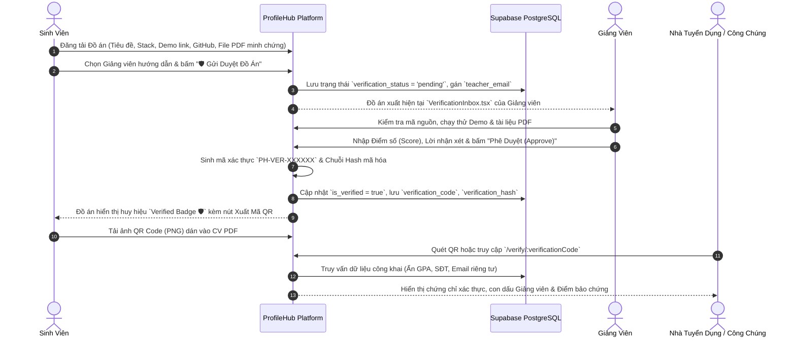
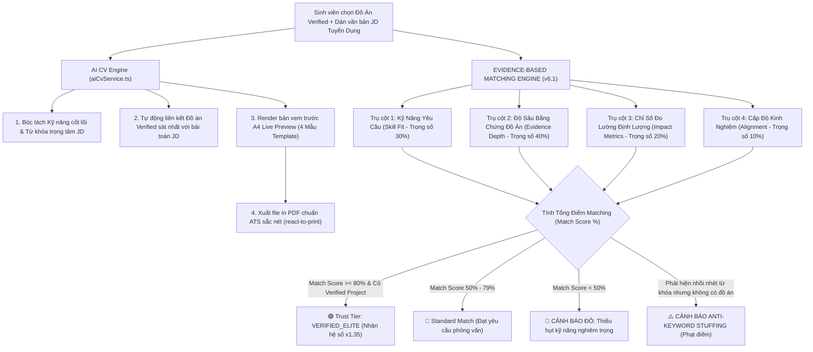
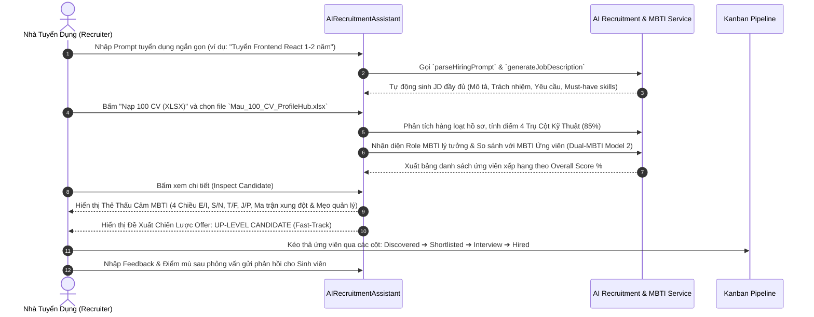
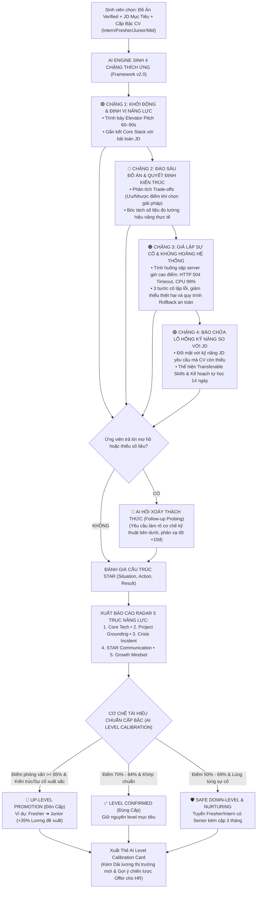
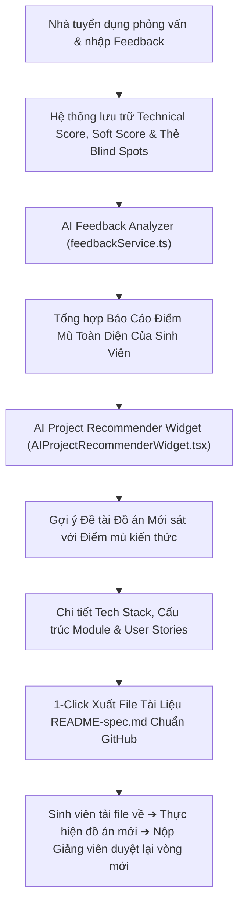

# 🌐 TÀI LIỆU TỔNG HỢP TOÀN BỘ CÁC LUỒNG CHÍNH CỦA HỆ THỐNG PROFILEHUB
## Verified Academic & AI Career Ecosystem (Tài Liệu Đặc Tả Luồng Vận Hành Toàn Diện)

---

## 📑 MỤC LỤC
1. [Tổng Quan Kiến Trúc & 3 Tác Tử Hệ Thống](#1-tổng-quan-kiến-trúc--3-tác-tử-hệ-thống)
2. [LUỒNG 1: Quản Lý Đồ Án & Xác Thực Giảng Viên (Academic Verification & Integrity Gateway)](#2-luồng-1-quản-lý-đồ-án--xác-thực-giảng-viên)
3. [LUỒNG 2: AI CV Builder & Đối Soát Khớp CV-JD 4 Trụ Cột (Evidence-Based CV-JD Matching)](#3-luồng-2-ai-cv-builder--đối-soát-khớp-cv-jd-4-trụ-cột)
4. [LUỒNG 3: Nhà Tuyển Dụng Thông Minh & Đánh Giá Văn Hóa Dual-MBTI](#4-luồng-3-nhà-tuyển-dụng-thông-minh--đánh-giá-văn-hóa-dual-mbti)
5. [LUỒNG 4: Phòng Luyện Phỏng Vấn AI Thích Ứng 4 Chặng & Tái Hiệu Chuẩn Cấp Bậc](#5-luồng-4-phòng-luyện-phỏng-vấn-ai-thích-ứng-4-chặng--tái-hiệu-chuẩn-cấp-bậc)
6. [LUỒNG 5: Vòng Lặp Phản Hồi Tuyển Dụng & AI Đề Xuất Đồ Án Bổ Trợ](#6-luồng-5-vòng-lặp-phản-hồi-tuyển-dụng--ai-đề-xuất-đồ-án-bổ-trợ)
7. [Bảng Tổng Hợp Ma Trận Dữ Liệu & Điểm Chạm (Touchpoints)](#7-bảng-tổng-hợp-ma-trận-dữ-liệu--điểm-chạm)

---

## 1. TỔNG QUAN KIẾN TRÚC & 3 TÁC TỬ HỆ THỐNG

Hệ thống **ProfileHub** vận hành dựa trên tam giác liên kết giá trị giữa **Sinh viên**, **Giảng viên** và **Doanh nghiệp tuyển dụng**:

```mermaid
flowchart TD
    subgraph SinhVien ["👨‍🎓 1. SINH VIÊN (STUDENT)"]
        S_Proj["Quản lý Đồ án & Chứng chỉ"]
        S_CV["AI CV Builder (Xuất PDF A4)"]
        S_Match["Đối soát Matching CV-JD 4 Trụ Cột"]
        S_Mock["Phòng Luyện Phỏng Vấn AI 4 Chặng"]
        S_Level["Tái Hiệu Chuẩn Cấp Bậc & Lương Mới"]
        S_Reco["AI Gợi ý Đồ án Khắc phục Điểm mù"]
    end

    subgraph GiangVien ["👨‍🏫 2. GIẢNG VIÊN (TEACHER / VERIFIER)"]
        T_Inbox["Hộp Thư Tiếp Nhận Đồ Án"]
        T_Grade["Thẩm Định Mã Nguồn & Chấm Điểm"]
        T_Hash["Cấp Mã Bảo Chứng Cryptographic Hash"]
        T_Badge["Gắn Huy Hiệu Verified Badge 🛡️"]
    end

    subgraph DoanhNghiep ["🏢 3. NHÀ TUYỂN DỤNG (RECRUITER)"]
        R_Prompt["AI Sinh JD từ Prompt Tuyển Dụng"]
        R_Bulk["Nạp Hàng Loạt 100 CV (XLSX)"]
        R_Match["Thuật Toán Khớp Bằng Chứng 4 Trụ Cột"]
        R_MBTI["Đánh Giá Văn Hóa Dual-MBTI Fit"]
        R_Calib["Đề Xuất Offer Đôn Cấp (Up-Level)"]
        R_Kanban["Kanban Pipeline & Gửi Feedback Lỗ Hổng"]
    end

    S_Proj -->|"Nộp hồ sơ duyệt đồ án"| T_Inbox
    T_Badge -->|"Xác thực bảo chứng"| S_Proj
    T_Badge -->|"Cung cấp bằng chứng thực tế"| R_Match
    S_CV -->|"Ứng tuyển"| R_Bulk
    R_Calib -->|"Khuyến nghị gửi Offer"| S_Level
    R_Kanban -->|"Gửi phản hồi phỏng vấn & Blind spots"| S_Reco
```

---

## 2. LUỒNG 1: QUẢN LÝ ĐỒ ÁN & XÁC THỰC GIẢNG VIÊN (ACADEMIC VERIFICATION & INTEGRITY GATEWAY)

### 📌 Mục tiêu:
Biến các bài tập lớn/đồ án của sinh viên thành tài sản số được bảo chứng học thuật bởi Giảng viên đại học, loại bỏ hoàn toàn việc gian lận đồ án trong CV.

---

## 3. LUỒNG 2: AI CV BUILDER & ĐỐI SOÁT KHỚP CV-JD 4 TRỤ CỘT (EVIDENCE-BASED MATCHING)

### 📌 Mục tiêu:
Giúp sinh viên tạo CV chuẩn ATS từ đồ án Verified và đối soát chính xác mức độ phù hợp với JD doanh nghiệp dựa trên **4 Trụ Cột Bằng Chứng (v6.1)**.

---

## 4. LUỒNG 3: NHÀ TUYỂN DỤNG THÔNG MINH & ĐÁNH GIÁ VĂN HÓA DUAL-MBTI

### 📌 Mục tiêu:
Hỗ trợ Nhà tuyển dụng sinh JD nhanh chóng, nạp hàng loạt 100 CV từ Excel và đánh giá toàn diện cả **Kỹ thuật thực chiến (85%)** lẫn **Văn hóa làm việc Dual-MBTI (15%)**.

---

## 5. LUỒNG 4: PHÒNG LUYỆN PHỎNG VẤN AI THÍCH ỨNG 4 CHẶNG & TÁI HIỆU CHUẨN CẤP BẬC

### 📌 Mục tiêu:
Mô phỏng chân thực buổi Tech Interview 45 phút của các tập đoàn công nghệ; loại bỏ câu hỏi lý thuyết sách vở; hỏi xoáy vào quyết định kiến trúc, xử lý khủng hoảng live crash và tái định giá cấp bậc ứng viên.

---

## 6. LUỒNG 5: VÒNG LẶP PHẢN HỒI TUYỂN DỤNG & AI ĐỀ XUẤT ĐỒ ÁN BỔ TRỢ (FEEDBACK LOOP & REMEDIAL RECOMMENDER)

### 📌 Mục tiêu:
Biến các đánh giá từ chối hoặc góp ý của Nhà tuyển dụng thành lộ trình học tập cụ thể, tự động gợi ý đồ án thực chiến để bù đắp điểm mù (Knowledge Blind Spots).

---

## 7. BẢNG TỔNG HỢP MA TRẬN DỮ LIỆU & ĐIỂM CHẠM (TOUCHPOINTS)

| Luồng Nghiệp Vụ | Tác Tử Chính | Input Đầu Vào | Xử Lý Trọng Tâm (Processing Engine) | Output Đầu Ra (Deliverables) |
| :--- | :--- | :--- | :--- | :--- |
| **1. Xác Thực Đồ Án** | Sinh viên, Giảng viên | Mã nguồn GitHub, Demo URL, File PDF môn học | Kiểm định mã nguồn, sinh mã `PH-VER-XXXXXX` & chuỗi băm Cryptographic Hash | Huy hiệu `Verified Badge 🛡️`, Link xác thực công khai, Ảnh QR Code |
| **2. AI CV & Matching** | Sinh viên | Đồ án Verified, Văn bản JD tuyển dụng | Thuật toán 4 Trụ Cột v6.1 (Kỹ năng 30%, Bằng chứng 40%, Chỉ số 20%, Cấp độ 10%) | CV PDF chuẩn in A4, Điểm Match %, Cảnh báo đỏ $<50\%$, Cảnh báo Anti-Stuffing |
| **3. AI Tuyển Dụng & MBTI** | Nhà tuyển dụng | Prompt tuyển dụng, File 100 CV Excel (XLSX) | Parse JD tự động, Chấm điểm Matching hàng loạt, Đối sánh Dual-MBTI Model 2 | Bảng xếp hạng ứng viên, Thẻ Thấu Cảm MBTI 4 tab, Đề xuất chiến lược Up-Level |
| **4. Phỏng Vấn & Leveling** | Sinh viên, AI Engine | Đồ án Verified, JD mục tiêu, Cấp bậc CV ban đầu | Luyện phỏng vấn 4 chặng, AI Hỏi Xoáy, Chấm điểm STAR, Radar 5 trục, Tái hiệu chuẩn cấp bậc | Báo cáo Phỏng vấn 5 trục Radar, Thẻ Đôn/Hạ cấp bậc (Leveling Card), Dải lương mới |
| **5. Feedback & Gợi Ý Đồ Án** | Sinh viên, Nhà tuyển dụng | Nhận xét phỏng vấn, Điểm mù (Blind Spots) | Tổng hợp lỗ hổng kiến thức, phân tích khoảng cách kỹ năng so với thị trường | Lộ trình tự học khắc phục, Đồ án đề xuất, File `README-spec.md` tải về |

---

> 💡 **Kết luận:** Hệ thống **ProfileHub** tạo ra một hệ sinh thái khép kín: **Học tập $\rightarrow$ Xác thực đồ án $\rightarrow$ Xuất CV $\rightarrow$ Luyện phỏng vấn thích ứng $\rightarrow$ Tái hiệu chuẩn cấp bậc $\rightarrow$ Kết nối tuyển dụng $\rightarrow$ Nhận phản hồi & Tiếp tục phát triển đồ án mới**.
