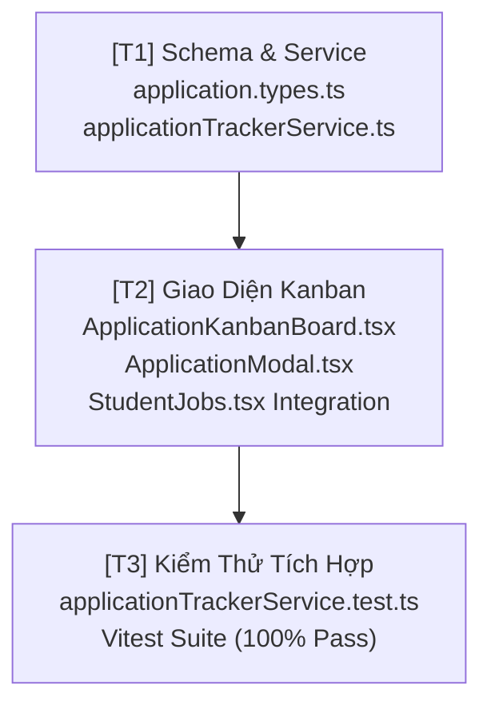

# Kế Hoạch Triển Khai: Bảng Kanban Theo Dõi Nộp Đơn & Tiến Trình Tuyển Dụng (Application Pipeline Tracker)

> **Mã kế hoạch:** `PLAN-20261104-APP-PIPELINE`  
> **Áp dụng chuẩn:** [ROLES_AND_GOVERNANCE_RULES.md](file:///C:/Users/ADMIN/Desktop/STUDY/docs/architecture/ROLES_AND_GOVERNANCE_RULES.md) (Chuỗi Baton T1 - T2 - T3)  
> **Chiến lược sản phẩm:** Single-Player Utility (100% tự chủ cho Ứng viên, loại bỏ hoàn toàn phụ thuộc vào Giảng viên duyệt hay HR bên thứ ba)  
> **Tài liệu tham chiếu:**  
> - Bối cảnh & Thuật ngữ: [`docs/CONTEXT.md`](file:///C:/Users/ADMIN/Desktop/STUDY/docs/CONTEXT.md)  
> - Quy chuẩn nâng cấp giao diện: [`profilehub/docs/product/updateui.md`](file:///C:/Users/ADMIN/Desktop/STUDY/profilehub/docs/product/updateui.md)  
> - Sổ tay tính năng mới: [`profilehub/docs/product/tinhnangmoi.md`](file:///C:/Users/ADMIN/Desktop/STUDY/profilehub/docs/product/tinhnangmoi.md)  
> - Phân tích context: `/speckit-analyze` (Loại bỏ cơ chế Verify giảng viên ảo, tập trung giá trị thực chiến cho Ứng viên)

---

## 🎯 Mục Tiêu Cốt Lõi (Goal)
Xây dựng **Bảng Kanban Theo Dõi Tiến Trình Tuyển Dụng (Application Pipeline Tracker)** dành riêng cho Ứng viên:
1. Cho phép ứng viên quản lý trực quan toàn bộ các công ty đã nộp đơn qua 5 chặng: `[Đã nộp]` $\to$ `[HR liên hệ]` $\to$ `[Bài Test]` $\to$ `[Phỏng Vấn]` $\to$ `[Nhận Offer / Thỏa Thuận]`.
2. Hỗ trợ cả 2 nguồn ứng tuyển: Nộp việc từ kho việc nội bộ ProfileHub (`StudentJobs.tsx`) HOẶC Tự ghi chú công ty nộp từ bên ngoài (TopCV, ITviec, LinkedIn, Referral...).
3. **Mỗi đơn ứng tuyển gắn chặt với 1 bản CV cụ thể:** 1-Click mở lại đúng bản CV đã gửi cho công ty đó (`CvQuickViewModal`) để ứng viên không bao giờ bị "lệch tủ" khi HR gọi điện thoại.
4. **Kết nối hệ sinh thái phỏng vấn:** 1-Click chuyển dữ liệu sang `AiMockInterviewModal` (Phỏng vấn thử sát đề bài công ty) và `ProjectDefenseModal` (Bảo vệ đồ án kỹ thuật).

---

## 🏛️ Kiến Trúc Kỹ Thuật & Quyết Định Thiết Kế (Technical Decisions)

### 1. Mô Hình Dữ Liệu Tự Chủ (Single-Player Data Architecture)
* Tạo kiểu dữ liệu `CandidateApplicationItem` và dịch vụ `applicationTrackerService.ts`.
* Lưu trữ kép thông minh (Dual-Storage Seam):
  - **Offline/Cục bộ:** Lưu an toàn trong `localStorage` theo `userId` (`profilehub_applications_${userId}`), có sẵn bộ mock data mẫu phong phú nếu là phiên mới.
  - **Đồng bộ sự kiện thời gian thực (Custom Event):** Phát sự kiện `storage` và `application_pipeline_updated` để tự động làm mới các widget trên Dashboard và trang Việc làm mà không cần tải lại trang.

### 2. Các Trạng Thái Vòng Đời Đơn Ứng Tuyển (Kanban Stages)
```
[1. applied]       ──► Nộp hồ sơ (Chờ HR xem xét)
[2. screening]     ──► HR phản hồi / Phỏng vấn sơ bộ qua điện thoại
[3. assessment]    ──► Làm bài test kỹ thuật / Take-home assignment
[4. interview]     ──► Phỏng vấn vòng kỹ thuật hoặc gặp Giám đốc
[5. offer]         ──► Nhận thư mời nhận việc (Offer letter)
[6. rejected]      ──► Trượt / Tạm dừng (Lưu trữ để rút kinh nghiệm)
```

### 3. Vị Trí Giao Diện & Điểm Chạm (UI Touchpoints)
* **Vị trí 1 (Trang Quản lý Việc làm & Tuyển dụng - `/student/jobs` hoặc tab chuyên biệt):** Tích hợp công tắc chuyển đổi: `[ 💼 Tìm việc làm ]` $\longleftrightarrow$ `[ 📊 Tiến trình nộp đơn (Kanban) ]`.
* **Vị trí 2 (Dashboard Sinh viên):** Thêm Mini-Kanban / Widget tiến độ ứng tuyển nổi bật, hiển thị tỷ lệ phản hồi (Response Rate) và cảnh báo các buổi phỏng vấn sắp diễn ra.
* **Hộp thoại Thêm/Sửa Đơn Nộp (`ApplicationModal.tsx`):** Cho phép nhập tên công ty, vị trí, mức lương kỳ vọng, link JD gốc, chọn bản CV liên kết trong kho CV, và chọn giai đoạn hiện tại.

---

## 📋 Phân Rã Kỹ Thuật (T1 - T2 - T3 Baton Chain)



---

### [T1] Khai Báo Schema Types & Dịch Vụ Theo Dõi Tuyển Dụng
- **Tệp tạo mới:**
  - `profilehub/src/types/application.types.ts`
  - `profilehub/src/services/applicationTrackerService.ts`
- **Nội dung thực hiện:**
  1. Khai báo Interface `CandidateApplicationItem`:
     ```typescript
     export type ApplicationStage = 'applied' | 'screening' | 'assessment' | 'interview' | 'offer' | 'rejected';

     export interface CandidateApplicationItem {
       id: string;
       userId: string;
       companyName: string;
       companyLogo?: string;
       roleTitle: string;
       salaryExpectation?: string;
       jobLocation?: string;
       applicationSource: 'profilehub' | 'topcv' | 'itviec' | 'linkedin' | 'referral' | 'other';
       linkedCvId?: string;
       linkedCvTitle?: string;
       stage: ApplicationStage;
       appliedDate: string; // ISO Date YYYY-MM-DD
       interviewDate?: string; // Optional YYYY-MM-DD HH:mm
       jobDescriptionUrl?: string;
       notes?: string;
       updatedAt: string;
     }
     ```
  2. Xây dựng `applicationTrackerService.ts`:
     - `getApplications(userId?: string): CandidateApplicationItem[]`
     - `createApplication(data: Omit<CandidateApplicationItem, 'id' | 'updatedAt'>): CandidateApplicationItem`
     - `updateStage(id: string, stage: ApplicationStage): boolean`
     - `updateApplication(id: string, patch: Partial<CandidateApplicationItem>): boolean`
     - `deleteApplication(id: string): boolean`
     - `getAnalytics(userId?: string): { total: number; active: number; interviewRate: number; offerRate: number }`

---

### [T2] Xây Dựng Component Giao Diện Kanban & Modal Quản Lý
- **Tệp tạo mới / tích hợp:**
  - `profilehub/src/components/student/ApplicationKanbanBoard.tsx`
  - `profilehub/src/components/student/AddApplicationModal.tsx`
  - Tích hợp vào `profilehub/src/pages/student/StudentJobs.tsx`
- **Nội dung thực hiện:**
  1. **Component `ApplicationKanbanBoard.tsx`:**
     - Thiết kế 5 cột Kanban hiện đại (Tailwind CSS, hỗ trợ cả Dark/Light mode).
     - Mỗi thẻ công ty (Application Card) hiển thị: Logo/Tên công ty, Vị trí tuyển dụng, Ngày nộp, Huy hiệu nguồn tuyển (`TopCV`, `LinkedIn`, `ProfileHub`), Badge bản CV gắn liền.
     - Các nút thao tác nhanh trên mỗi Card:
       - `[ 📄 Xem CV đã nộp ]`: Mở `CvQuickViewModal` xem đúng phiên bản đã gửi.
       - `[ 🎙️ Luyện phỏng vấn AI ]`: Mở `AiMockInterviewModal` điền sẵn tên công ty & vị trí.
       - `[ ⏭️ Chuyển trạng thái ]`: Nhanh chóng kéo/chuyển sang bước kế tiếp.
  2. **Modal `AddApplicationModal.tsx`:**
     - Form thêm đơn ứng tuyển tinh gọn (Tên công ty, vị trí, nguồn nộp, dropdown chọn CV trong kho, mức lương kỳ vọng, ghi chú).
  3. **Tích hợp vào `StudentJobs.tsx`:**
     - Bổ sung nút chuyển đổi tab: `[ 💼 Cơ Hội Việc Làm ]` và `[ 📋 Tiến Trình Ứng Tuyển Của Tôi (Badge: số lượng) ]`.
     - Khi ứng viên bấm "Nộp đơn" một công việc trên ProfileHub, tự động tạo ngay 1 thẻ trong Kanban ở cột `[applied]`.

---

### [T3] Viết Bộ Kiểm Thử Tự Động Toàn Diện
- **Tệp tạo mới:**
  - `profilehub/src/services/applicationTrackerService.test.ts`
- **Nội dung kiểm thử (AAA Pattern):**
  1. `TC-APP-01: Khởi tạo và lấy danh sách đơn nộp phân vùng theo userId chính xác`.
  2. `TC-APP-02: Thêm mới đơn ứng tuyển với bản CV gắn kết thành công`.
  3. `TC-APP-03: Chuyển đổi trạng thái (stage transition) từ applied -> interview -> offer mượt mà`.
  4. `TC-APP-04: Cập nhật thông tin ghi chú, lương và ngày giờ phỏng vấn`.
  5. `TC-APP-05: Tính toán chỉ số thống kê (Analytics) chính xác (Tỷ lệ phản hồi, số lời mời phỏng vấn)`.
  6. `TC-APP-06: Xóa đơn ứng tuyển và duy trì tính toàn vẹn dữ liệu`.

---

## 🔒 Tiêu Chuẩn Nghiệm Thu & Rào Chắn Chất Lượng (Quality Gate)
- [ ] TypeScript Strict Mode: `npx tsc --noEmit` đạt **0 lỗi**.
- [ ] Unit Tests: Toàn bộ test suite mới + 33 test suites cũ đều **PASS 100%** trên Vitest.
- [ ] Build Production: `npm run build` hoàn thành trong < 25s, không phát sinh cảnh báo đóng gói.
- [ ] Hoạt động mượt mà trên Mobile (< 360px), hỗ trợ đầy đủ Dark Theme.
