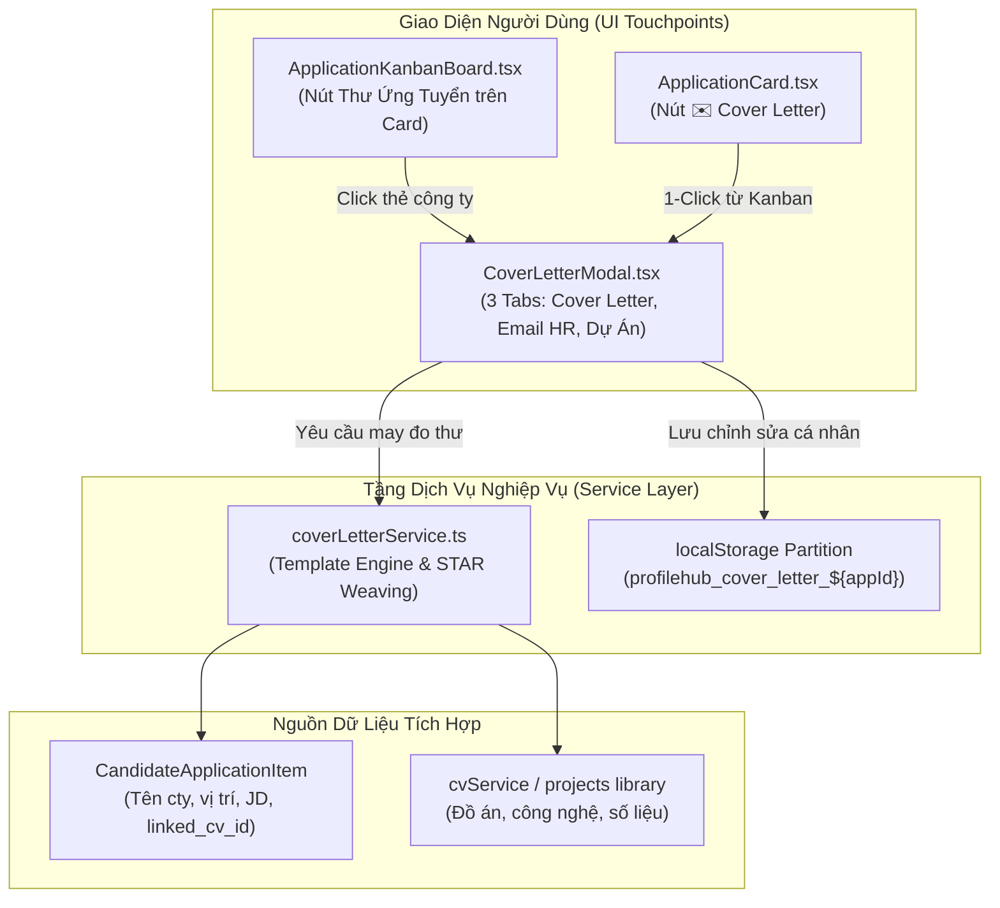

# Kế Hoạch Triển Khai: Bộ Hồ Sơ Ứng Tuyển Toàn Diện (Cover Letter & Outbound Email Generator)

> **Mã kế hoạch:** `PLAN-20261104-COVER-LETTER-EMAIL`  
> **Áp dụng chuẩn:** [ROLES_AND_GOVERNANCE_RULES.md](file:///C:/Users/ADMIN/Desktop/STUDY/docs/architecture/ROLES_AND_GOVERNANCE_RULES.md) (Chuỗi Baton PO Alex $\to$ BA Sarah $\to$ Dev Leo $\to$ QA Emma $\to$ DevOps Kevin)  
> **Chiến lược sản phẩm:** Giải quyết khoảng trống then chốt chặng cuối (The Last-Mile Application Problem) khi ứng viên nộp hồ sơ. 100% Single-Player Utility, Zero-Cost, chạy ngoại tuyến tức thì với Rule Engine và AI Synthesis.  
> **Tài liệu tham chiếu:**  
> - Bối cảnh & Nghiên cứu Phase 0: [`docs/superpowers/specs/2026-11-04-cover-letter-and-email-generator/research.md`](file:///C:/Users/ADMIN/Desktop/STUDY/docs/superpowers/specs/2026-11-04-cover-letter-and-email-generator/research.md)  
> - Mô hình dữ liệu: [`docs/superpowers/specs/2026-11-04-cover-letter-and-email-generator/data-model.md`](file:///C:/Users/ADMIN/Desktop/STUDY/docs/superpowers/specs/2026-11-04-cover-letter-and-email-generator/data-model.md)  
> - Hợp đồng interface: [`docs/superpowers/specs/2026-11-04-cover-letter-and-email-generator/contracts/cover-letter-api.md`](file:///C:/Users/ADMIN/Desktop/STUDY/docs/superpowers/specs/2026-11-04-cover-letter-and-email-generator/contracts/cover-letter-api.md)  
> - Hướng dẫn kiểm chứng: [`docs/superpowers/specs/2026-11-04-cover-letter-and-email-generator/quickstart.md`](file:///C:/Users/ADMIN/Desktop/STUDY/docs/superpowers/specs/2026-11-04-cover-letter-and-email-generator/quickstart.md)  

---

## 🏛️ GIAI ĐOẠN 1: THẨM ĐỊNH & PHÊ DUYỆT CỦA PRODUCT OWNER (PO ALEX)

### 1. Thẩm Định Trùng Lặp & Tính Kế Thừa (Deduplication Guard)
- **Đối chiếu mã nguồn hiện có:**
  - `applicationTrackerService.ts`: Quản lý danh sách công ty đã nộp đơn trên Kanban. *Chưa có công cụ sinh văn bản thư từ ứng tuyển.*
  - `applicationPitchService.ts`: Sinh kịch bản nói miệng (Elevator Pitch) cho phỏng vấn. *Không tạo thư A4 trang trọng hay email gửi HR.*
  - `cvService.ts`: Chứa đầy đủ dữ liệu đồ án, công nghệ và số liệu STAR của ứng viên.
- **Kết luận của PO:** Tính năng mới mang tính **kế thừa trực tiếp dữ liệu từ CV và Kanban**, lấp đầy bước cuối cùng giúp ứng viên biến bản CV thành một bộ hồ sơ nộp việc hoàn chỉnh. Đạt điều kiện phê duyệt triển khai độc lập.

### 2. Định Giá Trị Sản Phẩm (RICE Prioritization)
- **Reach (Độ tiếp cận):** 10/10 (100% ứng viên khi nộp hồ sơ đều cần thư ứng tuyển hoặc email giới thiệu gửi kèm CV).
- **Impact (Tác động):** 9/10 (Tăng vọt tỷ lệ phản hồi từ HR nhờ email chuyên nghiệp và Cover Letter dệt đúng số liệu đồ án).
- **Confidence (Độ tin cậy):** 10/10 (Cấu trúc thư 4 đoạn chuẩn quốc tế và mẫu email outbound đã được kiểm chứng trong ngành nhân sự công nghệ).
- **Effort (Công sức):** 3/10 (Tận dụng kho đồ án sẵn có trong CV và component modal Tailwind hiện có).
- $\mathbf{RICE\ Score} = \frac{10 \times 9 \times 10}{3} = \mathbf{300}$ $\longrightarrow$ **Ưu tiên Tối thượng (P1 - Top 1)**.

### 3. User Story (Chuẩn INVEST)
> **Là một** Ứng viên / Sinh viên IT chuẩn bị gửi hồ sơ ứng tuyển tới một công ty công nghệ,  
> **Tôi muốn** hệ thống tự động may đo một bức Thư ứng tuyển (Cover Letter) chuẩn 4 đoạn và Mẫu Email gửi HR hoàn chỉnh dựa trên đúng vị trí và đồ án tiêu biểu trong CV của tôi,  
> **Để** tôi có thể gửi đi ngay lập tức một bộ hồ sơ chuyên nghiệp, tạo ấn tượng vượt trội với nhà tuyển dụng mà không mất hàng giờ loay hoay viết lách.

### 4. Tiêu Chí Nghiệm Thu (Acceptance Criteria - BDD Format)
- **AC-01 (Tự động dệt đồ án & số liệu vào Cover Letter 4 đoạn):**
  - *Given:* Ứng viên chọn một công ty trong Kanban (VD: *Shopee - Frontend Engineer*) có gắn liền bản CV chứa đồ án React & Redis.
  - *When:* Ứng viên bấm nút `[✉️ Thư Ứng Tuyển]`.
  - *Then:* Hệ thống sinh ngay bức thư gồm 4 đoạn chuẩn mực (Mở đầu $\to$ Đồ án nổi bật kèm công nghệ & số liệu $\to$ Độ tương thích doanh nghiệp $\to$ Lời cảm ơn & CTA), không bịa đặt công nghệ.
- **AC-02 (Linh hoạt 3 phong cách & Chỉnh sửa trực tiếp):**
  - *Given:* Ứng viên muốn thay đổi phong cách văn phong cho phù hợp văn hóa công ty.
  - *When:* Chuyển đổi giữa 3 Tone: *Chuyên nghiệp (Corporate)*, *Khởi nghiệp (Startup)*, *Kỹ thuật (Tech Direct)*.
  - *Then:* Nội dung thư và tiêu đề cập nhật tương ứng; cho phép sửa trực tiếp và bấm lưu bản nháp vào `localStorage`.
- **AC-03 (Mẫu Email gửi kèm CV & 1-Click Copy / Xuất Markdown):**
  - *Given:* Ứng viên chuẩn bị mở Gmail/Outlook gửi hồ sơ.
  - *When:* Chuyển sang tab "Mẫu Email Gửi HR" hoặc bấm nút Tải Markdown.
  - *Then:* Hệ thống hiển thị sẵn Tiêu đề email chuẩn `[Ứng Tuyển] - [Vị Trí] - [Tên Sinh Viên]`, checklist file đính kèm, nút sao chép 1-click và nút tải file `.md`.

### 5. Xử Lý Các Kịch Bản Lỗi & Biên (Edge Cases)
- **Ứng viên chưa liên kết CV nào:** Tự động lấy đồ án nổi bật nhất từ kho Master Projects hoặc điền placeholder hướng dẫn rõ ràng.
- **Chế độ ngoại tuyến (Offline Mode):** Rule Template Engine hoạt động 100% cục bộ trên trình duyệt, không xoay chờ API AI.
- **Tên công ty hoặc vị trí quá dài:** Tự động cắt gọt thông minh trên tiêu đề email để không bị tràn màn hình mobile.

---

## 🛠️ GIAI ĐOẠN 2: THIẾT KẾ KỸ THUẬT & PHÂN RÃ (BA SARAH & TECH LEAD DAVID)

### 1. Kiến Trúc Luồng Dữ Liệu

### 2. Phân Rã Kỹ Thuật (Baton Chain T1 - T2 - T3)

#### 🔹 [T1] Khai Báo Schema Types & Xây Dựng Service Cốt Lõi
- **Tệp tạo mới:**
  - `profilehub/src/types/coverLetter.types.ts`: Định nghĩa `CoverLetterTone`, `CoverLetterDraft`, `GenerateCoverLetterInput`.
  - `profilehub/src/services/coverLetterService.ts`: Hiện thực thuật toán trích xuất dự án, sinh 4 đoạn thư, định dạng email gửi HR, lưu/đọc `localStorage` và xuất Markdown.
  - `profilehub/src/services/coverLetterService.test.ts`: Bộ kiểm thử Vitest toàn diện kiểm tra tính nhất quán câu chữ, không bịa công nghệ và lưu nháp an toàn.

#### 🔹 [T2] Xây Dựng Component Giao Diện & Tích Hợp Điểm Chạm
- **Tệp tạo mới:**
  - `profilehub/src/components/student/CoverLetterModal.tsx`:
    - Tab 1: **Thư Ứng Tuyển A4 (Formal Cover Letter)** với bộ chọn 3 Tone, ô soạn thảo WYSIWYG nhẹ, nút Tải Markdown & Copy.
    - Tab 2: **Mẫu Email Gửi HR (Outbound Email)** với Tiêu đề email chuẩn, Checklist đính kèm và nút 1-click Copy.
    - Tab 3: **Dự án trích xuất** hiển thị các minh chứng kỹ thuật đã được lồng vào thư.
- **Tệp tích hợp:**
  - `profilehub/src/components/student/ApplicationCard.tsx`: Bổ sung nút hành động `[✉️ Thư]` nổi bật mở `CoverLetterModal`.
  - `profilehub/src/components/student/AddApplicationModal.tsx`: Tùy chọn mở nhanh Cover Letter ngay sau khi lưu đơn mới.

#### 🔹 [T3] Kiểm Thử Hồi Quy & Đóng Gói Toàn Hệ Thống
- Chạy toàn bộ test suites Vitest (`npm run test`) đảm bảo 37 test files đạt 100% pass.
- Đóng gói Production bundle (`npm run build`) đạt 0 lỗi TypeScript Strict Mode.

---

## 📅 BẢNG TIẾN ĐỘ THI CÔNG
| Mã Task | Phân loại | Trách nhiệm | Tệp tác động | Trạng thái |
| :--- | :---: | :--- | :--- | :---: |
| **T1.1** | Setup | Dev Subagent | `src/types/coverLetter.types.ts` | Sẵn sàng |
| **T1.2** | Core | Dev Subagent | `src/services/coverLetterService.ts` | Sẵn sàng |
| **T1.3** | Test | QA Subagent | `src/services/coverLetterService.test.ts` | Sẵn sàng |
| **T2.1** | UI | Dev Subagent | `src/components/student/CoverLetterModal.tsx` | Sẵn sàng |
| **T2.2** | Integration | Dev Subagent | `src/components/student/ApplicationCard.tsx` | Sẵn sàng |
| **T2.3** | Integration | Dev Subagent | `src/components/student/AddApplicationModal.tsx` | Sẵn sàng |
| **T3.1** | Quality Gate | QA / CI/CD | `npm run test` & `npm run build` | Sẵn sàng |
