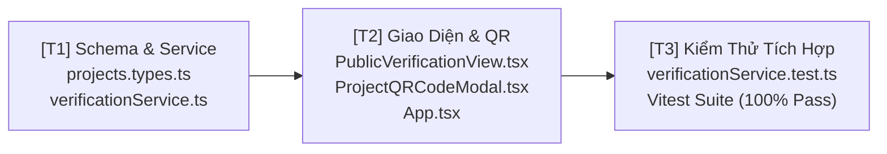

# Kế Hoạch Triển Khai: Cổng Tra Cứu Bảo Chứng Đồ Án Công Khai & QR Code (Public Verification Gateway)

> **Mã kế hoạch:** `PLAN-20261104-VERIFY-GATEWAY`  
> **Áp dụng chuẩn:** [ROLES_AND_GOVERNANCE_RULES.md](file:///C:/Users/ADMIN/Desktop/STUDY/docs/architecture/ROLES_AND_GOVERNANCE_RULES.md) (Chuỗi Baton T1 - T2 - T3)  
> **Tài liệu tham chiếu:**  
> - Đặc tả: [`docs/spec-verification-gateway-and-ai-recommender.md`](file:///C:/Users/ADMIN/Desktop/STUDY/docs/spec-verification-gateway-and-ai-recommender.md)  
> - Bối cảnh & Thuật ngữ: [`docs/CONTEXT.md`](file:///C:/Users/ADMIN/Desktop/STUDY/docs/CONTEXT.md)  
> - Sơ đồ hệ thống: [`profilehub/docs/architecture/SO_DO_KY_THUAT_VA_CHUC_NANG_HE_THONG.md`](file:///C:/Users/ADMIN/Desktop/STUDY/profilehub/docs/architecture/SO_DO_KY_THUAT_VA_CHUC_NANG_HE_THONG.md)  
> - Báo cáo phân tích: `speckit-analyze` (Phát hiện C1, C2, I1, I2, U1, A1)

---

## 🎯 Mục Tiêu (Goal)
Hoàn thiện mắt xích còn thiếu lớn nhất trong hệ sinh thái ProfileHub: **Cổng tra cứu bảo chứng đồ án công khai (`/verify/:code`)**. Cho phép nhà tuyển dụng và đối tác bên ngoài quét mã QR trên CV hoặc nhấp vào liên kết để xác thực ngay lập tức tính xác thực của đồ án, người bảo chứng (Giảng viên/Mentor), và mã băm toàn vẹn SHA-256 mà không cần đăng nhập tài khoản. Đồng thời kích hoạt cơ chế che giấu dữ liệu riêng tư (Zero Data Leak) bảo vệ thông tin sinh viên.

---

## 🏛️ Kiến Trúc Kỹ Thuật & Quyết Định Thiết Kế (Architecture & Decisions)

### 1. Phân Vùng Tuyến Đường Độc Lập (Isolated Public Route)
* Đăng ký `<Route path="/verify/:code" element={<PublicVerificationView />} />` trong `App.tsx` hoàn toàn **nằm ngoài** `<Route element={<MainLayout />}>`.
* **Lý do:** Tuyệt đối không để rò rỉ Sidebar, thanh điều hướng cá nhân của sinh viên hay các menu nội bộ ra giao diện công cộng của Nhà tuyển dụng.

### 2. Dịch Vụ Bảo Chứng & Thuật Toán Băm SHA-256 (`verificationService.ts`)
* Tạo module dịch vụ thuần TypeScript `src/services/verificationService.ts`.
* Công thức sinh chuỗi băm bất biến:
  $$\text{Verification Hash} = \text{SHA-256}(\text{projectId} + "|" + \text{studentId} + "|" + \text{teacherId} + "|" + \text{verifiedAt})$$
* Hỗ trợ giải thuật băm tương thích kép: Sử dụng Web Crypto API (`crypto.subtle.digest`) trên môi trường Trình duyệt hiện đại và Node.js crypto fallback khi chạy Vitest Runner.

### 3. Vùng Đệm Riêng Tư (Privacy Boundary Data Contract)
* Dữ liệu trả về cho trang công khai tuân thủ nghiêm ngặt giao ước `PublicVerifiedProjectRecord`:
  * ✅ **Công khai:** Họ tên sinh viên, Trường / Khoa, Tên đồ án, Tóm tắt kỹ thuật, Tech Stack, Họ tên & Học vị Giảng viên duyệt, Ngày giờ xác thực, Mã băm SHA-256, Bộ 4 link tài nguyên (`demo_url`, `github_url`, `figma_url`, `doc_url`).
  * ❌ **Tuyệt đối ẩn (Private):** Điểm trung bình GPA, Số điện thoại cá nhân, Địa chỉ Email riêng, và các Ghi chú bẫy đồ án / Điểm mù phỏng vấn.

### 4. Đồng Bộ Mã QR (`ProjectQRCodeModal.tsx`)
* Thay thế link fallback tạm thời bằng URL bảo chứng tiêu chuẩn:
  $$\text{URL} = \text{baseUrl} + "/verify/" + \text{project.verification\_code}$$
* Tự động hiển thị huy hiệu Verified Shield 🛡️ và cung cấp nút tải ảnh PNG chất lượng cao để chèn vào CV A4.

---

## 📋 Phân Rã Công Việc Kỹ Thuật (T1 - T2 - T3 Baton Breakdown)



---

### [T1] Khai Báo Schema Types, Contract & Verification Service
- **Tệp chỉnh sửa/tạo mới:**
  - `profilehub/src/types/projects.types.ts`
  - `profilehub/src/services/verificationService.ts`
- **Chi tiết thực hiện:**
  1. Định nghĩa interface `PublicVerifiedProjectRecord`:
     ```typescript
     export interface PublicVerifiedProjectRecord {
       verificationCode: string;
       verificationHash: string;
       verifiedAt: string;
       project: {
         id: string;
         title: string;
         projectType: string;
         description: string;
         tags: string[];
         demoUrl?: string;
         githubUrl?: string;
         figmaUrl?: string;
         docUrl?: string;
       };
       student: {
         name: string;
         university: string;
         faculty?: string;
         avatarUrl?: string;
       };
       instructor: {
         name: string;
         title: string;
         department?: string;
       };
       isValid: boolean;
     }
     ```
  2. Xây dựng các hàm cốt lõi trong `verificationService.ts`:
     - `computeVerificationHash(payload: { projectId: string; studentId: string; teacherId: string; verifiedAt: string }): Promise<string>`
     - `getVerifiedProjectByCode(code: string): Promise<PublicVerifiedProjectRecord | null>`
     - `generateVerificationCode(): string` (Sinh mã định dạng `PH-VER-XXXXXX` chuẩn Base62)

---

### [T2] Xây Dựng Giao Diện Tra Cứu Công Khai & Đồng Bộ QR Code
- **Tệp chỉnh sửa/tạo mới:**
  - `profilehub/src/pages/public/PublicVerificationView.tsx`
  - `profilehub/src/components/student/ProjectQRCodeModal.tsx`
  - `profilehub/src/App.tsx`
- **Chi tiết thực hiện:**
  1. **Tạo trang `PublicVerificationView.tsx`:**
     - Thiết kế giao diện phong cách Certificate / Trust Badge cao cấp (nền Slate-950 tối ưu tương phản hoặc Card chứng thực sang trọng).
     - Hiển thị dấu mộc số: *"Đã bảo chứng bởi Giảng viên đại học - ProfileHub Verified Proof"*.
     - Hiển thị bảng tra cứu mã băm SHA-256 kèm nút 1-click sao chép Hash.
     - Hiển thị nút trải nghiệm trực tiếp: Live Demo, GitHub Repo Tree, Tài liệu Spec.
     - Xử lý trạng thái khi mã không hợp lệ hoặc đồ án chưa được duyệt: Màn hình 404 thân thiện kèm hướng dẫn quay về trang chủ.
  2. **Cập nhật `App.tsx`:**
     - Đăng ký tuyến đường công khai: `<Route path="/verify/:code" element={<PublicVerificationView />} />`.
  3. **Đồng bộ hóa `ProjectQRCodeModal.tsx`:**
     - Cập nhật URL trỏ chính xác về `${baseUrl}/verify/${project.verification_code || 'PH-VER-SAMPLE'}`.
     - Giữ nguyên tính năng tải ảnh PNG và sao chép liên kết trực tiếp.

---

### [T3] Viết Bộ Kiểm Thử Tự Động & Đảm Bảo An Toàn Dữ Liệu
- **Tệp tạo mới:**
  - `profilehub/src/services/verificationService.test.ts`
- **Chi tiết thực hiện:**
  1. `TC-VER-01: Tính toán mã băm SHA-256 đồng nhất và có thể kiểm chứng lại`.
  2. `TC-VER-02: Tra cứu thành công đồ án hợp lệ với đầy đủ bằng chứng và thông tin giảng viên`.
  3. `TC-VER-03: Chốt chặn bảo mật - Dữ liệu trả về tuyệt đối KHÔNG chứa GPA, số điện thoại hoặc email cá nhân của sinh viên`.
  4. `TC-VER-04: Xử lý an toàn khi truyền mã rỗng, mã giả mạo hoặc đồ án chưa qua phê duyệt`.
  5. `TC-VER-05: Kiểm tra định dạng mã sinh tự động PH-VER-XXXXXX`.

---

## 🔒 Kiểm Soát Chất Lượng & Rào Chắn Tiêu Chuẩn (Quality Gate)
- [ ] **TypeScript Check:** Chạy `npx tsc --noEmit` đạt 0 lỗi, tuân thủ TypeScript Strict Mode.
- [ ] **Test Coverage:** Chạy `npm run test` (Vitest) toàn bộ 34 test suites (129+ tests) đạt **PASS 100%**.
- [ ] **Build Validation:** Chạy `npm run build` hoàn thành bundle production không phát sinh lỗi đóng gói Vite.
- [ ] **UX Compliance:** Không chứa bất kỳ thanh cuộn ngang ngoài ý muốn (Zero horizontal overflow) trên màn hình di động (< 360px).
