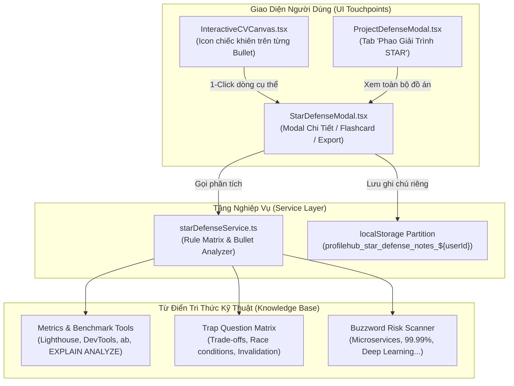

# Kế Hoạch Triển Khai: STAR Defense Cheat-Sheet & Metric Justification (Phao Cứu Sinh Giải Trình Số Liệu Phỏng Vấn)

> **Mã kế hoạch:** `PLAN-20261104-STAR-DEFENSE`  
> **Áp dụng chuẩn:** [ROLES_AND_GOVERNANCE_RULES.md](file:///C:/Users/ADMIN/Desktop/STUDY/docs/architecture/ROLES_AND_GOVERNANCE_RULES.md) (Chuỗi Baton PO Alex $\to$ BA Sarah $\to$ Dev $\to$ Tester)  
> **Chiến lược sản phẩm:** Giải quyết góc khuất tâm lý GK-01 (Hội chứng kẻ giả mạo & nỗi sợ bị Tech Lead vặn số liệu STAR trên CV). 100% Single-Player Utility, Zero-Cost, chạy ngoại tuyến tức thì.  
> **Tài liệu tham chiếu:**  
> - Bối cảnh & Nghiên cứu Phase 0: [`docs/superpowers/specs/2026-11-04-star-defense-cheat-sheet/research.md`](file:///C:/Users/ADMIN/Desktop/STUDY/docs/superpowers/specs/2026-11-04-star-defense-cheat-sheet/research.md)  
> - Mô hình dữ liệu: [`docs/superpowers/specs/2026-11-04-star-defense-cheat-sheet/data-model.md`](file:///C:/Users/ADMIN/Desktop/STUDY/docs/superpowers/specs/2026-11-04-star-defense-cheat-sheet/data-model.md)  
> - Hợp đồng interface: [`docs/superpowers/specs/2026-11-04-star-defense-cheat-sheet/contracts/star-defense-api.md`](file:///C:/Users/ADMIN/Desktop/STUDY/docs/superpowers/specs/2026-11-04-star-defense-cheat-sheet/contracts/star-defense-api.md)  
> - Hướng dẫn kiểm chứng: [`docs/superpowers/specs/2026-11-04-star-defense-cheat-sheet/quickstart.md`](file:///C:/Users/ADMIN/Desktop/STUDY/docs/superpowers/specs/2026-11-04-star-defense-cheat-sheet/quickstart.md)  

---

## 🏛️ GIAI ĐOẠN 1: THẨM ĐỊNH & PHÊ DUYỆT CỦA PRODUCT OWNER (PO ALEX)

### 1. Thẩm Định Trùng Lặp & Tính Kế Thừa (Deduplication Guard)
- **Đối chiếu mã nguồn hiện có:**
  - `starBulletService.ts`: Chuyên tái cấu trúc câu sang dạng STAR và chống bịa công nghệ (Anti-Hallucination). *Không cung cấp cơ sở số liệu hay câu hỏi bẫy chi tiết theo từng dòng.*
  - `starDiagnosticService.ts`: Chẩn đoán độ chuẩn STAR, điểm số câu chữ và khơi gợi câu hỏi (Elicitation). *Không cung cấp kịch bản trả lời mẫu 30s giải trình số liệu.*
  - `projectDefenseService.ts`: Cung cấp câu hỏi bẫy ở tầm vĩ mô của **toàn bộ dự án** (Project-level tech stack). *Chưa đào sâu vào **từng gạch đầu dòng cụ thể (bullet-level metrics)** khi bị người phỏng vấn chỉ tay vào số %.*
- **Kết luận của PO:** Tính năng mới mang tính **kế thừa và lấp đầy khoảng trống then chốt** giữa viết CV và đi phỏng vấn thực tế. Đạt điều kiện phê duyệt triển khai độc lập và liên kết bổ trợ chặt chẽ với `projectDefenseService` và `InteractiveCVCanvas`.

### 2. Định Giá Trị Sản Phẩm (RICE Prioritization)
- **Reach (Độ tiếp cận):** 10/10 (100% ứng viên có số liệu định lượng trên CV đều cần bảo vệ số liệu của mình).
- **Impact (Tác động):** 9/10 (Chấm dứt cảm giác run sợ, ấp úng, "kẻ giả mạo" khi bị Tech Lead hỏi khó).
- **Confidence (Độ tin cậy):** 10/10 (Bộ câu hỏi bẫy kỹ thuật và công cụ đo đạc thực tế tuân theo tiêu chuẩn kỹ thuật chuẩn mực của ngành phần mềm).
- **Effort (Công sức):** 4/10 (Tận dụng kiến trúc client-side sẵn có và component modal modal Tailwind hiện có).
- $\mathbf{RICE\ Score} = \frac{10 \times 9 \times 10}{4} = \mathbf{225}$ $\longrightarrow$ **Ưu tiên Tối thượng (P1)**.

### 3. User Story (Chuẩn INVEST)
> **Là một** Ứng viên / Sinh viên IT chuẩn bị bước vào vòng phỏng vấn kỹ thuật,  
> **Tôi muốn** có một bảng "Phao cứu sinh" phân tích từng dòng số liệu trong CV để biết rõ công cụ đo đạc, các câu hỏi bẫy thường gặp và kịch bản trả lời mẫu 30 giây,  
> **Để** tôi tự tin giải trình mạch lạc, không sợ bị đánh giá là chém gió hoặc giả mạo số liệu trước các Tech Lead khó tính.

### 4. Tiêu Chí Nghiệm Thu (Acceptance Criteria - BDD Format)
- **AC-01 (Phân tích cơ sở số liệu & câu hỏi bẫy):**
  - *Given:* Ứng viên có một câu mô tả chứa số liệu (VD: *"Tối ưu hóa thời gian tải trang giảm 35% bằng lazy loading"*).
  - *When:* Ứng viên bấm vào icon chiếc khiên `[🛡️ Phao]` trên canvas CV hoặc trong modal đồ án.
  - *Then:* Hệ thống hiển thị ngay: Công cụ đo (Chrome DevTools / Lighthouse), số liệu Trước & Sau (Before & After), ít nhất 2 câu hỏi bẫy xoáy kỹ thuật và kịch bản trả lời mẫu 30s chuẩn chỉnh.
- **AC-02 (Cảnh báo từ ngữ nhạy cảm & đề xuất thay thế):**
  - *Given:* Câu mô tả chứa buzzword nhạy cảm (VD: "Microservices", "99.99% Uptime", "AI-powered").
  - *When:* Phân tích phao cứu sinh được kích hoạt.
  - *Then:* Hệ thống gắn nhãn cảnh báo rủi ro màu cam/đỏ và đưa ra cụm từ thay thế an toàn hơn cho sinh viên.
- **AC-03 (Chế độ Flashcard ôn luyện & Xuất Markdown):**
  - *Given:* Ứng viên đang chuẩn bị phỏng vấn trong 15 phút tới.
  - *When:* Ứng viên chuyển sang chế độ Flashcard hoặc bấm nút "Xuất Markdown".
  - *Then:* Ứng viên có thể lật từng thẻ câu hỏi - câu trả lời để nhẩm tập dượt, hoặc sao chép toàn bộ nội dung sang clipboard chỉ bằng 1 cú click.

### 5. Xử Lý Các Kịch Bản Lỗi & Biên (Edge Cases)
- **Câu mô tả không có số liệu định lượng:** Vẫn phân tích sâu theo công nghệ phát hiện được (React, Node, SQL...), cung cấp câu hỏi bẫy về trade-off và hướng dẫn cách đo đạc bổ sung số liệu vào câu.
- **Không có kết nối mạng (Offline Mode):** Hoạt động 100% mượt mà nhờ Rule Engine cục bộ mà không báo lỗi hay xoay tròn chờ API.
- **Đồ án chưa có gạch đầu dòng nào:** Cung cấp thông báo hướng dẫn và nút tạo câu mẫu nhanh.

---

## 🛠️ GIAI ĐOẠN 2: THIẾT KẾ KỸ THUẬT & PHÂN RÃ (BA SARAH & TECH LEAD DAVID)

### 1. Kiến Trúc Luồng Dữ Liệu

### 2. Phân Rã Kỹ Thuật (Baton Chain T1 - T2 - T3)

#### 🔹 [T1] Khai Báo Schema Types & Xây Dựng Service Cốt Lõi
- **Tệp tạo mới:**
  - `profilehub/src/types/starDefense.types.ts`: Định nghĩa `MetricBasisInfo`, `TrapQuestionItem`, `RedFlagWarning`, `StarDefenseItem`, `ProjectDefenseOverview`.
  - `profilehub/src/services/starDefenseService.ts`: Triển khai phân tích ngữ nghĩa, quét số liệu, nhận diện công nghệ, tra cứu ma trận câu hỏi bẫy, tạo kịch bản 30s và xuất Markdown.
  - `profilehub/src/services/starDefenseService.test.ts`: Bộ unit test Vitest toàn diện kiểm thử phát hiện số liệu, bẫy kỹ thuật và lưu ghi chú.

#### 🔹 [T2] Xây Dựng Component Giao Diện & Tích Hợp Điểm Chạm
- **Tệp tạo mới:**
  - `profilehub/src/components/cv/StarDefenseModal.tsx`:
    - Tab 1: **Phân tích giải trình chi tiết** (Công cụ đo, Before/After, 3 câu hỏi bẫy, kịch bản 30s).
    - Tab 2: **Chế độ Lật Thẻ Ôn Luyện (Flashcard Mode)** để luyện tập phản xạ nhanh.
    - Tab 3: **Ghi chú cá nhân & Xuất bản** (Lưu vào localStorage, nút copy Markdown).
- **Tệp tích hợp:**
  - `profilehub/src/components/cv/InteractiveCVCanvas.tsx`: Thêm nút icon `[🛡️ Phao]` tinh tế ngay cạnh mỗi gạch đầu dòng trong phần Project / Experience để mở `StarDefenseModal`.
  - `profilehub/src/components/cv/ProjectDefenseModal.tsx`: Thêm tab chuyên sâu **"🛡️ Phao Giải Trình STAR"** cho phép duyệt toàn bộ các bullets của đồ án hiện tại.

#### 🔹 [T3] Kiểm Thử Hồi Quy & Xác Minh Hệ Thống
- Chạy toàn bộ test suites Vitest (`npm run test`).
- Kiểm tra tính tương thích TypeScript Strict Mode (`npx tsc --noEmit` & `npm run build`).
- Xác minh không phát sinh bất kỳ lỗi bundle hay giao diện nào.

---

## 📅 BẢNG TIẾN ĐỘ THI CÔNG
| Mã Task | Trách nhiệm | Tệp tác động | Trạng thái |
| :--- | :--- | :--- | :--- |
| **T1.1** | Dev Subagent | `src/types/starDefense.types.ts` | Sẵn sàng |
| **T1.2** | Dev Subagent | `src/services/starDefenseService.ts` | Sẵn sàng |
| **T1.3** | Tester Subagent | `src/services/starDefenseService.test.ts` | Sẵn sàng |
| **T2.1** | Dev Subagent | `src/components/cv/StarDefenseModal.tsx` | Sẵn sàng |
| **T2.2** | Dev Subagent | `src/components/cv/InteractiveCVCanvas.tsx` | Sẵn sàng |
| **T2.3** | Dev Subagent | `src/components/cv/ProjectDefenseModal.tsx` | Sẵn sàng |
| **T3.1** | QA / CI/CD | `npm run test` & `npm run build` | Sẵn sàng |
