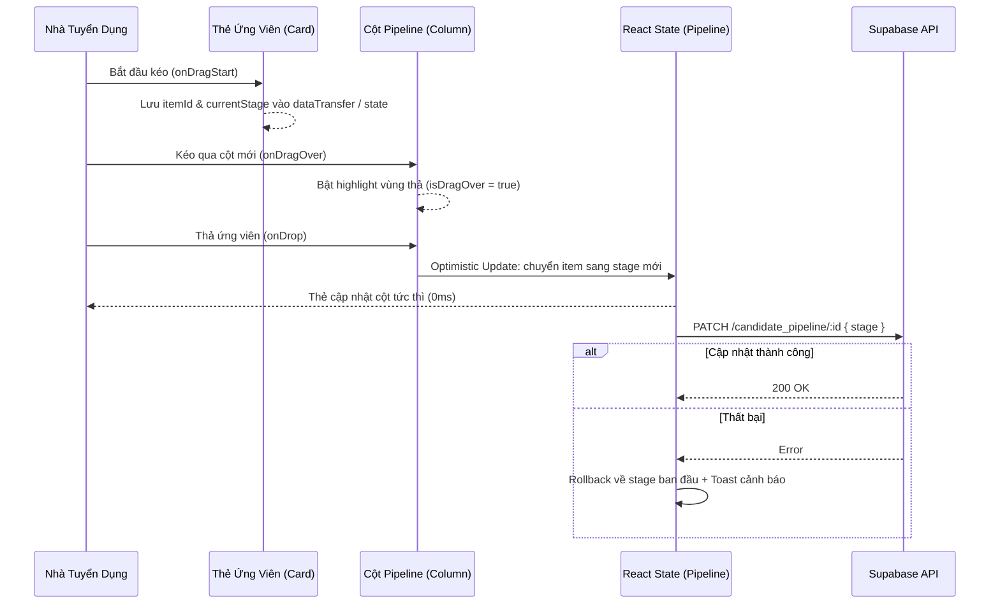

# Kế Hoạch Triển Khai: Tính Năng Kéo Thả (Drag & Drop) & Đồng Bộ Pipeline Tuyển Dụng

> **Mã kế hoạch:** `PLAN-20261105-PIPELINE-DRAG-AND-DROP`  
> **Áp dụng chuẩn:** [ROLES_AND_GOVERNANCE_RULES.md](file:///C:/Users/ADMIN/Desktop/STUDY/docs/architecture/ROLES_AND_GOVERNANCE_RULES.md) (Chuỗi Baton T1 - T2 - T3)  
> **Nhật ký dự án:** Thứ 5 (05/11/2026) — Nâng cấp trải nghiệm Kanban kéo thả trực quan cho Nhà tuyển dụng  
> **Nhánh Git:** `profilehub_v1`  
> **Mục tiêu:** Thay thế thao tác chọn dropdown thủ công bằng trải nghiệm Kéo Thả (HTML5 Native Drag & Drop Zero-Dependency), phản hồi tức thì (Optimistic UI) và đồng bộ Supabase Cloud an toàn.

---

## 🎯 Mục Tiêu Cốt Lõi (Core Goals)

1. **Trải nghiệm Kéo Thả Trực Quan (Zero-Dependency Drag & Drop):**
   - Sử dụng chuẩn HTML5 Drag and Drop API native (`onDragStart`, `onDragOver`, `onDragLeave`, `onDrop`, `onDragEnd`), không cần cài thêm thư viện nặng (`react-beautiful-dnd` hay `dnd-kit`) gây phình to bundle.
   - Hiệu ứng visual cao cấp: Thẻ đang kéo mờ 40% (`opacity-40 scale-95`), viền chuyển động. Cột đích hover hiển thị vùng thả nổi bật (`border-2 border-dashed border-blue-400 bg-blue-50/60`).

2. **Cập Nhật Lạc Quan (Optimistic UI) & Đồng Bộ Đa Tầng:**
   - Phản hồi vị trí thẻ ứng viên ngay lập tức (0ms delay).
   - Tự động đồng bộ vào Local Storage (`saveSharedPipeline`).
   - Gọi Supabase API ngầm cập nhật bảng `candidate_pipeline`. Nếu gặp sự cố mạng, tự động rollback vị trí cũ và hiển thị toast thông báo.

3. **Kích Hoạt Tự Động Hành Động Theo Stage:**
   - Kéo vào cột `interview` (Phỏng vấn) $\to$ Tự động mở Modal Hẹn Lịch Phỏng Vấn (`scheduleItem`) với thông tin ứng viên đã nạp sẵn.
   - Kéo vào cột `hired` (Tuyển dụng) $\to$ Hiển thị lời chúc mừng tuyển dụng thành công.

4. **Trợ năng (Accessibility) & Thiết bị di động:**
   - Giữ lại nút chuyển stage nhanh bằng phím tắt / dropdown nhỏ gọn để người dùng mobile hoặc screen-reader vẫn thao tác thuận tiện 100%.

---

## 🏛️ Kiến Trúc Kỹ Thuật (Architecture & Technical Decisions)

### 1. Luồng Xử Lý Sự Kiện Kéo Thả (Drag & Drop Lifecycle)

---

## 📋 Phân Rã Kỹ Thuật (T1 - T2 - T3 Baton Chain)

* **[T1] Logic Hook / Utility:** Xây dựng hook `usePipelineDragDrop` và hàm xử lý chuyển đổi stage an toàn (`pipelineDragDrop.ts`).
* **[T2] Giao Diện Kanban:** Cập nhật `CandidatePipeline.tsx` với các thuộc tính `draggable`, drop zones, animations, và auto-trigger modal hẹn lịch phỏng vấn.
* **[T3] Kiểm Thử Tự Động:** Viết Unit Test cho logic di chuyển stage và rollback (`pipelineDragDrop.test.ts`), chạy toàn bộ test suite đảm bảo 100% pass.
