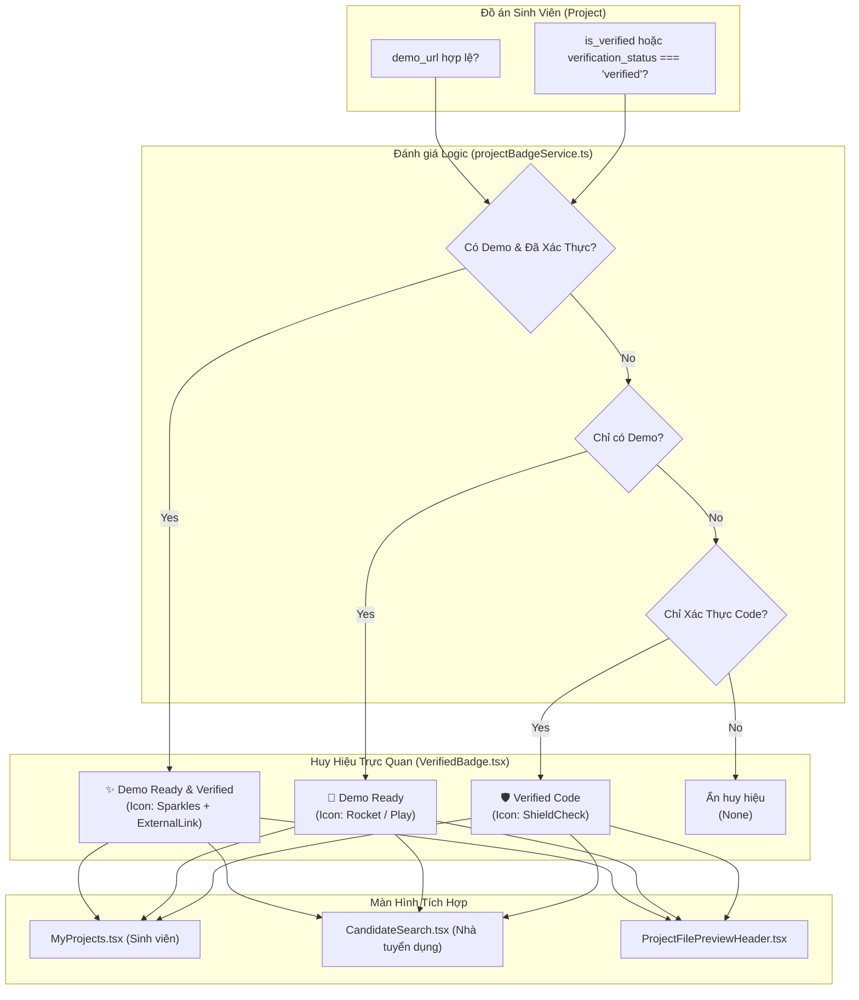

# Kế Hoạch Triển Khai: Phân Cấp Huy Hiệu Đồ Án Thông Minh ("Demo Ready" & "Verified Codebase")
> **Mã kế hoạch:** `PLAN-20261105-DEMO-READY-PROJECT-BADGES`  
> **Áp dụng chuẩn:** [ROLES_AND_GOVERNANCE_RULES.md](file:///C:/Users/ADMIN/Desktop/STUDY/docs/architecture/ROLES_AND_GOVERNANCE_RULES.md) (Chuỗi Baton T1 - T2 - T3)  
> **Tài liệu tham chiếu:**  
> - Báo cáo nghiên cứu giải pháp: [`docs/superpowers/specs/2026-11-05-demo-ready-project-badges/research.md`](file:///C:/Users/ADMIN/Desktop/STUDY/docs/superpowers/specs/2026-11-05-demo-ready-project-badges/research.md)  
> - Mô hình dữ liệu & Phân loại: [`docs/superpowers/specs/2026-11-05-demo-ready-project-badges/data-model.md`](file:///C:/Users/ADMIN/Desktop/STUDY/docs/superpowers/specs/2026-11-05-demo-ready-project-badges/data-model.md)  
> - Giao ước kỹ thuật API & UI: [`docs/superpowers/specs/2026-11-05-demo-ready-project-badges/contracts/project-badges-contract.md`](file:///C:/Users/ADMIN/Desktop/STUDY/docs/superpowers/specs/2026-11-05-demo-ready-project-badges/contracts/project-badges-contract.md)  
> - Hướng dẫn nghiệm thu nhanh: [`docs/superpowers/specs/2026-11-05-demo-ready-project-badges/quickstart.md`](file:///C:/Users/ADMIN/Desktop/STUDY/docs/superpowers/specs/2026-11-05-demo-ready-project-badges/quickstart.md)  
> **Nhánh Git:** `profilehub_v1`  
> **Mục tiêu:** Chuyển đổi từ nhãn đơn "Verified 🛡️" sang Hệ Thống Phân Cấp Huy Hiệu Đồ Án Thông Minh (Smart Dual-Badges): Phân biệt rõ giữa sản phẩm có bản chạy thử trực tiếp (`🚀 Demo Ready`) và sản phẩm có chứng chỉ mã nguồn bảo mật (`🛡️ Verified Code`), tối ưu hóa khả năng tương tác 1-click cho Nhà tuyển dụng và khích lệ sinh viên lập trình thực chiến.

---

## 🎯 Mục Tiêu Cốt Lõi (Core Goals)

1. **Phân Cấp Huy Hiệu Đồ Án Trực Quan & Hành Động Hóa (Actionable Smart Badges):**
   - **`🚀 Demo Ready`**: Dành cho đồ án có link chạy thật (`demo_url` hợp lệ như Vercel, Netlify, Render, web/mobile app). Cho phép Nhà tuyển dụng click trực tiếp để mở sản phẩm dùng thử ngay trong tab mới mà không cần mở modal phức tạp.
   - **`🛡️ Verified Code`**: Dành cho đồ án đã được bảo chứng mã nguồn (chữ ký số HMAC-SHA256, Mentor/Giảng viên phê duyệt) nhưng không có giao diện web (Backend API, CLI Tool, Dự án NDA doanh nghiệp).
   - **`✨ Demo Ready & Verified` (Full)**: Đồ án xuất sắc đạt trọn vẹn cả 2 tiêu chí (vừa có code bảo chứng, vừa có bản chạy live).
2. **Nâng Cấp Component Huy Hiệu Đa Biến Thể (`VerifiedBadge.tsx`):**
   - Hỗ trợ đầy đủ các props: `variant` (`'full' | 'demo-ready' | 'verified' | 'none'`), `demoUrl`, `size` (`'sm' | 'md' | 'lg'`), `interactive` (hỗ trợ hover/click, ngăn nổi bọt sự kiện, hỗ trợ bàn phím WCAG a11y).
   - Tương thích ngược 100% với các vị trí gọi cũ (nếu không truyền `variant`, component tự suy luận an toàn từ props hoặc render fallback mặc định).
3. **Core Service Đánh Giá Huy Hiệu & Thống Kê (`projectBadgeService.ts`):**
   - `getProjectBadgeVariant(project)`: Hàm thuần túy (pure function) đánh giá đồ án thành variant phù hợp với 0ms latency.
   - `countCandidateProjectBadges(projects)`: Đếm chi tiết số lượng `demoReadyCount`, `verifiedCount`, `fullCount` của ứng viên.
4. **Nâng Cấp Giao Diện Quản Lý & Tìm Kiếm Ứng Viên:**
   - **Sinh viên (`MyProjects.tsx`):** Thẻ đồ án hiển thị huy hiệu động. Sinh viên có thể click vào `Demo Ready` để kiểm tra nhanh link demo của mình.
   - **Nhà tuyển dụng (`CandidateSearch.tsx`):**
     * Thẻ ứng viên hiển thị song song hai chip: `🚀 X Demo Ready` và `🛡️ Y Verified`.
     * Thanh công cụ thêm bộ lọc nhanh: `[ 🚀 Có Demo Chạy Thật ]` bên cạnh `[ 🛡️ Có Đồ Án Verified ]`.
     * Danh sách đồ án tiêu biểu trong thẻ ứng viên hiển thị badge tương ứng cho từng đồ án.
   - **Xem chi tiết đồ án (`ProjectFilePreviewHeader.tsx`):** Hiển thị đúng biến thể của đồ án đang xem.

---

## 🏛️ Kiến Trúc Luồng Nghiệp Vụ (Architecture Flow)

---

## 📋 Phân Rã Công Việc Kỹ Thuật (Baton Chain Breakdown: T1 - T2 - T3)

### 🔹 Giai Đoạn T1: Nền Tảng Kiểu Dữ Liệu & Core Service Engine
*Trách nhiệm: Backend & Core Engineer*
* **T1.1:** Tạo file [`src/types/projectBadge.types.ts`](file:///C:/Users/ADMIN/Desktop/STUDY/profilehub/src/types/projectBadge.types.ts):
  - Định nghĩa `ProjectBadgeVariant`: `'full' | 'demo-ready' | 'verified' | 'none'`.
  - Định nghĩa `BadgeVisualConfig`: `label`, `tooltip`, `bgColor`, `textColor`, `borderColor`, `iconType`.
  - Định nghĩa `VerifiedBadgeProps` và `ProjectBadgeEvaluationInput`.
  - Định nghĩa `CandidateBadgeSummary`: `{ demoReadyCount: number; verifiedCount: number; fullCount: number; totalCount: number }`.
* **T1.2:** Xây dựng core service [`src/services/projectBadgeService.ts`](file:///C:/Users/ADMIN/Desktop/STUDY/profilehub/src/services/projectBadgeService.ts):
  - `getProjectBadgeVariant(project?: ProjectBadgeEvaluationInput): ProjectBadgeVariant`: Xử lý an toàn các trường hợp link demo rỗng, khoảng trắng, `'#'`, null/undefined.
  - `getBadgeVisualConfig(variant: ProjectBadgeVariant): BadgeVisualConfig | null`: Cung cấp cấu hình bảng màu, icon, tooltip chuẩn hóa.
  - `countCandidateProjectBadges(projects?: ProjectBadgeEvaluationInput[]): CandidateBadgeSummary`: Tính toán tổng số lượng từng loại huy hiệu của ứng viên.
* **T1.3:** Xây dựng bộ kiểm thử đơn vị [`src/services/projectBadgeService.test.ts`](file:///C:/Users/ADMIN/Desktop/STUDY/profilehub/src/services/projectBadgeService.test.ts):
  - 12+ kịch bản kiểm thử:
    1. Đồ án có link demo hợp lệ + verified = `full`.
    2. Đồ án chỉ có link demo = `demo-ready`.
    3. Đồ án chỉ có verified = `verified`.
    4. Đồ án không có link demo và không verified = `none`.
    5. Link demo là `'#'` hoặc chuỗi rỗng = coi như không có demo.
    6. Input rỗng, undefined, hoặc null = xử lý an toàn không quăng lỗi.
    7. Hàm đếm `countCandidateProjectBadges` thống kê chính xác các tổ hợp đồ án.

---

### 🔹 Giai Đoạn T2: Nâng Cấp Component & Tích Hợp UI Phản Ứng
*Trách nhiệm: Frontend Engineer & UI/UX*
* **T2.1: Nâng cấp Component [`src/components/common/VerifiedBadge.tsx`](file:///C:/Users/ADMIN/Desktop/STUDY/profilehub/src/components/common/VerifiedBadge.tsx):**
  - Hỗ trợ các props mới: `variant`, `demoUrl`, `interactive`, `size`, `className`.
  - Hiển thị icon động: `Sparkles` cho `'full'`, `Rocket` cho `'demo-ready'`, `ShieldCheck` cho `'verified'`.
  - Thiết kế bảng màu tương phản cao, hiện đại:
    * `full`: Nền ngọc lục bảo nhạt (`#ecfdf5`), chữ xanh đậm (`#065f46`), viền ngọc lục bảo (`#6ee7b7`), kèm icon `ExternalLink` nhỏ khi hover.
    * `demo-ready`: Nền xanh dương dịu (`#eff6ff`), chữ xanh dương đậm (`#1e40af`), viền xanh (`#93c5fd`).
    * `verified`: Nền tím pastel (`#faf5ff`), chữ tím đậm (`#6b21a8`), viền tím (`#d8b4fe`).
  - Hỗ trợ click mở demo trực tiếp (`window.open(demoUrl, '_blank', 'noopener,noreferrer')`), chặn nổi bọt `e.stopPropagation()`.
  - Hỗ trợ tương tác bàn phím (Enter, Space) và `role="button"`, `aria-label`.
* **T2.2: Nâng cấp Màn hình Quản Lý Đồ Án Sinh Viên [`src/pages/student/MyProjects.tsx`](file:///C:/Users/ADMIN/Desktop/STUDY/profilehub/src/pages/student/MyProjects.tsx):**
  - Thay thế khối hiển thị badge cố định bằng việc gọi `getProjectBadgeVariant(proj)`.
  - Hiển thị badge tương tác `<VerifiedBadge variant={variant} demoUrl={proj.demo_url} size="sm" interactive={true} />`.
* **T2.3: Nâng cấp Màn hình Tìm Kiếm Ứng Viên Tuyển Dụng [`src/pages/recruiter/CandidateSearch.tsx`](file:///C:/Users/ADMIN/Desktop/STUDY/profilehub/src/pages/recruiter/CandidateSearch.tsx):**
  - Thêm state lọc `onlyDemoReady` bên cạnh `onlyVerified`.
  - Cập nhật logic lọc: Cho phép lọc ứng viên có ít nhất 1 đồ án Demo Ready.
  - Thẻ ứng viên: Hiển thị song song chip `🚀 X Demo Ready` và `🛡️ Y Verified` bằng kết quả của `countCandidateProjectBadges`.
  - Danh sách đồ án tiêu biểu trong thẻ ứng viên: Thay thế `VerifiedBadge` cũ bằng `VerifiedBadge` đa biến thể có tương tác.
* **T2.4: Nâng cấp Header Xem Đồ Án [`src/components/projects/ProjectFilePreviewHeader.tsx`](file:///C:/Users/ADMIN/Desktop/STUDY/profilehub/src/components/projects/ProjectFilePreviewHeader.tsx):**
  - Tích hợp `getProjectBadgeVariant(project)` để hiển thị huy hiệu chuẩn xác theo trạng thái thực tế.

---

### 🔹 Giai Đoạn T3: Kiểm Thử Toàn Diện, Nghiệm Thu & Cổng Chất Lượng (Quality Gate)
*Trách nhiệm: QA Tester & DevOps*
* **T3.1: Kiểm thử tự động:**
  - Chạy toàn bộ test suites: `npm test -- --run` $\to$ Đảm bảo toàn bộ 43 test suites (bao gồm `projectBadgeService.test.ts` mới) vượt qua 100% (dự kiến $\ge 212$ tests).
  - Kiểm tra TypeScript nghiêm ngặt: `npx tsc --noEmit` $\to$ 0 lỗi.
  - Đóng gói ứng dụng: `npm run build` $\to$ Thành công.
* **T3.2: Kiểm thử tương tác giao diện:**
  - Xác nhận click vào huy hiệu `Demo Ready` mở đúng tab mới.
  - Xác nhận click không làm kích hoạt sự kiện click của thẻ cha (nhờ `stopPropagation`).
  - Xác nhận bộ lọc `onlyDemoReady` lọc chính xác ứng viên có link demo.
* **T3.3: Bàn giao & Dual-Sync Git:**
  - Cập nhật artifact `session_log_2026-11-05.md`.
  - Tạo Git commit với chuẩn Conventional Commit: `feat(badges): implement smart demo-ready and verified dual-badge system`.
  - Đồng bộ lên cả hai nhánh: `origin/profilehub_v1` và `origin/1310-co-ban-chua-sua`.
