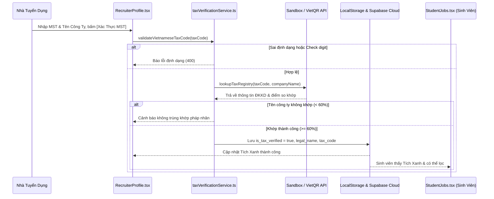

# Kế Hoạch Triển Khai: Xác Thực Mã Số Thuế Doanh Nghiệp (MST) & Cấp Tích Xanh Uy Tín
> **Mã kế hoạch:** `PLAN-20261105-ENTERPRISE-TAX-VERIFICATION`  
> **Áp dụng chuẩn:** [ROLES_AND_GOVERNANCE_RULES.md](file:///C:/Users/ADMIN/Desktop/STUDY/docs/architecture/ROLES_AND_GOVERNANCE_RULES.md) (Chuỗi Baton T1 - T2 - T3)  
> **Tài liệu tham chiếu:**  
> - Đặc tả yêu cầu sản phẩm hợp nhất: [`profilehub/docs/product/spec.md`](file:///C:/Users/ADMIN/Desktop/STUDY/profilehub/docs/product/spec.md) (Lộ trình Giai đoạn 3: Sàn việc làm & Xác thực MST)  
> - Báo cáo nghiên cứu kỹ thuật: [`docs/superpowers/specs/2026-11-05-enterprise-tax-code-verification/research.md`](file:///C:/Users/ADMIN/Desktop/STUDY/docs/superpowers/specs/2026-11-05-enterprise-tax-code-verification/research.md)  
> - Mô hình dữ liệu: [`docs/superpowers/specs/2026-11-05-enterprise-tax-code-verification/data-model.md`](file:///C:/Users/ADMIN/Desktop/STUDY/docs/superpowers/specs/2026-11-05-enterprise-tax-code-verification/data-model.md)  
> - Giao ước kỹ thuật: [`docs/superpowers/specs/2026-11-05-enterprise-tax-code-verification/contracts/enterprise-tax-verification-api.md`](file:///C:/Users/ADMIN/Desktop/STUDY/docs/superpowers/specs/2026-11-05-enterprise-tax-code-verification/contracts/enterprise-tax-verification-api.md)  
> - Hướng dẫn nghiệm thu: [`docs/superpowers/specs/2026-11-05-enterprise-tax-code-verification/quickstart.md`](file:///C:/Users/ADMIN/Desktop/STUDY/docs/superpowers/specs/2026-11-05-enterprise-tax-code-verification/quickstart.md)  
> **Nhánh Git:** `profilehub_v1`  
> **Mục tiêu:** Xây dựng hệ thống xác thực pháp nhân doanh nghiệp qua Mã Số Thuế (MST) và cấp Tích Xanh Doanh Nghiệp Uy Tín (Verified Enterprise Badge), bảo vệ ứng viên sinh viên khỏi các công ty "ma" hoặc lừa đảo.

---

## 🎯 Mục Tiêu Cốt Lõi (Core Goals)

1. **Bộ Xác Minh MST Chuẩn Pháp Lý Việt Nam (Vietnamese Tax Code Validator):**
   - Hỗ trợ cả 2 định dạng: 10 chữ số (doanh nghiệp mẹ/độc lập) và 13 ký tự (chi nhánh, văn phòng đại diện).
   - Kiểm tra mã tỉnh thành và tính toán Checksum số kiểm tra (Check digit $N_{10}$) theo Thông tư 105/2020/TT-BTC ngay trên Client (0ms).
2. **Cơ Chế Tra Cứu Đa Tầng & Offline Sandbox:**
   - Xây dựng `taxVerificationService.ts` với 3 tầng xử lý: Local Validation $\to$ Sandbox Registry (FPT, VNG, MoMo, VNPT, Viettel...) $\to$ VietQR Open Business API.
   - Đảm bảo kiểm thử tự động Vitest và demo ngoại tuyến hoạt động tin cậy 100%.
3. **Thuật Toán Chống Giả Mạo / Mượn Danh MST (Anti-Spoofing):**
   - So khớp độ tương đồng chuỗi giữa Tên doanh nghiệp tự khai và Tên pháp nhân trên ĐKKD ($\ge 60\%$).
   - Tự động thu hồi Tích Xanh (`reverification_required`) nếu nhà tuyển dụng thay đổi Tên công ty hoặc đổi MST.
4. **Nâng Cấp Giao Diện Toàn Diện (UI Integration):**
   - **Nhà tuyển dụng (`RecruiterProfile.tsx`):** Thêm trường MST, nút kiểm tra thời gian thực, hiển thị Tích Xanh và thông tin ĐKKD.
   - **Sinh viên (`StudentJobs.tsx`):** Thêm huy hiệu Tích Xanh trên thẻ tuyển dụng và nút lọc nhanh `[🛡️ Chỉ xem công ty có Tích Xanh]`.
   - **Modal Doanh Nghiệp (`RecruiterCompanyModal.tsx`):** Hiển thị khối bảo chứng pháp lý ĐKKD.

---

## 🏛️ Kiến Trúc Luồng Nghiệp Vụ (Architecture Flow)

---

## 📋 Phân Rã Kỹ Thuật (T1 - T2 - T3 Baton Chain)

### [T1] Schema, Types & Tax Verification Service
* **Tệp tạo mới / cập nhật:**
  - `profilehub/src/types/taxVerification.types.ts`
  - `profilehub/src/types/database.ts` (mở rộng `RecruiterProfile` và `JobPost`)
  - `profilehub/src/utils/jobSync.ts` (bổ sung trường thuế vào `RecruiterCompanyProfile`)
  - `profilehub/src/services/taxVerificationService.ts`
  - `profilehub/server/migrations/20261105100000_enterprise_tax_verification.sql`
* **Công việc cụ thể:**
  1. Triển khai thuật toán kiểm tra định dạng và checksum số kiểm tra MST theo Thông tư 105/2020/TT-BTC.
  2. Xây dựng Sandbox Mock Registry cho các tập đoàn công nghệ hàng đầu tại Việt Nam.
  3. Xây dựng thuật toán so khớp tên thương hiệu với tên pháp nhân (`computeCompanyNameSimilarity`).
  4. Triển khai phương thức lưu trữ đồng bộ kép (Dual-Storage Seam: LocalStorage + Supabase Cloud).

### [T2] Tích Hợp Giao Diện Nhà Tuyển Dụng & Sinh Viên
* **Tệp cập nhật:**
  - `profilehub/src/pages/recruiter/RecruiterProfile.tsx`: Nhập MST, nút tra cứu, hiển thị kết quả xác thực.
  - `profilehub/src/components/student/RecruiterCompanyModal.tsx`: Hiển thị khối pháp lý đã thẩm định.
  - `profilehub/src/pages/student/StudentJobs.tsx`: Hiển thị huy hiệu Tích Xanh trên Job Card và bộ lọc nhanh.
* **Công việc cụ thể:**
  1. Thiết kế UI trạng thái: Unverified, Loading, Verified (Tích Xanh), Rejected, Reverification Required.
  2. Bổ sung nút bấm lọc nhanh `[🛡️ Chỉ xem công ty có Tích Xanh]` trong trang việc làm của sinh viên.
  3. Tích hợp cơ chế tự động vô hiệu hóa Tích Xanh khi chỉnh sửa thông tin công ty.

### [T3] Kiểm Thử Tự Động & Nghiệm Thu Chất Lượng
* **Tệp tạo mới:**
  - `profilehub/src/services/taxVerificationService.test.ts`
* **Công việc cụ thể:**
  1. Viết bài test toàn diện kiểm tra các trường hợp: MST 10 số, MST 13 số, sai check digit, chuỗi ký tự lạ.
  2. Kiểm thử chống mượn danh MST: Tên lệch bị từ chối, tên khớp được duyệt.
  3. Kiểm thử tự động thu hồi Tích Xanh khi thay đổi tên công ty.
  4. Chạy `npm test -- --run` đạt 100% Pass và `npx tsc --noEmit` đạt 0 lỗi.
