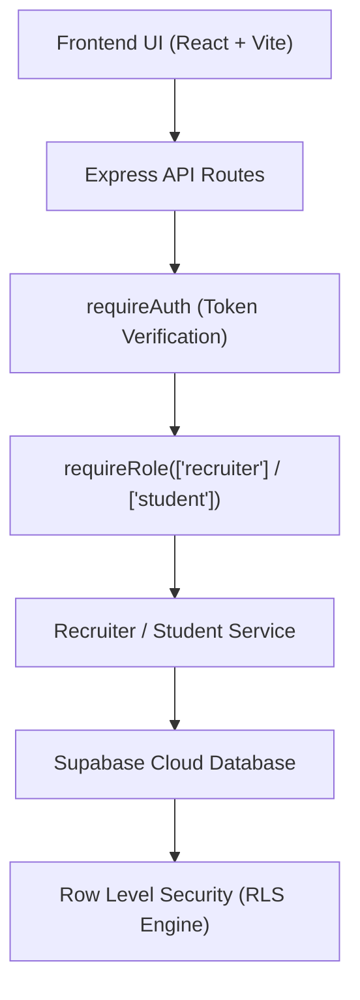
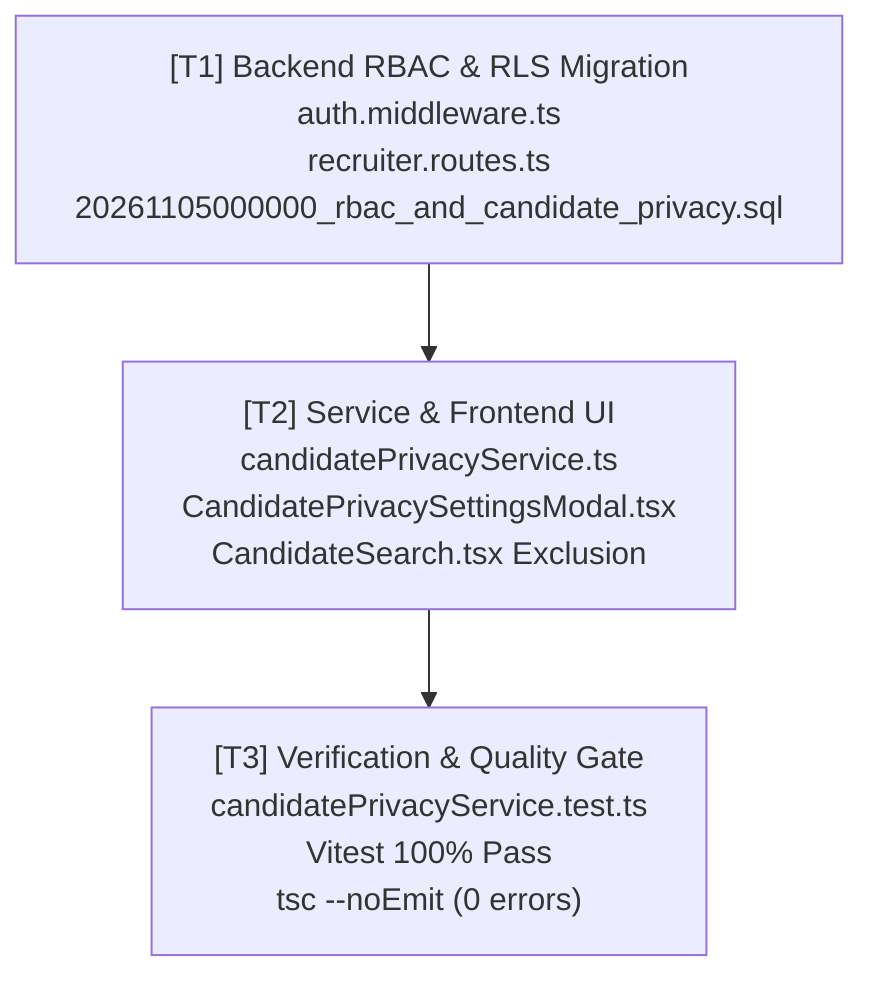

# Kế Hoạch Triển Khai: Phân Quyền RBAC & Quyền Riêng Tư Ứng Viên (RBAC & Candidate Privacy)

> **Mã kế hoạch:** `PLAN-20261105-RBAC-CANDIDATE-PRIVACY`  
> **Áp dụng chuẩn:** [ROLES_AND_GOVERNANCE_RULES.md](file:///C:/Users/ADMIN/Desktop/STUDY/docs/architecture/ROLES_AND_GOVERNANCE_RULES.md) (Chuỗi Baton T1 - T2 - T3)  
> **Nhật ký dự án:** Thứ 5 (05/11/2026) — Cấu hình RLS nâng cao, hoàn thiện phân quyền RBAC, chế độ Open to Work & Ẩn CV  
> **Nhánh Git:** `profilehub_v1`  
> **Phân tích:** Kế thừa trực tiếp việc gỡ bỏ nút đổi vai trò thủ công trên UI (`298a120`) sang cơ chế kiểm soát truy cập tầng Backend và Database RLS.

---

## 🎯 Mục Tiêu Cốt Lõi (Core Goals)

1. **Siết chặt phân quyền RBAC (Role-Based Access Control) tại Backend:**
   - Xây dựng middleware `requireRole(['recruiter'])` và `requireRole(['student'])` trong `server/src/middlewares/auth.middleware.ts`.
   - Ngăn chặn mọi hành vi sinh viên giả mạo token gọi các endpoint quản lý ứng viên, phỏng vấn, hoặc tạo tin tuyển dụng của Recruiter.

2. **Chính sách bảo mật dữ liệu Row Level Security (RLS) trên Supabase:**
   - Tạo migration SQL `server/migrations/20261105000000_rbac_and_candidate_privacy.sql`.
   - Cấu hình RLS nâng cao:
     - `candidate_pipeline`: Recruiter chỉ xem/sửa hồ sơ thuộc pipeline tuyển dụng của mình; Sinh viên chỉ xem trạng thái ứng tuyển của chính họ.
     - `student_profiles`: Bổ sung các trường bảo mật quyền riêng tư: `is_open_to_work` (boolean, mặc định true), `blocked_companies` (text[] danh sách tên công ty bị chặn).

3. **Tính năng Quyền riêng tư ứng viên (Candidate Privacy Controls):**
   - Xây dựng `src/services/candidatePrivacyService.ts` quản lý trạng thái Open to Work và Company Blacklist.
   - Thêm giao diện cấu hình quyền riêng tư cho Sinh viên trong hồ sơ/cài đặt.
   - Nâng cấp `CandidateSearch.tsx`: Tự động loại trừ các ứng viên đã tắt `is_open_to_work` hoặc các ứng viên đã chặn công ty của Recruiter đang đăng nhập.

---

## 🏛️ Kiến Trúc Kỹ Thuật (Architecture & Technical Decisions)

### 1. Phân Tầng Bảo Mật (Defense in Depth)

### 2. Cấu Trúc Bảng & Trường Bảo Mật

* Bảng `student_profiles`:
  - `is_open_to_work` (boolean DEFAULT true): Cho phép sinh viên chủ động bật/tắt hiển thị trong Talent Pool.
  - `blocked_companies` (text[] DEFAULT '{}'): Danh sách tên các công ty sinh viên không muốn cho xem hồ sơ.
* Middleware `requireRole`:
  - Đọc vai trò người dùng từ `auth.users.raw_user_meta_data->>'role'` hoặc bảng `users`.
  - Nếu vai trò không khớp danh sách cho phép, lập tức trả về mã lỗi `403 Forbidden`.

---

## 📋 Phân Rã Kỹ Thuật (T1 - T2 - T3 Baton Chain)

