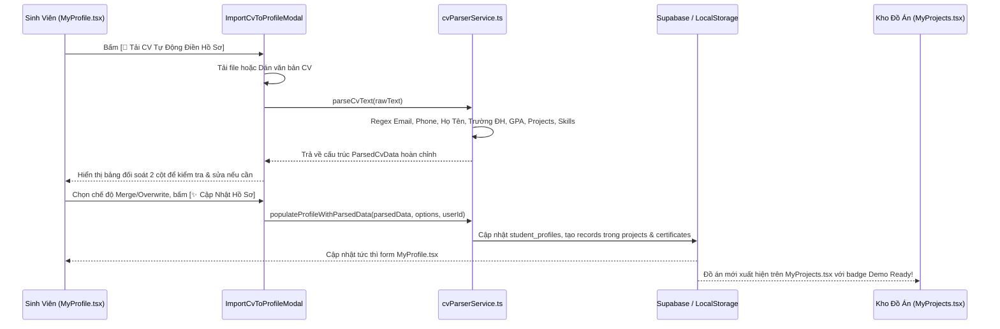

# Kế Hoạch Triển Khai: Quét CV Tự Động Điền Hồ Sơ Cá Nhân (Smart CV Parser & Master Profile Auto-Populate)
> **Mã kế hoạch:** `PLAN-20261105-SMART-CV-PARSER-PROFILE-AUTO-POPULATE`  
> **Áp dụng chuẩn:** [ROLES_AND_GOVERNANCE_RULES.md](file:///C:/Users/ADMIN/Desktop/STUDY/docs/architecture/ROLES_AND_GOVERNANCE_RULES.md) (Chuỗi Baton T1 - T2 - T3)  
> **Tài liệu tham chiếu:**  
> - Báo cáo nghiên cứu kỹ thuật: [`docs/superpowers/specs/2026-11-05-smart-cv-parser-profile-auto-populate/research.md`](file:///C:/Users/ADMIN/Desktop/STUDY/docs/superpowers/specs/2026-11-05-smart-cv-parser-profile-auto-populate/research.md)  
> - Mô hình dữ liệu & Merge Rules: [`docs/superpowers/specs/2026-11-05-smart-cv-parser-profile-auto-populate/data-model.md`](file:///C:/Users/ADMIN/Desktop/STUDY/docs/superpowers/specs/2026-11-05-smart-cv-parser-profile-auto-populate/data-model.md)  
> - Giao ước kỹ thuật Service & UI: [`docs/superpowers/specs/2026-11-05-smart-cv-parser-profile-auto-populate/contracts/cv-parser-contract.md`](file:///C:/Users/ADMIN/Desktop/STUDY/docs/superpowers/specs/2026-11-05-smart-cv-parser-profile-auto-populate/contracts/cv-parser-contract.md)  
> - Hướng dẫn nghiệm thu nhanh: [`docs/superpowers/specs/2026-11-05-smart-cv-parser-profile-auto-populate/quickstart.md`](file:///C:/Users/ADMIN/Desktop/STUDY/docs/superpowers/specs/2026-11-05-smart-cv-parser-profile-auto-populate/quickstart.md)  
> **Nhánh Git:** `profilehub_v1`  
> **Mục tiêu:** Xây dựng hệ thống Smart CV Parser tự động quét nội dung từ file CV tải lên hoặc văn bản dán trực tiếp, trích xuất cấu trúc dữ liệu đa tầng (Liên hệ, Học vấn, Kỹ năng, Đồ án có link Demo/Git, Chứng chỉ), và tự động điền vào Hồ Sơ Cá Nhân (Master Profile) chỉ trong 3 giây.

---

## 🎯 Mục Tiêu Cốt Lõi (Core Goals)

1. **Bộ Bóc Tách CV Thông Minh Cục Bộ (`cvParserService.ts`):**
   - Hoạt động ngoại tuyến 0ms, không phụ thuộc AI API bên ngoài, bảo mật thông tin cá nhân 100%.
   - Nhận diện chính xác: Họ và tên, Email, Số điện thoại, Trường ĐH, Chuyên ngành, Điểm GPA (thang 4 hoặc 10).
   - Kế thừa từ điển 120+ công nghệ của `jobStudioService.ts` để trích xuất chuẩn hóa kỹ năng.
   - Bóc tách danh sách đồ án thực tế kèm link GitHub (`github.com/...`) và Live Demo (`https://...`), sẵn sàng kích hoạt huy hiệu `🚀 Demo Ready`.
   - Bóc tách danh sách chứng chỉ ngoại ngữ và chuyên ngành.
2. **Giao Diện Đối Soát & Tinh Chỉnh (`ImportCvToProfileModal.tsx`):**
   - Hỗ trợ cả 2 phương thức: Tải tệp tin (.pdf, .docx, .txt) hoặc Dán văn bản thô (Raw Paste).
   - Bảng đối soát trực quan cho phép sinh viên xem lại, chỉnh sửa hoặc xóa bớt thông tin nhận diện trước khi xác nhận lưu.
   - Lựa chọn linh hoạt giữa 2 chế độ:
     * `🔘 Hợp nhất (Merge):` Chỉ điền vào các trường đang trống, bảo vệ thông tin cũ.
     * `🔘 Ghi đè (Overwrite):` Thay thế toàn bộ bằng thông tin mới từ CV.
3. **Tích Hợp Tự Động Điền Vào Hệ Thống (Master Profile Population):**
   - Cập nhật thông tin cá nhân vào bảng `student_profiles` ([`MyProfile.tsx`](file:///C:/Users/ADMIN/Desktop/STUDY/profilehub/src/pages/student/MyProfile.tsx)).
   - Tự động tạo các bản ghi đồ án mới trong bảng `projects` ([`MyProjects.tsx`](file:///C:/Users/ADMIN/Desktop/STUDY/profilehub/src/pages/student/MyProjects.tsx)).
   - Tự động tạo các chứng chỉ trong bảng `certificates`.
4. **Điểm Chạm Trải Nghiệm Người Dùng (UX Touchpoints):**
   - Đặt nút bấm nổi bật màu tím gradient **`[ 📄 Tải CV Tự Động Điền Hồ Sơ ]`** tại trang [`MyProfile.tsx`](file:///C:/Users/ADMIN/Desktop/STUDY/profilehub/src/pages/student/MyProfile.tsx).
   - Gợi ý nạp hồ sơ nhanh tại trang [`Dashboard.tsx`](file:///C:/Users/ADMIN/Desktop/STUDY/profilehub/src/pages/student/Dashboard.tsx).

---

## 🏛️ Kiến Trúc Luồng Nghiệp Vụ (Architecture Flow)

---

## 📋 Phân Rã Công Việc Kỹ Thuật (Baton Chain Breakdown: T1 - T2 - T3)

### 🔹 Giai Đoạn T1: Nền Tảng Kiểu Dữ Liệu & Core Parser Engine
*Trách nhiệm: Backend & Core Algorithm Engineer*
* **T1.1:** Tạo file [`src/types/cvParser.types.ts`](file:///C:/Users/ADMIN/Desktop/STUDY/profilehub/src/types/cvParser.types.ts): Định nghĩa các kiểu `ParsedPersonalInfo`, `ParsedEducation`, `ParsedProject`, `ParsedCertificate`, `ParsedCvData`, `ProfileAutoPopulateOptions`, `ProfilePopulateResult`.
* **T1.2:** Xây dựng core service [`src/services/cvParserService.ts`](file:///C:/Users/ADMIN/Desktop/STUDY/profilehub/src/services/cvParserService.ts):
  - `parseCvText(text: string): ParsedCvData`: Bóc tách thông tin cá nhân, trường ĐH, chuyên ngành, GPA, kỹ năng (dùng `jobStudioService.extractSkillsFromText`), danh sách đồ án (tự trích xuất link Git & Demo), danh sách chứng chỉ.
  - `parseCvFile(file: File): Promise<ParsedCvData>`: Đọc text an toàn bằng `FileReader`.
  - `populateProfileWithParsedData(parsedData, options, userId)`: Hợp nhất và lưu dữ liệu vào `student_profiles`, `projects`, `certificates`.
* **T1.3:** Xây dựng bộ kiểm thử đơn vị tự động [`src/services/cvParserService.test.ts`](file:///C:/Users/ADMIN/Desktop/STUDY/profilehub/src/services/cvParserService.test.ts):
  - 15+ kịch bản kiểm thử:
    1. Bóc tách họ tên tiếng Việt (Nguyễn Văn A, Trần Thị Bích).
    2. Bóc tách email và số điện thoại VN chuẩn (`0901...`, `+84...`).
    3. Bóc tách trường ĐH (Bách Khoa, KHTN, CNTT, FPT...) và chuyên ngành.
    4. Bóc tách điểm GPA thang 4 (`3.6/4.0`) và thang 10 (`8.5/10`).
    5. Bóc tách từ khóa công nghệ IT chuẩn hóa (React, Node.js, Docker...).
    6. Bóc tách đồ án kèm link GitHub và link Demo.
    7. Kiểm thử hợp nhất chế độ `merge` không đè dữ liệu cũ.
    8. Kiểm thử ghi đè chế độ `overwrite`.

---

### 🔹 Giai Đoạn T2: Xây Dựng Component Giao Diện & Tích Hợp UI Phản Ứng
*Trách nhiệm: Frontend Engineer & UI/UX*
* **T2.1: Xây dựng Modal [`src/components/student/ImportCvToProfileModal.tsx`](file:///C:/Users/ADMIN/Desktop/STUDY/profilehub/src/components/student/ImportCvToProfileModal.tsx):**
  - **Khối nhập liệu:** Hỗ trợ kéo thả file (`.pdf`, `.docx`, `.txt`) và tab dán trực tiếp đoạn văn bản CV (Raw Paste).
  - **Khối đối soát (Review Board):** Trình bày dữ liệu bóc tách được dưới dạng các thẻ thông tin có thể chỉnh sửa:
    * Thẻ Thông tin cá nhân & Học vấn (Tên, Email, SĐT, Trường, GPA, Vị trí).
    * Thẻ Kỹ năng (các chip tag có thể bấm xóa hoặc gõ thêm).
    * Thẻ Đồ án được nhận diện (hiển thị tiêu đề, vai trò, link git, demo url).
    * Thẻ Chứng chỉ.
  - **Khối tùy chọn:** Radio button chọn `🔘 Bổ sung (Merge)` hoặc `🔘 Ghi đè (Overwrite)`, checkbox chọn có tạo đồ án/chứng chỉ không.
  - **Nút hành động:** `[ ✨ Cập Nhật Vào Hồ Sơ Cá Nhân ]` kèm hiệu ứng loading và thông báo kết quả.
* **T2.2: Tích hợp vào trang Hồ Sơ Cá Nhân [`src/pages/student/MyProfile.tsx`](file:///C:/Users/ADMIN/Desktop/STUDY/profilehub/src/pages/student/MyProfile.tsx):**
  - Thêm nút bấm nổi bật màu tím gradient tại header trang: **`[ 📄 Tải CV Tự Động Điền Hồ Sơ ]`**.
  - Callback tự động nạp lại dữ liệu form, danh sách đồ án và chứng chỉ ngay sau khi modal hoàn tất.
* **T2.3: Tích hợp gợi ý Onboarding tại [`src/pages/student/Dashboard.tsx`](file:///C:/Users/ADMIN/Desktop/STUDY/profilehub/src/pages/student/Dashboard.tsx):**
  - Bổ sung nút gọi nhanh modal từ Dashboard cho sinh viên mới.

---

### 🔹 Giai Đoạn T3: Kiểm Thử Toàn Diện, Nghiệm Thu & Cổng Chất Lượng (Quality Gate)
*Trách nhiệm: QA Tester & DevOps*
* **T3.1: Kiểm thử tự động:**
  - Chạy toàn bộ test suites: `npm test -- --run` $\to$ Đảm bảo toàn bộ 44 test suites (bao gồm `cvParserService.test.ts` mới) vượt qua 100% (dự kiến $\ge 225$ tests).
  - Kiểm tra TypeScript nghiêm ngặt: `npx tsc --noEmit` $\to$ 0 lỗi.
  - Đóng gói ứng dụng: `npm run build` $\to$ Thành công.
* **T3.2: Kiểm thử luồng trải nghiệm người dùng (E2E):**
  - Dán đoạn văn bản CV mẫu ➔ Xác nhận dữ liệu được bóc tách chính xác.
  - Bấm xác nhận ➔ Xác nhận Form trong `MyProfile.tsx` được điền đầy đủ.
  - Mở trang `MyProjects.tsx` ➔ Xác nhận các đồ án mới xuất hiện với đúng link demo và GitHub.
* **T3.3: Bàn giao & Dual-Sync Git:**
  - Cập nhật artifact `session_log_2026-11-05.md`.
  - Tạo Git commit: `feat(profile): implement smart cv parser and master profile auto-populate`.
  - Đẩy mã nguồn lên cả hai nhánh: `origin/profilehub_v1` và `origin/1310-co-ban-chua-sua`.
