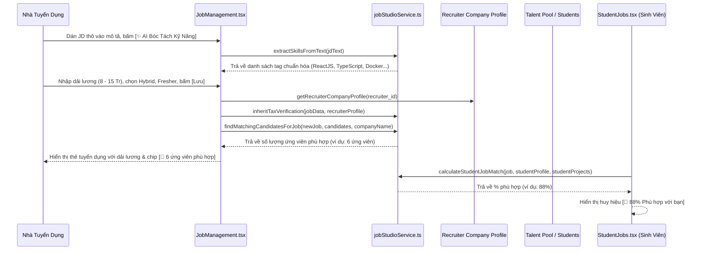

# Kế Hoạch Triển Khai: Chuẩn Hóa Đăng Tin Tuyển Dụng & Bóc Tách Kỹ Năng Tự Động (Smart Job Studio)
> **Mã kế hoạch:** `PLAN-20261105-SMART-JOB-STUDIO`  
> **Áp dụng chuẩn:** [ROLES_AND_GOVERNANCE_RULES.md](file:///C:/Users/ADMIN/Desktop/STUDY/docs/architecture/ROLES_AND_GOVERNANCE_RULES.md) (Chuỗi Baton T1 - T2 - T3)  
> **Tài liệu tham chiếu:**  
> - Đặc tả yêu cầu sản phẩm hợp nhất: [`profilehub/docs/product/spec.md`](file:///C:/Users/ADMIN/Desktop/STUDY/profilehub/docs/product/spec.md) (Lộ trình Giai đoạn 3: Sàn việc làm & Chuẩn hóa tin đăng)  
> - Báo cáo nghiên cứu kỹ thuật: [`docs/superpowers/specs/2026-11-05-smart-job-studio-and-candidate-matching/research.md`](file:///C:/Users/ADMIN/Desktop/STUDY/docs/superpowers/specs/2026-11-05-smart-job-studio-and-candidate-matching/research.md)  
> - Mô hình dữ liệu & Migration: [`docs/superpowers/specs/2026-11-05-smart-job-studio-and-candidate-matching/data-model.md`](file:///C:/Users/ADMIN/Desktop/STUDY/docs/superpowers/specs/2026-11-05-smart-job-studio-and-candidate-matching/data-model.md)  
> - Giao ước kỹ thuật API & UI: [`docs/superpowers/specs/2026-11-05-smart-job-studio-and-candidate-matching/contracts/job-studio-api.md`](file:///C:/Users/ADMIN/Desktop/STUDY/docs/superpowers/specs/2026-11-05-smart-job-studio-and-candidate-matching/contracts/job-studio-api.md)  
> - Hướng dẫn nghiệm thu nhanh: [`docs/superpowers/specs/2026-11-05-smart-job-studio-and-candidate-matching/quickstart.md`](file:///C:/Users/ADMIN/Desktop/STUDY/docs/superpowers/specs/2026-11-05-smart-job-studio-and-candidate-matching/quickstart.md)  
> **Nhánh Git:** `profilehub_v1`  
> **Mục tiêu:** Xây dựng hệ thống Smart Job Studio chuẩn hóa tin tuyển dụng công nghệ, trích xuất kỹ năng 1-click bằng AI/Regex và thuật toán tính điểm bắt cặp ứng viên 2 chiều tức thì giữa Nhà tuyển dụng và Sinh viên.

---

## 🎯 Mục Tiêu Cốt Lõi (Core Goals)

1. **Chuẩn Hóa Dữ Liệu Tin Đăng Tuyển Dụng (Standardized Job Schema):**
   - Mở rộng `JobPost` với các trường thực tế: Dải lương (`salary_min`, `salary_max`, `currency`, `is_negotiable`), Cấp bậc (`intern`, `fresher`, `junior`, `middle`, `senior`), Hình thức làm việc (`on-site`, `hybrid`, `remote`), Hạn nộp đơn (`deadline_date`).
   - Tự động kế thừa Huy hiệu Tích Xanh & Mã số thuế (`is_tax_verified`, `tax_verification_tier`, `tax_code`) từ hồ sơ doanh nghiệp đã xác thực.
2. **Bộ Bóc Tách Kỹ Năng Tự Động 1-Click (Automated Skill Extraction Engine):**
   - Xây dựng `extractSkillsFromText` với từ điển regex hơn 120+ công nghệ thực chiến, hỗ trợ chuẩn hóa alias (`react.js` $\to$ `ReactJS`, `k8s` $\to$ `Kubernetes`, `tailwind` $\to$ `Tailwind CSS`).
   - Tốc độ phản hồi 0ms, hoạt động ngoại tuyến, không tốn chi phí API token.
3. **Thuật Toán Bắt Cặp Ứng Viên 2 Chiều Tức Thì (Instant Reverse Candidate Matching):**
   - Phía Nhà tuyển dụng (`JobManagement.tsx`): Hiển thị chip số lượng ứng viên tiềm năng `[ 👥 X ứng viên phù hợp ]` với link 1-click chuyển sang `CandidateSearch.tsx` kèm bộ lọc.
   - Phía Sinh viên (`StudentJobs.tsx`): Hiển thị huy hiệu độ phù hợp cá nhân `[ 🎯 85% Phù hợp với bạn ]` dựa trên Master Profile của chính ứng viên.
   - Tuân thủ quyền riêng tư: Tự động loại trừ ứng viên tắt `is_open_to_work` hoặc chặn công ty của Recruiter.
4. **Nâng Cấp Giao Diện Toàn Diện (UI/UX Transformation):**
   - **Nhà tuyển dụng (`JobManagement.tsx`):** Thêm trường dải lương, hình thức, cấp bậc, nút `[ ✨ AI Bóc Tách Kỹ Năng ]`, hiển thị chip số ứng viên phù hợp trên thẻ việc làm.
   - **Sinh viên (`StudentJobs.tsx`):** Thêm huy hiệu dải lương nổi bật, tag hình thức/cấp bậc, huy hiệu điểm phù hợp cá nhân và bộ lọc nâng cao.

---

## 🏛️ Kiến Trúc Luồng Nghiệp Vụ (Architecture Flow)

---

## 📋 Phân Rã Công Việc Kỹ Thuật (Baton Chain Breakdown: T1 - T2 - T3)

### 🔹 Giai Đoạn T1: Nền Tảng Kiểu Dữ Liệu, Migration & Core Service Engine
*Trách nhiệm: Backend & Tech Lead*
* **T1.1:** Tạo file [`src/types/job.types.ts`](file:///C:/Users/ADMIN/Desktop/STUDY/profilehub/src/types/job.types.ts) định nghĩa các kiểu chuẩn hóa: `ExperienceLevel`, `WorkplaceType`, `SalaryCurrency`, `ExtractedSkillCategory`, `SkillExtractionResult`, `CandidateMatchSummary`, `JobCandidateMatchResult`.
* **T1.2:** Cập nhật [`src/types/database.ts`](file:///C:/Users/ADMIN/Desktop/STUDY/profilehub/src/types/database.ts) mở rộng `JobPost` với các trường: `workplace_type`, `experience_level`, `salary_min`, `salary_max`, `currency`, `is_negotiable`, `deadline_date`, `updated_at`.
* **T1.3:** Tạo script di chuyển cơ sở dữ liệu [`server/migrations/20261105200000_smart_job_studio.sql`](file:///C:/Users/ADMIN/Desktop/STUDY/profilehub/server/migrations/20261105200000_smart_job_studio.sql).
* **T1.4:** Xây dựng core service [`src/services/jobStudioService.ts`](file:///C:/Users/ADMIN/Desktop/STUDY/profilehub/src/services/jobStudioService.ts):
  - `extractSkillsFromText(jdText: string)`: Từ điển 120+ công nghệ với alias mapping.
  - `formatSalaryRange(options: SalaryFormatOptions)`: Định dạng dải lương thân thiện.
  - `calculateCandidateJobMatch(jobSkills, candidate)`: Tính toán điểm phù hợp kết hợp số lượng đồ án Verified.
  - `findMatchingCandidatesForJob(job, candidates, recruiterCompanyName)`: Lọc ứng viên tiềm năng có áp dụng privacy.
  - `calculateStudentJobMatch(job, studentProfile, studentProjects)`: Tính điểm phù hợp cho sinh viên.
  - `inheritTaxVerification(job, recruiterProfile)`: Tự động kế thừa Tích Xanh & MST.
* **T1.5:** Cập nhật seed dữ liệu mặc định trong [`src/utils/jobSync.ts`](file:///C:/Users/ADMIN/Desktop/STUDY/profilehub/src/utils/jobSync.ts) với các trường dải lương, hình thức, cấp bậc chuẩn hóa.

---

### 🔹 Giai Đoạn T2: Nâng Cấp Giao Diện Người Dùng (UI Integration & Reactive Flow)
*Trách nhiệm: Frontend Engineer & UI/UX*
* **T2.1: Nâng cấp Nhà tuyển dụng (`JobManagement.tsx`):**
  - Thêm các ô nhập liệu vào Modal Đăng/Sửa tin: Dải lương (`salary_min`, `salary_max`, `currency`), Checkbox `is_negotiable`, Dropdown `workplace_type`, Dropdown `experience_level`, Date picker `deadline_date`.
  - Thêm nút `[ ✨ AI Bóc Tách Kỹ Năng ]`: Đọc nội dung mô tả công việc hiện tại, bóc tách và điền tức thì vào ô kỹ năng.
  - Kế thừa tự động thông tin Tích Xanh khi lưu bài đăng.
  - Trên mỗi thẻ bài đăng trong danh sách: Hiển thị badge dải lương, tag hình thức, cấp bậc, và chip `[ 👥 {count} ứng viên phù hợp ]` liên kết trực tiếp sang `CandidateSearch.tsx`.
* **T2.2: Nâng cấp Tìm kiếm ứng viên (`CandidateSearch.tsx`):**
  - Hỗ trợ tham số URL `?jobId=...` hoặc `?skills=...` để tự động kích hoạt bộ lọc ứng viên theo tin tuyển dụng đã chọn.
  - Hiển thị badge điểm tương thích chi tiết trên từng thẻ ứng viên.
* **T2.3: Nâng cấp Sàn việc làm Sinh viên (`StudentJobs.tsx`):**
  - Hiển thị dải lương nổi bật trên từng thẻ việc làm (`8 - 15 Triệu VNĐ` hoặc `Thỏa thuận`).
  - Hiển thị tag hình thức (`🏢 On-site`, `🌐 Hybrid`, `🏠 Remote`) và cấp bậc (`🌱 Thực tập sinh`, `🚀 Fresher`).
  - Hiển thị huy hiệu độ phù hợp cá nhân: `[ 🎯 {score}% Phù hợp với bạn ]` dựa trên Master Profile của chính sinh viên đang đăng nhập.

---

### 🔹 Giai Đoạn T3: Kiểm Thử Toàn Diện, Nghiệm Thu & Cổng Chất Lượng (Quality Gate)
*Trách nhiệm: QA Tester & DevOps*
* **T3.1: Bộ kiểm thử đơn vị (`jobStudioService.test.ts`):**
  - Kiểm thử `extractSkillsFromText` với 10+ kịch bản (alias, chữ hoa/thường, ranh giới từ, deduplication).
  - Kiểm thử `formatSalaryRange` với 8+ trường hợp biên (min only, max only, negotiable, USD, VND, empty).
  - Kiểm thử `calculateCandidateJobMatch` và `findMatchingCandidatesForJob` với kịch bản có/không có đồ án Verified.
  - Kiểm thử loại trừ ứng viên tắt `is_open_to_work` hoặc chặn công ty.
  - Kiểm thử `inheritTaxVerification` kế thừa Tích Xanh chính xác.
* **T3.2: Kiểm tra tổng thể hệ thống (Quality Gate):**
  - Chạy toàn bộ test suite (`npm test -- --run`) $\to$ **100% Pass** (toàn bộ 42 test files).
  - Kiểm tra TypeScript (`npx tsc --noEmit`) $\to$ **0 Lỗi**.
  - Kiểm tra Build Production (`npm run build`) $\to$ **Thành công**.
* **T3.3: Bàn giao & Đồng bộ:**
  - Cập nhật nhật ký phiên phát triển vào artifact `session_log_2026-11-05.md`.
  - Tạo Git commit với thông điệp Conventional Commit rõ ràng.
