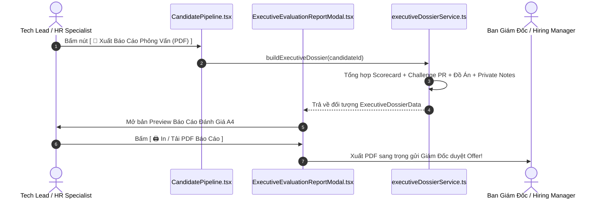

# Kế Hoạch Triển Khai: Hồ Sơ Đánh Giá Ứng Viên Chuyên Sâu & Xuất Báo Cáo Ban Giám Đốc (Executive Candidate Evaluation Dossier & 1-Click PDF Export)
> **Mã kế hoạch:** `PLAN-20261109-EXECUTIVE-DOSSIER-PDF`  
> **Áp dụng chuẩn:** [ROLES_AND_GOVERNANCE_RULES.md](file:///C:/Users/ADMIN/Desktop/STUDY/docs/architecture/ROLES_AND_GOVERNANCE_RULES.md) (Chuỗi Baton T1 - T2 - T3)  
> **Spec Directory:** [`docs/superpowers/specs/2026-11-09-candidate-dossier-and-executive-pdf-export/`](file:///C:/Users/ADMIN/Desktop/STUDY/docs/superpowers/specs/2026-11-09-candidate-dossier-and-executive-pdf-export/)  
> **Nhánh Git:** `profilehub_v1`  
> **Trạng thái:** HOÀN TẤT & ĐÃ TRIỂN KHAI THÀNH CÔNG (100% Quality Gates Passed)  
> **Mục tiêu:** Giải quyết nút thắt lớn nhất trong quy trình tuyển dụng doanh nghiệp: Tổng hợp toàn bộ dữ liệu phỏng vấn (Bảng chấm điểm Scorecard 5 tiêu chí, Bài giải thử thách Take-Home PR, Đồ án bảo chứng Verified, Ghi chú nội bộ) thành Báo Cáo Đánh Giá Ứng Viên Điều Hành (Executive Dossier) và cho phép 1-click xuất file PDF/In ấn tiêu chuẩn để trình Ban Giám Đốc/Hiring Manager ký duyệt tuyển dụng. Kèm theo đó là ngân hàng Template JD chuẩn IT tích hợp thẳng vào Job Studio.

---

## 🎯 Mục Tiêu Cốt Lõi (Core Goals)

1. **Hồ Sơ Đánh Giá Tổng Hợp Điều Hành (Executive Candidate Evaluation Dossier):**
   - Tổng hợp tự động từ mọi luồng dữ liệu của ứng viên trong Pipeline: Điểm đồng thuận phỏng vấn (Consensus Score 0-100), Bảng sao 5 tiêu chí (Kiến trúc, Code Defense, Debugging, Giao tiếp, Văn hóa), Điểm bài giải Take-Home Challenge (GitHub PR), Huy hiệu đồ án Verified, và Ghi chú nội bộ.
   - Hiển thị khuyến nghị tuyển dụng rõ ràng (`STRONG_HIRE`, `HIRE`, `NEUTRAL`, `NO_HIRE`) kèm phân tích Điểm mạnh cốt lõi & Rủi ro/Điểm cần khắc phục.

2. **Công Cụ Xuất Báo Cáo PDF Chuẩn Executive (1-Click Print & PDF Engine):**
   - Cung cấp giao diện xem trước (Print Preview) sang trọng theo chuẩn tài liệu doanh nghiệp A4.
   - Tích hợp công cụ in trình duyệt (`window.print()`) với CSS `@media print` được tinh chỉnh tỉ mỉ: Ngắt trang sạch sẽ, không vỡ layout, ẩn các nút bấm thừa, có chữ ký người phỏng vấn và ngày đánh giá.
   - Hỗ trợ chế độ Blind Screening: Khi xuất báo cáo ở chế độ ẩn danh, file PDF tự động mã hóa danh tính thành `Ứng viên #DEV-XXXX` nhằm phục vụ các buổi họp hội đồng tuyển dụng độc lập.

3. **Ngân Hàng Mẫu JD Chuẩn Ngành Kèm Gợi Ý Lương (Job Description Template Quick-Picker):**
   - Bổ sung 6 mẫu JD thực chiến (Frontend React/Next.js, Backend Node/Go, Fullstack, AI/Data Fresher, DevOps/Cloud, UI/UX Designer) tích hợp trực tiếp vào modal tạo JD của [`JobManagement.tsx`](file:///C:/Users/ADMIN/Desktop/STUDY/profilehub/src/pages/recruiter/JobManagement.tsx).
   - 1-click áp dụng toàn bộ từ khóa, dải lương khuyến nghị thị trường và tiêu chí đầu ra.

---

## 🏛️ Sơ Đồ Kiến Trúc Luồng Hoạt Động (Architecture Flow)

---

## 📋 Phân Rã Kỹ Thuật (Baton Chain Breakdown: T1 - T2 - T3)

### 🔹 Giai Đoạn T1: Data Modeling & Core Dossier Service
* **T1.1:** Định nghĩa kiểu dữ liệu `ExecutiveEvaluationDossier`, `DossierRiskFactor`, `JobTemplateItem` trong [`src/types/database.ts`](file:///C:/Users/ADMIN/Desktop/STUDY/profilehub/src/types/database.ts).
* **T1.2:** Xây dựng service [`src/services/executiveDossierService.ts`](file:///C:/Users/ADMIN/Desktop/STUDY/profilehub/src/services/executiveDossierService.ts):
  - Hàm `buildExecutiveDossier(candidate: CandidatePipelineItem, isBlind?: boolean)`
  - Hàm `generatePrintableHtml(dossier: ExecutiveEvaluationDossier)`
  - Ngân hàng mẫu JD [`src/services/jobTemplateBank.ts`](file:///C:/Users/ADMIN/Desktop/STUDY/profilehub/src/services/jobTemplateBank.ts)
* **T1.3:** Viết unit test tự động trong [`src/services/executiveDossierService.test.ts`](file:///C:/Users/ADMIN/Desktop/STUDY/profilehub/src/services/executiveDossierService.test.ts).

### 🔹 Giai Đoạn T2: Xây Dựng UI Modal & Bộ Render PDF / Print
* **T2.1:** Xây dựng component modal [`src/components/recruiter/ExecutiveEvaluationReportModal.tsx`](file:///C:/Users/ADMIN/Desktop/STUDY/profilehub/src/components/recruiter/ExecutiveEvaluationReportModal.tsx):
  - Thiết kế khổ tài liệu A4 chuẩn doanh nghiệp với logo công ty, khung điểm Scorecard radar/bar, chi tiết bài giải thử thách, nhận xét phỏng vấn.
  - Các nút: `[ In / Xuất PDF ]`, `[ Sao Chép Bản Tóm Tắt Email ]`, `[ Đóng ]`.
  - CSS in ấn chuẩn: `@media print { ... }`.
* **T2.2:** Tích hợp nút `[ 📑 Báo Cáo PDF ]` trên thẻ ứng viên và trong modal Scorecard của [`src/pages/recruiter/CandidatePipeline.tsx`](file:///C:/Users/ADMIN/Desktop/STUDY/profilehub/src/pages/recruiter/CandidatePipeline.tsx).
* **T2.3:** Tích hợp bộ chọn `Template JD Nhanh` vào modal thêm tin tuyển dụng của [`src/pages/recruiter/JobManagement.tsx`](file:///C:/Users/ADMIN/Desktop/STUDY/profilehub/src/pages/recruiter/JobManagement.tsx).

### 🔹 Giai Đoạn T3: Kiểm Thử Toàn Diện & Quality Gates
* **T3.1:** Chạy `npx tsc --noEmit` đạt 0 lỗi biên dịch tĩnh.
* **T3.2:** Chạy `npx vitest run` đảm bảo 100% tests pass.
* **T3.3:** Chạy `npm run build` đóng gói Vite production thành công.
