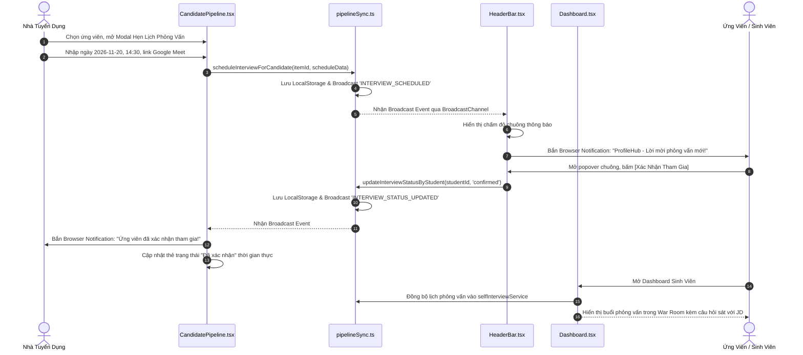

# Kế Hoạch Triển Khai: Hệ Thống Bánh Đà Tăng Trưởng Khép Kín Cho Ứng Viên & Nhà Tuyển Dụng
> **Mã kế hoạch:** `PLAN-20261109-CLOSED-LOOP-GROWTH-PIPELINE`  
> **Áp dụng chuẩn:** [ROLES_AND_GOVERNANCE_RULES.md](file:///C:/Users/ADMIN/Desktop/STUDY/docs/architecture/ROLES_AND_GOVERNANCE_RULES.md) (Chuỗi Baton T1 - T2 - T3)  
> **Tài liệu tham chiếu:**  
> - Báo cáo nghiên cứu kỹ thuật: [`docs/superpowers/specs/2026-11-09-closed-loop-growth-pipeline/research.md`](file:///C:/Users/ADMIN/Desktop/STUDY/docs/superpowers/specs/2026-11-09-closed-loop-growth-pipeline/research.md)  
> - Mô hình dữ liệu & State Machine: [`docs/superpowers/specs/2026-11-09-closed-loop-growth-pipeline/data-model.md`](file:///C:/Users/ADMIN/Desktop/STUDY/docs/superpowers/specs/2026-11-09-closed-loop-growth-pipeline/data-model.md)  
> - Hợp đồng API & UI Contracts: [`docs/superpowers/specs/2026-11-09-closed-loop-growth-pipeline/contracts/growth-pipeline-api.md`](file:///C:/Users/ADMIN/Desktop/STUDY/docs/superpowers/specs/2026-11-09-closed-loop-growth-pipeline/contracts/growth-pipeline-api.md)  
> - Hướng dẫn kiểm thử & nghiệm thu nhanh: [`docs/superpowers/specs/2026-11-09-closed-loop-growth-pipeline/quickstart.md`](file:///C:/Users/ADMIN/Desktop/STUDY/docs/superpowers/specs/2026-11-09-closed-loop-growth-pipeline/quickstart.md)  
> **Nhánh Git:** `profilehub_v1`  
> **Mục tiêu:** Xây dựng vòng lặp tương tác hai chiều vững chắc: Ứng viên chứng minh năng lực bằng Đồ án bảo chứng & CV đo ni đóng giày $\leftrightarrow$ Nhà tuyển dụng sàng lọc bằng chứng, xếp lịch và kết nối tức thời qua Web Notification đa tab.

---

## 🎯 Mục Tiêu Cốt Lõi (Core Goals)

1. **Chuẩn Hóa Nhãn Hiển Thị Điểm Khớp 2 Chiều (Standardized JD Match Score):**
   - Đồng bộ nhãn tiếng Việt duy nhất `🎯 Độ tương thích JD: {score}%` trên toàn bộ các trang của Nhà tuyển dụng (`CandidateSearch.tsx`, `JobManagement.tsx`, `CandidatePipeline.tsx`).
   - Loại bỏ hoàn toàn các nhãn tiếng Anh gây nhầm lẫn (`AI Match Score`).
2. **Kênh Thông Báo Trình Duyệt Real-time Đa Tab (Browser Notification & Multi-Tab Broadcast):**
   - Xây dựng hạ tầng Web Notification native (`Notification.requestPermission()`, `new Notification()`) an toàn.
   - Kết nối `BroadcastChannel` với fallback `localStorage` event để phát thông báo tức thì giữa các tab độc lập của Ứng viên và Nhà tuyển dụng.
3. **Liên Kết Tự Động Với Phòng Luyện Phỏng Vấn (War Room Auto-Sync):**
   - Lịch hẹn phỏng vấn từ nhà tuyển dụng tự động xuất hiện tại khu vực War Room trên `Dashboard.tsx` của sinh viên thông qua `selfInterviewService.syncFromPipelineItem`.
   - Sinh viên có ngay bộ câu hỏi tình huống chuyên sâu bám sát Tech Stack của JD để luyện tập trước buổi gặp mặt.
4. **Loại Bỏ Hoàn Toàn Mã Nguồn Dư Thừa & Tính Năng Giả Lập:**
   - Xóa bỏ `AIRecruitmentAssistant.tsx` (-906 dòng) và các tính năng giả lập không mang lại giá trị thực tế.
   - Hợp nhất quản lý chứng chỉ về `MyProfile.tsx`.

---

## 🏛️ Sơ Đồ Luồng Tương Tác Hai Chiều (Baton Interaction Flow)

---

## 📋 Phân Rã Công Việc Kỹ Thuật (Baton Chain Breakdown: T1 - T2 - T3)

### 🔹 Giai Đoạn T1: Hạ Tầng Kiểu Dữ Liệu & Service Đồng Bộ
*Trách nhiệm: Core Logic & Services*
* [x] **T1.1:** Mở rộng kiểu dữ liệu [`src/types/database.ts`](file:///C:/Users/ADMIN/Desktop/STUDY/profilehub/src/types/database.ts):
  - Bổ sung vào `CandidatePipelineItem`: `suggested_interview_date`, `suggested_interview_time`, `student_reschedule_reason`, trạng thái `'reschedule_requested'`.
  - Bổ sung `company_name` vào `JobPost`.
* [x] **T1.2:** Xây dựng bộ tiện ích thông báo & Broadcast trong [`src/utils/pipelineSync.ts`](file:///C:/Users/ADMIN/Desktop/STUDY/profilehub/src/utils/pipelineSync.ts):
  - `isNotificationSupported()`, `getNotificationPermission()`, `requestBrowserNotificationPermission()`, `sendBrowserNotification()`.
  - `broadcastPipelineEvent()` và `subscribeToPipelineEvents()` qua `BroadcastChannel` và `CustomEvent`.
  - `scheduleInterviewForCandidate()` tích hợp phát thông điệp `INTERVIEW_SCHEDULED`.
  - Nâng cấp `updateInterviewStatusByStudent()` và `requestInterviewRescheduleByStudent()` phát thông điệp `INTERVIEW_STATUS_UPDATED`.
* [x] **T1.3:** Bổ sung hàm [`syncFromPipelineItem`](file:///C:/Users/ADMIN/Desktop/STUDY/profilehub/src/services/selfInterviewService.ts#L305) trong `selfInterviewService.ts` để đồng bộ lịch hẹn vào War Room.
* [x] **T1.4:** Viết bộ test đơn vị hoàn chỉnh [`src/utils/pipelineSync.test.ts`](file:///C:/Users/ADMIN/Desktop/STUDY/profilehub/src/utils/pipelineSync.test.ts) (11 tests).

---

### 🔹 Giai Đoạn T2: Tích Hợp Giao Diện & Chuẩn Hóa Nhãn
*Trách nhiệm: Frontend & UI Integration*
* [x] **T2.1: Chuẩn hóa nhãn điểm tương thích:**
  - Cập nhật [`CandidateSearch.tsx`](file:///C:/Users/ADMIN/Desktop/STUDY/profilehub/src/pages/recruiter/CandidateSearch.tsx#L370): `🎯 Độ tương thích JD: {scoreResult.matchScore}%`.
  - Cập nhật [`CandidatePipeline.tsx`](file:///C:/Users/ADMIN/Desktop/STUDY/profilehub/src/pages/recruiter/CandidatePipeline.tsx#L325): `🎯 Độ tương thích JD: {score}%`.
  - Cập nhật [`JobManagement.tsx`](file:///C:/Users/ADMIN/Desktop/STUDY/profilehub/src/pages/recruiter/JobManagement.tsx#L779): `... ứng viên phù hợp (Độ tương thích JD ≥ 50%)`.
* [x] **T2.2: Tích hợp thông báo đẩy vào [`HeaderBar.tsx`](file:///C:/Users/ADMIN/Desktop/STUDY/profilehub/src/components/layout/HeaderBar.tsx):**
  - Thêm widget yêu cầu cấp quyền **"Bật thông báo đẩy"** / **"Đã kích hoạt thông báo đẩy"** trong popover chuông.
  - Lắng nghe sự kiện broadcast để bắn native browser notification khi có lịch hẹn mới hoặc ứng viên phản hồi.
* [x] **T2.3: Tích hợp bảng Kanban [`CandidatePipeline.tsx`](file:///C:/Users/ADMIN/Desktop/STUDY/profilehub/src/pages/recruiter/CandidatePipeline.tsx):**
  - Sử dụng `scheduleInterviewForCandidate` khi recruiter lưu lịch hẹn.
  - Lắng nghe sự kiện `INTERVIEW_STATUS_UPDATED` để cập nhật trạng thái ứng viên và phát browser alert.
* [x] **T2.4: Tích hợp [`Dashboard.tsx`](file:///C:/Users/ADMIN/Desktop/STUDY/profilehub/src/pages/student/Dashboard.tsx):**
  - Tự động gọi `selfInterviewService.syncFromPipelineItem` để đưa lịch hẹn phỏng vấn của nhà tuyển dụng vào War Room Sessions.
  - Đăng ký `subscribeToPipelineEvents` để cập nhật dữ liệu thời gian thực không cần tải lại trang.

---

### 🔹 Giai Đoạn T3: Kiểm Thử Nghiệm Thu & Cổng Chất Lượng
*Trách nhiệm: Verification & Production Readiness*
* [x] **T3.1:** Kiểm tra biên dịch TypeScript tĩnh (`npx tsc --noEmit`) $\to$ **Exit code 0, 0 errors**.
* [x] **T3.2:** Chạy toàn bộ test suites (`npx vitest run`) $\to$ **48/48 files passed, 274/274 tests passed (100%)**.
* [x] **T3.3:** Đóng gói production build (`npm run build`) $\to$ **Vite bundle thành công trong 21.90s**.
