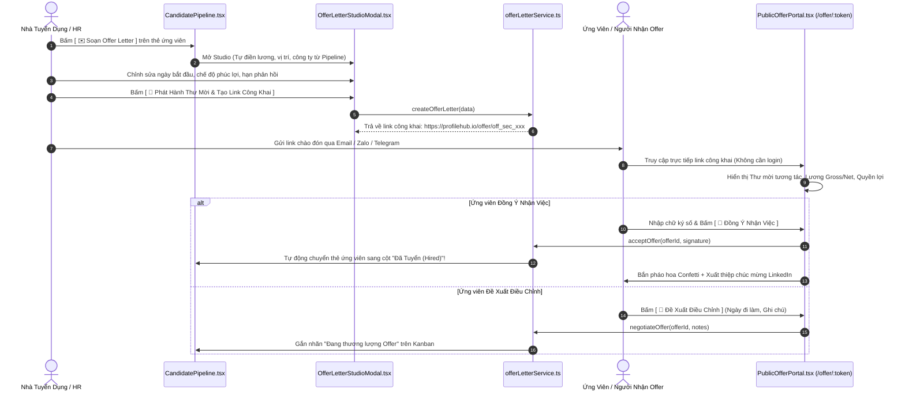

# Kế Hoạch Triển Khai: Public Interactive Offer Portal & Enterprise Offer Letter Studio
> **Mã kế hoạch:** `PLAN-20261109-PUBLIC-OFFER-PORTAL`  
> **Mã đặc tả:** `SPEC-20261109-PUBLIC-OFFER-PORTAL`  
> **Áp dụng chuẩn:** [ROLES_AND_GOVERNANCE_RULES.md](file:///C:/Users/ADMIN/Desktop/STUDY/docs/architecture/ROLES_AND_GOVERNANCE_RULES.md) (Chuỗi Baton T1 - T2 - T3)  
> **Spec Directory:** [`docs/superpowers/specs/2026-11-09-public-offer-portal-and-letter-studio/`](file:///C:/Users/ADMIN/Desktop/STUDY/docs/superpowers/specs/2026-11-09-public-offer-portal-and-letter-studio/)  
> **Nhánh Git:** `profilehub_v1`  
> **Trạng thái:** APPROVED / READY FOR IMPLEMENTATION  
> **Mục tiêu chiến lược:** Xây dựng cổng chào đón ứng viên công khai (Public Interactive Offer Portal) chuẩn SaaS đẳng cấp quốc tế kết hợp Studio tạo thư mời nhận việc (Offer Letter Studio) cho Nhà tuyển dụng, hoàn thiện mắt xích quan trọng nhất của chu trình tuyển dụng và tạo độ nhận diện thương hiệu mở rộng ra bên ngoài.

---

## 🎯 1. Bối Cảnh & Vấn Đề (Context & Problem Statement)

1. **Đứt gãy trải nghiệm sau phỏng vấn (The Post-Interview Void):**
   - ProfileHub đã có chu trình hoàn hảo từ Đăng tin -> Ứng tuyển -> Take-Home Challenge -> Interview Scorecard -> Báo cáo điều hành (Executive Dossier).
   - Tuy nhiên, sau khi Giám đốc bấm duyệt `HIRE`, quy trình tuyển dụng lại rơi vào ngõ cụt: HR phải thoát web, mở file Word/PDF thủ công để soạn thư mời nhận việc, rồi gửi qua email thông thường.
2. **Thiếu tính năng Public lan tỏa thương hiệu (Brand Virality & Public Exposure):**
   - Đa số tính năng tuyển dụng hiện nằm sau bức tường đăng nhập (`/recruiter/pipeline`).
   - Để website thực sự thu hút cộng đồng bên ngoài và có giá trị sử dụng công khai, cần có **Cổng chào đón nhận việc công khai (Public Offer Acceptance Portal)** tại đường dẫn mở `public` (VD: `/offer/:secureToken` hoặc `/offer/:offerId`).
   - Ứng viên khi nhận link thư mời có thể truy cập ngay mà không bắt buộc phải đăng nhập phức tạp, trải nghiệm xem thư mời tương tác, chiêm ngưỡng lời chào mừng của công ty, xem minh bạch phúc lợi, ký điện tử trực tiếp, hoặc chia sẻ hình ảnh "I Accepted the Offer!" lên LinkedIn/Facebook.
3. **Thương lượng bất tiện & Không cập nhật Pipeline tự động:**
   - Ứng viên muốn đề xuất lùi ngày đi làm 1 tuần hoặc hỏi thêm về thiết bị làm việc thường phải reply email qua lại nhiều ngày.
   - Khi ứng viên đồng ý nhận việc, thẻ Kanban trên Pipeline tuyển dụng không tự động nhảy sang trạng thái `hired`, dẫn đến việc quản lý dữ liệu bị phân mảnh.

---

## 🏛️ 2. Kiến Trúc Giải Pháp & Sơ Đồ Luồng (Solution Architecture)

---

## 📋 3. Phân Rã Chi Tiết Theo Vai Trò & Tính Năng Thiết Thực

### 🅰️ Phía Nhà Tuyển Dụng (Recruiter Studio)
1. **Offer Letter Studio Modal (`OfferLetterStudioModal.tsx`):**
   - Tích hợp nút `[ ✉️ Soạn Thư Mời Offer ]` ngay trên thẻ Kanban tại trang Pipeline (`CandidatePipeline.tsx`).
   - Tự động kế thừa thông tin ứng viên: Họ tên, vị trí, mức lương deal từ Scorecard/Dossier, thông tin công ty và Tích xanh MST doanh nghiệp.
   - Bộ cấu hình chuyên nghiệp:
     - Chức danh (Job Title) & Cấp bậc (Level).
     - Thu nhập: Lương chính thức (Gross/Net), Lương thử việc (85% hoặc 100%), Thưởng gia nhập (Sign-on Bonus).
     - Ngày bắt đầu làm việc (Start Date) & Thời hạn phản hồi offer (Deadline).
     - Địa điểm làm việc & Hình thức (On-site, Hybrid, Remote).
     - Gói phúc lợi: Bảo hiểm sức khỏe VIP, trợ cấp thiết bị (MacBook), du lịch năm, ngày phép.
     - Lời nhắn gửi riêng từ CEO / CTO / Tech Lead.
   - Xem trước nhanh định dạng chuẩn A4 hoặc thiệp web.
   - Nút `[ 🔗 Sao Chép Link Thư Mời Công Khai ]` & `[ 🖨️ In / Tải PDF Offer ]`.

### 🅱️ Phía Công Khai & Ứng Viên (Public Interactive Portal)
1. **Trang Chào Đón Nhận Việc Công Khai (`/offer/:token` - `PublicOfferPortal.tsx`):**
   - **Hoàn toàn công khai (Public Route):** Bất kỳ ai có đường link bảo mật đều có thể xem mà không bị rào cản đăng nhập.
   - **Giao diện Hero chào đón ấn tượng (Delightful Hero Section):**
     - Logo công ty nổi bật kèm huy hiệu Tích xanh doanh nghiệp xác thực.
     - Dòng thông điệp chào đón cá nhân hóa: *"Chào mừng [Họ Tên] gia nhập đội ngũ phát triển sản phẩm của [Tên Công Ty]!"*
   - **Thẻ phân tích minh bạch thu nhập (Interactive Compensation Card):**
     - Bóc tách rõ ràng mức lương, phụ cấp, thưởng và số ngày phép.
     - Đồng hồ đếm ngược thời hạn phản hồi offer (Countdown Timer).
   - **Khu vực Trải nghiệm & Quyền lợi (Company Culture & Perks Grid):**
     - Hiển thị môi trường làm việc, thiết bị được cấp, quyền lợi bảo hiểm, lộ trình đào tạo.
   - **Cơ chế Ký Số & Xác Nhận 1-Click (1-Click Digital Sign-off):**
     - Ứng viên gõ họ tên chữ ký điện tử -> Bấm `[ 🎉 Xác Nhận Nhận Việc ]`.
     - Kích hoạt hiệu ứng pháo hoa toàn màn hình (Canvas Confetti).
     - Sinh huy hiệu chia sẻ mạng xã hội: *"Tôi vừa chính thức gia nhập [Company] với vai trò [Position] qua ProfileHub!"*.
   - **Cơ chế Phản Hồi Linh Hoạt (Interactive Negotiation / Notes):**
     - Cho phép ứng viên gửi phản hồi nếu cần thay đổi ngày nhận việc hoặc có câu hỏi trước khi chốt, thông tin phản hồi lập tức cập nhật về Dashboard của HR.

### 🅲 Tự Động Hóa Đồng Bộ Hệ Thống (Pipeline Sync & State Invariants)
- Khi Offer được tạo -> Kanban Candidate Pipeline cập nhật trạng thái `offer_extended` (Đã gửi Offer).
- Khi Offer được chấp thuận -> Kanban tự động nhảy sang `hired` (Đã tuyển thành công).
- Khi Offer bị từ chối / thương lượng -> Cập nhật ghi chú trực tiếp vào timeline của ứng viên.

---

## 🛠️ 4. Phân Công Baton Chain (T1 - T2 - T3)

- **Tầng 1 (Data Types & Invariants):**
  - Khai báo model `OfferLetter`, `OfferBenefitItem`, `OfferStatus` trong `src/types/database.ts`.
- **Tầng 2 (Logic & Storage Service):**
  - Viết `src/services/offerLetterService.ts` quản lý CRUD, sinh mã bảo mật token duy nhất, mã hóa trạng thái, tự động đồng bộ sang Pipeline.
  - Viết test suite `src/services/offerLetterService.test.ts` đảm bảo 100% logic tính lương, hạn nộp, token lookup và chuyển đổi trạng thái đạt chuẩn.
- **Tầng 3 (Public UI & Recruiter Components):**
  - Trang công khai `src/pages/public/PublicOfferPortal.tsx` (Route `/offer/:token`).
  - Component modal Studio `src/components/recruiter/OfferLetterStudioModal.tsx`.
  - Tích hợp nút `[ ✉️ Soạn Offer ]` và thẻ hiển thị trạng thái Offer trong `src/pages/recruiter/CandidatePipeline.tsx`.
  - Đăng ký route công khai trong `src/App.tsx`.

---

## 🔒 5. Quality Gates & Acceptance Criteria

- **TypeScript:** `npx tsc --noEmit` đạt 0 lỗi biên dịch.
- **Unit Tests:** Toàn bộ test suite cũ (53 files / 293 tests) + test mới cho `offerLetterService` đều pass 100%.
- **Vite Build:** `npm run build` xuất bản bundle production sạch sẽ, không lỗi vỡ import.
- **Public Access Verification:** Truy cập trực tiếp đường dẫn `/offer/:token` ở chế độ trình duyệt ẩn danh không bị chuyển hướng về `/login`.
