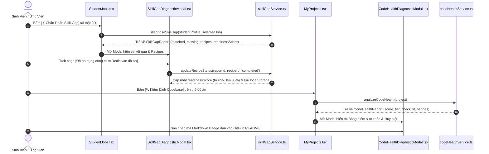

# Kế Hoạch Triển Khai: Chẩn Đoán Khoảng Cách Kỹ Năng & Trợ Lý Nâng Cấp Đồ Án (Skill-Gap Diagnostic & Project Upgrader)
> **Mã kế hoạch:** `PLAN-20261109-SKILL-GAP-UPGRADER`  
> **Áp dụng chuẩn:** [ROLES_AND_GOVERNANCE_RULES.md](file:///C:/Users/ADMIN/Desktop/STUDY/docs/architecture/ROLES_AND_GOVERNANCE_RULES.md) (Chuỗi Baton T1 - T2 - T3)  
> **Tài liệu tham chiếu:**  
> - Nghiên cứu kỹ thuật: [`docs/superpowers/specs/2026-11-09-skill-gap-and-project-upgrader/research.md`](file:///C:/Users/ADMIN/Desktop/STUDY/docs/superpowers/specs/2026-11-09-skill-gap-and-project-upgrader/research.md)  
> - Mô hình dữ liệu: [`docs/superpowers/specs/2026-11-09-skill-gap-and-project-upgrader/data-model.md`](file:///C:/Users/ADMIN/Desktop/STUDY/docs/superpowers/specs/2026-11-09-skill-gap-and-project-upgrader/data-model.md)  
> - Giao ước kỹ thuật: [`docs/superpowers/specs/2026-11-09-skill-gap-and-project-upgrader/contracts/skill-gap-upgrader-api.md`](file:///C:/Users/ADMIN/Desktop/STUDY/docs/superpowers/specs/2026-11-09-skill-gap-and-project-upgrader/contracts/skill-gap-upgrader-api.md)  
> - Hướng dẫn kiểm thử nhanh: [`docs/superpowers/specs/2026-11-09-skill-gap-and-project-upgrader/quickstart.md`](file:///C:/Users/ADMIN/Desktop/STUDY/docs/superpowers/specs/2026-11-09-skill-gap-and-project-upgrader/quickstart.md)  
> **Nhánh Git:** `profilehub_v1`  
> **Mục tiêu:** Biến nền tảng thành bệ phóng năng lực cho sinh viên thông qua việc phát hiện chính xác lỗ hổng kỹ năng so với JD mong muốn, đề xuất các công thức nâng cấp mã nguồn (Recipes) thực tế vào đồ án, và cấp chứng chỉ sức khỏe mã nguồn chuẩn Production.

---

## 🎯 Mục Tiêu Cốt Lõi (Core Goals)

1. **Bộ Máy Chẩn Đoán Skill Gap & Đề Xuất Công Thức Nâng Cấp (Skill-Gap Engine & Recipe Bank):**
   - Phân tích đối chiếu giữa kỹ năng của sinh viên (từ CV & Đồ án) với yêu cầu tuyển dụng của Job.
   - Phân loại rõ ràng: Kỹ năng đã khớp $\leftrightarrow$ Kỹ năng còn thiếu (phân cấp `critical`, `recommended`, `optional`).
   - Cung cấp các công thức nâng cấp mã nguồn (Actionable Recipes) cho các kỹ năng hay thiếu (Redis, Docker, Unit Test, Message Queue, Indexing, CI/CD).
   - Tự động cộng điểm tăng hạng `readinessScore` khi sinh viên hoàn thành mini-task.

2. **Bộ Máy Kiểm Định Sức Khỏe Mã Nguồn Không Xâm Lấn (Code Quality & Architecture Health Check):**
   - Đánh giá kho lưu trữ GitHub của đồ án theo 5 tiêu chuẩn vàng: README, Gitignore, Bảo mật bí mật `.env`, Kiểm thử Unit Tests, CI/CD Pipeline.
   - Xếp hạng phân bậc: `A+ Production-Ready` / `B Solid Junior` / `C Needs Refactor`.
   - Cấp huy hiệu bảo chứng kỹ thuật có thể nhúng trực tiếp vào GitHub README.

3. **Giao Diện Trực Quan, Trải Nghiệm Mượt Mà (Interactive UI Integration):**
   - Nút `[ ⚡ Chẩn Đoán Skill-Gap ]` đặt tại mỗi tin tuyển dụng trên [`StudentJobs.tsx`](file:///C:/Users/ADMIN/Desktop/STUDY/profilehub/src/pages/student/StudentJobs.tsx) mở modal `SkillGapDiagnosticModal.tsx`.
   - Nút `[ 🔍 Kiểm Định Codebase ]` đặt tại mỗi đồ án trên [`MyProjects.tsx`](file:///C:/Users/ADMIN/Desktop/STUDY/profilehub/src/pages/student/MyProjects.tsx) mở modal `CodeHealthDiagnosticModal.tsx`.

---

## 🏛️ Sơ Đồ Luồng Tương Tác (Baton Sequence Flow)

---

## 📋 Phân Rã Kỹ Thuật (Baton Chain Breakdown: T1 - T2 - T3)

### 🔹 Giai Đoạn T1: Hạ Tầng Dữ Liệu & Service Logic (Core Engine)
*Trách nhiệm: Core Logic & Services*
* **T1.1:** Mở rộng kiểu dữ liệu trong [`src/types/database.ts`](file:///C:/Users/ADMIN/Desktop/STUDY/profilehub/src/types/database.ts) với `SkillGapReport`, `ProjectUpgradeRecipe`, `CodeHealthReport`, và các enum liên quan.
* **T1.2:** Xây dựng service [`src/services/skillGapService.ts`](file:///C:/Users/ADMIN/Desktop/STUDY/profilehub/src/services/skillGapService.ts):
  - Hàm bóc tách kỹ năng, đối chiếu ontology/alias dictionary, tính `readinessScore`.
  - Ngân hàng Recipe Template Bank chuẩn hóa cho các công nghệ cốt lõi (Redis, Docker, Vitest, CI/CD, SQL Indexing).
  - Quản lý trạng thái lưu trữ trong `localStorage`.
* **T1.3:** Xây dựng service [`src/services/codeHealthService.ts`](file:///C:/Users/ADMIN/Desktop/STUDY/profilehub/src/services/codeHealthService.ts):
  - Hàm phân tích cấu trúc repo GitHub (qua metadata hoặc manifest).
  - Chấm điểm theo 5 tiêu chuẩn an toàn & kiến trúc, xếp hạng `A+/B/C` và cấp huy hiệu.
* **T1.4:** Viết toàn diện bộ test cases tự động:
  - [`src/services/skillGapService.test.ts`](file:///C:/Users/ADMIN/Desktop/STUDY/profilehub/src/services/skillGapService.test.ts)
  - [`src/services/codeHealthService.test.ts`](file:///C:/Users/ADMIN/Desktop/STUDY/profilehub/src/services/codeHealthService.test.ts)

---

### 🔹 Giai Đoạn T2: Xây Dựng Giao Diện UI & Tích Hợp Người Dùng
*Trách nhiệm: Frontend & UX Components*
* **T2.1:** Xây dựng component modal [`src/components/student/SkillGapDiagnosticModal.tsx`](file:///C:/Users/ADMIN/Desktop/STUDY/profilehub/src/components/student/SkillGapDiagnosticModal.tsx):
  - Thanh đo tiến trình điểm sẵn sàng tuyển dụng `readinessScore`.
  - Hai cột so sánh trực quan Kỹ năng đạt $\leftrightarrow$ Kỹ năng thiếu.
  - Danh sách thẻ Recipe Card có nút mở chi tiết mã nguồn mẫu và nút đánh dấu hoàn thành.
* **T2.2:** Xây dựng component modal [`src/components/student/CodeHealthDiagnosticModal.tsx`](file:///C:/Users/ADMIN/Desktop/STUDY/profilehub/src/components/student/CodeHealthDiagnosticModal.tsx):
  - Huy hiệu điểm số và xếp hạng phân bậc.
  - Checklist 5 tiêu chuẩn vàng với icon màu sắc rõ nét.
  - Nút sao chép mã Markdown Badge nhúng vào GitHub.
* **T2.3:** Tích hợp nút `[ ⚡ Chẩn Đoán Skill-Gap ]` vào [`src/pages/student/StudentJobs.tsx`](file:///C:/Users/ADMIN/Desktop/STUDY/profilehub/src/pages/student/StudentJobs.tsx).
* **T2.4:** Tích hợp nút `[ 🔍 Kiểm Định Codebase ]` vào từng thẻ đồ án trong [`src/pages/student/MyProjects.tsx`](file:///C:/Users/ADMIN/Desktop/STUDY/profilehub/src/pages/student/MyProjects.tsx).

---

### 🔹 Giai Đoạn T3: Kiểm Thử Toàn Diện, Nghiệm Thu & Đóng Gói
*Trách nhiệm: Quality Gate & Verification*
* **T3.1:** Kiểm tra biên dịch TypeScript với `npx tsc --noEmit` đạt 0 lỗi.
* **T3.2:** Chạy toàn bộ test suites tự động `npx vitest run` đảm bảo 100% tests pass.
* **T3.3:** Đóng gói sản phẩm production với `npm run build` qua Vite bundle thành công.
