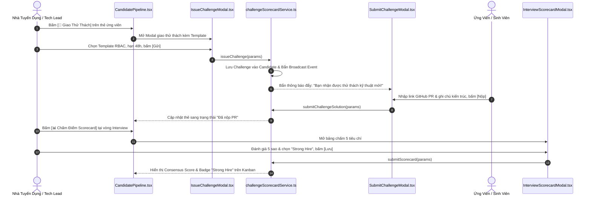

# Kế Hoạch Triển Khai: Thử Thách Kỹ Thuật Thực Chiến & Bảng Chấm Điểm Phỏng Vấn Chuẩn Hóa
> **Mã kế hoạch:** `PLAN-20261109-CHALLENGE-SCORECARD`  
> **Áp dụng chuẩn:** [ROLES_AND_GOVERNANCE_RULES.md](file:///C:/Users/ADMIN/Desktop/STUDY/docs/architecture/ROLES_AND_GOVERNANCE_RULES.md) (Chuỗi Baton T1 - T2 - T3)  
> **Tài liệu tham chiếu:**  
> - Nghiên cứu kỹ thuật: [`docs/superpowers/specs/2026-11-09-take-home-challenge-and-collaborative-scorecard/research.md`](file:///C:/Users/ADMIN/Desktop/STUDY/docs/superpowers/specs/2026-11-09-take-home-challenge-and-collaborative-scorecard/research.md)  
> - Mô hình dữ liệu: [`docs/superpowers/specs/2026-11-09-take-home-challenge-and-collaborative-scorecard/data-model.md`](file:///C:/Users/ADMIN/Desktop/STUDY/docs/superpowers/specs/2026-11-09-take-home-challenge-and-collaborative-scorecard/data-model.md)  
> - Giao ước kỹ thuật: [`docs/superpowers/specs/2026-11-09-take-home-challenge-and-collaborative-scorecard/contracts/challenge-scorecard-api.md`](file:///C:/Users/ADMIN/Desktop/STUDY/docs/superpowers/specs/2026-11-09-take-home-challenge-and-collaborative-scorecard/contracts/challenge-scorecard-api.md)  
> - Hướng dẫn kiểm thử nhanh: [`docs/superpowers/specs/2026-11-09-take-home-challenge-and-collaborative-scorecard/quickstart.md`](file:///C:/Users/ADMIN/Desktop/STUDY/docs/superpowers/specs/2026-11-09-take-home-challenge-and-collaborative-scorecard/quickstart.md)  
> **Nhánh Git:** `profilehub_v1`  
> **Mục tiêu:** Tối ưu hóa toàn diện hiệu suất tuyển dụng cho Doanh nghiệp: Cho phép 1-click giao thử thách kỹ thuật thực tế trên repo đồ án của ứng viên, cung cấp bảng chấm điểm phỏng vấn chuẩn hóa 5 tiêu chí (Collaborative Scorecard), và kích hoạt chế độ sàng lọc ẩn danh (Blind Screening) loại bỏ 100% định kiến vô thức.

---

## 🎯 Mục Tiêu Cốt Lõi (Core Goals)

1. **Phòng Giao Thử Thách Kỹ Thuật Gắn Đồ Án (Evidence-Based Take-Home Challenge Studio):**
   - Nhà tuyển dụng giao thử thách thực tế có deadline (48h/72h) trực tiếp trên Kanban Pipeline.
   - Sinh viên nhận thông báo thời gian thực, làm bài trên branch mới của repo đồ án và nộp link GitHub Pull Request.
   - Thẻ Kanban tự động hiển thị trạng thái `Đang làm`, `Đã nộp PR`, và điểm đánh giá.

2. **Bảng Chấm Điểm Phỏng Vấn Chuẩn Hóa 5 Tiêu Chí (Collaborative Interview Scorecard):**
   - Chuẩn hóa quy trình phỏng vấn theo chuẩn Google & Meta với 5 tiêu chuẩn vàng: Kiến trúc, Phản biện code, Gỡ lỗi, Giao tiếp, Văn hóa.
   - Cho phép nhiều người phỏng vấn chấm điểm độc lập, tự động tính điểm đồng thuận (Consensus Score: 0 - 100) và xếp hạng đề xuất (`Strong Hire`, `Hire`, `Neutral`, `No Hire`).

3. **Chế Độ Sàng Lọc Ẩn Danh (Blind Screening Mode):**
   - Công tắc chuyển đổi che tên thật, avatar, trường đại học của ứng viên để loại bỏ thiên kiến vô thức.
   - Đảm bảo việc sàng lọc chỉ dựa trên năng lực thực chất (Merit-based): Đồ án bảo chứng, Điểm Code Health `A+`, và chất lượng bài giải thử thách.

---

## 🏛️ Sơ Đồ Luồng Tương Tác (Baton Sequence Flow)

---

## 📋 Phân Rã Kỹ Thuật (Baton Chain Breakdown: T1 - T2 - T3)

### 🔹 Giai Đoạn T1: Hạ Tầng Dữ Liệu & Service Logic (Core Engine)
*Trách nhiệm: Core Logic & Services*
* **T1.1:** Định nghĩa kiểu dữ liệu `TakeHomeChallenge`, `ChallengeSubmission`, `InterviewScorecard`, `ScorecardCriteriaScores` trong [`src/types/database.ts`](file:///C:/Users/ADMIN/Desktop/STUDY/profilehub/src/types/database.ts).
* **T1.2:** Xây dựng service [`src/services/challengeScorecardService.ts`](file:///C:/Users/ADMIN/Desktop/STUDY/profilehub/src/services/challengeScorecardService.ts):
  - Hàm `issueChallenge`, `submitChallengeSolution`, `evaluateChallenge`.
  - Hàm `submitScorecard`, `calculateConsensus`.
  - Hàm `getBlindCandidateInfo` hỗ trợ chế độ sàng lọc ẩn danh.
* **T1.3:** Viết bộ test đơn vị tự động kiểm thử toàn diện trong [`src/services/challengeScorecardService.test.ts`](file:///C:/Users/ADMIN/Desktop/STUDY/profilehub/src/services/challengeScorecardService.test.ts).

---

### 🔹 Giai Đoạn T2: Xây Dựng Giao Diện UI & Tích Hợp Pipeline
*Trách nhiệm: Frontend & UX Components*
* **T2.1:** Xây dựng component modal [`src/components/recruiter/IssueChallengeModal.tsx`](file:///C:/Users/ADMIN/Desktop/STUDY/profilehub/src/components/recruiter/IssueChallengeModal.tsx) với thư viện đề bài mẫu (Template Bank) và chọn hạn nộp 48h/72h.
* **T2.2:** Xây dựng component modal [`src/components/student/SubmitChallengeModal.tsx`](file:///C:/Users/ADMIN/Desktop/STUDY/profilehub/src/components/student/SubmitChallengeModal.tsx) hỗ trợ sinh viên nộp link GitHub PR và đếm ngược deadline.
* **T2.3:** Xây dựng component modal [`src/components/recruiter/InterviewScorecardModal.tsx`](file:///C:/Users/ADMIN/Desktop/STUDY/profilehub/src/components/recruiter/InterviewScorecardModal.tsx) chấm điểm 5 tiêu chuẩn vàng với giao diện sao và chọn quyết định tuyển dụng.
* **T2.4:** Tích hợp nút hành động và công tắc `[ 🕶️ Chế Độ Ẩn Danh (Blind Screening) ]` vào [`src/pages/recruiter/CandidatePipeline.tsx`](file:///C:/Users/ADMIN/Desktop/STUDY/profilehub/src/pages/recruiter/CandidatePipeline.tsx).

---

### 🔹 Giai Đoạn T3: Kiểm Thử Toàn Diện, Nghiệm Thu & Đóng Gói
*Trách nhiệm: Quality Gate & Verification*
* **T3.1:** Kiểm tra biên dịch TypeScript với `npx tsc --noEmit` đạt 0 lỗi.
* **T3.2:** Chạy toàn bộ test suites tự động `npx vitest run` đảm bảo 100% tests pass.
* **T3.3:** Đóng gói sản phẩm production với `npm run build` qua Vite bundle thành công.
