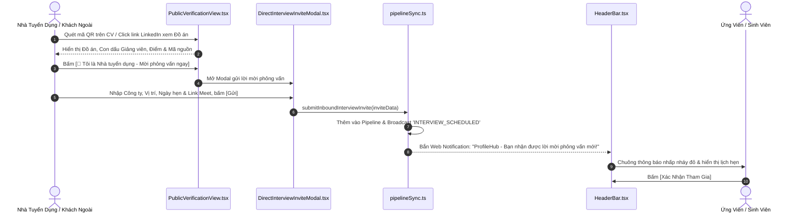

# Kế Hoạch Triển Khai: Cổng Lan Tỏa Hồ Sơ & Mời Phỏng Vấn Trực Tiếp Từ Public Verification
> **Mã kế hoạch:** `PLAN-20261109-VIRAL-GATEWAY`  
> **Áp dụng chuẩn:** [ROLES_AND_GOVERNANCE_RULES.md](file:///C:/Users/ADMIN/Desktop/STUDY/docs/architecture/ROLES_AND_GOVERNANCE_RULES.md) (Chuỗi Baton T1 - T2 - T3)  
> **Tài liệu tham chiếu:**  
> - Nghiên cứu kỹ thuật: [`docs/superpowers/specs/2026-11-09-viral-portfolio-interview-gateway/research.md`](file:///C:/Users/ADMIN/Desktop/STUDY/docs/superpowers/specs/2026-11-09-viral-portfolio-interview-gateway/research.md)  
> - Mô hình dữ liệu: [`docs/superpowers/specs/2026-11-09-viral-portfolio-interview-gateway/data-model.md`](file:///C:/Users/ADMIN/Desktop/STUDY/docs/superpowers/specs/2026-11-09-viral-portfolio-interview-gateway/data-model.md)  
> - Giao ước kỹ thuật: [`docs/superpowers/specs/2026-11-09-viral-portfolio-interview-gateway/contracts/viral-gateway-api.md`](file:///C:/Users/ADMIN/Desktop/STUDY/docs/superpowers/specs/2026-11-09-viral-portfolio-interview-gateway/contracts/viral-gateway-api.md)  
> - Hướng dẫn kiểm thử nhanh: [`docs/superpowers/specs/2026-11-09-viral-portfolio-interview-gateway/quickstart.md`](file:///C:/Users/ADMIN/Desktop/STUDY/docs/superpowers/specs/2026-11-09-viral-portfolio-interview-gateway/quickstart.md)  
> **Nhánh Git:** `profilehub_v1`  
> **Mục tiêu:** Biến trang tra cứu đồ án công khai và mã QR trên CV thành kênh chuyển đổi tuyển dụng trực tiếp: Nhà tuyển dụng bên ngoài có thể gửi lời mời phỏng vấn ngay tại chỗ $\leftrightarrow$ Sinh viên dễ dàng khoe đồ án lên LinkedIn & GitHub với mã bảo chứng chính thức.

---

## 🎯 Mục Tiêu Cốt Lõi (Core Goals)

1. **Nút Hành Động Mời Phỏng Vấn Trực Tiếp (Direct Interview CTA):**
   - Đặt nút bấm nổi bật trên [`PublicVerificationView.tsx`](file:///C:/Users/ADMIN/Desktop/STUDY/profilehub/src/pages/public/PublicVerificationView.tsx).
   - Khi nhà tuyển dụng xem đồ án và ưng ý, họ có thể bấm ngay để gửi lời mời phỏng vấn mà không cần trải qua các bước tìm kiếm phức tạp.
2. **Modal Hẹn Lịch Nhanh Cho Doanh Nghiệp (Fast Inbound Schedule Modal):**
   - Hỗ trợ cả nhà tuyển dụng đã đăng nhập (chọn từ tin tuyển dụng có sẵn) hoặc khách vãng lai (nhập tên công ty, email, dải lương đề xuất, ngày giờ và link Google Meet).
   - Tự động nạp vào `CandidatePipeline.tsx` và kích hoạt thông báo đẩy thời gian thực qua `pipelineSync.ts`.
3. **Bộ Công Cụ Lan Tỏa Đồ Án (Viral Growth Toolkit):**
   - Nút chia sẻ 1-click lên LinkedIn với thông điệp tôn vinh thành tích học thuật và đồ án được bảo chứng.
   - Sinh đoạn mã Markdown Badge chèn vào file `README.md` trên GitHub của sinh viên dẫn thẳng về trang xác thực ProfileHub.

---

## 🏛️ Sơ Đồ Luồng Tương Tác (Baton Sequence Flow)

---

## 📋 Phân Rã Công Việc Kỹ Thuật (Baton Chain Breakdown: T1 - T2 - T3)

### 🔹 Giai Đoạn T1: Hạ Tầng Dữ Liệu & Service Hàm Nghiệp Vụ
*Trách nhiệm: Core Logic & Backend*
* **T1.1:** Định nghĩa kiểu dữ liệu `InboundInterviewInvite` trong [`src/types/database.ts`](file:///C:/Users/ADMIN/Desktop/STUDY/profilehub/src/types/database.ts).
* **T1.2:** Xây dựng hàm `submitInboundInterviewInvite` trong [`src/utils/pipelineSync.ts`](file:///C:/Users/ADMIN/Desktop/STUDY/profilehub/src/utils/pipelineSync.ts): tạo pipeline item mới, lưu storage và phát broadcast event.
* **T1.3:** Viết test cases kiểm thử luồng inbound invite trong [`src/utils/pipelineSync.test.ts`](file:///C:/Users/ADMIN/Desktop/STUDY/profilehub/src/utils/pipelineSync.test.ts).

---

### 🔹 Giai Đoạn T2: Xây Dựng Giao Diện Modal & Tích Hợp Trang Công Khai
*Trách nhiệm: Frontend & UI Integration*
* **T2.1:** Tạo component `DirectInterviewInviteModal.tsx`:
  - Form nhập thông tin: Tên công ty, Email liên hệ, Chức danh tuyển dụng, Ngày giờ phỏng vấn, Link Google Meet, Lời nhắn.
  - Tự động điền thông tin nếu Recruiter đã đăng nhập trên trình duyệt.
* **T2.2:** Tạo component `ViralShareBadgeModal.tsx`:
  - Nút chia sẻ LinkedIn, nút sao chép link chứng chỉ, đoạn mã Markdown chèn vào GitHub `README.md`.
* **T2.3:** Tích hợp 2 nút bấm mới vào [`PublicVerificationView.tsx`](file:///C:/Users/ADMIN/Desktop/STUDY/profilehub/src/pages/public/PublicVerificationView.tsx):
  - Nút `[ 🏢 Mời Phỏng Vấn Trực Tiếp ]` với style gradient tím nổi bật.
  - Nút `[ 🔗 Lan Tỏa & Khoe Đồ Án ]` với style viền sáng.

---

### 🔹 Giai Đoạn T3: Kiểm Thử Toàn Diện, Nghiệm Thu & Đóng Gói
*Trách nhiệm: Quality Gate & Verification*
* **T3.1:** Kiểm tra biên dịch TypeScript với `npx tsc --noEmit` đạt 0 lỗi.
* **T3.2:** Chạy toàn bộ test suites tự động `npx vitest run` đạt 100% pass.
* **T3.3:** Kiểm tra đóng gói `npm run build` qua Vite bundle thành công.
