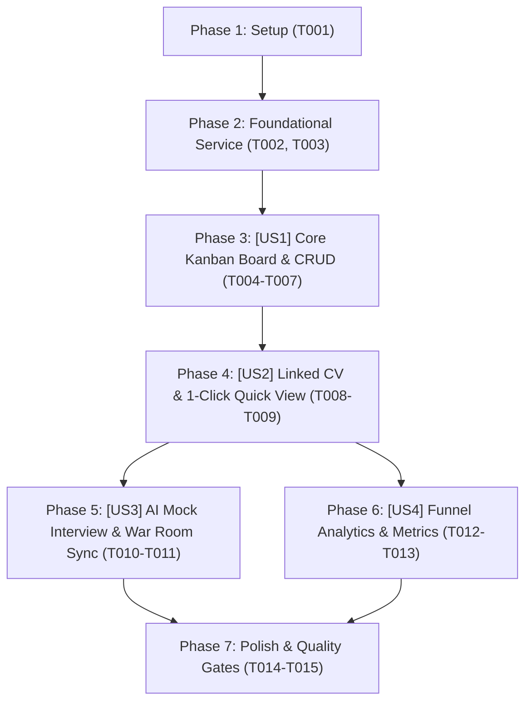

# Tasks: Application Pipeline Tracker (Bảng Kanban Theo Dõi Nộp Đơn Ứng Tuyển)

> **Feature Name:** Application Pipeline Tracker  
> **Plan Document:** [`docs/superpowers/plans/2026-11-04-application-pipeline-tracker-plan.md`](file:///C:/Users/ADMIN/Desktop/STUDY/docs/superpowers/plans/2026-11-04-application-pipeline-tracker-plan.md)  
> **Spec Directory:** [`docs/superpowers/specs/2026-11-04-application-pipeline-tracker/`](file:///C:/Users/ADMIN/Desktop/STUDY/docs/superpowers/specs/2026-11-04-application-pipeline-tracker/)  
> **Branch:** `profilehub_v1`  
> **Checklist Format Requirement:** `- [ ] [TaskID] [P?] [Story?] Description with file path`

---

## Dependencies & Story Execution Order

---

## Phase 1: Setup

- [X] T001 Khởi tạo schema types và enums cho đơn ứng tuyển trong profilehub/src/types/application.types.ts

---

## Phase 2: Foundational (Blocking Prerequisites)

- [X] T002 [P] Xây dựng service quản trị dữ liệu applicationTrackerService trong profilehub/src/services/applicationTrackerService.ts
- [X] T003 [P] Viết bộ kiểm thử Unit Test cho applicationTrackerService trong profilehub/src/services/applicationTrackerService.test.ts

---

## Phase 3: User Story 1 - Core Kanban Board & Application CRUD (P1 - MVP)

**Story Goal:** Ứng viên xem được bảng Kanban 6 cột trạng thái, tạo đơn ứng tuyển mới và kéo/chuyển trạng thái giữa các giai đoạn tuyển dụng.  
**Independent Test Criteria:** Thêm đơn mới thành công; thẻ hiển thị đúng cột; chuyển stage cập nhật tức thì.

- [X] T004 [P] [US1] Xây dựng thẻ hiển thị công ty ApplicationCard trong profilehub/src/components/student/ApplicationCard.tsx
- [X] T005 [P] [US1] Xây dựng modal thêm/sửa đơn ứng tuyển AddApplicationModal trong profilehub/src/components/student/AddApplicationModal.tsx
- [X] T006 [US1] Xây dựng bảng Kanban 6 cột ApplicationKanbanBoard trong profilehub/src/components/student/ApplicationKanbanBoard.tsx
- [X] T007 [US1] Tích hợp tab chuyển đổi Việc Làm và Tiến Trình Ứng Tuyển trong profilehub/src/pages/student/StudentJobs.tsx

---

## Phase 4: User Story 2 - Linked CV Versioning & 1-Click Quick View (P1 - MVP)

**Story Goal:** Mỗi đơn ứng tuyển gắn chặt với 1 bản CV trong kho; ứng viên 1-click mở xem đúng bản CV đã gửi cho công ty đó.  
**Independent Test Criteria:** Dropdown load đủ CV từ `cvService`; click nút "Xem CV đã nộp" mở đúng modal `CvQuickViewModal` với dữ liệu CV tương ứng.

- [X] T008 [P] [US2] Tích hợp bộ chọn CV từ cvService vào modal trong profilehub/src/components/student/AddApplicationModal.tsx
- [X] T009 [US2] Kết nối nút xem nhanh CV đã nộp mở CvQuickViewModal trong profilehub/src/components/student/ApplicationCard.tsx

---

## Phase 5: User Story 3 - AI Interview Coach & War Room Integration (P2)

**Story Goal:** Từ thẻ công ty trên Kanban, ứng viên 1-click mở phòng luyện phỏng vấn AI được may đo theo đúng công ty và vị trí đó. Tự động đồng bộ lịch phỏng vấn sang Dashboard War Room.  
**Independent Test Criteria:** Click nút "Luyện phỏng vấn AI" truyền đúng tên công ty & vị trí vào `AiMockInterviewModal`; chuyển stage `interview` đồng bộ vào `selfInterviewService`.

- [X] T010 [P] [US3] Tích hợp nút hành động mở AiMockInterviewModal trên thẻ công ty trong profilehub/src/components/student/ApplicationCard.tsx
- [X] T011 [US3] Kích hoạt hàm đồng bộ lịch phỏng vấn sang selfInterviewService khi đơn chuyển sang stage interview trong profilehub/src/services/applicationTrackerService.ts

---

## Phase 6: User Story 4 - Application Analytics & Funnel Metrics (P2)

**Story Goal:** Hiển thị thanh đo lường hiệu quả săn việc (Tổng đơn, đang xử lý, số phỏng vấn, số offer, tỷ lệ phản hồi %).  
**Independent Test Criteria:** Các con số thống kê thay đổi tương ứng theo số lượng và trạng thái các thẻ trên Kanban.

- [X] T012 [P] [US4] Xây dựng thanh thống kê phễu ứng tuyển ApplicationAnalyticsWidget trong profilehub/src/components/student/ApplicationAnalyticsWidget.tsx
- [X] T013 [US4] Nhúng ApplicationAnalyticsWidget lên đầu bảng Kanban trong profilehub/src/components/student/ApplicationKanbanBoard.tsx

---

## Phase 7: Polish & Quality Gates

- [X] T014 [P] Tối ưu hóa hiển thị Responsive Mobile dưới 360px và Dark Theme tương phản trong profilehub/src/components/student/ApplicationKanbanBoard.tsx
- [X] T015 Chạy kiểm thử tự động toàn diện vitest run và tsc noEmit đạt 0 lỗi trong profilehub
