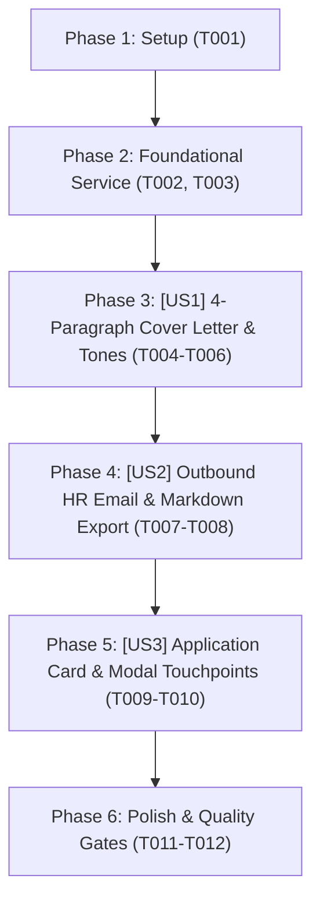

# Tasks: Cover Letter & Outbound Email Generator (Bộ Hồ Sơ Ứng Tuyển Toàn Diện)

> **Feature Name:** Cover Letter & Outbound Email Generator  
> **Plan Document:** [`docs/superpowers/plans/2026-11-04-cover-letter-and-email-generator-plan.md`](file:///C:/Users/ADMIN/Desktop/STUDY/docs/superpowers/plans/2026-11-04-cover-letter-and-email-generator-plan.md)  
> **Spec Directory:** [`docs/superpowers/specs/2026-11-04-cover-letter-and-email-generator/`](file:///C:/Users/ADMIN/Desktop/STUDY/docs/superpowers/specs/2026-11-04-cover-letter-and-email-generator/)  
> **Branch:** `profilehub_v1`  
> **Checklist Format Requirement:** `- [X] [TaskID] [P?] [Story?] Description with file path`

---

## Dependencies & Story Execution Order

---

## Phase 1: Setup

- [X] T001 Khởi tạo schema types và enums cho Cover Letter & Email trong profilehub/src/types/coverLetter.types.ts

---

## Phase 2: Foundational (Blocking Prerequisites)

- [X] T002 [P] Xây dựng service cốt lõi coverLetterService với Template Engine 4 đoạn và dệt số liệu STAR trong profilehub/src/services/coverLetterService.ts
- [X] T003 [P] Viết bộ kiểm thử Unit Test cho coverLetterService kiểm tra sinh thư, 3 tones, email subject và lưu nháp trong profilehub/src/services/coverLetterService.test.ts

---

## Phase 3: User Story 1 - Tailored 4-Paragraph Cover Letter & Tone Presets (P1 - MVP)

**Story Goal:** Ứng viên xem được Thư ứng tuyển chuẩn 4 đoạn được dệt đúng tên công ty, vị trí và đồ án tiêu biểu trong CV, có thể chuyển đổi giữa 3 Tone (Chuyên nghiệp / Startup / Kỹ thuật) và chỉnh sửa trực tiếp.  
**Independent Test Criteria:** Mở modal thấy thư ứng tuyển được điền tự động; đổi Tone cập nhật nội dung tức thì; sửa nội dung bấm lưu giữ nguyên trong `localStorage`.

- [X] T004 [P] [US1] Xây dựng modal hiển thị và soạn thảo thư CoverLetterModal trong profilehub/src/components/student/CoverLetterModal.tsx
- [X] T005 [US1] Triển khai thuật toán trích xuất đồ án và dệt số liệu định lượng vào đoạn 2 của thư trong profilehub/src/services/coverLetterService.ts
- [X] T006 [US1] Tích hợp thanh công cụ đổi Tone và ô soạn thảo chỉnh sửa trực tiếp trong profilehub/src/components/student/CoverLetterModal.tsx

---

## Phase 4: User Story 2 - Outbound HR Email Template & Markdown Export (P1 - MVP)

**Story Goal:** Cung cấp mẫu Email gửi kèm CV ngắn gọn dưới 150 từ với Tiêu đề email chuẩn quốc tế, checklist file đính kèm và 1-click sao chép / xuất Markdown.  
**Independent Test Criteria:** Chuyển sang Tab Email thấy tiêu đề chuẩn `[Ứng Tuyển] - [Vị Trí] - [Tên Sinh Viên]`; click nút copy hiển thị toast; nút tải file Markdown xuất file `.md` chuẩn.

- [X] T007 [P] [US2] Xây dựng giao diện Tab Mẫu Email Gửi HR và nút 1-click Copy trong profilehub/src/components/student/CoverLetterModal.tsx
- [X] T008 [US2] Triển khai tính năng định dạng và xuất file Markdown hoàn chỉnh trong profilehub/src/services/coverLetterService.ts

---

## Phase 5: User Story 3 - Seamless Kanban Card & Modal Integration (P1)

**Story Goal:** Tích hợp nút hành động mở Cover Letter trực tiếp từ thẻ công ty trên bảng Kanban và trong modal tạo đơn ứng tuyển.  
**Independent Test Criteria:** Thẻ công ty trên Kanban có nút `[✉️ Thư]`; click mở ngay modal với dữ liệu công ty và vị trí tương ứng.

- [X] T009 [P] [US3] Tích hợp nút mở CoverLetterModal trên thẻ công ty trong profilehub/src/components/student/ApplicationCard.tsx
- [X] T010 [US3] Tích hợp tùy chọn mở nhanh Cover Letter sau khi tạo đơn trong profilehub/src/components/student/AddApplicationModal.tsx

---

## Phase 6: Polish & Quality Gates

- [X] T011 [P] Tối ưu hóa giao diện Responsive Mobile và Dark Mode tương phản cao cho CoverLetterModal.tsx
- [X] T012 Chạy kiểm thử tự động toàn diện vitest run và tsc noEmit đạt 0 lỗi trong profilehub
