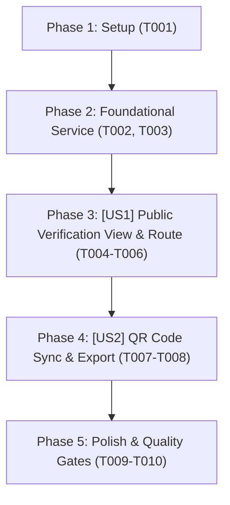

# Tasks: Public Verification Gateway & QR Proof (Cổng Tra Cứu Bảo Chứng Đồ Án Công Khai)

> **Feature Name:** Public Verification Gateway & QR Proof  
> **Plan Document:** [`docs/superpowers/plans/2026-11-04-public-verification-gateway-plan.md`](file:///C:/Users/ADMIN/Desktop/STUDY/docs/superpowers/plans/2026-11-04-public-verification-gateway-plan.md)  
> **Spec Directory:** [`docs/superpowers/specs/2026-11-04-public-verification-gateway/`](file:///C:/Users/ADMIN/Desktop/STUDY/docs/superpowers/specs/2026-11-04-public-verification-gateway/)  
> **Branch:** `profilehub_v1`  
> **Checklist Format Requirement:** `- [ ] [TaskID] [P?] [Story?] Description with file path`

---

## Dependencies & Story Execution Order

---

## Phase 1: Setup

- [X] T001 Khởi tạo schema types và interfaces cho hồ sơ bảo chứng công khai PublicVerifiedProjectRecord trong profilehub/src/types/projects.types.ts

---

## Phase 2: Foundational (Blocking Prerequisites)

- [X] T002 [P] Xây dựng service cốt lõi verificationService với giải thuật băm SHA-256 và rào chắn riêng tư Zero Data Leak trong profilehub/src/services/verificationService.ts
- [X] T003 [P] Viết bộ kiểm thử Unit Test cho verificationService kiểm tra băm SHA-256, tra cứu mã và bảo vệ dữ liệu nhạy cảm trong profilehub/src/services/verificationService.test.ts

---

## Phase 3: User Story 1 - Public Verification View & Standalone Route (P1 - MVP)

**Story Goal:** Nhà tuyển dụng truy cập link `/verify/:code` xem được Giấy chứng nhận số bảo chứng đồ án, thông tin tác giả, giảng viên bảo chứng và mã băm SHA-256 mà không cần đăng nhập.  
**Independent Test Criteria:** Mở `/verify/PH-VER-A8B9C2` hiển thị đầy đủ thông tin đồ án và khiên chứng thực; mở mã sai hiển thị màn hình 404 thân thiện; kiểm tra DOM không chứa GPA/SĐT/Email sinh viên.

- [X] T004 [P] [US1] Xây dựng trang giao diện công khai PublicVerificationView với thiết kế chứng nhận số cao cấp trong profilehub/src/pages/public/PublicVerificationView.tsx
- [X] T005 [US1] Đăng ký tuyến đường công khai độc lập /verify/:code trong profilehub/src/App.tsx nằm ngoài MainLayout
- [X] T006 [US1] Tích hợp nút sao chép mã băm SHA-256 và các link trải nghiệm đồ án (Demo, GitHub, Figma, Docs) trong profilehub/src/pages/public/PublicVerificationView.tsx

---

## Phase 4: User Story 2 - QR Code Synchronization & Export (P2)

**Story Goal:** Sinh viên mở modal mã QR của đồ án đã bảo chứng nhận được URL chuẩn `/verify/:code` và tải được ảnh QR PNG chất lượng cao đính kèm vào CV.  
**Independent Test Criteria:** Mở ProjectQRCodeModal thấy link chuẩn trỏ về `/verify/:code`; nút tải ảnh QR PNG hoạt động chính xác.

- [X] T007 [P] [US2] Cập nhật URL bảo chứng tiêu chuẩn trong modal mã QR trong profilehub/src/components/student/ProjectQRCodeModal.tsx
- [X] T008 [US2] Đồng bộ hóa hiển thị huy hiệu Verified Shield trong ProjectQRCodeModal.tsx

---

## Phase 5: Polish & Quality Gates

- [X] T009 [P] Tối ưu hóa giao diện Responsive Mobile dưới 360px và Dark Mode tương phản cao cho PublicVerificationView.tsx
- [X] T010 Chạy kiểm thử tự động toàn diện vitest run và tsc noEmit đạt 0 lỗi trong profilehub
