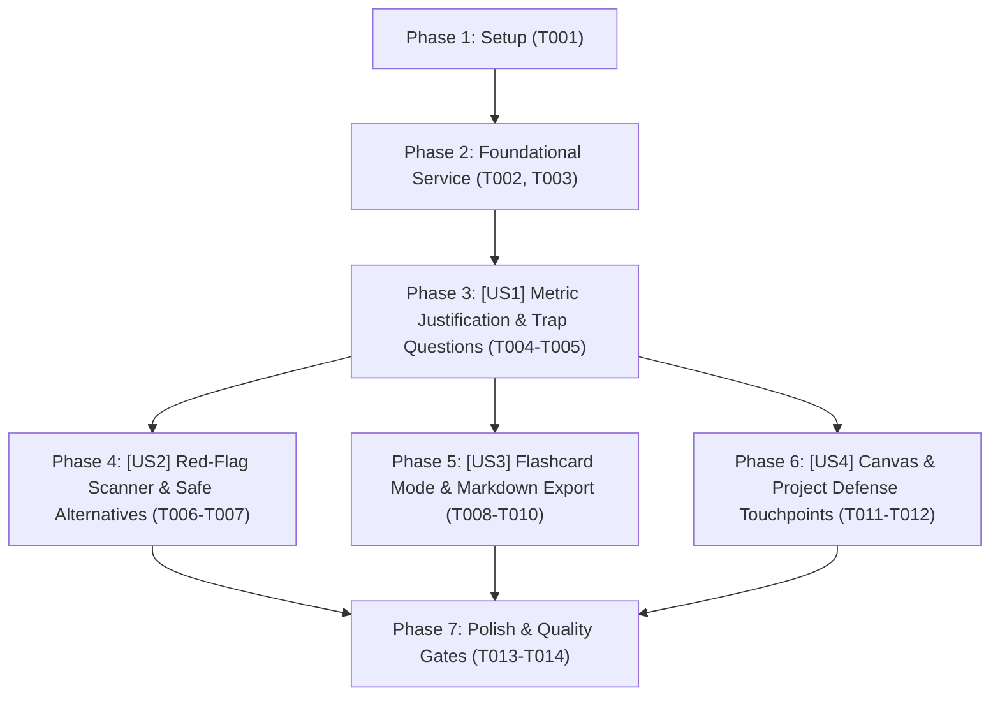

# Tasks: STAR Defense Cheat-Sheet & Metric Justification (Phao Cứu Sinh Giải Trình Số Liệu Phỏng Vấn)

> **Feature Name:** STAR Defense Cheat-Sheet & Metric Justification  
> **Plan Document:** [`docs/superpowers/plans/2026-11-04-star-defense-cheat-sheet-plan.md`](file:///C:/Users/ADMIN/Desktop/STUDY/docs/superpowers/plans/2026-11-04-star-defense-cheat-sheet-plan.md)  
> **Spec Directory:** [`docs/superpowers/specs/2026-11-04-star-defense-cheat-sheet/`](file:///C:/Users/ADMIN/Desktop/STUDY/docs/superpowers/specs/2026-11-04-star-defense-cheat-sheet/)  
> **Branch:** `profilehub_v1`  
> **Checklist Format Requirement:** `- [ ] [TaskID] [P?] [Story?] Description with file path`

---

## Dependencies & Story Execution Order

---

## Phase 1: Setup

- [X] T001 Khởi tạo schema types và interfaces cho phao giải trình trong profilehub/src/types/starDefense.types.ts

---

## Phase 2: Foundational (Blocking Prerequisites)

- [X] T002 [P] Xây dựng ma trận tri thức công nghệ và dịch vụ phân tích starDefenseService trong profilehub/src/services/starDefenseService.ts
- [X] T003 [P] Viết bộ kiểm thử Unit Test toàn diện cho starDefenseService trong profilehub/src/services/starDefenseService.test.ts

---

## Phase 3: User Story 1 - Metric Justification & Trap Questions (P1 - MVP)

**Story Goal:** Ứng viên xem được công cụ đo đạc thực tế, số liệu Before/After và ít nhất 2 câu hỏi bẫy kỹ thuật xoáy sâu kèm kịch bản trả lời mẫu 30 giây cho từng câu bullet point trên CV.  
**Independent Test Criteria:** Nhập câu có chứa số liệu (VD: *"giảm 35% response time bằng Redis"*), service trả về đúng công cụ đo đạc (Lighthouse / Chrome DevTools / Apache Bench), số liệu trước-sau và kịch bản 30s mạch lạc; UI hiển thị đầy đủ các thẻ thông tin.

- [X] T004 [P] [US1] Xây dựng modal hiển thị phao cứu sinh StarDefenseModal trong profilehub/src/components/cv/StarDefenseModal.tsx
- [X] T005 [US1] Triển khai thuật toán trích xuất số liệu Before/After và kịch bản trả lời mẫu 30s trong profilehub/src/services/starDefenseService.ts

---

## Phase 4: User Story 2 - Red-Flag Buzzword Scanner & Safe Alternatives (P2)

**Story Goal:** Tự động phát hiện các từ khóa nhạy cảm / đao to búa lớn (Microservices, 99.99% Uptime, High concurrency...) trong câu bullet và cảnh báo rủi ro, đưa ra cụm từ thay thế an toàn hơn cho ứng viên.  
**Independent Test Criteria:** Phát hiện từ khóa nhạy cảm trong câu, gắn cờ mức độ rủi ro (high/medium), hiển thị lý do Tech Lead hay bắt bẻ và cung cấp cụm từ an toàn thay thế.

- [X] T006 [P] [US2] Xây dựng engine quét từ khóa rủi ro cao và gợi ý từ ngữ an toàn trong profilehub/src/services/starDefenseService.ts
- [X] T007 [US2] Tích hợp hộp cảnh báo rủi ro câu chữ trực quan trên giao diện trong profilehub/src/components/cv/StarDefenseModal.tsx

---

## Phase 5: User Story 3 - Flashcard Rehearsal Mode & Custom Notes Export (P2)

**Story Goal:** Cung cấp chế độ lật thẻ Flashcards 2 mặt giúp ứng viên tập dượt phản xạ phỏng vấn trong 5 phút; cho phép ghi chú cá nhân lưu vào `localStorage` và 1-click xuất bản Markdown mang theo.  
**Independent Test Criteria:** Chuyển đổi qua lại giữa chế độ Chi tiết và Flashcard mượt mà; lật thẻ hiển thị câu trả lời; nhập ghi chú cá nhân và F5 vẫn lưu giữ; nút sao chép Markdown sao chép chuẩn định dạng.

- [X] T008 [P] [US3] Xây dựng chế độ lật thẻ Flashcards 2 mặt ôn phản xạ phỏng vấn trong profilehub/src/components/cv/StarDefenseModal.tsx
- [X] T009 [P] [US3] Triển khai tính năng lưu ghi chú cá nhân vào localStorage và định dạng xuất Markdown trong profilehub/src/services/starDefenseService.ts
- [X] T010 [US3] Tích hợp thanh công cụ lưu ghi chú và xuất bản Markdown trong profilehub/src/components/cv/StarDefenseModal.tsx

---

## Phase 6: User Story 4 - Seamless CV Canvas & Project Defense Touchpoints (P1)

**Story Goal:** Tích hợp nút mở Phao cứu sinh trực tiếp trên từng gạch đầu dòng của CV Editor và nhúng tab duyệt toàn bộ đồ án vào modal bảo vệ đồ án hiện có.  
**Independent Test Criteria:** Hover vào bullet trên `InteractiveCVCanvas.tsx` xuất hiện icon chiếc khiên `[🛡️ Phao]`; click mở ngay modal cho dòng đó; mở `ProjectDefenseModal.tsx` có thêm tab xem trọn bộ phao cứu sinh của đồ án đang chọn.

- [X] T011 [P] [US4] Tích hợp nút kích hoạt Phao cứu sinh trên từng gạch đầu dòng đồ án trong profilehub/src/components/cv/InteractiveCVCanvas.tsx
- [X] T012 [US4] Tích hợp tab chuyên sâu Phao Giải Trình STAR cho toàn bộ đồ án trong profilehub/src/components/cv/ProjectDefenseModal.tsx

---

## Phase 7: Polish & Quality Gates

- [X] T013 [P] Tối ưu hóa giao diện Responsive Mobile và Dark Mode cho StarDefenseModal trong profilehub/src/components/cv/StarDefenseModal.tsx
- [X] T014 Chạy kiểm thử tự động toàn diện vitest run và tsc noEmit đạt 0 lỗi trong profilehub

---

## Parallel Execution Opportunities

- **Cặp 1 (T002 & T003):** Service implementation và Unit Test suites có thể triển khai song song theo nguyên lý Test-Driven Development (TDD).
- **Cặp 2 (T004, T006, T008):** Các component con và sub-views của modal (Metric Details, Red-flag alert, Flashcard view) có thể phân tách component độc lập.
- **Cặp 3 (T011 & T012):** Tích hợp điểm chạm trên `InteractiveCVCanvas.tsx` và `ProjectDefenseModal.tsx` hoàn toàn độc lập về mặt file.

---

## Implementation Strategy & MVP Scope

- **MVP Scope (Phát hành cốt lõi):** Hoàn thành **Phase 1, Phase 2, Phase 3 (US1)** và **Phase 6 (US4)**. Khi đó ứng viên đã có thể click vào bất kỳ dòng bullet point nào trên CV để xem ngay công cụ đo đạc và câu hỏi bẫy kỹ thuật.
- **Mở rộng (Phase 4, Phase 5):** Bổ sung bộ lọc cảnh báo buzzwords nhạy cảm và chế độ Flashcard ôn luyện phản xạ.
- **Tiêu chuẩn chất lượng:** Tuân thủ 100% TypeScript Strict Mode, 0 lỗi `any`, 100% tests pass trên Vitest.
