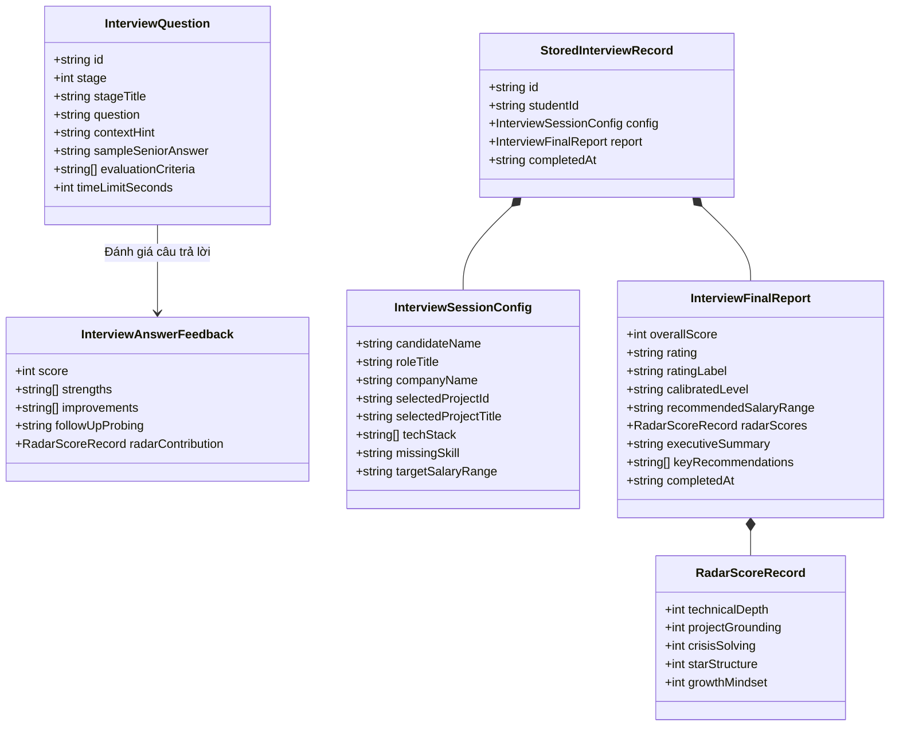

# Mô Hình Dữ Liệu: Phòng Luyện Phỏng Vấn AI War Room & Radar 5 Trục
> **Mã tài liệu:** `DATA-MODEL-20261105-AI-MOCK-INTERVIEW-WAR-ROOM`  
> **Tính năng:** AI Mock Interview Simulator & 5-Axis Radar Skill Competency Matrix (FR-008)  
> **Dự án:** ProfileHub - Nền tảng Hồ sơ Nghề nghiệp Dựa trên Bằng chứng  
> **Nhánh Git:** `profilehub_v1`  
> **Ngày lập:** 05/11/2026  

---

## 1. Sơ Đồ Cấu Trúc Dữ Liệu (Class Diagram)



---

## 2. Định Nghĩa Kiểu Dữ Liệu TypeScript (TypeScript Definitions)

Vị trí lưu trữ: [`src/types/mockInterview.types.ts`](file:///C:/Users/ADMIN/Desktop/STUDY/profilehub/src/types/mockInterview.types.ts)

```typescript
export type InterviewStageNumber = 1 | 2 | 3 | 4;

export type InterviewRatingTier = 
  | 'STRONG_HIRE' 
  | 'HIRE' 
  | 'LEANING_HIRE' 
  | 'NEEDS_IMPROVEMENT' 
  | 'NO_HIRE';

export type CalibratedLevelTier = 'Fresher' | 'Junior 1' | 'Junior 2' | 'Mid-level';

export interface InterviewSessionConfig {
  candidateName: string;
  roleTitle: string;
  companyName?: string;
  selectedProjectId?: string;
  selectedProjectTitle: string;
  techStack: string[];
  missingSkill: string;
  targetSalaryRange?: string;
}

export interface RadarScoreRecord {
  technicalDepth: number;     // 0 - 100: Độ sâu kỹ thuật & Kiến trúc
  projectGrounding: number;   // 0 - 100: Tính xác thực & Bằng chứng đồ án
  crisisSolving: number;      // 0 - 100: Tư duy xử lý sự cố & khủng hoảng
  starStructure: number;      // 0 - 100: Cấu trúc diễn đạt chuẩn STAR
  growthMindset: number;      // 0 - 100: Tố chất học hỏi & Văn hóa thích ứng
}

export interface InterviewAnswerFeedback {
  score: number;
  strengths: string[];
  improvements: string[];
  followUpProbing?: string;
  radarContribution: Partial<RadarScoreRecord>;
}

export interface InterviewFinalReport {
  overallScore: number;
  rating: InterviewRatingTier;
  ratingLabel: string;
  calibratedLevel: CalibratedLevelTier;
  recommendedSalaryRange: string;
  radarScores: RadarScoreRecord;
  executiveSummary: string;
  keyRecommendations: string[];
  completedAt: string;
}

export interface StoredInterviewRecord {
  id: string;
  studentId: string;
  config: InterviewSessionConfig;
  report: InterviewFinalReport;
  answers: Array<{
    stage: number;
    question: string;
    answer: string;
    feedback: InterviewAnswerFeedback;
  }>;
  completedAt: string;
}
```

---

## 3. Thuật Toán Lượng Giác Tính Điểm Radar SVG 5 Trục

Cho một tâm tọa độ $(cx = 150, cy = 150)$ và bán kính tối đa $R = 100$:
Mỗi trục thứ $i$ ($i \in \{0, 1, 2, 3, 4\}$) tạo một góc $\theta_i = \frac{2\pi i}{5} - \frac{\pi}{2}$:
* Tọa độ đỉnh cực đại (100%):
  $$X_i = 150 + 100 \cdot \cos(\theta_i)$$
  $$Y_i = 150 + 100 \cdot \sin(\theta_i)$$
* Tọa độ điểm ứng viên đạt được với số điểm $S_i \in [0, 100]$:
  $$x_i = 150 + \left(100 \cdot \frac{S_i}{100}\right) \cdot \cos(\theta_i)$$
  $$y_i = 150 + \left(100 \cdot \frac{S_i}{100}\right) \cdot \sin(\theta_i)$$
Chuỗi SVG Polygon Points được tạo bằng: `points = "${x0},${y0} ${x1},${y1} ${x2},${y2} ${x3},${y3} ${x4},${y4}"`.
Thuật toán này chạy tức thì tại client, 0 dependencies bên ngoài, cực nhẹ và phản hồi chuyển động mượt mà.
