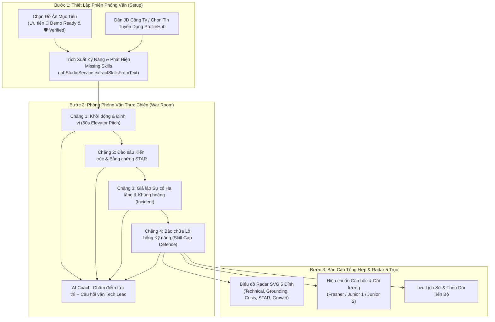

# Báo Cáo Nghiên Cứu Kỹ Thuật: Phòng Luyện Phỏng Vấn Thích Ứng AI War Room 4 Chặng & Biểu Đồ Radar 5 Trục
> **Mã tài liệu:** `RESEARCH-20261105-AI-MOCK-INTERVIEW-WAR-ROOM`  
> **Tính năng:** AI Mock Interview Simulator & 5-Axis Radar Skill Competency Matrix (FR-008)  
> **Dự án:** ProfileHub - Nền tảng Hồ sơ Nghề nghiệp Dựa trên Bằng chứng  
> **Nhánh Git:** `profilehub_v1`  
> **Ngày lập:** 05/11/2026  

---

## 1. Bối Cảnh, Vấn Đề Thực Tế & Động Lực Sản Phẩm

### 1.1. Nghịch Lý Phỏng Vấn Kỹ Thuật (The Technical Interview Bottleneck)
Qua khảo sát thực tế sinh viên ngành Công nghệ thông tin chuẩn bị tốt nghiệp:
1. **Khủng hoảng phản xạ (The Interview Freeze):** Dù sinh viên trực tiếp code đồ án môn học hoặc tốt nghiệp, khi đối diện với Tech Lead hoặc Giám đốc kỹ thuật, các bạn thường nói lắp bắp, lan man, không thể hiện được tư duy kiến trúc và thiếu số liệu định lượng (Anti-hallucination metrics).
2. **Né tránh điểm yếu công nghệ (Skill Gap Blindspot):** Khi JD đòi hỏi một công nghệ mà ứng viên chưa từng làm trên production (ví dụ: Kubernetes, Kafka, CI/CD), sinh viên thường có xu hướng "chém gió" hoặc thừa nhận thất bại một cách thụ động, thay vì thể hiện tư duy học hỏi nhanh (Growth Mindset) và lộ trình thích ứng trong 2 tuần.
3. **Hiện trạng trên ProfileHub:**
   - Đã có sẵn dịch vụ toán học `aiMockInterviewService.ts` với barem chấm điểm 4 chặng và thuật toán ma trận radar 5 trục.
   - Tuy nhiên, hiện tại tính năng này chỉ được bọc trong một Modal nhỏ (`AiMockInterviewModal.tsx`) với dữ liệu tĩnh mặc định (`E-Commerce Platform`, `React/Node.js`), hiển thị thanh tiến trình đơn điệu (Progress Bars) thay vì Biểu Đồ Radar hình mạng nhện trực quan, và chưa kết nối thực sự với kho đồ án hay JD tuyển dụng của sinh viên.

---

## 2. Kiến Trúc Luồng Nghiệp Vụ Cốt Lõi (Architecture Flow)

---

## 3. Các Quyết Định Kỹ Thuật Trọng Tâm (Key Technical Decisions)

### Quyết định 1: Trang Độc Lập Chuyên Sâu (`/mock-interview`) thay vì Modal Pop-up
* **Lý do:** Buổi phỏng vấn đòi hỏi sự tập trung cao độ, màn hình rộng để đọc câu hỏi, xem code snippet kiến trúc, quan sát đồng hồ đếm ngược và đọc nhận xét chi tiết của AI Coach. Modal nhỏ gây chật chội và không tạo được không khí nghiêm túc của một buổi phỏng vấn thực thụ.
* **Tích hợp:**
  - Thêm tuyến đường `/mock-interview` trong [`src/App.tsx`](file:///C:/Users/ADMIN/Desktop/STUDY/profilehub/src/App.tsx).
  - Thêm menu `🎙️ Luyện Phỏng Vấn` trên thanh điều hướng HeaderBar và nút bấm nổi bật tại Dashboard sinh viên.

### Quyết định 2: Tự Động Rút Trích Dữ Liệu Thực Tế Của Ứng Viên
* Khi mở phòng phỏng vấn:
  1. Tự động liệt kê danh sách đồ án thực tế của sinh viên từ Supabase/LocalStorage.
  2. Cho phép chọn vị trí ứng tuyển từ danh sách việc làm trên sàn `StudentJobs` hoặc dán JD bất kỳ.
  3. Tự động so sánh kỹ năng của đồ án với JD để tìm ra kỹ năng còn thiếu (`missingSkill`), đưa vào làm đề bài thử thách cho **Chặng 4: Bào Chữa Lỗ Hổng Kỹ Năng**.

### Quyết định 3: Biểu Đồ Radar SVG 5 Trục Thuần Túy (Zero External Library)
* **Lý do:** Không cài đặt các thư viện biểu đồ nặng nề (như Chart.js hay Recharts) làm phình to bundle kích thước file.
* **Giải pháp:** Sử dụng thẻ `<svg>` và công thức lượng giác toán học tính toán tọa độ $(x, y)$ của 5 đỉnh đa giác đều:
  $$x_i = cx + r \cdot \frac{\text{score}_i}{100} \cdot \cos\left(\frac{2\pi i}{5} - \frac{\pi}{2}\right)$$
  $$y_i = cy + r \cdot \frac{\text{score}_i}{100} \cdot \sin\left(\frac{2\pi i}{5} - \frac{\pi}{2}\right)$$
  Hiển thị đa giác bán trong suốt với hiệu ứng phát sáng neon hiện đại và nhãn 5 trục rõ ràng.

### Quyết định 4: Barem Đánh Giá Chống Bịa Đặt Số Liệu (Anti-Hallucination Barem)
* Tiêu chí chấm điểm thưởng điểm cao (+15 điểm) khi câu trả lời có chứa các con số kỹ thuật thực tế (`ms`, `RPS`, `%`, `connections`, `uptime`).
* Nếu câu trả lời chung chung hoặc né tránh, AI Coach tự động kích hoạt **Câu hỏi vặn (Follow-up Probing)** buộc sinh viên phải đưa ra dẫn chứng cụ thể.

---

## 4. Kế Hoạch Triển Khai (Roadmap)
1. **Phase 1: Specs & Models:** Thiết lập `data-model.md`, `contracts/`, `quickstart.md`.
2. **Phase 2: Core Enhancements:** Nâng cấp `aiMockInterviewService.ts` với hàm tính toán tọa độ SVG Radar và lưu trữ lịch sử phiên phỏng vấn.
3. **Phase 3: UI Implementation:** Xây dựng trang `/mock-interview` hoàn chỉnh với 3 chế độ (Setup ➔ Interview Session ➔ Radar Assessment Report).
4. **Phase 4: Navigation Integration:** Tích hợp đường dẫn vào HeaderBar và Dashboard.
5. **Phase 5: Quality Gates & Dual-Sync:** Vitest 100% Pass, TSC 0 lỗi, Build prod và Push GitHub.
