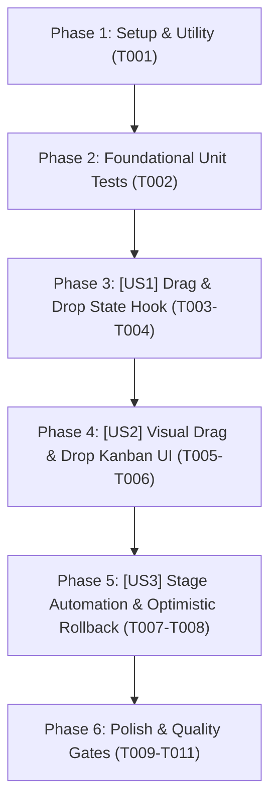

# Tasks: Kéo Thả (Drag & Drop) & Đồng Bộ Pipeline Tuyển Dụng

> **Feature Name:** Kéo Thả (Drag & Drop) & Đồng Bộ Pipeline Tuyển Dụng (Pipeline Drag-and-Drop)  
> **Plan Document:** [`docs/superpowers/plans/2026-11-05-candidate-pipeline-drag-and-drop-plan.md`](file:///C:/Users/ADMIN/Desktop/STUDY/docs/superpowers/plans/2026-11-05-candidate-pipeline-drag-and-drop-plan.md)  
> **Spec Directory:** [`docs/superpowers/specs/2026-11-05-candidate-pipeline-drag-and-drop/`](file:///C:/Users/ADMIN/Desktop/STUDY/docs/superpowers/specs/2026-11-05-candidate-pipeline-drag-and-drop/)  
> **Branch:** `profilehub_v1`  
> **Checklist Format Requirement:** `- [ ] [TaskID] [P?] [Story?] Description with file path`

---

## Dependencies & Story Execution Order

---

## Phase 1: Setup

- [X] T001 Khởi tạo types và utility functions cho kéo thả pipeline trong profilehub/src/utils/pipelineDragDrop.ts

---

## Phase 2: Foundational (Blocking Prerequisites)

- [X] T002 Xây dựng bộ kiểm thử Unit Test cho logic chuyển đổi stage và kéo thả trong profilehub/src/utils/pipelineDragDrop.test.ts

---

## Phase 3: User Story 1 - Drag & Drop State Hook (P1 - Core State Management)

**Story Goal:** Quản lý trạng thái kéo (draggingItemId, dragOverStage) một cách độc lập và cung cấp các hàm xử lý sự kiện kéo thả chuẩn HTML5.  
**Independent Test Criteria:** Hook theo dõi chính xác phần tử đang được kéo, cập nhật cột đích khi di chuột qua, và dọn dẹp sạch sẽ khi sự kiện kéo kết thúc.

- [X] T003 [P] [US1] Xây dựng custom hook usePipelineDragDrop trong profilehub/src/hooks/usePipelineDragDrop.ts
- [X] T004 [US1] Viết bài kiểm thử Unit Test cho usePipelineDragDrop trong profilehub/src/hooks/usePipelineDragDrop.test.ts

---

## Phase 4: User Story 2 - Visual Drag & Drop Kanban UI (P1 - Interactive Kanban)

**Story Goal:** Biến các thẻ ứng viên thành phần tử có thể kéo thả (`draggable={true}`) và các cột STAGES thành các drop zones với hiệu ứng đồ họa highlight rõ ràng.  
**Independent Test Criteria:** Thẻ ứng viên hiển thị con trỏ `cursor-grab`, mờ khi kéo; cột đích đổi màu viền nét đứt khi hover; thả thẻ vào cột đích cập nhật vị trí ngay lập tức.

- [X] T005 [US2] Tích hợp thuộc tính draggable và visual dragging state cho thẻ ứng viên trong profilehub/src/pages/recruiter/CandidatePipeline.tsx
- [X] T006 [US2] Cấu hình drop zones cho các cột STAGES với hiệu ứng highlight trực quan trong profilehub/src/pages/recruiter/CandidatePipeline.tsx

---

## Phase 5: User Story 3 - Stage Automation & Optimistic Rollback (P2 - Reliability & Delight)

**Story Goal:** Tự động kích hoạt hành động nghiệp vụ tương ứng theo từng giai đoạn (ví dụ: tự mở Modal Hẹn Lịch Phỏng Vấn) và khôi phục trạng thái an toàn nếu API Cloud gặp sự cố.  
**Independent Test Criteria:** Kéo vào cột Phỏng Vấn tự động bật Modal Hẹn Lịch; khi API Supabase gặp lỗi mạng, thẻ tự động hoàn trả về vị trí ban đầu và hiển thị thông báo.

- [X] T007 [P] [US3] Tích hợp cơ chế tự động kích hoạt Modal Hẹn Lịch khi thả vào cột interview trong profilehub/src/pages/recruiter/CandidatePipeline.tsx
- [X] T008 [US3] Xây dựng cơ chế Optimistic UI và Rollback tự động khi cập nhật Supabase API gặp sự cố mạng trong profilehub/src/pages/recruiter/CandidatePipeline.tsx

---

## Phase 6: Polish & Quality Gates

- [X] T009 Kiểm thử toàn bộ hệ thống bằng lệnh npm test -- --run và đảm bảo không có bài test nào bị vỡ (165/165 Passed)
- [X] T010 Kiểm tra nghiêm ngặt kiểu dữ liệu TypeScript bằng npx tsc --noEmit (0 Errors)
- [X] T011 Kiểm tra đóng gói sản phẩm bằng lệnh npm run build (Success in 23.06s)
