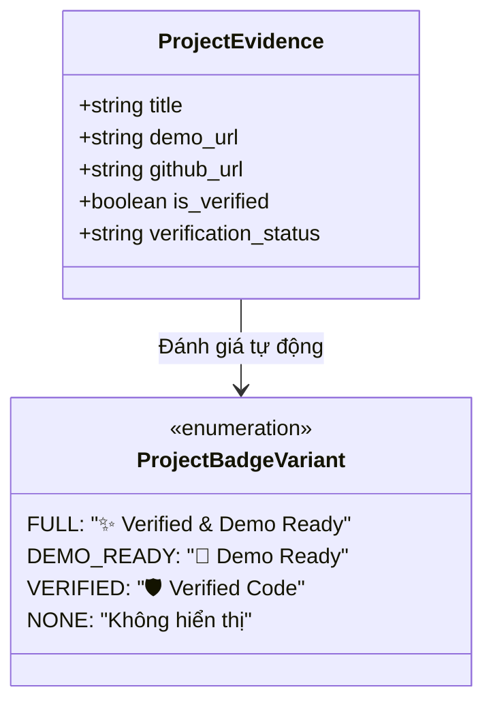

# Mô Hình Dữ Liệu & Giao Diện Huy Hiệu Đồ Án (Data Model & Badge Taxonomy)
> **Mã tài liệu:** `DATA-MODEL-20261105-DEMO-READY-BADGES`  
> **Tính năng:** Smart Project Badges: "Demo Ready" vs "Verified Codebase"  
> **Dự án:** ProfileHub - Nền tảng Hồ sơ Nghề nghiệp Dựa trên Bằng chứng  
> **Nhánh Git:** `profilehub_v1`  
> **Ngày lập:** 05/11/2026  

---

## 1. Sơ Đồ Cấu Trúc Huy Hiệu (Badge Hierarchy Diagram)



---

## 2. Định Nghĩa Kiểu Dữ Liệu TypeScript (TypeScript Definitions)

Vị trí lưu trữ: [`src/types/projectBadge.types.ts`](file:///C:/Users/ADMIN/Desktop/STUDY/profilehub/src/types/projectBadge.types.ts)

```typescript
/**
 * Các biến thể của huy hiệu đồ án
 */
export type ProjectBadgeVariant = 'full' | 'demo-ready' | 'verified' | 'none';

/**
 * Cấu hình hiển thị chi tiết của từng biến thể
 */
export interface BadgeVisualConfig {
  variant: ProjectBadgeVariant;
  label: string;
  tooltip: string;
  bgColor: string;
  textColor: string;
  borderColor: string;
  iconType: 'sparkles' | 'rocket' | 'shield';
}

/**
 * Thuộc tính của component VerifiedBadge
 */
export interface VerifiedBadgeProps {
  variant?: ProjectBadgeVariant;
  demoUrl?: string;
  verifiedAt?: string;
  size?: 'sm' | 'md' | 'lg';
  interactive?: boolean; // Cho phép click mở link demo ngay trên badge
  className?: string;
}

/**
 * Thông tin đầu vào để xác định huy hiệu của đồ án
 */
export interface ProjectBadgeEvaluationInput {
  is_verified?: boolean;
  verification_status?: string;
  demo_url?: string;
}
```

---

## 3. Logic Đánh Giá Huy Hiệu (Evaluation Function)

```typescript
/**
 * Xác định biến thể huy hiệu phù hợp dựa trên link demo và trạng thái bảo chứng
 */
export function getProjectBadgeVariant(project?: ProjectBadgeEvaluationInput): ProjectBadgeVariant {
  if (!project) return 'none';

  const hasDemo = Boolean(project.demo_url && project.demo_url.trim() !== '' && project.demo_url !== '#');
  const isVerified = project.is_verified === true || project.verification_status === 'verified';

  if (hasDemo && isVerified) {
    return 'full'; // ✨ Verified & Demo Ready
  }

  if (hasDemo) {
    return 'demo-ready'; // 🚀 Demo Ready
  }

  if (isVerified) {
    return 'verified'; // 🛡️ Verified Code
  }

  return 'none';
}
```

---

## 4. Ma Trận Quy Tắc Hiển Thị (Badge Rendering Matrix)

| Biến thể (`variant`) | Điều kiện kích hoạt | Nhãn hiển thị (`label`) | Icon | Màu sắc | Hành vi khi Click |
| :--- | :--- | :--- | :---: | :--- | :--- |
| **`full`** | Có `demo_url` VÀ `is_verified` | `✨ Demo Ready & Verified` | `Sparkles` + `ExternalLink` | Xanh ngọc lục bích viền ngọc | Mở `demo_url` trong tab mới |
| **`demo-ready`** | Có `demo_url` nhưng chưa bảo chứng | `🚀 Demo Ready` | `Rocket` / `Play` | Xanh lá mạ viền xanh lục | Mở `demo_url` trong tab mới |
| **`verified`** | Có bảo chứng nhưng chưa có `demo_url` | `🛡️ Verified Code` | `ShieldCheck` | Tím Indigo viền tím | Mở modal chi tiết bảo chứng |
| **`none`** | Không có cả 2 | *(Ẩn)* | *(None)* | *(None)* | Không có |
