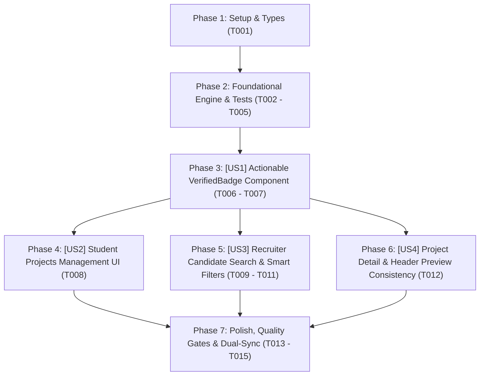

# Tasks: Phân Cấp Huy Hiệu Đồ Án Thông Minh ("Demo Ready" & "Verified Codebase")

> **Feature Name:** Phân Cấp Huy Hiệu Đồ Án Thông Minh: "Demo Ready" vs "Verified Codebase" (Smart Project Dual-Badges)  
> **Plan Document:** [`docs/superpowers/plans/2026-11-05-demo-ready-project-badges-plan.md`](file:///C:/Users/ADMIN/Desktop/STUDY/docs/superpowers/plans/2026-11-05-demo-ready-project-badges-plan.md)  
> **Spec Directory:** [`docs/superpowers/specs/2026-11-05-demo-ready-project-badges/`](file:///C:/Users/ADMIN/Desktop/STUDY/docs/superpowers/specs/2026-11-05-demo-ready-project-badges/)  
> **Branch:** `profilehub_v1`  
> **Checklist Format Requirement:** `- [ ] [TaskID] [P?] [Story?] Description with file path`

---

## 🏛️ Dependencies & Story Execution Order

---

## Phase 1: Setup & Types

- [X] T001 Khởi tạo các định nghĩa kiểu dữ liệu ProjectBadgeVariant, BadgeVisualConfig, VerifiedBadgeProps, ProjectBadgeEvaluationInput, CandidateBadgeSummary trong profilehub/src/types/projectBadge.types.ts

---

## Phase 2: Foundational Engine & Tests (Blocking Prerequisites)

- [X] T002 Xây dựng hàm logic getProjectBadgeVariant xử lý an toàn link demo rỗng, '#', khoảng trắng và cờ verified trong profilehub/src/services/projectBadgeService.ts
- [X] T003 [P] Xây dựng hàm cấu hình hiển thị getBadgeVisualConfig cung cấp màu sắc, icon, tooltip chuẩn hóa cho từng biến thể trong profilehub/src/services/projectBadgeService.ts
- [X] T004 [P] Xây dựng hàm thống kê số lượng huy hiệu countCandidateProjectBadges trả về demoReadyCount, verifiedCount, fullCount trong profilehub/src/services/projectBadgeService.ts
- [X] T005 Xây dựng bộ kiểm thử đơn vị tự động 100% cho projectBadgeService bao phủ 12+ kịch bản biên trong profilehub/src/services/projectBadgeService.test.ts

---

## Phase 3: User Story 1 - Actionable Multi-Variant VerifiedBadge Component (P1 - Nâng Cấp Component Huy Hiệu Đa Biến Thể)

**Story Goal:** Nâng cấp component `VerifiedBadge.tsx` hỗ trợ 3 biến thể trực quan (`full`, `demo-ready`, `verified`), tích hợp khả năng 1-click mở trực tiếp link sản phẩm chạy thật với phím tắt a11y và ngăn chặn sự kiện nổi bọt.  
**Independent Test Criteria:** Render đúng icon `Sparkles` cho `full`, `Rocket` cho `demo-ready`, `ShieldCheck` cho `verified`; khi click vào badge có `demoUrl` thì tự động gọi `window.open` với `_blank` và `stopPropagation()`; hỗ trợ phím Enter/Space; giữ tương thích ngược 100% với các vị trí gọi cũ.

- [X] T006 [US1] Nâng cấp props và giao diện đa biến thể ('full', 'demo-ready', 'verified') cùng bảng màu tương phản và icon động trong profilehub/src/components/common/VerifiedBadge.tsx
- [X] T007 [US1] Tích hợp tính năng click mở Live Demo 1-click trực tiếp, ngăn chặn nổi bọt sự kiện e.stopPropagation() và hỗ trợ phím nóng WCAG a11y trong profilehub/src/components/common/VerifiedBadge.tsx

---

## Phase 4: User Story 2 - Student Projects Management UI (P1 - Quản Lý Đồ Án Phía Sinh Viên)

**Story Goal:** Giúp sinh viên thấy rõ trạng thái đồ án của mình (Demo Ready hoặc Verified Code) trên từng thẻ đồ án tại `MyProjects.tsx`, đồng thời có thể click vào badge Demo Ready để kiểm tra nhanh đường link demo sản phẩm.  
**Independent Test Criteria:** Thẻ đồ án tại `MyProjects.tsx` gọi `getProjectBadgeVariant(proj)`; hiển thị huy hiệu phù hợp thay cho nhãn verified đơn điệu cũ; bấm vào badge `Demo Ready` mở ngay trang web sản phẩm trong tab mới mà không kích hoạt modal sửa/xem của thẻ cha.

- [X] T008 [US2] Tích hợp hàm getProjectBadgeVariant và cập nhật vị trí hiển thị VerifiedBadge tương tác tại tiêu đề thẻ đồ án trong profilehub/src/pages/student/MyProjects.tsx

---

## Phase 5: User Story 3 - Recruiter Candidate Search & Smart Filters (P1 - Tìm Kiếm Ứng Viên & Lọc Thông Minh Phía Tuyển Dụng)

**Story Goal:** Cung cấp cho Nhà tuyển dụng khả năng lọc tức thì các ứng viên có đồ án chạy thật (`Demo Ready`) và hiển thị song song hai chip `🚀 X Demo Ready` và `🛡️ Y Verified` trên từng thẻ ứng viên để tối ưu hóa quyết định tuyển dụng.  
**Independent Test Criteria:** Trang `CandidateSearch.tsx` có checkbox `[ 🚀 Chỉ xem Ứng viên có đồ án Demo Ready ]`; thẻ ứng viên hiển thị chính xác số lượng `🚀 X Demo Ready` và `🛡️ Y Verified`; danh sách đồ án nổi bật của ứng viên hiển thị badge thông minh có thể click xem demo trực tiếp.

- [X] T009 [US3] Thêm state và checkbox bộ lọc nhanh [🚀 Chỉ xem Ứng viên có đồ án Demo Ready] vào thanh công cụ tìm kiếm trong profilehub/src/pages/recruiter/CandidateSearch.tsx
- [X] T010 [P] [US3] Cập nhật thẻ ứng viên hiển thị song song hai chip 🚀 X Demo Ready và 🛡️ Y Verified sử dụng countCandidateProjectBadges trong profilehub/src/pages/recruiter/CandidateSearch.tsx
- [X] T011 [US3] Cập nhật danh sách đồ án tiêu biểu và modal chi tiết CV ứng viên sử dụng VerifiedBadge đa biến thể có tương tác trong profilehub/src/pages/recruiter/CandidateSearch.tsx

---

## Phase 6: User Story 4 - Project Detail & Header Preview Consistency (P2 - Tính Nhất Quán Giao Diện Xem Chi Tiết)

**Story Goal:** Đảm bảo tính nhất quán trên toàn bộ nền tảng khi xem chi tiết đồ án hoặc mở file preview, huy hiệu đồ án luôn phản ánh chính xác trạng thái Demo Ready / Verified Code.  
**Independent Test Criteria:** Header xem trước đồ án trong `ProjectFilePreviewHeader.tsx` hiển thị badge đúng biến thể và click được vào link demo.

- [X] T012 [P] [US4] Cập nhật component ProjectFilePreviewHeader.tsx sử dụng getProjectBadgeVariant và VerifiedBadge thông minh trong profilehub/src/components/projects/ProjectFilePreviewHeader.tsx

---

## Phase 7: Polish, Quality Gates & Dual-Sync Git

- [X] T013 Chạy toàn bộ 43 test suites Vitest bằng lệnh npm test -- --run đảm bảo 100% Pass và không có bất kỳ hồi quy nào
- [X] T014 [P] Kiểm tra TypeScript nghiêm ngặt npx tsc --noEmit đạt 0 lỗi và đóng gói Production npm run build thành công
- [X] T015 Cập nhật session_log_2026-11-05.md và thực hiện Dual-Sync Git commit đẩy lên cả 2 nhánh origin/profilehub_v1 và origin/1310-co-ban-chua-sua
