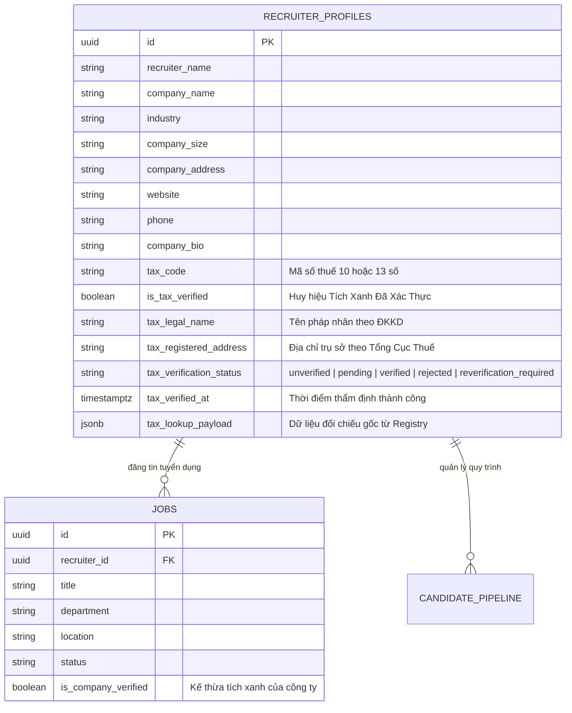
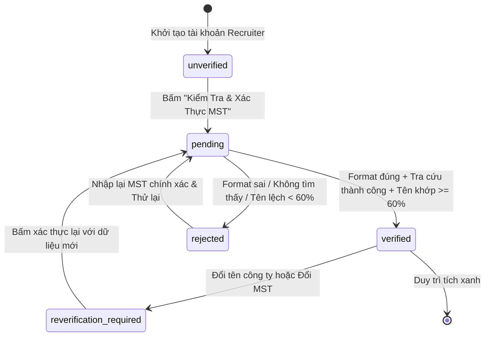

# Mô Hình Dữ Liệu: Xác Thực Mã Số Thuế & Tích Xanh Doanh Nghiệp (Data Model)
> **Mã tài liệu:** `DATA-20261105-ENTERPRISE-TAX-VERIFICATION`  
> **Vị trí lưu:** [`docs/superpowers/specs/2026-11-05-enterprise-tax-code-verification/data-model.md`](file:///C:/Users/ADMIN/Desktop/STUDY/docs/superpowers/specs/2026-11-05-enterprise-tax-code-verification/data-model.md)  
> **Phiên bản:** v1.0 Enterprise

---

## 1. Sơ Đồ Thực Thể & Quan Hệ (Entity-Relationship Diagram)



---

## 2. Định Nghĩa Kiểu Dữ Liệu TypeScript (`taxVerification.types.ts`)

```typescript
/**
 * Trạng thái xác thực Mã số thuế của doanh nghiệp
 */
export type TaxVerificationStatus = 
  | 'unverified'               // Chưa khai báo hoặc chưa xác thực
  | 'pending'                  // Đang gọi API đối chiếu
  | 'verified'                 // Đã xác thực thành công (Cấp Tích Xanh)
  | 'rejected'                 // Từ chối (MST không tồn tại hoặc sai thông tin)
  | 'reverification_required'; // Cần xác thực lại (do đổi tên công ty hoặc đổi MST)

/**
 * Kết quả kiểm tra định dạng và checksum cục bộ của MST
 */
export interface TaxValidationResult {
  isValid: boolean;
  error?: string;
  normalizedTaxCode: string;
  taxType: '10_digit_parent' | '13_digit_branch' | 'invalid';
}

/**
 * Dữ liệu tra cứu doanh nghiệp từ Tax Registry API
 */
export interface TaxLookupResult {
  taxCode: string;
  legalName: string;
  internationalName?: string;
  shortName?: string;
  registeredAddress: string;
  status: string; // VD: "Đang hoạt động" | "Tạm ngừng kinh doanh"
  isMatchWithCompany: boolean;
  matchScore: number; // 0 đến 100%
  matchReason?: string;
  source: 'sandbox_registry' | 'vietqr_api' | 'manual_verification';
}

/**
 * Mở rộng thông tin Nhà tuyển dụng với trường dữ liệu thuế
 */
export interface EnterpriseTaxProfile {
  taxCode?: string;
  isTaxVerified: boolean;
  taxLegalName?: string;
  taxRegisteredAddress?: string;
  taxVerificationStatus: TaxVerificationStatus;
  taxVerifiedAt?: string;
  taxLookupPayload?: TaxLookupResult;
}
```

---

## 3. Bản Đồ Chuyển Trạng Thái (State Machine Transitions)



### Quy Tắc Chuyển Trạng Thái
1. **Từ `unverified` sang `pending`:**
   - Kích hoạt khi Recruiter nhấn nút **[🛡️ Xác Thực MST]** trên giao diện `RecruiterProfile.tsx`.
2. **Từ `pending` sang `verified`:**
   - Điều kiện 1: `validateVietnameseTaxCode(code).isValid === true`.
   - Điều kiện 2: Tìm thấy pháp nhân trong Sandbox Registry hoặc VietQR API.
   - Điều kiện 3: Tỷ lệ đối chiếu tên $\ge 60\%$.
   - Hành động: Gán `is_tax_verified = true`, ghi nhận `tax_verified_at = new Date().toISOString()`, lưu `tax_legal_name` và `tax_registered_address`.
3. **Từ `pending` sang `rejected`:**
   - Phát sinh khi MST không vượt qua Checksum, không tìm thấy trên hệ thống thuế, hoặc tên công ty đăng ký hoàn toàn không liên quan đến tên pháp nhân.
4. **Từ `verified` sang `reverification_required`:**
   - Phát sinh khi Recruiter chỉnh sửa ô `companyName` hoặc ô `taxCode` mà không thực hiện xác thực lại. Toàn bộ huy hiệu Tích Xanh trên các Job đăng tuyển tạm thời bị ẩn.

---

## 4. Tệp Migration Cơ Sở Dữ Liệu SQL
**Đường dẫn:** `profilehub/server/migrations/20261105100000_enterprise_tax_verification.sql`

```sql
-- Migration: Bổ sung các trường xác thực MST doanh nghiệp cho bảng recruiter_profiles
ALTER TABLE recruiter_profiles
ADD COLUMN IF NOT EXISTS tax_code VARCHAR(20),
ADD COLUMN IF NOT EXISTS is_tax_verified BOOLEAN DEFAULT FALSE,
ADD COLUMN IF NOT EXISTS tax_legal_name TEXT,
ADD COLUMN IF NOT EXISTS tax_registered_address TEXT,
ADD COLUMN IF NOT EXISTS tax_verification_status VARCHAR(30) DEFAULT 'unverified',
ADD COLUMN IF NOT EXISTS tax_verified_at TIMESTAMPTZ,
ADD COLUMN IF NOT EXISTS tax_lookup_payload JSONB;

-- Index hỗ trợ tìm kiếm nhanh theo mã số thuế
CREATE INDEX IF NOT EXISTS idx_recruiter_tax_code ON recruiter_profiles(tax_code);
CREATE INDEX IF NOT EXISTS idx_recruiter_is_tax_verified ON recruiter_profiles(is_tax_verified);

-- RLS Policy: Cho phép Recruiter tự cập nhật MST của chính mình
CREATE POLICY "Recruiters can update own tax verification" 
ON recruiter_profiles 
FOR UPDATE 
TO authenticated 
USING (id = auth.uid()) 
WITH CHECK (id = auth.uid());
```
