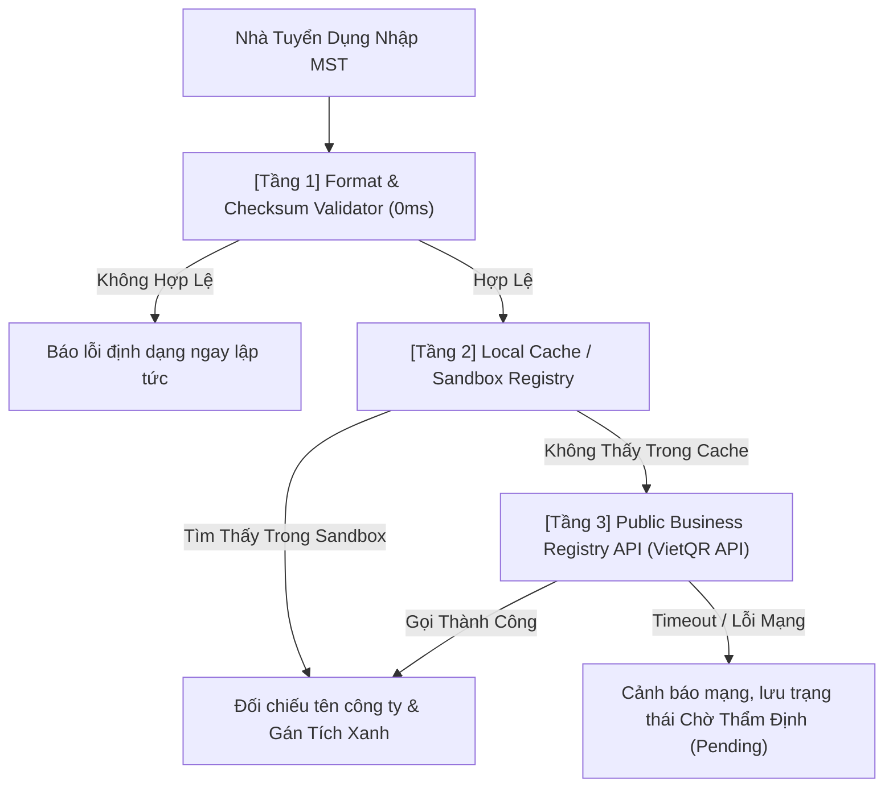

# Nghiên Cứu Kỹ Thuật: Xác Thực Mã Số Thuế Doanh Nghiệp (MST) & Cấp Tích Xanh Uy Tín
> **Mã nghiên cứu:** `RES-20261105-ENTERPRISE-TAX-VERIFICATION`  
> **Tính năng:** Xác thực MST & Tích Xanh Doanh Nghiệp (Verified Enterprise Badge)  
> **Vị trí lưu:** [`docs/superpowers/specs/2026-11-05-enterprise-tax-code-verification/research.md`](file:///C:/Users/ADMIN/Desktop/STUDY/docs/superpowers/specs/2026-11-05-enterprise-tax-code-verification/research.md)  
> **Trạng thái:** Hoàn tất nghiên cứu & Đã phê duyệt phương án

---

## 1. Nghiên Cứu Thuật Toán Kiểm Tra Định Dạng & Checksum MST Việt Nam

### Bối Cảnh Pháp Lý
Theo **Thông tư số 105/2020/TT-BTC** của Bộ Tài chính hướng dẫn về đăng ký thuế:
- Cấu trúc mã số thuế: `N1N2N3N4N5N6N7N8N9N10 - N11N12N13`
  - Hai chữ số đầu `N1N2`: Mã số phân khoảng tỉnh, thành phố trực thuộc trung ương hoặc mã phân loại người nộp thuế.
  - Bảy chữ số tiếp theo `N3N4N5N6N7N8N9`: Quy định theo một cấu trúc xác định, tăng dần từ `0000001` đến `9999999`.
  - Chữ số thứ mười `N10`: Chữ số kiểm tra (Check digit).
  - Ba chữ số `N11N12N13`: Các số thứ tự từ `001` đến `999` cấp cho đơn vị trực thuộc (chi nhánh, văn phòng đại diện).

### Thuật Toán Tính Số Kiểm Tra (Check Digit Algorithm)
Số kiểm tra $N_{10}$ được tính toán dựa trên tổng trọng số của 9 chữ số đầu tiên:
$$S = 31 \times N_1 + 29 \times N_2 + 23 \times N_3 + 19 \times N_4 + 17 \times N_5 + 13 \times N_6 + 7 \times N_7 + 5 \times N_8 + 3 \times N_9$$
$$R = S \pmod{11}$$
$$N_{10} = 10 - R \quad (\text{nếu } 10 - R = 10 \text{ thì } N_{10} = 0)$$

* **Quyết định:** Triển khai hàm `validateVietnameseTaxCode(taxCode: string)` thuần TypeScript:
  1. Loại bỏ khoảng trắng và dấu gạch nối (Chuẩn hóa: `0312345678-001` $\to$ `0312345678001`).
  2. Kiểm tra độ dài: Chỉ chấp nhận đúng 10 số hoặc 13 số.
  3. Kiểm tra mã tỉnh `N1N2`: Nằm trong dải hợp lệ được Bộ Tài chính cấp phát.
  4. Xác minh số kiểm tra $N_{10}$ theo công thức chuẩn.
* **Lợi ích:** Xử lý Client-side 0ms, chặn các chuỗi nhập giả mạo hoặc gõ nhầm ngay lập tức mà không cần gọi API ra ngoài.

---

## 2. Chiến Lược Tra Cứu Đa Tầng (Multi-Tier Lookup & Offline Fallback)

### Thách Thức
- Các API tra cứu dữ liệu doanh nghiệp nhà nước hoặc cổng thông tin đăng ký quốc gia thường không có SLA ổn định 100%, có thể bị nghẽn mạng, thay đổi captcha, hoặc giới hạn rate-limit khi test tự động.

### Quyết Định Kiến Trúc
Hệ thống sử dụng cơ chế **3-Tier Gateway Pipeline**:



1. **Sandbox Mock Registry:**
   - Định nghĩa trước dữ liệu của các doanh nghiệp đối tác tiêu biểu (FPT Software, VNG, MoMo, VNPT, Viettel, CMC...) để đảm bảo việc chạy Unit Test (Vitest) và nghiệm thu đồ án không bao giờ phụ thuộc vào kết nối Internet bên ngoài.
2. **VietQR Open Business API:**
   - Endpoint: `https://api.vietqr.io/v2/business/{tax_code}`
   - Trả về JSON:
     ```json
     {
       "code": "00",
       "desc": "success",
       "data": {
         "id": "0305011749",
         "name": "CÔNG TY CỔ PHẦN VNG",
         "address": "Z06 Đường số 13, Khu chế xuất Tân Thuận, Phường Tân Thuận Đông, Quận 7, TP Hồ Chí Minh",
         "internationalName": "VNG CORPORATION"
       }
     }
     ```

---

## 3. Cơ Chế Chống Mượn Danh MST (Anti-Spoofing & Name Matching)

### Nguy Cơ Tiềm Ẩn
- Một công ty không uy tín có thể tra cứu mã số thuế của tập đoàn lớn (ví dụ MST của VNG hoặc FPT) rồi điền vào hồ sơ để giả mạo Tích Xanh.

### Giải Pháp Kỹ Thuật
1. **Thuật toán Chuẩn Hóa Chuỗi (String Normalization):**
   - Chuyển toàn bộ chuỗi về chữ thường, bỏ dấu tiếng Việt (ví dụ `CÔNG TY TNHH` $\to$ `cong ty tnhh`).
   - Loại bỏ các từ tiền tố pháp lý phổ biến: `công ty`, `cổ phần`, `trách nhiệm hữu hạn`, `tnhh`, `tập đoàn`, `chi nhánh`.
2. **Đối Chiếu Tên Pháp Nhân (Core Keyword Match):**
   - So sánh tập từ khóa cốt lõi giữa **Tên doanh nghiệp tự khai** (`companyName`) và **Tên đăng ký kinh doanh chính thức** (`taxLegalName`).
   - Ví dụ:
     - Tên tự khai: `"FPT Software HCM"`
     - Tên ĐKKD: `"CÔNG TY TNHH PHẦN MỀM FPT HỒ CHÍ MINH"`
     - Từ khóa giao thoa: `{"fpt", "software", "hcm"}` $\approx$ `{"phan", "mem", "fpt", "ho", "chi", "minh"}` $\implies$ Khớp $\ge 70\% \implies$ **Hợp lệ (Verified)**.
     - Nếu tự khai `"Công Ty Đa Cấp Sao Vàng"` nhưng dùng MST của `"CÔNG TY CỔ PHẦN VNG"` $\implies$ Tỷ lệ khớp $0\% \implies$ **Từ chối xác thực (Rejected: Mismatch Name)**.

---

## 4. Tự Động Hủy Tích Xanh Khi Sửa Đổi Dữ Liệu (Invalidation Rules)

* **Nguyên tắc bất biến:** Huy hiệu Tích Xanh gắn liền chặt chẽ với cặp giá trị `(tax_code, company_name)`.
* **Quy tắc vô hiệu hóa:**
  - Nếu Nhà tuyển dụng thay đổi `company_name` hoặc `tax_code` trong trang Quản lý hồ sơ `RecruiterProfile.tsx`:
    - Hệ thống tự động đặt `is_tax_verified = false`.
    - Trạng thái chuyển thành `pending_reverification`.
    - Xóa huy hiệu Tích Xanh trên toàn bộ các Job đang hiển thị của nhà tuyển dụng đó cho đến khi thực hiện xác thực lại thành công.

---

## 5. Kết Luận & Quyết Định Triển Khai
- **Phương án lựa chọn:** Xây dựng `taxVerificationService.ts` với đầy đủ validator định dạng MST Việt Nam, thuật toán đối chiếu tên pháp lý và Sandbox Mock Registry phục vụ kiểm thử 100% tự động.
- **Tiêu chuẩn chất lượng:** Viết bộ test `taxVerificationService.test.ts` bao phủ các ca kiểm thử: MST 10 số hợp lệ, MST 13 số hợp lệ, MST sai check digit, MST không khớp tên công ty, và cơ chế reset tích xanh khi đổi tên.
