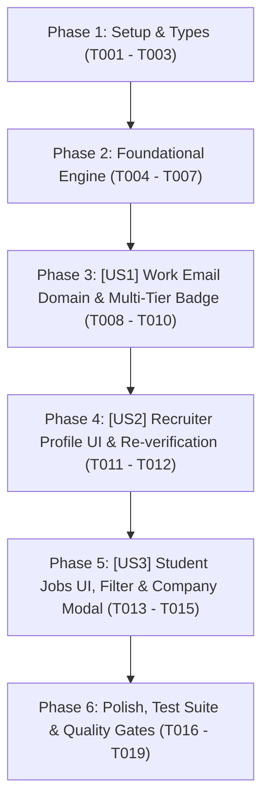

# Tasks: Xác Thực Mã Số Thuế Doanh Nghiệp (MST) & Cấp Tích Xanh Uy Tín (Verified Enterprise Badge)

> **Feature Name:** Xác Thực MST Doanh Nghiệp & Phòng Chống Mạo Danh Nhân Viên (Enterprise Tax Code Verification & Anti-Impersonation Defense)  
> **Plan Document:** [`docs/superpowers/plans/2026-11-05-enterprise-tax-code-verification-plan.md`](file:///C:/Users/ADMIN/Desktop/STUDY/docs/superpowers/plans/2026-11-05-enterprise-tax-code-verification-plan.md)  
> **Spec Directory:** [`docs/superpowers/specs/2026-11-05-enterprise-tax-code-verification/`](file:///C:/Users/ADMIN/Desktop/STUDY/docs/superpowers/specs/2026-11-05-enterprise-tax-code-verification/)  
> **Branch:** `profilehub_v1`  
> **Checklist Format Requirement:** `- [ ] [TaskID] [P?] [Story?] Description with file path`

---

## 🏛️ Dependencies & Story Execution Order

---

## Phase 1: Setup & Types

- [X] T001 Khởi tạo schema types cho xác thực MST và phòng chống mạo danh trong profilehub/src/types/taxVerification.types.ts
- [X] T002 [P] Mở rộng các trường thuế, work email và tier trong profilehub/src/types/database.ts và profilehub/src/utils/jobSync.ts
- [X] T003 [P] Tạo tệp migration SQL định nghĩa schema bảng recruiter_profiles và ràng buộc bảo vệ trong profilehub/server/migrations/20261105100000_enterprise_tax_verification.sql

---

## Phase 2: Foundational Engine (Blocking Prerequisites)

- [X] T004 Xây dựng thuật toán kiểm tra định dạng và checksum số kiểm tra N10 theo Thông tư 105/2020/TT-BTC trong profilehub/src/services/taxVerificationService.ts
- [X] T005 [P] Xây dựng bộ Sandbox Mock Registry các doanh nghiệp công nghệ tiêu biểu (FPT, VNG, Viettel, VNPT, MoMo...) và trường hợp MST giả trong profilehub/src/services/taxVerificationService.ts
- [X] T006 Xây dựng cơ chế chống Spam & Rate-Limiting (tối đa 5 lần/ngày/account, cooldown 30s) trong profilehub/src/services/taxVerificationService.ts
- [X] T007 Xây dựng thuật toán so khớp tên thương hiệu tự khai với tên pháp nhân ĐKKD (ngưỡng >= 60%) trong profilehub/src/services/taxVerificationService.ts

---

## Phase 3: User Story 1 - Work Email Domain Verification & Multi-Tier Badge (P1 - Chống Mạo Danh Nhân Viên)

**Story Goal:** Ngăn chặn kẻ lừa đảo dùng MST thật của công ty nhưng lại sử dụng email rác cá nhân để lừa gạt sinh viên, thông qua cơ chế khóa domain email công vụ (`@company.com`) và phân cấp Tích Xanh / Tích Bạc.  
**Independent Test Criteria:** Tài khoản dùng email domain công ty được xác thực OTP và cấp Tích Xanh toàn phần; tài khoản dùng email cá nhân (`@gmail.com`) chỉ được cấp Tích Bạc kèm nhãn cảnh báo phòng chống lừa đảo; đổi tên công ty tự động thu hồi tích về trạng thái chờ xác thực lại.

- [X] T008 [P] [US1] Triển khai thuật toán kiểm tra tên miền Email công vụ và bộ tạo/xác minh mã OTP 6 số trong profilehub/src/services/taxVerificationService.ts
- [X] T009 [US1] Triển khai bộ phân cấp huy hiệu Tích Xanh (full) vs Tích Bạc (silver) dựa trên email domain và bằng chứng nhân sự trong profilehub/src/services/taxVerificationService.ts
- [X] T010 [US1] Triển khai hàm verifyAndSaveRecruiterTax tích hợp lưu trữ kép (Dual-Storage Seam) và cơ chế tự động thu hồi tích khi đổi tên công ty trong profilehub/src/services/taxVerificationService.ts

---

## Phase 4: User Story 2 - Recruiter Profile UI Integration (P1 - Giao Diện Nhà Tuyển Dụng)

**Story Goal:** Cung cấp giao diện trực quan cho nhà tuyển dụng nhập MST, email công vụ, kích hoạt xác thực tức thì và nhận phản hồi minh bạch về kết quả ĐKKD.  
**Independent Test Criteria:** Giao diện hiển thị ô nhập MST và Email công vụ; bấm xác thực hiển thị loading; trả về Tích Xanh nếu hợp lệ hoặc thông báo chi tiết lý do từ chối (sai checksum, không tồn tại, tên không khớp).

- [X] T011 [US2] Cập nhật giao diện quản lý hồ sơ nhà tuyển dụng với form nhập MST, Work Email và hiển thị huy hiệu Tích Xanh / Tích Bạc trong profilehub/src/pages/recruiter/RecruiterProfile.tsx
- [X] T012 [US2] Tích hợp modal nhập mã OTP xác minh Work Email và cơ chế cảnh báo tự động yêu cầu xác thực lại khi thay đổi thông tin trong profilehub/src/pages/recruiter/RecruiterProfile.tsx

---

## Phase 5: User Story 3 - Student Job Market & Transparency UI (P2 - Bảo Vệ Sinh Viên)

**Story Goal:** Giúp sinh viên nhận biết ngay lập tức độ tin cậy của doanh nghiệp tuyển dụng qua huy hiệu Tích Xanh, lọc sạch các tin đăng chưa kiểm định và xem đầy đủ thông tin pháp nhân ĐKKD.  
**Independent Test Criteria:** Thẻ Job Card hiển thị huy hiệu Tích Xanh / Tích Bạc tương ứng; bấm nút lọc nhanh chỉ hiển thị các việc làm từ doanh nghiệp có Tích Xanh; modal chi tiết công ty hiển thị khối bảo chứng ĐKKD đầy đủ.

- [X] T013 [P] [US3] Hiển thị huy hiệu Tích Xanh (Verified Enterprise) và Tích Bạc kèm cảnh báo an toàn trên từng thẻ việc làm trong profilehub/src/pages/student/StudentJobs.tsx
- [X] T014 [US3] Bổ sung nút bấm bộ lọc nhanh [🛡️ Chỉ xem công ty có Tích Xanh] trong profilehub/src/pages/student/StudentJobs.tsx
- [X] T015 [P] [US3] Cập nhật modal chi tiết doanh nghiệp với khối thông tin pháp lý ĐKKD đã thẩm định trong profilehub/src/components/student/RecruiterCompanyModal.tsx

---

## Phase 6: Polish, Test Suite & Quality Gates

- [X] T016 Xây dựng bộ kiểm thử Unit Test toàn diện kiểm chứng 100% các ca nghiệp vụ thuế và phòng chống mạo danh trong profilehub/src/services/taxVerificationService.test.ts
- [X] T017 Thực thi toàn bộ bộ kiểm thử tự động với lệnh npm test -- --run bảo đảm 100% Pass không gây lỗi hồi quy
- [X] T018 Kiểm tra nghiêm ngặt kiểu dữ liệu TypeScript bằng npx tsc --noEmit đạt 0 lỗi
- [X] T019 Đóng gói sản phẩm với npm run build thành công tối ưu bundle
