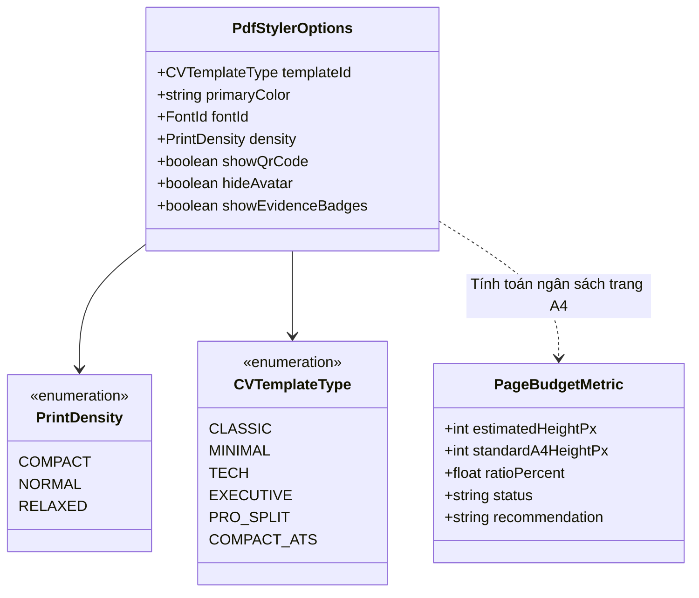

# Mô Hình Dữ Liệu: Bộ Chọn Theme & Tuỳ Biến Xuất PDF Chuyên Nghiệp (Data Model)

> **Mã tài liệu:** `DATA-MODEL-20261105-MULTI-THEME-PDF-STYLER`  
> **Tính năng:** Multi-Theme PDF Styler, Live A4 Print Sheet Preview & Professional Resume Export Studio  
> **Dự án:** ProfileHub - Nền tảng Hồ sơ Nghề nghiệp Dựa trên Bằng chứng  
> **Nhánh Git:** `profilehub_v1`  
> **Ngày lập:** 05/11/2026  

---

## 1. Sơ Đồ Cấu Trúc Dữ Liệu Thực Thể (Class Diagram)



---

## 2. Định Nghĩa Kiểu Dữ Liệu TypeScript (TypeScript Definitions)

Vị trí lưu trữ: [`src/types/pdfStyler.types.ts`](file:///C:/Users/ADMIN/Desktop/STUDY/profilehub/src/types/pdfStyler.types.ts)

```typescript
import type { CVTemplateType } from '../components/cv/CVTemplates';

export type PrintDensity = 'compact' | 'normal' | 'relaxed';

export type FontId = 'be-vietnam-pro' | 'inter' | 'plus-jakarta' | 'lora' | 'roboto';

export interface FontOptionItem {
  id: FontId;
  name: string;
  desc: string;
  fontFamily: string;
}

export interface ColorPaletteItem {
  id: string;
  name: string;
  hex: string;
  badgeLabel?: string;
}

export interface VisualTemplateItem {
  id: CVTemplateType;
  name: string;
  subtitle: string;
  desc: string;
  badge: string;
  badgeColor: string;
  layoutType: '1_column' | '2_column_split' | 'top_banner' | 'timeline';
}

export interface PdfStylerOptions {
  templateId: CVTemplateType;
  primaryColor: string;
  fontId: FontId;
  density: PrintDensity;
  showQrCode: boolean;
  hideAvatar: boolean;
  showEvidenceBadges: boolean;
}

export interface PageBudgetMetric {
  ratioPercent: number; // Tỷ lệ % so với chiều cao chuẩn A4
  isSinglePage: boolean; // True nếu <= 100%
  isWarning: boolean;    // True nếu > 100% && <= 115% (chớm tràn)
  isMultiPage: boolean;  // True nếu > 115%
  statusMessage: string;
  badgeColor: 'emerald' | 'amber' | 'rose';
}
```

---

## 3. Quy Tắc Điều Chỉnh Mật Độ In Ấn (Print Density Rules)

| Mật độ | Cỡ chữ cơ sở (Base Font Size) | Khoảng cách dòng (Line Height) | Lề trang in (@page margin) | Mục đích tối ưu |
| :--- | :---: | :---: | :---: | :--- |
| **`compact` (Gọn gàng)** | `9.5pt` | `1.3` | `6mm 8mm` | Gom trọn 1 trang A4 hoàn hảo cho ứng viên có nhiều đồ án (3-4 đồ án). |
| **`normal` (Tiêu chuẩn)** | `10.5pt` | `1.45` | `8mm 10mm` | Bố cục chuẩn mực, cân đối và thanh lịch cho hồ sơ thông thường. |
| **`relaxed` (Thoáng đãng)** | `11.5pt` | `1.6` | `10mm 12mm` | Làm đầy trang A4 cho sinh viên mới ra trường hoặc hồ sơ ít kinh nghiệm. |

---

## 4. Danh Mục 6 Mẫu CV Trực Quan (Visual Templates Catalog)

1. **`classic` — Modern Top-Banner:**
   - Đặc trưng: Khối Header màu đậm trải ngang, thân chia 2 cột bất đối xứng (35% - 65%) chuẩn phong cách TopCV Pro.
2. **`minimal` — Minimalist Harvard:**
   - Đặc trưng: 1 cột tối giản học thuật, font Lora Serif, đường kẻ hairline $0.5\text{px}$ chuẩn Ivy League.
3. **`tech` — Tech Developer Terminal:**
   - Đặc trưng: Dành riêng cho Lập trình viên với Bento Card, tag công nghệ nổi bật và link GitHub/Live Demo.
4. **`executive` — Timeline Milestone:**
   - Đặc trưng: Trục thời gian kẻ dọc nối các mốc dự án, chuyên nghiệp cho cấp bậc Middle/Senior.
5. **`pro_split` — Left Solid Sidebar:**
   - Đặc trưng: Cột trái nền đặc màu Châu Âu, cột phải nền trắng tinh tế.
6. **`compact_ats` — Compact 1-Page ATS:**
   - Đặc trưng: Tối ưu 100% cho thuật toán quét hồ sơ ATS, bố cục 50-50, độ tương phản cao.
