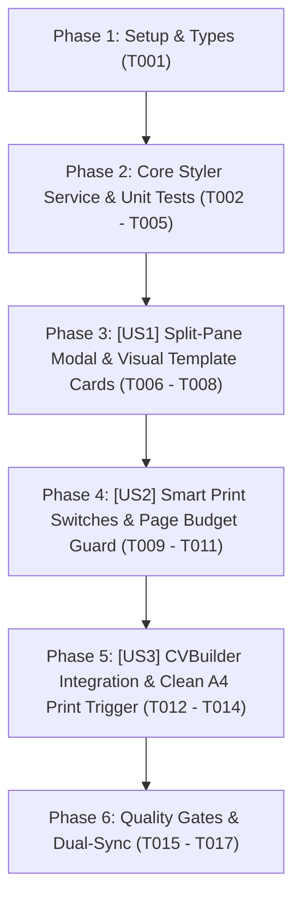

# Tasks: Bộ Chọn Theme & Tuỳ Biến Xuất PDF Chuyên Nghiệp (Multi-Theme PDF Styler & Professional Resume Export Studio)

> **Feature Name:** Bộ Chọn Theme & Tuỳ Biến Xuất PDF Chuyên Nghiệp: Multi-Theme PDF Styler, Live A4 Print Sheet Preview & Professional Resume Export Studio  
> **Plan Document:** [`docs/superpowers/plans/2026-11-05-multi-theme-pdf-styler-plan.md`](file:///C:/Users/ADMIN/Desktop/STUDY/docs/superpowers/plans/2026-11-05-multi-theme-pdf-styler-plan.md)  
> **Spec Directory:** [`docs/superpowers/specs/2026-11-05-multi-theme-pdf-styler/`](file:///C:/Users/ADMIN/Desktop/STUDY/docs/superpowers/specs/2026-11-05-multi-theme-pdf-styler/)  
> **Branch:** `profilehub_v1`  
> **Checklist Format Requirement:** `- [ ] [TaskID] [P?] [Story?] Description with file path`

---

## 🏛️ Dependencies & Story Execution Order

---

## Phase 1: Setup & Types

- [X] T001 Khởi tạo các định nghĩa kiểu dữ liệu PrintDensity, FontId, PdfStylerOptions, PageBudgetMetric, VisualTemplateItem trong profilehub/src/types/pdfStyler.types.ts

---

## Phase 2: Core Styler Service & Tests (Blocking Prerequisites)

- [X] T002 Xây dựng hàm getStoredStylerPreferences và saveStylerPreferences quản trị cấu hình in ấn qua LocalStorage trong profilehub/src/services/pdfStylerService.ts
- [X] T003 [P] Xây dựng hàm tính toán ngân sách trang in A4 calculatePageBudget hỗ trợ nhận diện trang đơn và cảnh báo chớm tràn dòng mồ côi trong profilehub/src/services/pdfStylerService.ts
- [X] T004 [P] Xây dựng hàm getDensityStyles cung cấp các lớp CSS co giãn khoảng cách dòng, cỡ chữ và padding trang in theo mật độ compact, normal, relaxed trong profilehub/src/services/pdfStylerService.ts
- [X] T005 Xây dựng bộ kiểm thử đơn vị tự động 100% cho pdfStylerService bao phủ 7+ kịch bản nghiệm thu trong profilehub/src/services/pdfStylerService.test.ts

---

## Phase 3: User Story 1 - Interactive Split-Pane Modal & Visual Template Cards (P1 - Giao Diện Studio & Bộ Chọn Mẫu Trực Quan)

**Story Goal:** Xây dựng modal `PdfExportStylerModal.tsx` với bố cục Split-Pane 2 cột: Cột trái chứa danh sách 6 thẻ mẫu CV (`classic`, `minimal`, `tech`, `executive`, `pro_split`, `compact_ats`) kèm nhãn đặc trưng, cột phải hiển thị tờ giấy A4 xem trước tỷ lệ 1:1 phản hồi tức thì 0ms khi chuyển mẫu.  
**Independent Test Criteria:** Mở modal, nhấp chọn lần lượt 6 thẻ template, tờ giấy A4 bên phải lập tức đổi giao diện sang template tương ứng mà không cần reload trang.

- [X] T006 [US1] Xây dựng khung giao diện Split-Pane 2 cột cho modal xem trước trang in trong profilehub/src/components/cv/PdfExportStylerModal.tsx
- [X] T007 [P] [US1] Xây dựng danh sách 6 thẻ mẫu CV thẻ ảnh trực quan với huy hiệu phong cách TopCV Pro, Harvard Ivy League, Hacker Terminal trong profilehub/src/components/cv/PdfExportStylerModal.tsx
- [X] T008 [US1] Tích hợp bộ chọn bảng màu chủ đạo 6 chip màu và phông chữ tiếng Việt chuẩn trong profilehub/src/components/cv/PdfExportStylerModal.tsx

---

## Phase 4: User Story 2 - Smart Print Switches & Page Budget Guard Bar (P1 - Công Tắc In Ấn & Kiểm Soát Ngân Sách Trang)

**Story Goal:** Bổ sung bộ 4 công tắc in ấn chuyên nghiệp (In mã QR Bằng chứng số, Ẩn ảnh thẻ Blind Hiring, Huy hiệu Demo Ready, Mật độ dòng Compact ép 1 trang) và thanh đo Page Budget cảnh báo tràn trang thời gian thực.  
**Independent Test Criteria:** Bật công tắc ẩn avatar $\to$ ảnh thẻ trên tờ A4 ẩn đi; bật QR code $\to$ mã QR hiển thị ở góc CV; chọn mật độ Compact $\to$ thanh đo Page Budget chuyển sang màu xanh lá cây báo vừa khít 1 trang A4.

- [X] T009 [US2] Bổ sung bộ 4 công tắc in ấn thông minh cho phép bật tắt QR Code, ẩn avatar và hiện huy hiệu bảo chứng trong profilehub/src/components/cv/PdfExportStylerModal.tsx
- [X] T010 [P] [US2] Xây dựng bộ điều khiển mật độ khoảng cách dòng Compact, Normal, Relaxed trong profilehub/src/components/cv/PdfExportStylerModal.tsx
- [X] T011 [US2] Tích hợp thanh đo ngân sách trang in A4 cảnh báo màu xanh khi vừa vặn 1 trang và màu vàng khi chớm tràn dòng mồ côi trong profilehub/src/components/cv/PdfExportStylerModal.tsx

---

## Phase 5: User Story 3 - CVBuilder Integration & Clean A4 Export Trigger (P1 - Tích Hợp CVBuilder & Kích Hoạt In Sạch Sẽ)

**Story Goal:** Tích hợp `PdfExportStylerModal.tsx` vào trang `CVBuilder.tsx`, thay thế hành vi gọi in trực tiếp bằng mở modal xem trước, hỗ trợ phím tắt `Ctrl + P`, và kích hoạt quy tắc in `@media print` sạch sẽ không dính thanh công cụ.  
**Independent Test Criteria:** Tại `CVBuilder.tsx`, bấm nút `[ Xuất PDF ]` hoặc nhấn `Ctrl + P` $\to$ modal mở ra; bấm `[ 🖨️ In / Tải PDF Chuẩn Kích Thước A4 ]` $\to$ hộp thoại in của trình duyệt mở ra sạch sẽ chỉ in trang A4.

- [X] T012 [US3] Tích hợp PdfExportStylerModal vào trang tạo CV và gắn sự kiện kích hoạt vào nút Xuất PDF cùng phím tắt Ctrl + P trong profilehub/src/pages/student/CVBuilder.tsx
- [X] T013 [US3] Hoàn thiện quy tắc in ấn CSS media print đảm bảo xuất PDF sắc nét, màu in trung thực và chỉ hiển thị trang in A4 trong profilehub/src/pages/student/CVBuilder.tsx
- [X] T014 [US3] Xây dựng bộ kiểm thử logic giao diện cho modal in ấn và các công tắc điều khiển trong profilehub/src/components/cv/pdfExportModalLogic.test.ts

---

## Phase 6: Polish, Quality Gates & Dual-Sync Git

- [X] T015 Chạy toàn bộ 46 test suites Vitest bằng lệnh npm test -- --run đảm bảo 100% Pass và không có bất kỳ hồi quy nào
- [X] T016 [P] Kiểm tra TypeScript nghiêm ngặt npx tsc --noEmit đạt 0 lỗi và đóng gói Production npm run build thành công
- [X] T017 Cập nhật session_log_2026-11-05.md và thực hiện Dual-Sync Git commit đẩy lên cả 2 nhánh origin/profilehub_v1 và origin/1310-co-ban-chua-sua
