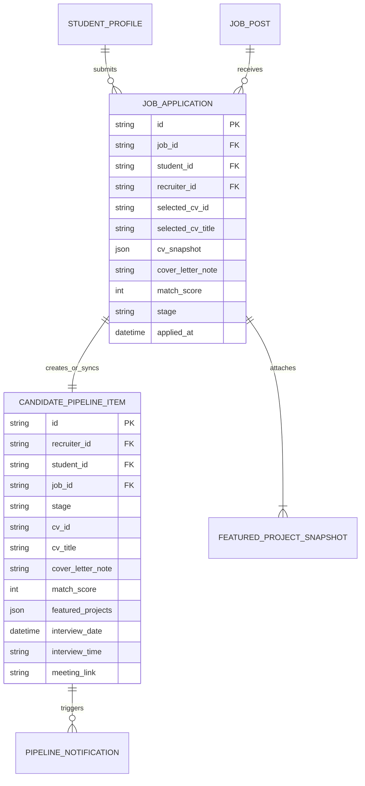

# Mô Hình Dữ Liệu: Vòng Lặp Ứng Tuyển 1-Click Bằng Bằng Chứng & Đồng Bộ Pipeline
> **Mã tài liệu:** `DATA-MODEL-20261105-ONE-CLICK-EVIDENCE-APPLY-PIPELINE-SYNC`  
> **Tính năng:** 1-Click Evidence-Based Apply & Real-Time Two-Way Hiring Pipeline Sync  
> **Dự án:** ProfileHub - Nền tảng Hồ sơ Nghề nghiệp Dựa trên Bằng chứng  
> **Nhánh Git:** `profilehub_v1`  
> **Ngày lập:** 05/11/2026  

---

## 1. Sơ Đồ Cấu Trúc Dữ Liệu Thực Thể (Entity Relationship Diagram)



---

## 2. Định Nghĩa Kiểu Dữ Liệu TypeScript (TypeScript Definitions)

Vị trí lưu trữ: [`src/types/jobApplication.types.ts`](file:///C:/Users/ADMIN/Desktop/STUDY/profilehub/src/types/jobApplication.types.ts)

```typescript
import type { PipelineStage } from './database';
import type { ProjectBadgeVariant } from './projectBadge.types';

/**
 * Snapshot thông tin đồ án đính kèm trong đơn ứng tuyển
 */
export interface FeaturedProjectAttachment {
  id: string;
  title: string;
  description?: string;
  demo_url?: string;
  github_url?: string;
  is_verified?: boolean;
  verification_status?: string;
  badge_variant?: ProjectBadgeVariant;
}

/**
 * Dữ liệu đầu vào khi sinh viên nộp đơn ứng tuyển qua modal
 */
export interface JobApplicationSubmissionInput {
  jobId: string;
  jobTitle: string;
  companyName: string;
  recruiterId: string;
  selectedCvId: string;
  selectedCvTitle: string;
  cvSnapshot?: any;
  featuredProjects: FeaturedProjectAttachment[];
  coverLetterNote?: string;
  matchScore: number;
}

/**
 * Bản ghi đơn ứng tuyển hoàn chỉnh trong hệ thống
 */
export interface JobApplicationRecord {
  id: string;
  jobId: string;
  jobTitle: string;
  companyName: string;
  recruiterId: string;
  studentId: string;
  studentName: string;
  studentEmail: string;
  studentMajor?: string;
  studentUniversity?: string;
  selectedCvId: string;
  selectedCvTitle: string;
  cvSnapshot?: any;
  featuredProjects: FeaturedProjectAttachment[];
  coverLetterNote?: string;
  matchScore: number;
  stage: PipelineStage;
  appliedAt: string;
  updatedAt: string;
}

/**
 * Thông báo hai chiều gửi tới ứng viên khi nhà tuyển dụng chuyển stage
 */
export interface StudentApplicationNotification {
  id: string;
  studentId: string;
  jobId: string;
  jobTitle: string;
  companyName: string;
  stage: PipelineStage;
  message: string;
  interviewDate?: string;
  interviewTime?: string;
  meetingLink?: string;
  createdAt: string;
  isRead: boolean;
}
```

---

## 3. Quy Tắc Bất Biến & Chuyển Đổi Trạng Thái (State Transition Invariants)

1. **Quy tắc Duy Nhất (Single Active Application):** Mỗi sinh viên chỉ có tối đa 1 đơn ứng tuyển đang hoạt động cho cùng một tin tuyển dụng `(student_id, job_id)`. Bấm ứng tuyển lại sẽ cập nhật bản ghi hiện có thay vì tạo đơn trùng lặp.
2. **Quy tắc Chụp Bản Sao Bất Biến (Immutability Snapshot):**
   `cvSnapshot` được deep clone tại thời điểm bấm nộp đơn để bảo toàn bằng chứng nộp ban đầu của sinh viên.
3. **Quy tắc Lan Truyền Trạng Thái (Bi-directional Propagation):**
   Khi Recruiter cập nhật `stage` trên Kanban:
   $$\text{recruiter\_pipeline}[\text{stage}] \Longrightarrow \text{application\_tracker}[\text{stage}] \Longrightarrow \text{student\_notification}[\text{new\_event}]$$
