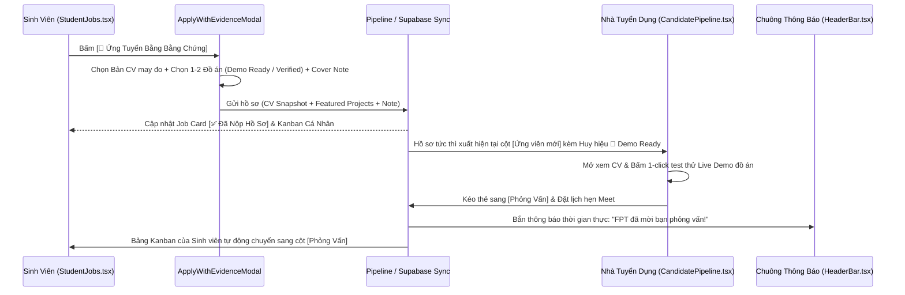

# Báo Cáo Nghiên Cứu Kỹ Thuật: Vòng Lặp Ứng Tuyển 1-Click Bằng Bằng Chứng & Đồng Bộ Pipeline Hai Chiều
> **Mã tài liệu:** `RESEARCH-20261105-ONE-CLICK-EVIDENCE-APPLY-PIPELINE-SYNC`  
> **Tính năng:** 1-Click Evidence-Based Apply & Real-Time Two-Way Hiring Pipeline Sync  
> **Dự án:** ProfileHub - Nền tảng Hồ sơ Nghề nghiệp Dựa trên Bằng chứng  
> **Nhánh Git:** `profilehub_v1`  
> **Ngày lập:** 05/11/2026  

---

## 1. Bối Cảnh, Vấn Đề Thực Tế & Động Lực Sản Phẩm

### 1.1. "Mắt Xích Đứt Đoạn" Trên Các Sàn Tuyển Dụng Truyền Thống
Trên các nền tảng tuyển dụng thông thường (TopCV, VietnamWorks, Indeed):
1. **Rải CV mù quáng (Spamming PDFs):** Ứng viên nộp cùng một file PDF chung chung cho 50 công ty khác nhau mà không có bằng chứng chứng minh mình thực sự làm được việc.
2. **Hố đen ứng tuyển (The Black Hole):** Sau khi bấm "Nộp đơn", ứng viên hoàn toàn mù tịt về số phận hồ sơ của mình (HR đã xem chưa? Có được vào vòng phỏng vấn không?).
3. **Phía Nhà Tuyển Dụng quá tải (Review Fatigue):** HR nhận hàng trăm file PDF giống hệt nhau, không có link demo, không biết code thật nằm ở đâu, mất 80% thời gian để sàng lọc những ứng viên "chém gió".

### 1.2. Hiện Trạng & Cơ Hội Trên ProfileHub
- **Những gì ProfileHub đã có sẵn cực tốt:**
  - Nhà tuyển dụng: Đăng tin việc làm chuẩn hóa (`JobManagement.tsx`), Bóc tách kỹ năng tự động, Xác thực Mã số thuế Tích Xanh, Bảng Kanban kéo thả (`CandidatePipeline.tsx`).
  - Sinh viên: Kho đồ án có phân cấp `🚀 Demo Ready` & `🛡️ Verified Code` (`MyProjects.tsx`), Sàn việc làm hiển thị dải lương và % phù hợp cá nhân (`StudentJobs.tsx`), Bảng Kanban theo dõi đơn nộp (`ApplicationKanbanBoard`).
- **Lỗ hổng cốt tử cần giải quyết:**
  - Nút "Ứng tuyển" ở `StudentJobs.tsx` hiện tại chỉ bật một thông báo `alert()` đơn sơ, tự động lấy CV mặc định mà **không cho phép sinh viên chọn đồ án Demo Ready tiêu biểu muốn khoe với HR**.
  - Khi ứng tuyển xong, hồ sơ chưa hiển thị trực quan các huy hiệu bằng chứng (`🚀 Demo Ready`, `🛡️ Verified`) trên thẻ Kanban của Nhà tuyển dụng.
  - Khi Nhà tuyển dụng kéo thẻ sang vòng Phỏng vấn hoặc Đặt lịch hẹn, sinh viên chưa nhận được thông báo thời gian thực trên chuông `HeaderBar.tsx`.

---

## 2. Kiến Trúc Luồng Nghiệp Vụ Khép Kín (Closed Hiring Loop)

---

## 3. Các Quyết Định Thiết Kế & Kỹ Thuật (Architectural Decisions)

### Quyết định 1: Modal Ứng Tuyển Bằng Bằng Chứng (`ApplyWithEvidenceModal.tsx`)
* Thay thế lệnh `alert()` sơ sài bằng một Modal 3 bước tinh gọn:
  1. **Chọn Bản CV May Đo:** Tự động đề xuất bản CV có `targetRole` khớp nhất với tiêu đề công việc.
  2. **Chọn Đồ Án Minh Chứng:** Liệt kê các đồ án trong kho của sinh viên, hiển thị rõ huy hiệu `🚀 Demo Ready` và `🛡️ Verified`. Cho phép tick chọn 1 - 2 đồ án xuất sắc nhất.
  3. **Lời Nhắn / Pitch Ngắn (Cover Note):** AI gợi ý sẵn lời mở đầu dựa trên điểm mạnh của đồ án, sinh viên có thể chỉnh sửa tự do trước khi nộp.

### Quyết định 2: Đính Kèm Bản Chụp Bất Biến (Immutable Snapshot) Của CV & Đồ Án
* Theo chuẩn FR-001 của ProfileHub: Khi nộp đơn, hệ thống chụp lại (Deep Clone) bản CV và thông tin đồ án tại thời điểm nộp. Dù sau này sinh viên có chỉnh sửa đồ án trong kho cá nhân, hồ sơ đã nộp cho nhà tuyển dụng vẫn giữ nguyên tính toàn vẹn (Immutability).

### Quyết định 3: Nâng Cấp Thẻ Ứng Viên Trên Kanban Nhà Tuyển Dụng (`CandidatePipeline.tsx`)
* Trên thẻ ứng viên ở cột `Ứng viên mới` (`discovered`):
  - Hiển thị chip số lượng đồ án: `🚀 X Demo Ready` và `🛡️ Y Verified`.
  - Hiển thị `🎯 {matchScore}% Khớp JD`.
  - Hiển thị tên bản CV ứng tuyển (`linked_cv_title`).
  - Nút bấm `[ Xem Cặp Hồ Sơ & Demo ]` cho phép HR mở ngay tab Live Demo của đồ án mà không mất công tìm kiếm.

### Quyết định 4: Cơ Chế Đồng Bộ Hai Chiều & Thông Báo Chuông (`HeaderBar.tsx`)
* Khi Nhà tuyển dụng thay đổi trạng thái (chuyển sang Phỏng vấn / Đặt lịch hẹn / Từ chối):
  - Sự kiện lưu vào cơ chế đồng bộ `pipelineSync.ts`.
  - Chuông thông báo `HeaderBar.tsx` của sinh viên lập tức nhảy chấm đỏ thông báo mới.
  - Tab "Tiến Trình Ứng Tuyển (Kanban)" trong `StudentJobs.tsx` tự động chuyển thẻ sang cột tương ứng.

---

## 4. Bảng So Sánh Trước & Sau Khi Triển Khai

| Yếu tố | Trước khi triển khai | Sau khi hoàn thiện tính năng |
| :--- | :--- | :--- |
| **Thao tác nộp đơn** | Nút bấm gọi `alert()`, tự động lấy 1 CV ngẫu nhiên, không chọn được đồ án. | Modal chuyên nghiệp, chọn CV phù hợp, chọn 1-2 đồ án Demo Ready, viết lời chào nhanh. |
| **Giá trị đối với HR** | Nhận tên ứng viên chung chung, không biết đồ án nào có bản chạy thử. | Thấy ngay `🚀 Demo Ready`, bấm 1-click trải nghiệm sản phẩm của ứng viên ngay trên Kanban. |
| **Trạng thái hai chiều** | Ứng viên nộp xong không biết HR làm gì tiếp theo. | Đồng bộ thời gian thực: HR đổi cột ➔ Chuông sinh viên báo ngay lập tức. |
| **Mức độ hoàn thiện** | Hai phân hệ Student và Recruiter hoạt động rời rạc. | **Khép kín 100% vòng đời tuyển dụng (The Complete Hiring Loop).** |
