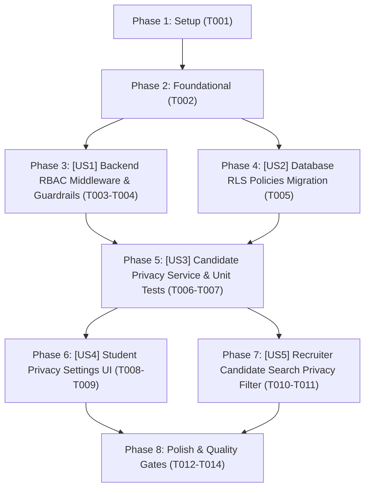

# Tasks: Phân Quyền RBAC & Quyền Riêng Tư Ứng Viên (RBAC & Candidate Privacy)

> **Feature Name:** Phân Quyền RBAC & Quyền Riêng Tư Ứng Viên (RBAC & Candidate Privacy)  
> **Plan Document:** [`docs/superpowers/plans/2026-11-05-rbac-and-candidate-privacy-plan.md`](file:///C:/Users/ADMIN/Desktop/STUDY/docs/superpowers/plans/2026-11-05-rbac-and-candidate-privacy-plan.md)  
> **Spec Directory:** [`docs/superpowers/specs/2026-11-05-rbac-and-candidate-privacy/`](file:///C:/Users/ADMIN/Desktop/STUDY/docs/superpowers/specs/2026-11-05-rbac-and-candidate-privacy/)  
> **Branch:** `profilehub_v1`  
> **Checklist Format Requirement:** `- [ ] [TaskID] [P?] [Story?] Description with file path`

---

## Dependencies & Story Execution Order

---

## Phase 1: Setup

- [X] T001 Khởi tạo schema types và enums cho Candidate Privacy trong profilehub/src/types/privacy.types.ts

---

## Phase 2: Foundational (Blocking Prerequisites)

- [X] T002 Cập nhật database type definitions trong profilehub/src/types/database.ts và server/src/types/index.ts để hỗ trợ is_open_to_work và blocked_companies

---

## Phase 3: User Story 1 - Backend RBAC Middleware & Route Guards (P1 - Security Baseline)

**Story Goal:** Ngăn chặn truy cập trái phép bằng cách kiểm tra vai trò người dùng (recruiter/student) tại tầng middleware của Express server.  
**Independent Test Criteria:** Sinh viên gọi API `/api/recruiter/*` nhận phản hồi `403 Forbidden`; Recruiter gọi API nhận dữ liệu thành công `200 OK`.

- [X] T003 [P] [US1] Xây dựng middleware requireRole trong profilehub/server/src/middlewares/auth.middleware.ts
- [X] T004 [US1] Áp dụng requireRole(['recruiter']) cho toàn bộ endpoint tuyển dụng trong profilehub/server/src/routes/recruiter.routes.ts

---

## Phase 4: User Story 2 - Database RLS Policies & Privacy Schema (P1 - Data Protection)

**Story Goal:** Tạo migration SQL kích hoạt Row Level Security (RLS) chặt chẽ cho các bảng liên quan đến ứng tuyển, tuyển dụng và quyền riêng tư ứng viên.  
**Independent Test Criteria:** Chạy migration SQL trên Supabase thành công, người dùng không thể đọc trộm hay sửa bản ghi pipeline của người khác qua Supabase Client.

- [X] T005 [US2] Xây dựng migration SQL nâng cấp RLS và cột quyền riêng tư trong profilehub/server/migrations/20261105000000_rbac_and_candidate_privacy.sql

---

## Phase 5: User Story 3 - Candidate Privacy Service & Unit Tests (P2 - Core Logic)

**Story Goal:** Xây dựng service quản lý trạng thái Open to Work và Company Blacklist cho ứng viên, hỗ trợ lưu trữ cục bộ và đồng bộ Supabase Cloud.  
**Independent Test Criteria:** Viết bộ test Vitest kiểm thử logic bật/tắt nhận việc, thêm/xóa công ty bị chặn, và kiểm tra điều kiện ứng viên có bị ẩn khỏi nhà tuyển dụng cụ thể hay không (100% test pass).

- [X] T006 [P] [US3] Xây dựng service candidatePrivacyService trong profilehub/src/services/candidatePrivacyService.ts
- [X] T007 [P] [US3] Xây dựng bộ kiểm thử Unit Test cho candidatePrivacyService trong profilehub/src/services/candidatePrivacyService.test.ts

---

## Phase 6: User Story 4 - Student Privacy Settings UI (P2 - User Control)

**Story Goal:** Sinh viên có thể chủ động cấu hình trạng thái "Sẵn sàng nhận việc" (Open to Work) và nhập danh sách các công ty không muốn cho xem hồ sơ.  
**Independent Test Criteria:** Bật/tắt công tắc Open to Work lưu trạng thái ngay lập tức; nhập thêm/xóa tên công ty trong danh sách chặn hiển thị tag rõ ràng và phản ánh tức thì.

- [X] T008 [P] [US4] Xây dựng modal cấu hình quyền riêng tư CandidatePrivacyModal trong profilehub/src/components/student/CandidatePrivacyModal.tsx
- [X] T009 [US4] Tích hợp nút mở cài đặt quyền riêng tư vào trang Hồ sơ / Việc làm sinh viên trong profilehub/src/pages/student/StudentJobs.tsx

---

## Phase 7: User Story 5 - Recruiter Candidate Search Privacy Filter (P2 - Exclusion Engine)

**Story Goal:** Khi Nhà tuyển dụng tìm kiếm ứng viên tại CandidateSearch, hệ thống tự động loại trừ các ứng viên đã tắt Open to Work hoặc đã chặn công ty của Nhà tuyển dụng đó.  
**Independent Test Criteria:** Ứng viên tắt Open to Work không xuất hiện trong danh sách tìm kiếm; Nhà tuyển dụng thuộc công ty bị chặn không thấy ứng viên đó.

- [X] T010 [P] [US5] Tích hợp bộ lọc quyền riêng tư vào hàm fetchCandidates trong profilehub/src/pages/recruiter/CandidateSearch.tsx
- [X] T011 [US5] Bổ sung huy hiệu trạng thái Open to Work trên thẻ hồ sơ ứng viên trong profilehub/src/components/recruiter/CandidateDossierModal.tsx

---

## Phase 8: Polish & Quality Gates

- [X] T012 Kiểm thử toàn bộ hệ thống bằng lệnh npm test -- --run và đảm bảo không có bài test nào bị vỡ (158/158 Passed)
- [X] T013 Kiểm tra nghiêm ngặt kiểu dữ liệu TypeScript bằng npx tsc --noEmit (0 Errors)
- [X] T014 Cập nhật Sổ nhật ký thực tập BM01b và nhật ký dự án ghi nhận kết quả hoàn thành ngày 05/11/2026
