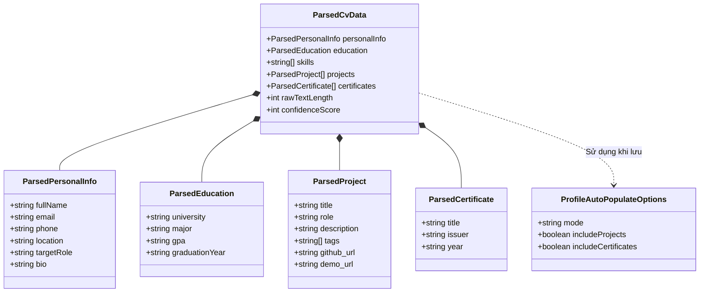

# Mô Hình Dữ Liệu: Quét CV Tự Động Điền Hồ Sơ Cá Nhân (Data Model)
> **Mã tài liệu:** `DATA-MODEL-20261105-SMART-CV-PARSER-PROFILE-AUTO-POPULATE`  
> **Tính năng:** Smart CV Parser, Structured Evidence Extraction & Master Profile Auto-Population  
> **Dự án:** ProfileHub - Nền tảng Hồ sơ Nghề nghiệp Dựa trên Bằng chứng  
> **Nhánh Git:** `profilehub_v1`  
> **Ngày lập:** 05/11/2026  

---

## 1. Sơ Đồ Cấu Trúc Dữ Liệu Thực Thể (Class Diagram)



---

## 2. Định Nghĩa Kiểu Dữ Liệu TypeScript (TypeScript Definitions)

Vị trí lưu trữ: [`src/types/cvParser.types.ts`](file:///C:/Users/ADMIN/Desktop/STUDY/profilehub/src/types/cvParser.types.ts)

```typescript
export interface ParsedPersonalInfo {
  fullName?: string;
  email?: string;
  phone?: string;
  location?: string;
  targetRole?: string;
  bio?: string;
}

export interface ParsedEducation {
  university?: string;
  major?: string;
  gpa?: string;
  graduationYear?: string;
}

export interface ParsedProject {
  title: string;
  role?: string;
  description?: string;
  tags?: string[];
  github_url?: string;
  demo_url?: string;
}

export interface ParsedCertificate {
  title: string;
  issuer?: string;
  year?: string;
}

export interface ParsedCvData {
  personalInfo: ParsedPersonalInfo;
  education: ParsedEducation;
  skills: string[];
  projects: ParsedProject[];
  certificates: ParsedCertificate[];
  rawTextLength: number;
  confidenceScore: number; // 0 - 100%
}

export interface ProfileAutoPopulateOptions {
  mode: 'overwrite' | 'merge'; // 'overwrite': Ghi đè toàn bộ, 'merge': Chỉ điền vào ô trống
  includeProjects: boolean;
  includeCertificates: boolean;
}

export interface ProfilePopulateResult {
  success: boolean;
  updatedProfileFields: string[];
  createdProjectsCount: number;
  createdCertificatesCount: number;
  message: string;
}
```

---

## 3. Quy Tắc Hợp Nhất & Điền Dữ Liệu (Merge Rules)

| Thuộc tính | Chế độ `overwrite` (Ghi đè) | Chế độ `merge` (Chỉ bổ sung mục trống) |
| :--- | :--- | :--- |
| **`full_name`** | Ghi đè bằng tên mới từ CV nếu có | Chỉ ghi nếu hồ sơ hiện tại chưa có tên |
| **`university`** | Cập nhật theo trường mới | Chỉ ghi nếu hiện tại để trống |
| **`major`** | Cập nhật theo ngành mới | Chỉ ghi nếu hiện tại để trống |
| **`gpa`** | Cập nhật theo điểm mới | Chỉ ghi nếu hiện tại chưa có GPA |
| **`skills`** | Thay bằng danh sách mới | Gộp danh sách cũ và mới, loại bỏ trùng lặp |
| **`projects`** | Tạo thêm các đồ án mới (tránh trùng tên) | Chỉ thêm các đồ án có tên chưa từng tồn tại trong kho |
| **`certificates`** | Tạo thêm các chứng chỉ mới | Chỉ thêm chứng chỉ chưa có trong danh sách |
