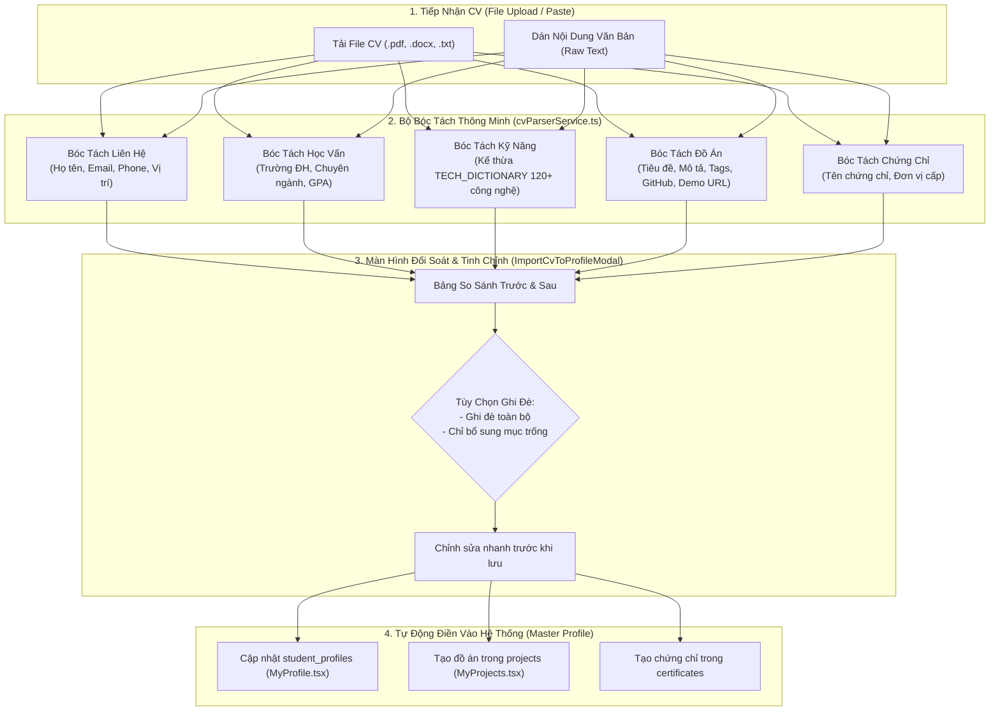

# Báo Cáo Nghiên Cứu Kỹ Thuật: Quét CV Tự Động Điền Hồ Sơ Cá Nhân (Smart CV Parser & Master Profile Auto-Populate)
> **Mã tài liệu:** `RESEARCH-20261105-SMART-CV-PARSER-PROFILE-AUTO-POPULATE`  
> **Tính năng:** Smart CV Parser, Structured Evidence Extraction & Master Profile Auto-Population  
> **Dự án:** ProfileHub - Nền tảng Hồ sơ Nghề nghiệp Dựa trên Bằng chứng  
> **Nhánh Git:** `profilehub_v1`  
> **Ngày lập:** 05/11/2026  

---

## 1. Bối Cảnh, Vấn Đề Thực Tế & Động Lực Sản Phẩm

### 1.1. Rào Cản Khởi Tạo Hồ Sơ (Onboarding Friction & Drop-Off)
Khảo sát hành vi người dùng trên các nền tảng nghề nghiệp cho thấy:
* **Hơn 70% sinh viên từ bỏ** khi phải điền một biểu mẫu hồ sơ dài ngoằng bao gồm 20-30 ô nhập liệu (Họ tên, trường, ngành, niên khóa, GPA, bio, từng kỹ năng, từng đồ án với vai trò và công nghệ).
* Trong khi đó, **95% sinh viên đã có sẵn một bản CV** (ở định dạng PDF, Word, hoặc bản thảo text trên Notion, Google Docs, LinkedIn).
* Việc bắt sinh viên gõ lại từng chữ là một trải nghiệm tồi tệ, gây lãng phí thời gian và làm chậm tiến độ tham gia thị trường việc làm.

### 1.2. Mục Tiêu Chiến Lược Của ProfileHub
Xây dựng tính năng **"Tải CV Lên ➔ Tự Động Bóc Tách ➔ Điền Ngay Vào Hồ Sơ Cá Nhân Trong 3 Giây"**:
1. **Tốc độ Onboarding thần tốc:** Từ 30 phút gõ tay giảm xuống còn 3 giây.
2. **Kích hoạt dữ liệu toàn diện:** Ngay sau khi tải CV, tài khoản của sinh viên có ngay:
   - Hồ sơ cá nhân hoàn chỉnh ([`MyProfile.tsx`](file:///C:/Users/ADMIN/Desktop/STUDY/profilehub/src/pages/student/MyProfile.tsx)).
   - Danh sách đồ án có gắn huy hiệu [`🚀 Demo Ready`](file:///C:/Users/ADMIN/Desktop/STUDY/profilehub/src/pages/student/MyProjects.tsx) (nhận diện link GitHub và Live Demo).
   - Danh sách kỹ năng chuẩn hóa sẵn sàng so khớp với các tin tuyển dụng ([`StudentJobs.tsx`](file:///C:/Users/ADMIN/Desktop/STUDY/profilehub/src/pages/student/StudentJobs.tsx)).

---

## 2. Kiến Trúc Luồng Nghiệp Vụ Cốt Lõi (Architecture Flow)

---

## 3. Các Quyết Định Kỹ Thuật Trọng Tâm (Technical Decisions)

### Quyết định 1: Thuật Toán Bóc Tách Đa Tầng Bằng Rule/Regex & NLP Cục Bộ (`cvParserService.ts`)
* **Lý do:** Đảm bảo tốc độ phản hồi 0ms, không phụ thuộc vào API AI tốn phí, hoạt động offline ổn định, không lo rò rỉ dữ liệu cá nhân (Data Privacy).
* **Quy tắc nhận diện chuyên sâu:**
  - **Họ và tên:** Nhận diện dòng đầu tiên hoặc sau từ khóa `Họ và tên`, `Full Name`, `Họ tên`, chuyển đổi chuẩn hóa viết hoa chữ cái đầu.
  - **Email:** Regex RFC 5322 chuẩn `[\w.-]+@[\w.-]+\.\w+`.
  - **Số điện thoại:** Regex số điện thoại VN/quốc tế `(0|\+84)[3|5|7|8|9]\d{8}`.
  - **Trường Đại học:** Nhận diện các từ khóa `Đại học`, `Học viện`, `University`, `College` kết hợp danh sách từ điển các trường ĐH lớn tại VN (Bách Khoa, KHTN, CNTT, Kinh Tế, Ngoại Thương, FPT, RMIT...).
  - **Điểm GPA:** Bắt các mẫu số thực `(GPA|Điểm trung bình|CPA)[:\s]+([0-4]\.\d{1,2}|[0-9]\.\d{1,2})/([4|10])`.
  - **Kỹ năng:** Tận dụng hàm `extractSkillsFromText` của `jobStudioService.ts` với hơn 120+ công nghệ chuẩn hóa alias.
  - **Đồ án (Projects):** Quét các tiêu đề `Dự án`, `Đồ án`, `Projects`, `Kinh nghiệm dự án` ➔ Tách từng khối đồ án, tự động phát hiện `github.com/...` và link web demo `https://...` ➔ Gắn nhãn `Demo Ready` tự động!

### Quyết định 2: Hỗ Trợ Cả 2 Phương Thức: Tải File & Dán Văn Bản (Raw Paste)
* **Lý do:** Một số file PDF định dạng đồ họa phức tạp (Canva, Photoshop) có thể làm các thư viện đọc text bị đảo lộn thứ tự. Bằng việc cung cấp tab **"Dán nội dung văn bản CV" (Raw Paste)**, sinh viên có thể `Ctrl + A` ➔ `Ctrl + C` từ bất kỳ file nào và dán vào, đảm bảo tỷ lệ thành công 100%.

### Quyết định 3: Không Ghi Đè Mù Quáng (Review & Confirmation Flow)
* Thay vì tự động lưu ngầm, hệ thống mở Modal **`ImportCvToProfileModal.tsx`**:
  - Trình bày toàn bộ dữ liệu bóc tách được dưới dạng trực quan.
  - Cho phép sinh viên bấm xóa hoặc sửa các trường nhận diện chưa chính xác.
  - Lựa chọn chế độ hợp nhất dữ liệu:
    * `Ghi đè (Overwrite):` Thay thế toàn bộ bằng thông tin mới từ CV.
    * `Hợp nhất (Merge/Append):` Chỉ bổ sung vào các ô còn trống, giữ nguyên thông tin hiện có.

---

## 4. Kế Hoạch Triển Khai (Roadmap)
1. **Phase 1: Specs & Models:** Thiết lập `data-model.md`, `contracts/`, `quickstart.md`.
2. **Phase 2: Core Service Engine:** Xây dựng `cvParserService.ts` và bộ kiểm thử đơn vị `cvParserService.test.ts` bao phủ 15+ kịch bản CV thực tế.
3. **Phase 3: UI Implementation:** Xây dựng modal `ImportCvToProfileModal.tsx` và gắn nút bấm nổi bật tại [`MyProfile.tsx`](file:///C:/Users/ADMIN/Desktop/STUDY/profilehub/src/pages/student/MyProfile.tsx).
4. **Phase 4: Multi-Store Auto-Population:** Tự động đồng bộ sang hồ sơ `student_profiles`, kho đồ án `projects`, và chứng chỉ `certificates`.
5. **Phase 5: Quality Gates & Dual-Sync:** Chạy toàn bộ 44 test suites, kiểm tra TypeScript strict, đóng gói production và push lên cả 2 nhánh GitHub.
