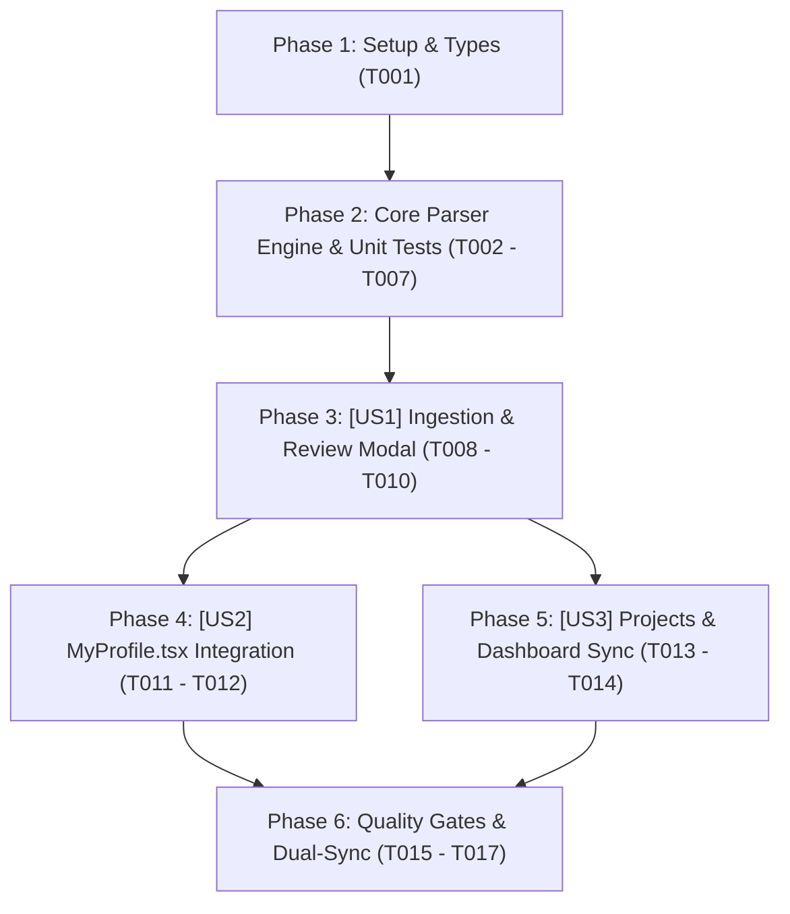

# Tasks: Quét CV Tự Động Điền Hồ Sơ Cá Nhân (Smart CV Parser & Master Profile Auto-Populate)

> **Feature Name:** Quét CV Tự Động Điền Hồ Sơ Cá Nhân: Smart CV Parser, Structured Evidence Extraction & Master Profile Auto-Population  
> **Plan Document:** [`docs/superpowers/plans/2026-11-05-smart-cv-parser-profile-auto-populate-plan.md`](file:///C:/Users/ADMIN/Desktop/STUDY/docs/superpowers/plans/2026-11-05-smart-cv-parser-profile-auto-populate-plan.md)  
> **Spec Directory:** [`docs/superpowers/specs/2026-11-05-smart-cv-parser-profile-auto-populate/`](file:///C:/Users/ADMIN/Desktop/STUDY/docs/superpowers/specs/2026-11-05-smart-cv-parser-profile-auto-populate/)  
> **Branch:** `profilehub_v1`  
> **Checklist Format Requirement:** `- [ ] [TaskID] [P?] [Story?] Description with file path`

---

## 🏛️ Dependencies & Story Execution Order

---

## Phase 1: Setup & Types

- [X] T001 Khởi tạo các định nghĩa kiểu dữ liệu ParsedPersonalInfo, ParsedEducation, ParsedProject, ParsedCertificate, ParsedCvData, ProfileAutoPopulateOptions, ProfilePopulateResult trong profilehub/src/types/cvParser.types.ts

---

## Phase 2: Core Parser Engine & Tests (Blocking Prerequisites)

- [X] T002 Xây dựng hàm bóc tách thông tin cá nhân và học vấn parseContactAndEducation trong profilehub/src/services/cvParserService.ts
- [X] T003 [P] Xây dựng hàm bóc tách kỹ năng chuẩn hóa parseSkills kết hợp từ điển TECH_DICTIONARY trong profilehub/src/services/cvParserService.ts
- [X] T004 [P] Xây dựng hàm bóc tách đồ án thực tế parseProjects tự động trích xuất GitHub URL và Live Demo URL trong profilehub/src/services/cvParserService.ts
- [X] T005 [P] Xây dựng hàm bóc tách chứng chỉ parseCertificates trong profilehub/src/services/cvParserService.ts
- [X] T006 Xây dựng hàm parseCvText, parseCvFile và logic tự động điền dữ liệu populateProfileWithParsedData hỗ trợ merge và overwrite trong profilehub/src/services/cvParserService.ts
- [X] T007 Xây dựng bộ kiểm thử đơn vị tự động 100% cho cvParserService bao phủ 15+ kịch bản CV thực tế trong profilehub/src/services/cvParserService.test.ts

---

## Phase 3: User Story 1 - Review & Ingestion Modal Component (P1 - Giao Diện Tiếp Nhận & Đối Soát CV)

**Story Goal:** Xây dựng modal `ImportCvToProfileModal.tsx` cho phép sinh viên tải file CV (.pdf, .docx, .txt) hoặc dán văn bản trực tiếp (Raw Paste), xem bảng đối soát dữ liệu 2 cột trực quan và lựa chọn chế độ ghi đè hoặc bổ sung.  
**Independent Test Criteria:** Mở modal tải file hoặc dán đoạn text CV; bấm Quét CV; hiển thị đầy đủ Họ tên, Trường, Ngành, GPA, Kỹ năng, Đồ án trong bảng đối soát; có thể sửa nhanh các trường; bấm cập nhật hiển thị thông báo thành công.

- [X] T008 [US1] Xây dựng giao diện tiếp nhận tệp tin kéo thả và tab dán văn bản trực tiếp trong profilehub/src/components/student/ImportCvToProfileModal.tsx
- [X] T009 [US1] Xây dựng bảng đối soát dữ liệu bóc tách được cho phép chỉnh sửa thông tin cá nhân, kỹ năng, đồ án trước khi lưu trong profilehub/src/components/student/ImportCvToProfileModal.tsx
- [X] T010 [US1] Tích hợp tùy chọn chế độ hợp nhất Merge và Overwrite cùng nút hành động cập nhật hồ sơ trong profilehub/src/components/student/ImportCvToProfileModal.tsx

---

## Phase 4: User Story 2 - Student Profile Integration (P1 - Tích Hợp Vào Hồ Sơ Cá Nhân Sinh Viên)

**Story Goal:** Tích hợp nút bấm nạp CV nổi bật tại trang `MyProfile.tsx` và tự động cập nhật Form hồ sơ cá nhân ngay khi hoàn tất bóc tách.  
**Independent Test Criteria:** Trang `MyProfile.tsx` có nút `[ 📄 Tải CV Tự Động Điền Hồ Sơ ]`; nhấp vào mở modal bóc tách; sau khi xác nhận, toàn bộ Form thông tin cá nhân được tự động điền đầy đủ mà không cần reload trang.

- [X] T011 [US2] Bổ sung nút bấm nổi bật [📄 Tải CV Tự Động Điền Hồ Sơ] tại header trang profilehub/src/pages/student/MyProfile.tsx
- [X] T012 [US2] Tích hợp cơ chế tự động nạp lại state thông tin cá nhân và callback làm mới dữ liệu sau khi quét CV trong profilehub/src/pages/student/MyProfile.tsx

---

## Phase 5: User Story 3 - Multi-Entity Auto-Population to Projects & Dashboard (P2 - Tự Động Tạo Đồ Án & Gợi Ý Dashboard)

**Story Goal:** Tự động đồng bộ các đồ án được bóc tách từ CV vào kho đồ án `MyProjects.tsx` (tự động gắn huy hiệu `Demo Ready`) và bổ sung nút gọi nhanh từ Dashboard sinh viên.  
**Independent Test Criteria:** Đồ án trong CV sau khi quét xuất hiện ngay trong trang `MyProjects.tsx` với đầy đủ link demo và tags; Dashboard có widget gợi ý nạp hồ sơ nhanh từ CV cũ.

- [X] T013 [P] [US3] Tích hợp cơ chế tạo các bản ghi đồ án mới vào kho đồ án và đồng bộ sự kiện lưu trữ trong profilehub/src/pages/student/MyProjects.tsx
- [X] T014 [US3] Bổ sung nút gọi nhanh Onboarding từ thẻ hồ sơ trên Dashboard sinh viên trong profilehub/src/pages/student/Dashboard.tsx

---

## Phase 6: Polish, Quality Gates & Dual-Sync Git

- [X] T015 Chạy toàn bộ 44 test suites Vitest bằng lệnh npm test -- --run đảm bảo 100% Pass và không có bất kỳ hồi quy nào
- [X] T016 [P] Kiểm tra TypeScript nghiêm ngặt npx tsc --noEmit đạt 0 lỗi và đóng gói Production npm run build thành công
- [X] T017 Cập nhật session_log_2026-11-05.md và thực hiện Dual-Sync Git commit đẩy lên cả 2 nhánh origin/profilehub_v1 và origin/1310-co-ban-chua-sua
