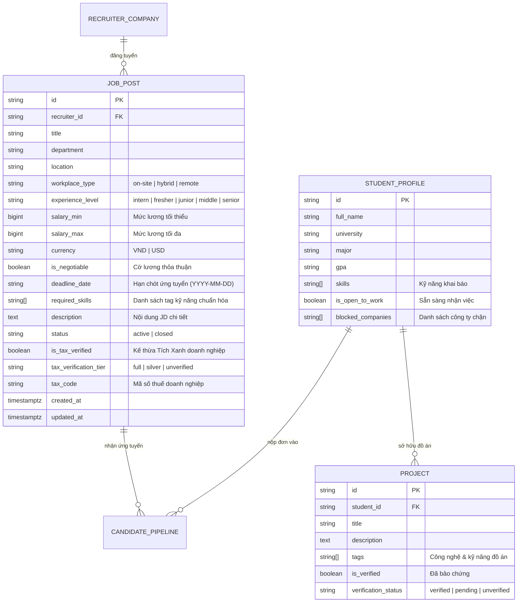

# Mô Hình Dữ Liệu: Chuẩn Hóa Đăng Tin Tuyển Dụng & Bóc Tách Kỹ Năng Tự Động (Smart Job Studio)
> **Mã tài liệu:** `DATA-MODEL-20261105-SMART-JOB-STUDIO`  
> **Tính năng:** Smart Job Studio, Standardized Job Posting, Automated Skill Tagging & Instant Candidate Matching  
> **Dự án:** ProfileHub - Nền tảng Hồ sơ Nghề nghiệp Dựa trên Bằng chứng  
> **Nhánh Git:** `profilehub_v1`  
> **Ngày lập:** 05/11/2026  

---

## 1. Sơ Đồ Thực Thể & Quan Hệ (Entity-Relationship Diagram)



---

## 2. Định Nghĩa Kiểu Dữ Liệu TypeScript (TypeScript Type Definitions)

Vị trí lưu trữ: [`src/types/job.types.ts`](file:///C:/Users/ADMIN/Desktop/STUDY/profilehub/src/types/job.types.ts) và đồng bộ vào [`src/types/database.ts`](file:///C:/Users/ADMIN/Desktop/STUDY/profilehub/src/types/database.ts).

```typescript
/**
 * Cấp bậc chuyên môn tuyển dụng
 */
export type ExperienceLevel = 'intern' | 'fresher' | 'junior' | 'middle' | 'senior';

/**
 * Hình thức làm việc
 */
export type WorkplaceType = 'on-site' | 'hybrid' | 'remote';

/**
 * Đơn vị tiền tệ
 */
export type SalaryCurrency = 'VND' | 'USD';

/**
 * Trạng thái bài đăng tuyển dụng
 */
export type JobStatus = 'active' | 'closed';

/**
 * Cấu trúc bài đăng tuyển dụng chuẩn hóa
 */
export interface JobPost {
  id: string;
  recruiter_id: string;
  title: string;
  department?: string;
  location?: string;
  workplace_type?: WorkplaceType;
  experience_level?: ExperienceLevel;
  salary_min?: number;
  salary_max?: number;
  currency?: SalaryCurrency;
  is_negotiable?: boolean;
  deadline_date?: string; // Định dạng YYYY-MM-DD
  required_skills?: string[];
  description?: string;
  status?: JobStatus;
  is_tax_verified?: boolean;
  tax_verification_tier?: 'full' | 'silver' | 'unverified';
  tax_code?: string;
  created_at?: string;
  updated_at?: string;
}

/**
 * Danh mục nhóm kỹ năng được bóc tách từ JD
 */
export type SkillCategory = 'languages_frameworks' | 'database_cloud' | 'tools_methods' | 'other';

export interface ExtractedSkillCategory {
  category: SkillCategory;
  categoryLabel: string;
  skills: string[];
}

export interface SkillExtractionResult {
  allSkills: string[];
  categorized: ExtractedSkillCategory[];
  rawCount: number;
}

/**
 * Kết quả khớp ứng viên với vị trí tuyển dụng
 */
export interface CandidateMatchSummary {
  candidateId: string;
  candidateName: string;
  university?: string;
  gpa?: string;
  matchScore: number; // 0 đến 100
  matchedSkills: string[];
  missingSkills: string[];
  verifiedProjectsCount: number;
  isOpenToWork: boolean;
}

export interface JobCandidateMatchResult {
  jobId: string;
  totalEligibleCandidates: number;
  topMatches: CandidateMatchSummary[];
}
```

---

## 3. Bản Di Chuyển Cơ Sở Dữ Liệu SQL (Database Migration Script)

Tập tin migration: [`server/migrations/20261105200000_smart_job_studio.sql`](file:///C:/Users/ADMIN/Desktop/STUDY/profilehub/server/migrations/20261105200000_smart_job_studio.sql)

```sql
-- Migration: Chuẩn hóa bài đăng tuyển dụng Smart Job Studio
-- Ngày tạo: 05/11/2026
-- Dự án: ProfileHub

-- 1. Bổ sung các cột chuẩn hóa vào bảng recruiter_jobs
ALTER TABLE recruiter_jobs 
  ADD COLUMN IF NOT EXISTS workplace_type VARCHAR(20) DEFAULT 'on-site',
  ADD COLUMN IF NOT EXISTS experience_level VARCHAR(20) DEFAULT 'fresher',
  ADD COLUMN IF NOT EXISTS salary_min BIGINT,
  ADD COLUMN IF NOT EXISTS salary_max BIGINT,
  ADD COLUMN IF NOT EXISTS currency VARCHAR(10) DEFAULT 'VND',
  ADD COLUMN IF NOT EXISTS is_negotiable BOOLEAN DEFAULT FALSE,
  ADD COLUMN IF NOT EXISTS deadline_date DATE,
  ADD COLUMN IF NOT EXISTS updated_at TIMESTAMPTZ DEFAULT NOW();

-- 2. Đánh chỉ mục Index tối ưu hóa truy vấn lọc dải lương & cấp bậc
CREATE INDEX IF NOT EXISTS idx_recruiter_jobs_salary 
  ON recruiter_jobs (salary_min, salary_max);

CREATE INDEX IF NOT EXISTS idx_recruiter_jobs_experience 
  ON recruiter_jobs (experience_level);

CREATE INDEX IF NOT EXISTS idx_recruiter_jobs_workplace 
  ON recruiter_jobs (workplace_type);

CREATE INDEX IF NOT EXISTS idx_recruiter_jobs_status_deadline 
  ON recruiter_jobs (status, deadline_date);

-- 3. Đảm bảo ràng buộc toàn vẹn dữ liệu lương
DO $$
BEGIN
  IF NOT EXISTS (
    SELECT 1 FROM pg_constraint WHERE conname = 'chk_job_salary_validity'
  ) THEN
    ALTER TABLE recruiter_jobs
      ADD CONSTRAINT chk_job_salary_validity
      CHECK (
        is_negotiable = TRUE OR 
        salary_min IS NULL OR 
        salary_max IS NULL OR 
        salary_max >= salary_min
      );
  END IF;
END $$;
```

---

## 4. Quy Tắc Xác Thực Dữ Liệu (Validation Rules)

| Thuộc tính | Quy tắc kiểm tra (Validation Rules) | Thông báo lỗi khi vi phạm |
| :--- | :--- | :--- |
| `title` | Bắt buộc, độ dài từ 5 đến 120 ký tự | "Tiêu đề công việc phải từ 5 đến 120 ký tự." |
| `workplace_type` | Thuộc `['on-site', 'hybrid', 'remote']` | "Hình thức làm việc không hợp lệ." |
| `experience_level` | Thuộc `['intern', 'fresher', 'junior', 'middle', 'senior']` | "Cấp bậc chuyên môn không hợp lệ." |
| `salary_min` & `salary_max` | Nếu không `is_negotiable`, `salary_min` và `salary_max` phải $\ge 0$. Nếu có cả 2, `salary_max \ge salary_min`. | "Mức lương tối đa không thể nhỏ hơn mức lương tối thiểu." |
| `currency` | Thuộc `['VND', 'USD']` | "Đơn vị tiền tệ phải là VND hoặc USD." |
| `deadline_date` | Nếu có, định dạng `YYYY-MM-DD` | "Hạn chót ứng tuyển không hợp lệ." |
| `required_skills` | Mảng chứa từ 1 đến 20 kỹ năng, mỗi tag từ 1 đến 50 ký tự | "Vui lòng gắn ít nhất 1 tag kỹ năng yêu cầu (tối đa 20 tag)." |
