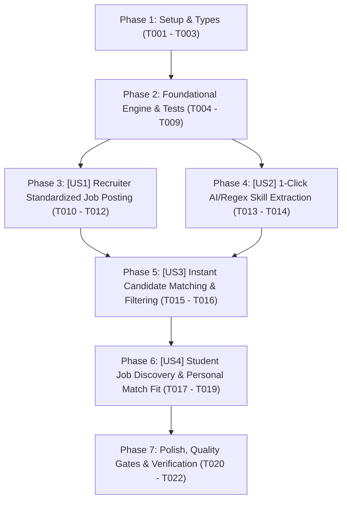

# Tasks: Chuẩn Hóa Đăng Tin Tuyển Dụng & Bóc Tách Kỹ Năng Tự Động (Smart Job Studio)

> **Feature Name:** Chuẩn Hóa Đăng Tin Tuyển Dụng, Bóc Tách Kỹ Năng AI/Regex & Bắt Cặp Ứng Viên 2 Chiều (Smart Job Studio, Automated Skill Tagging & Instant Candidate Matching)  
> **Plan Document:** [`docs/superpowers/plans/2026-11-05-smart-job-studio-and-candidate-matching-plan.md`](file:///C:/Users/ADMIN/Desktop/STUDY/docs/superpowers/plans/2026-11-05-smart-job-studio-and-candidate-matching-plan.md)  
> **Spec Directory:** [`docs/superpowers/specs/2026-11-05-smart-job-studio-and-candidate-matching/`](file:///C:/Users/ADMIN/Desktop/STUDY/docs/superpowers/specs/2026-11-05-smart-job-studio-and-candidate-matching/)  
> **Branch:** `profilehub_v1`  
> **Checklist Format Requirement:** `- [ ] [TaskID] [P?] [Story?] Description with file path`

---

## 🏛️ Dependencies & Story Execution Order

---

## Phase 1: Setup & Types

- [X] T001 Khởi tạo schema types cho Smart Job Studio (ExperienceLevel, WorkplaceType, SalaryCurrency, SkillExtractionResult, CandidateMatchSummary, JobCandidateMatchResult) trong profilehub/src/types/job.types.ts
- [X] T002 [P] Mở rộng định nghĩa JobPost và RecruiterCompanyProfile với các trường dải lương, hình thức, cấp bậc, deadline trong profilehub/src/types/database.ts và profilehub/src/utils/jobSync.ts
- [X] T003 [P] Tạo tệp migration SQL bổ sung các cột chuẩn hóa và đánh chỉ mục Index cho bảng recruiter_jobs trong profilehub/server/migrations/20261105200000_smart_job_studio.sql

---

## Phase 2: Foundational Engine & Tests (Blocking Prerequisites)

- [X] T004 Xây dựng hàm formatSalaryRange hỗ trợ định dạng VNĐ (Triệu VNĐ), USD, khoảng min-max, min-only, max-only và cờ thỏa thuận trong profilehub/src/services/jobStudioService.ts
- [X] T005 [P] Xây dựng từ điển Regex 120+ công nghệ IT thực chiến và hàm extractSkillsFromText chuẩn hóa alias (ReactJS, TypeScript, Kubernetes, Golang...) trong profilehub/src/services/jobStudioService.ts
- [X] T006 Xây dựng hàm tính toán độ tương đồng calculateCandidateJobMatch (SkillScore 70% + VerifiedProjects 30%) trong profilehub/src/services/jobStudioService.ts
- [X] T007 [P] Xây dựng hàm findMatchingCandidatesForJob tự động loại trừ ứng viên ẩn danh và kiểm tra chặn công ty theo chính sách privacy trong profilehub/src/services/jobStudioService.ts
- [X] T008 [P] Xây dựng hàm inheritTaxVerification tự động đồng bộ huy hiệu Tích Xanh và Mã số thuế từ hồ sơ doanh nghiệp vào bài đăng trong profilehub/src/services/jobStudioService.ts
- [X] T009 Xây dựng bộ kiểm thử đơn vị tự động bao phủ 100% các hàm nghiệp vụ của jobStudioService trong profilehub/src/services/jobStudioService.test.ts

---

## Phase 3: User Story 1 - Recruiter Standardized Job Posting (P1 - Chuẩn Hóa Tin Tuyển Dụng)

**Story Goal:** Cung cấp cho nhà tuyển dụng biểu mẫu đăng/sửa việc làm chuyên nghiệp với đầy đủ dải lương, hình thức làm việc, cấp bậc chuyên môn, hạn chót ứng tuyển và tự động kế thừa Tích Xanh uy tín đã thẩm định.  
**Independent Test Criteria:** Mở modal đăng việc có đầy đủ các trường mới; nhập lương min/max hoặc chọn Thỏa thuận; chọn On-site/Hybrid/Remote; chọn Intern/Fresher/Junior; lưu việc làm thành công vào LocalStorage/Supabase và hiển thị đầy đủ thông tin chuẩn hóa trên Job Card.

- [X] T010 [US1] Mở rộng Form tạo và sửa tin tuyển dụng với các trường Dải lương, Checkbox thỏa thuận, Hình thức làm việc, Cấp bậc, và Hạn chót nộp đơn trong profilehub/src/pages/recruiter/JobManagement.tsx
- [X] T011 [US1] Tích hợp cơ chế kế thừa Tích Xanh và Mã số thuế từ hồ sơ Recruiter khi tạo mới hoặc cập nhật bài đăng trong profilehub/src/pages/recruiter/JobManagement.tsx
- [X] T012 [P] [US1] Cập nhật giao diện thẻ bài đăng tuyển dụng hiển thị huy hiệu dải lương, tag hình thức làm việc và tag cấp bậc trong profilehub/src/pages/recruiter/JobManagement.tsx

---

## Phase 4: User Story 2 - 1-Click AI/Regex Skill Extraction (P1 - Bóc Tách Kỹ Năng Tự Động)

**Story Goal:** Giúp nhà tuyển dụng tiết kiệm thời gian bằng nút bấm 1-click tự động bóc tách từ khóa công nghệ từ mô tả công việc (JD) thô và điền chuẩn hóa vào danh sách tag kỹ năng yêu cầu.  
**Independent Test Criteria:** Dán đoạn văn bản JD có chứa nhiều công nghệ; bấm nút `[ ✨ AI Bóc Tách Kỹ Năng ]`; các tag kỹ năng được điền tự động vào ô skills, loại bỏ trùng lặp và chuyển về dạng viết hoa chuẩn mực (Canonical casing).

- [X] T013 [US2] Thêm nút bấm [✨ AI Bóc Tách Kỹ Năng] đặt cạnh ô Kỹ năng yêu cầu kèm hiệu ứng phản hồi trực quan trong profilehub/src/pages/recruiter/JobManagement.tsx
- [X] T014 [US2] Tích hợp hàm extractSkillsFromText kết nối nội dung trường Mô tả công việc với ô Kỹ năng yêu cầu trong profilehub/src/pages/recruiter/JobManagement.tsx

---

## Phase 5: User Story 3 - Instant Candidate Matching & Filtering (P2 - Bắt Cặp Ứng Viên 2 Chiều Phía Tuyển Dụng)

**Story Goal:** Hiển thị tức thì số lượng ứng viên tiềm năng phù hợp với tin đăng tuyển dụng ngay trên thẻ quản trị việc làm, cho phép nhà tuyển dụng 1-click chuyển sang danh sách ứng viên đã được chấm điểm phù hợp.  
**Independent Test Criteria:** Mỗi thẻ bài đăng trong `JobManagement.tsx` hiển thị chip `[ 👥 X ứng viên phù hợp ]`; bấm vào chip mở trang `CandidateSearch.tsx` kèm tham số lọc kỹ năng hoặc jobId; danh sách ứng viên được tính điểm tương thích thời gian thực.

- [X] T015 [P] [US3] Tích hợp tính toán số lượng ứng viên tiềm năng và hiển thị chip [👥 X ứng viên phù hợp] trên từng thẻ bài đăng trong profilehub/src/pages/recruiter/JobManagement.tsx
- [X] T016 [US3] Cập nhật trang tìm kiếm ứng viên hỗ trợ nhận tham số URL lọc theo tin đăng (jobId/skills) và hiển thị điểm tương thích cụ thể trong profilehub/src/pages/recruiter/CandidateSearch.tsx

---

## Phase 6: User Story 4 - Student Job Discovery & Personal Match Fit (P2 - Trải Nghiệm Tìm Việc & % Phù Hợp Cho Sinh Viên)

**Story Goal:** Giúp sinh viên nắm bắt thông tin việc làm minh bạch (dải lương, hình thức làm việc, cấp bậc) và nhìn thấy ngay tỷ lệ phần trăm phù hợp cá nhân giữa năng lực của mình với từng vị trí tuyển dụng.  
**Independent Test Criteria:** Thẻ việc làm trong `StudentJobs.tsx` hiển thị dải lương nổi bật; hiển thị tag cấp bậc và hình thức; hiển thị chip `[ 🎯 X% Phù hợp với bạn ]` dựa trên Master Profile của sinh viên; lọc và tìm kiếm mượt mà.

- [X] T017 [P] [US4] Cập nhật giao diện thẻ việc làm sinh viên hiển thị dải lương chuẩn hóa, tag hình thức làm việc và tag cấp bậc trong profilehub/src/pages/student/StudentJobs.tsx
- [X] T018 [US4] Tích hợp hàm calculateStudentJobMatch hiển thị huy hiệu % Phù hợp cá nhân thời gian thực trên từng thẻ việc làm trong profilehub/src/pages/student/StudentJobs.tsx
- [X] T019 [P] [US4] Cập nhật bộ lọc tìm kiếm sinh viên hỗ trợ lọc theo dải lương, cấp bậc và hình thức làm việc trong profilehub/src/pages/student/StudentJobs.tsx

---

## Phase 7: Polish, Quality Gates & Verification (Cross-Cutting Concerns)

- [X] T020 Chạy và xác thực toàn bộ test suites đảm bảo tỷ lệ Pass 100% trong profilehub/src/services/jobStudioService.test.ts và toàn bộ các test files của dự án
- [X] T021 [P] Cập nhật tài liệu kiểm thử và nhật ký phát triển trong docs/superpowers/specs/2026-11-05-smart-job-studio-and-candidate-matching/quickstart.md và .gemini/antigravity-cli/brain/session_log_2026-11-05.md
- [X] T022 Kiểm tra nghiệm thu chất lượng mã nguồn TypeScript Strict (tsc --noEmit) và đóng gói bản phát hành (npm run build)
