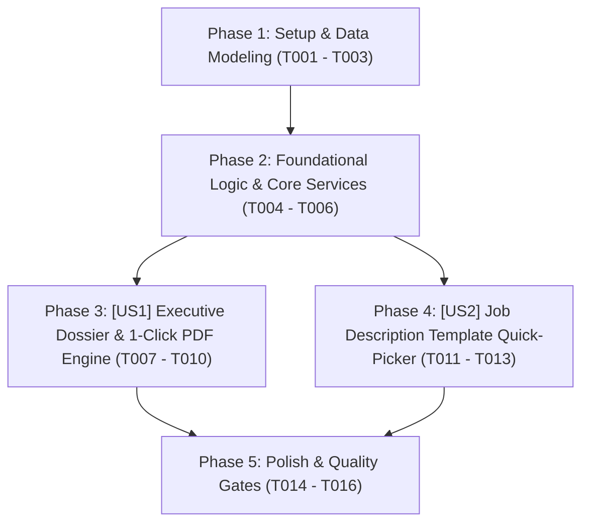

# Tasks: Hồ Sơ Đánh Giá Phỏng Vấn Chuyên Sâu & Xuất Báo Cáo Điều Hành PDF (Executive Dossier & 1-Click PDF Export)

> **Feature Name:** Hồ Sơ Đánh Giá Phỏng Vấn Điều Hành & Xuất Báo Cáo PDF Kèm Bộ Chọn Mẫu JD Nhanh (Executive Candidate Evaluation Dossier, 1-Click PDF Export & Job Template Quick-Picker)  
> **Plan Document:** [`docs/superpowers/plans/2026-11-09-candidate-dossier-and-executive-pdf-export-plan.md`](file:///C:/Users/ADMIN/Desktop/STUDY/docs/superpowers/plans/2026-11-09-candidate-dossier-and-executive-pdf-export-plan.md)  
> **Spec Directory:** [`docs/superpowers/specs/2026-11-09-candidate-dossier-and-executive-pdf-export/`](file:///C:/Users/ADMIN/Desktop/STUDY/docs/superpowers/specs/2026-11-09-candidate-dossier-and-executive-pdf-export/)  
> **Branch:** `profilehub_v1`  
> **Checklist Format Requirement:** `- [ ] [TaskID] [P?] [Story?] Description with file path`

---

## 🏛️ Dependencies & Story Execution Order

---

## Phase 1: Setup & Data Modeling

- [X] T001 Khai báo các interface và types `ExecutiveEvaluationDossier`, `DossierScorecardSummary`, `DossierChallengeSummary`, `DossierProjectHighlight`, `JobTemplateItem` trong [src/types/database.ts](file:///C:/Users/ADMIN/Desktop/STUDY/profilehub/src/types/database.ts)
- [X] T002 [P] Khởi tạo ngân hàng 6 mẫu JD thực chiến chuẩn ngành `jobTemplateBank.ts` trong [src/services/jobTemplateBank.ts](file:///C:/Users/ADMIN/Desktop/STUDY/profilehub/src/services/jobTemplateBank.ts)
- [X] T003 [P] Khởi tạo bộ hồ sơ tài liệu đặc tả Spec-Kit hoàn chỉnh (spec.md, data-model.md, contracts/executive-dossier-api.md, quickstart.md) trong [docs/superpowers/specs/2026-11-09-candidate-dossier-and-executive-pdf-export/](file:///C:/Users/ADMIN/Desktop/STUDY/docs/superpowers/specs/2026-11-09-candidate-dossier-and-executive-pdf-export/)

---

## Phase 2: Foundational Logic & Core Services (Blocking Prerequisites)

- [X] T004 Xây dựng service `executiveDossierService.ts` hỗ trợ hàm `buildExecutiveDossier` và `generateExecutiveEmailSummary` trong [src/services/executiveDossierService.ts](file:///C:/Users/ADMIN/Desktop/STUDY/profilehub/src/services/executiveDossierService.ts)
- [X] T005 [P] Viết bộ test đơn vị tự động `executiveDossierService.test.ts` kiểm thử tổng hợp dữ liệu, tính điểm trung bình và chế độ ẩn danh trong [src/services/executiveDossierService.test.ts](file:///C:/Users/ADMIN/Desktop/STUDY/profilehub/src/services/executiveDossierService.test.ts)
- [X] T006 [P] Viết bộ test `jobTemplateBank.test.ts` đảm bảo 100% mẫu JD có đầy đủ kỹ năng và dải lương hợp lệ trong [src/services/jobTemplateBank.test.ts](file:///C:/Users/ADMIN/Desktop/STUDY/profilehub/src/services/jobTemplateBank.test.ts)

---

## Phase 3: User Story 1 - Executive Evaluation Dossier & 1-Click PDF Exporter (P1)

**Story Goal:** Người phỏng vấn hoặc HR có thể 1-click mở bản báo cáo tổng hợp đánh giá ứng viên (Executive Dossier) khổ A4 trang trọng, xem tóm tắt điểm Scorecard 5 tiêu chí, bài giải Take-Home PR, đồ án bảo chứng và xuất file PDF sắc nét để trình Ban Giám Đốc ký duyệt.  
**Independent Test Criteria:** Mở trang `/recruiter/pipeline`, bấm nút `[ 📑 Báo Cáo PDF ]` trên thẻ ứng viên đã chấm điểm ➔ Modal Báo Cáo Đánh Giá A4 mở ra với đầy đủ thông tin điểm số, nhận xét và đồ án; bấm `[ 🖨️ In / Tải PDF Báo Cáo ]` ➔ Mở hộp thoại in trình duyệt, trang in sạch sẽ, không vỡ layout; bật Blind Screening ➔ Tên ứng viên trong bản in được mã hóa thành `Ứng viên #DEV-XXXX`.

- [X] T007 [P] [US1] Xây dựng component modal A4 `ExecutiveEvaluationReportModal.tsx` hỗ trợ xem trước và in ấn `@media print` trong [src/components/recruiter/ExecutiveEvaluationReportModal.tsx](file:///C:/Users/ADMIN/Desktop/STUDY/profilehub/src/components/recruiter/ExecutiveEvaluationReportModal.tsx)
- [X] T008 [US1] Tích hợp nút bấm `[ 📑 Báo Cáo PDF ]` trên từng thẻ ứng viên Kanban trong [src/pages/recruiter/CandidatePipeline.tsx](file:///C:/Users/ADMIN/Desktop/STUDY/profilehub/src/pages/recruiter/CandidatePipeline.tsx)
- [X] T009 [US1] Tích hợp nút `[ 📑 Xuất Báo Cáo ]` trực tiếp từ bên trong `InterviewScorecardModal.tsx` trong [src/components/recruiter/InterviewScorecardModal.tsx](file:///C:/Users/ADMIN/Desktop/STUDY/profilehub/src/components/recruiter/InterviewScorecardModal.tsx)
- [X] T010 [US1] Hỗ trợ tính năng sao chép tóm tắt đánh giá Markdown/Text gửi nhanh qua Email/Slack trong [src/components/recruiter/ExecutiveEvaluationReportModal.tsx](file:///C:/Users/ADMIN/Desktop/STUDY/profilehub/src/components/recruiter/ExecutiveEvaluationReportModal.tsx)

---

## Phase 4: User Story 2 - Job Description Template Quick-Picker in Job Studio (P2)

**Story Goal:** Nhà tuyển dụng khi tạo tin tuyển dụng mới có thể 1-click chọn mẫu JD chuẩn ngành (Frontend, Backend, AI/Data Fresher...) với từ khóa và mức lương thị trường gợi ý sẵn, tiết kiệm thời gian gõ JD.  
**Independent Test Criteria:** Mở trang `/recruiter/jobs`, bấm `[ + Đăng Tin Tuyển Dụng ]`, chọn một template trong dropdown ➔ Các trường tiêu đề, phòng ban, mức lương 8-12M và tags kỹ năng được tự động điền ngay lập tức.

- [X] T011 [P] [US2] Xây dựng component chọn mẫu `JobTemplatePicker.tsx` hiển thị danh sách 6 mẫu JD kèm preview kỹ năng và mức lương trong [src/components/recruiter/JobTemplatePicker.tsx](file:///C:/Users/ADMIN/Desktop/STUDY/profilehub/src/components/recruiter/JobTemplatePicker.tsx)
- [X] T012 [US2] Nhúng bộ chọn mẫu `JobTemplatePicker` vào modal Đăng tin tuyển dụng trong [src/pages/recruiter/JobManagement.tsx](file:///C:/Users/ADMIN/Desktop/STUDY/profilehub/src/pages/recruiter/JobManagement.tsx)
- [X] T013 [US2] Tự động kích hoạt cơ chế bóc tách kỹ năng tự động khi áp dụng mẫu JD trong [src/pages/recruiter/JobManagement.tsx](file:///C:/Users/ADMIN/Desktop/STUDY/profilehub/src/pages/recruiter/JobManagement.tsx)

---

## Phase 5: Polish & Quality Gates

- [X] T014 [P] Kiểm tra toàn vẹn kiểu dữ liệu tĩnh TypeScript với `npx tsc --noEmit` đạt 0 lỗi biên dịch
- [X] T015 [P] Chạy toàn bộ test suites tự động với `npx vitest run` đảm bảo 100% tests pass
- [X] T016 Đóng gói sản phẩm production với `npm run build` qua Vite bundle thành công
