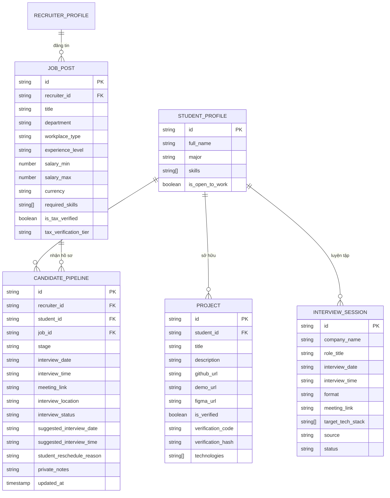
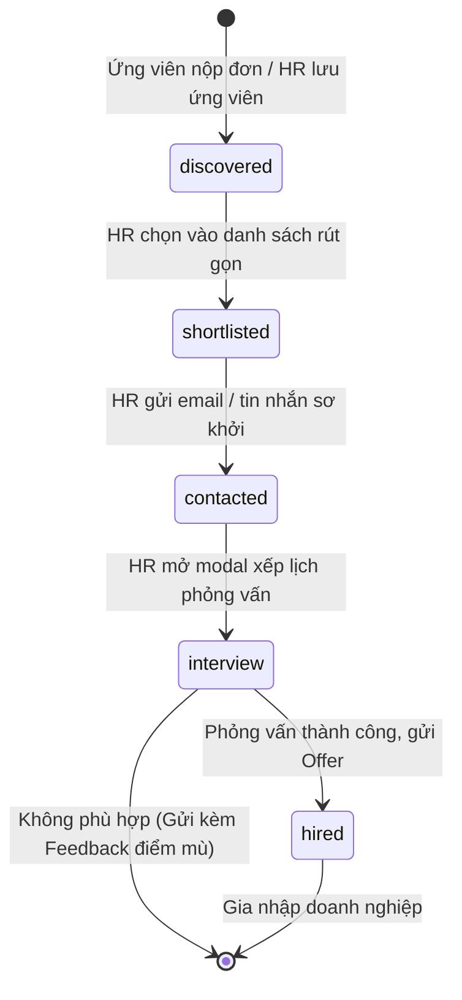
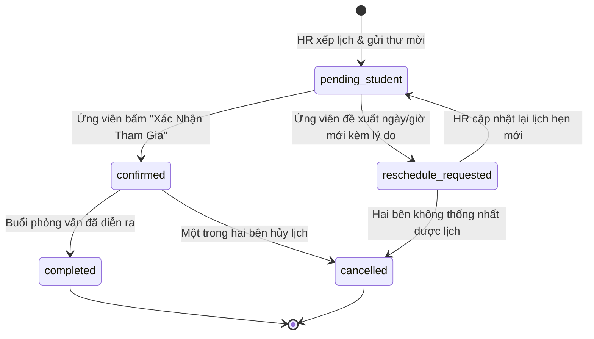

# Mô Hình Dữ Liệu & Hợp Đồng Trạng Thái (Data Model & State Transitions)
> **Mã đặc tả:** `SPEC-20261109-GROWTH-PIPELINE`  
> **Áp dụng:** Quản lý quy trình ứng tuyển, bảo chứng năng lực và đồng bộ phỏng vấn đa bên.

---

## 1. Sơ Đồ Thực Thể & Quan Hệ (Entity Relationship)



---

## 2. Máy Trạng Thái Ứng Tuyển & Phỏng Vấn (State Machine)

### 2.1 Quy Trình Chuyển Đổi Trạng Thái Pipeline (`stage`)


### 2.2 Quy Trình Trạng Thái Hẹn Phỏng Vấn (`interview_status`)


---

## 3. Cấu Trúc Bản Tin Broadcast Real-time (`PipelineBroadcastEvent`)

```typescript
export interface PipelineBroadcastEvent {
  type: 'INTERVIEW_SCHEDULED' | 'INTERVIEW_STATUS_UPDATED' | 'PIPELINE_UPDATED';
  studentId?: string;
  studentName?: string;
  jobTitle?: string;
  companyName?: string;
  interviewDate?: string;
  interviewTime?: string;
  status?: 'pending_student' | 'confirmed' | 'reschedule_requested' | 'cancelled' | 'completed';
  timestamp: number;
}
```
