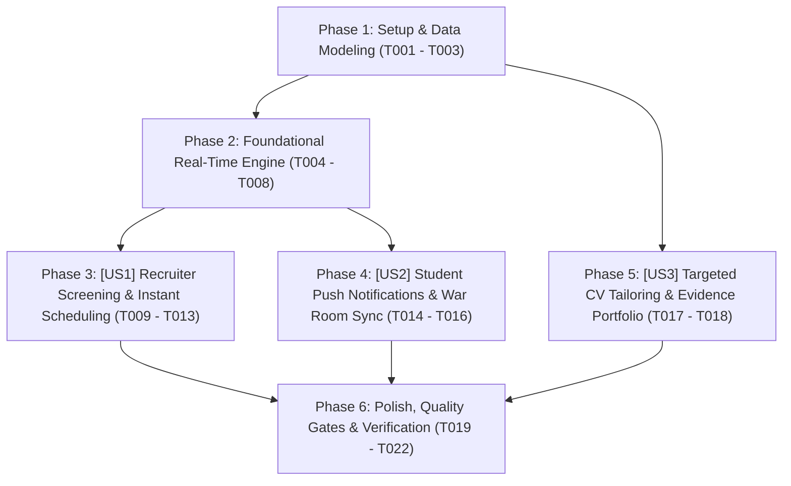

# Tasks: Hệ Thống Bánh Đà Tăng Trưởng Khép Kín Cho Ứng Viên & Nhà Tuyển Dụng (Closed-Loop Growth Pipeline)

> **Feature Name:** Hệ Thống Bánh Đà Tăng Trưởng Khép Kín: Hồ Sơ Bằng Chứng, Đo Ni Đóng Giày CV, Thông Báo Trình Duyệt Real-time & Đồng Bộ War Room Phỏng Vấn (Closed-Loop Growth Pipeline)  
> **Plan Document:** [`docs/superpowers/plans/2026-11-09-closed-loop-growth-pipeline-plan.md`](file:///C:/Users/ADMIN/Desktop/STUDY/docs/superpowers/plans/2026-11-09-closed-loop-growth-pipeline-plan.md)  
> **Spec Directory:** [`docs/superpowers/specs/2026-11-09-closed-loop-growth-pipeline/`](file:///C:/Users/ADMIN/Desktop/STUDY/docs/superpowers/specs/2026-11-09-closed-loop-growth-pipeline/)  
> **Branch:** `profilehub_v1`  
> **Checklist Format Requirement:** `- [ ] [TaskID] [P?] [Story?] Description with file path`

---

## 🏛️ Dependencies & Story Execution Order

---

## Phase 1: Setup & Data Modeling

- [X] T001 Mở rộng kiểu dữ liệu `CandidatePipelineItem` (thêm `suggested_interview_date`, `suggested_interview_time`, `student_reschedule_reason`, trạng thái `reschedule_requested`) và `JobPost` (`company_name`) trong [src/types/database.ts](file:///C:/Users/ADMIN/Desktop/STUDY/profilehub/src/types/database.ts)
- [X] T002 [P] Khởi tạo giao diện kiểu dữ liệu `PipelineBroadcastEvent` cho kênh broadcast đa tab trong [src/utils/pipelineSync.ts](file:///C:/Users/ADMIN/Desktop/STUDY/profilehub/src/utils/pipelineSync.ts)
- [X] T003 [P] Khởi tạo bộ hồ sơ tài liệu đặc tả Spec-Kit (research.md, data-model.md, contracts/growth-pipeline-api.md, quickstart.md) trong [docs/superpowers/specs/2026-11-09-closed-loop-growth-pipeline/](file:///C:/Users/ADMIN/Desktop/STUDY/docs/superpowers/specs/2026-11-09-closed-loop-growth-pipeline/)

---

## Phase 2: Foundational Real-Time Engine (Blocking Prerequisites)

- [X] T004 Xây dựng các hàm Web Notification API an toàn (`isNotificationSupported`, `getNotificationPermission`, `requestBrowserNotificationPermission`, `sendBrowserNotification`) trong [src/utils/pipelineSync.ts](file:///C:/Users/ADMIN/Desktop/STUDY/profilehub/src/utils/pipelineSync.ts)
- [X] T005 [P] Xây dựng cơ chế phát và đăng ký lắng nghe sự kiện đa tab (`broadcastPipelineEvent`, `subscribeToPipelineEvents`) qua BroadcastChannel và CustomEvent fallback trong [src/utils/pipelineSync.ts](file:///C:/Users/ADMIN/Desktop/STUDY/profilehub/src/utils/pipelineSync.ts)
- [X] T006 Xây dựng hàm `scheduleInterviewForCandidate` tự động cập nhật stage phỏng vấn, lưu storage và phát broadcast `INTERVIEW_SCHEDULED` trong [src/utils/pipelineSync.ts](file:///C:/Users/ADMIN/Desktop/STUDY/profilehub/src/utils/pipelineSync.ts)
- [X] T007 [P] Nâng cấp các hàm `updateInterviewStatusByStudent` và `requestInterviewRescheduleByStudent` phát thông điệp broadcast `INTERVIEW_STATUS_UPDATED` trong [src/utils/pipelineSync.ts](file:///C:/Users/ADMIN/Desktop/STUDY/profilehub/src/utils/pipelineSync.ts)
- [X] T008 [P] Xây dựng hàm `syncFromPipelineItem` tự động đồng bộ lịch phỏng vấn từ tin tuyển dụng vào War Room Sessions trong [src/services/selfInterviewService.ts](file:///C:/Users/ADMIN/Desktop/STUDY/profilehub/src/services/selfInterviewService.ts)

---

## Phase 3: User Story 1 - Recruiter Screening, Standardized Scoring & Instant Scheduling (P1)

**Story Goal:** Nhà tuyển dụng tìm kiếm ứng viên dựa trên bằng chứng, xem điểm khớp chuẩn hóa `🎯 Độ tương thích JD: {score}%`, hẹn lịch phỏng vấn với link Google Meet và nhận thông báo xác nhận tức thời từ ứng viên.  
**Independent Test Criteria:** Mở trang tìm kiếm hoặc quản trị bài đăng, nhãn điểm tương thích hiển thị chuẩn tiếng Việt; mở Kanban pipeline xếp lịch phỏng vấn với ngày giờ và link Meet; khi ứng viên xác nhận tham gia ở tab khác, thẻ ứng viên lập tức chuyển sang trạng thái "Đã xác nhận" và trình duyệt phát thông báo đẩy cho HR.

- [X] T009 [P] [US1] Chuẩn hóa nhãn điểm tương thích sang `🎯 Độ tương thích JD: {scoreResult.matchScore}%` trong [src/pages/recruiter/CandidateSearch.tsx](file:///C:/Users/ADMIN/Desktop/STUDY/profilehub/src/pages/recruiter/CandidateSearch.tsx)
- [X] T010 [P] [US1] Chuẩn hóa nhãn điểm tương thích sang `🎯 Độ tương thích JD: {score}%` trên thẻ ứng viên trong [src/pages/recruiter/CandidatePipeline.tsx](file:///C:/Users/ADMIN/Desktop/STUDY/profilehub/src/pages/recruiter/CandidatePipeline.tsx)
- [X] T011 [P] [US1] Chuẩn hóa nhãn số ứng viên phù hợp thành `... ứng viên phù hợp (Độ tương thích JD ≥ 50%)` trong [src/pages/recruiter/JobManagement.tsx](file:///C:/Users/ADMIN/Desktop/STUDY/profilehub/src/pages/recruiter/JobManagement.tsx)
- [X] T012 [US1] Tích hợp hàm `scheduleInterviewForCandidate` vào nút lưu lịch hẹn phỏng vấn trong [src/pages/recruiter/CandidatePipeline.tsx](file:///C:/Users/ADMIN/Desktop/STUDY/profilehub/src/pages/recruiter/CandidatePipeline.tsx)
- [X] T013 [US1] Đăng ký lắng nghe sự kiện `subscribeToPipelineEvents` để cập nhật trạng thái pipeline và bắn browser notification khi ứng viên xác nhận trong [src/pages/recruiter/CandidatePipeline.tsx](file:///C:/Users/ADMIN/Desktop/STUDY/profilehub/src/pages/recruiter/CandidatePipeline.tsx)

---

## Phase 4: User Story 2 - Student Push Notifications & War Room Prep (P1)

**Story Goal:** Ứng viên nhận thông báo đẩy tức thì trên trình duyệt khi có lời mời phỏng vấn, 1-click xác nhận tham gia trên HeaderBar, và tự động đồng bộ buổi phỏng vấn vào Interview War Room để luyện câu hỏi sát JD.  
**Independent Test Criteria:** Chuông thông báo trên HeaderBar nhấp nháy chấm đỏ khi có lịch hẹn mới; menu popover có widget bật thông báo đẩy trình duyệt và nút "Xác Nhận Tham Gia"; bấm xác nhận đồng bộ trạng thái ngay lập tức; mở Dashboard thấy buổi phỏng vấn xuất hiện trong War Room kèm Tech Stack của JD.

- [X] T014 [US2] Thêm widget yêu cầu quyền thông báo đẩy ("Bật thông báo đẩy" / "Đã kích hoạt thông báo đẩy") trong popover chuông của [src/components/layout/HeaderBar.tsx](file:///C:/Users/ADMIN/Desktop/STUDY/profilehub/src/components/layout/HeaderBar.tsx)
- [X] T015 [US2] Đăng ký `subscribeToPipelineEvents` trên HeaderBar để bắn native browser notification khi nhận lời mời phỏng vấn mới trong [src/components/layout/HeaderBar.tsx](file:///C:/Users/ADMIN/Desktop/STUDY/profilehub/src/components/layout/HeaderBar.tsx)
- [X] T016 [US2] Đồng bộ tự động các lịch hẹn phỏng vấn vào `selfInterviewService` và lắng nghe sự kiện pipeline thời gian thực trong [src/pages/student/Dashboard.tsx](file:///C:/Users/ADMIN/Desktop/STUDY/profilehub/src/pages/student/Dashboard.tsx)

---

## Phase 5: User Story 3 - Targeted CV Tailoring & Evidence Portfolio (P2)

**Story Goal:** Ứng viên tạo CV đo ni đóng giày theo từng JD với các câu đạn chuẩn STAR có định lượng và hiển thị đầy đủ liên kết sản phẩm thực tế (GitHub, Live Demo).  
**Independent Test Criteria:** Mở modal tạo CV theo JD; dán văn bản JD; hệ thống bóc tách từ khóa công nghệ, tính % khớp, chỉ ra từ khóa còn thiếu, ưu tiên đồ án liên quan nhất và giữ nguyên liên kết GitHub/Demo trong bản CV xuất ra.

- [X] T017 [P] [US3] Bổ sung các trường `demo_url`, `github_url`, `figma_url`, `score` vào cấu trúc dự án của CV trong [src/services/cvService.ts](file:///C:/Users/ADMIN/Desktop/STUDY/profilehub/src/services/cvService.ts)
- [X] T018 [US3] Tích hợp bộ bóc tách từ khóa kỹ năng, chip % khớp lệnh và danh sách từ khóa thiếu hụt vào modal [src/components/cv/GenerateCvFromJdModal.tsx](file:///C:/Users/ADMIN/Desktop/STUDY/profilehub/src/components/cv/GenerateCvFromJdModal.tsx)

---

## Phase 6: Polish, Quality Gates & Verification

- [X] T019 [P] Xây dựng bộ test đơn vị hoàn chỉnh kiểm thử lưu trữ, lọc dữ liệu, xếp lịch phỏng vấn và thông báo trong [src/utils/pipelineSync.test.ts](file:///C:/Users/ADMIN/Desktop/STUDY/profilehub/src/utils/pipelineSync.test.ts)
- [X] T020 Kiểm tra tính toàn vẹn kiểu dữ liệu tĩnh TypeScript với `npx tsc --noEmit` đạt 0 lỗi biên dịch
- [X] T021 Chạy toàn bộ test suites tự động của dự án với `npx vitest run` đạt 100% tỷ lệ pass (274/274 tests)
- [X] T022 Đóng gói sản phẩm production với `npm run build` qua Vite bundle thành công không lỗi cú pháp
