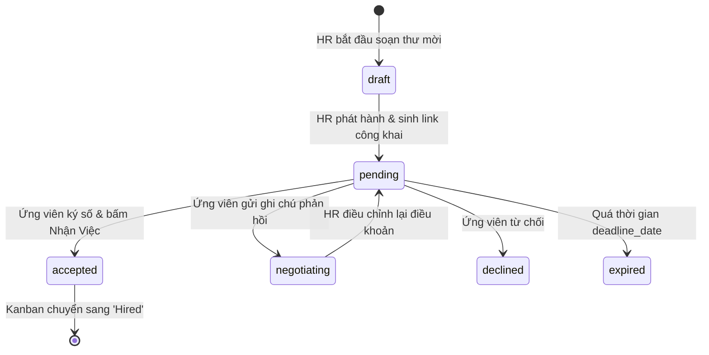

# Mô Hình Dữ Liệu (Data Model): Public Offer Portal & Offer Letter Studio

> **Feature:** `SPEC-20261109-PUBLIC-OFFER-PORTAL`  
> **Tài liệu:** `data-model.md`

---

## 1. Thực Thể Cốt Lõi: `OfferLetter`

Đại diện cho một bức thư mời nhận việc hoàn chỉnh được phát hành từ phía Doanh nghiệp cho một ứng viên.

| Trường Dữ Liệu | Kiểu Dữ Liệu | Bắt Buộc | Mô Tả & Ràng Buộc |
|---|---|:---:|---|
| `id` | `string` | Có | Định danh duy nhất (VD: `off_1715000000_abc`) |
| `token` | `string` | Có | Mã token truy cập công khai an toàn (VD: `off_sec_9f8a7b6c5d4e3f21`) |
| `candidate_id` | `string` | Có | ID của ứng viên trong hệ thống (`stu_xxx` hoặc `cand_xxx`) |
| `candidate_name` | `string` | Có | Họ tên đầy đủ của ứng viên |
| `candidate_email` | `string` | Không | Địa chỉ email nhận thông báo |
| `recruiter_id` | `string` | Có | ID của nhà tuyển dụng/công ty phát hành |
| `company_name` | `string` | Có | Tên doanh nghiệp (VD: "VNG Corporation", "FPT Software") |
| `company_logo` | `string` | Không | Đường dẫn URL logo công ty |
| `is_company_verified` | `boolean` | Có | Trạng thái Tích xanh ĐKKD của công ty |
| `job_title` | `string` | Có | Tên chức danh công việc (VD: "Junior Frontend Engineer") |
| `department` | `string` | Có | Phòng ban làm việc |
| `level` | `string` | Có | Cấp bậc (`intern`, `fresher`, `junior`, `middle`, `senior`) |
| `workplace_type` | `string` | Có | Hình thức làm việc (`on-site`, `hybrid`, `remote`) |
| `location` | `string` | Có | Địa chỉ văn phòng làm việc |
| `salary_official` | `number` | Có | Mức lương chính thức hàng tháng (VND) |
| `salary_probation` | `number` | Có | Mức lương trong thời gian thử việc (VND) |
| `probation_period_months` | `number` | Có | Số tháng thử việc (Mặc định: 2 tháng) |
| `sign_on_bonus` | `number` | Không | Tiền thưởng gia nhập (nếu có) |
| `currency` | `'VND' \| 'USD'` | Có | Đơn vị tiền tệ (Mặc định: `'VND'`) |
| `start_date` | `string` | Có | Ngày dự kiến bắt đầu làm việc (Định dạng YYYY-MM-DD) |
| `deadline_date` | `string` | Có | Hạn chót để ứng viên phản hồi thư mời |
| `benefits` | `OfferBenefitItem[]` | Có | Danh sách phúc lợi và trang thiết bị |
| `custom_message` | `string` | Không | Lời nhắn gửi cá nhân từ Giám đốc / Hiring Manager |
| `status` | `OfferStatus` | Có | Trạng thái hiện tại của thư mời |
| `digital_signature` | `string` | Không | Chữ ký xác nhận điện tử của ứng viên (họ tên nhập vào) |
| `signed_at` | `string` | Không | Dấu thời gian khi ứng viên ký chấp nhận (ISO String) |
| `negotiation_notes` | `string` | Không | Ghi chú phản hồi thương lượng của ứng viên |
| `created_at` | `string` | Có | Thời gian tạo thư mời |
| `updated_at` | `string` | Có | Thời gian cập nhật gần nhất |

---

## 2. Kiểu Dữ Liệu Bổ Trợ

### 2.1 Trạng Thái Thư Mời (`OfferStatus`)
```typescript
export type OfferStatus = 
  | 'draft'        // Đang soạn thảo
  | 'pending'      // Đã gửi cho ứng viên, đang chờ phản hồi
  | 'accepted'     // Ứng viên đã ký chấp nhận nhận việc
  | 'negotiating'  // Ứng viên gửi đề xuất điều chỉnh ngày/lương
  | 'declined'     // Ứng viên từ chối thư mời
  | 'expired';     // Thư mời đã quá thời hạn phản hồi
```

### 2.2 Mục Phúc Lợi (`OfferBenefitItem`)
```typescript
export interface OfferBenefitItem {
  id: string;
  category: 'hardware' | 'health' | 'culture' | 'finance' | 'learning';
  icon: string;        // Emoji hoặc icon name (VD: '💻', '🏥', '🏖️')
  title: string;       // Tiêu đề phúc lợi (VD: "Cấp MacBook Pro M3 Max")
  description: string; // Chi tiết phúc lợi (VD: "Trang bị màn hình 4K và phụ kiện công thái học")
}
```

---

## 3. Chuyển Đổi Trạng Thái Hệ Thống (State Machine)


